# 20262819《Linux内核原理与分析》第七周作业

> **本周主题｜分析 Linux 创建新进程的过程，验证子进程执行起点与内核栈的一致性**
>
> 教材范围：《庖丁解牛Linux操作系统分析》第7章“中断处理、内核线程和设备驱动”。
>
> 视频与实验：“进程的执行和进程的切换”；实验六“分析 Linux 内核创建一个新进程的过程”。

| 基本信息 | 内容 |
| :--- | :--- |
| 姓名 | 刘顺文 |
| 学号 | 20262819 |
| 作业周次 | 第七周 |
| 实验日期 | 2026-11-02 |
| 实验平台 | 蓝桥云课 Linux 实验环境 |
| 被调试内核 | 课程预置 Linux 3.18.6，32位 x86 |
| 实验工具 | QEMU、GDB、GCC、Python、cpio、gzip |
| 工作目录 | `/home/shiyanlou/LinuxKernel` |
| 用户程序 | MenuOS 中新增的 `forktest` 命令 |
| 本次调试对象 | 库函数 `fork()` 触发的 `clone` 系统调用 |

---

## 01｜本周学习内容与完成情况

| 学习任务 | 完成情况 | 本次记录 |
| :--- | :--- | :--- |
| 教材第7章学习与整理 | 已完成 | 梳理中断上下文、内核线程与驱动的关系 |
| 第七周视频学习 | 已完成 | 理解进程执行现场和进程切换的基本机制 |
| 阅读 `task_struct` | 已完成 | 定位状态、内核栈、身份、父子关系、资源及架构现场成员 |
| 分析创建进程的源码 | 已完成 | 阅读 `clone`、`do_fork`、`copy_process`、`copy_thread` |
| 构造可控的 `fork()` 调用 | 已完成 | 编译 `init-week7` 并制作独立镜像 |
| GDB 跟踪系统调用 | 已完成 | 命中 `SyS_clone`，记录参数与调用链 |
| 验证新任务结构和内核栈 | 已完成 | 父子任务结构与内核栈地址均不同 |
| 验证子进程执行起点 | 已完成 | 实际命中 `ret_from_fork`，栈指针与准备值一致 |
| 验证返回用户态 | 已完成 | 单步执行 `iret`，确认用户现场及 `eax=0` |
| 验证父子进程输出与回收 | 已完成 | 父进程得到866，子进程得到0，`waitpid()` 成功回收 |

题目给出的参考链接对应 Linux v3.18-rc6，本次实际阅读和调试的是课程环境中的 Linux 3.18.6。以下函数、寄存器和地址均按本次32位实验记录解释。教材第7章与视频、实验主题分别整理，不把当前教材第7章改写成进程创建章节。

---

## 02｜教材阅读与理解

### 2.1 中断处理：保存现场与恢复执行

中断使处理器能够及时响应设备事件。进入处理程序时，系统需要保存被打断的执行现场；处理完成后，再根据保存的现场恢复执行。用户态与内核态之间的转换还涉及权限级、栈和段寄存器等信息，具体保存布局取决于架构和入口方式。

系统调用是用户程序主动请求内核服务，与外部设备产生的硬件中断在触发原因上不同，但两者都需要正确组织入口、执行现场与返回路径。本次实验在子进程返回时观察到了 `iret`，并检查其使用的五项现场，进一步理解了保存现场必须与恢复代码配套的原因。

### 2.2 中断上下文与延后处理

硬中断处理强调及时响应，处理程序不宜长时间占用处理器，也不能像普通可睡眠的进程上下文那样随意阻塞。驱动通常先完成必要的响应，再把适合延后的工作交给后续机制处理。

需要区分不同延后机制的执行上下文：软中断仍有原子上下文的限制；工作队列通常由可调度的工作线程执行；线程化中断则把一部分处理交给专门的内核线程。不能把“延后执行”统一理解为“可以睡眠”。

### 2.3 内核线程：独立的任务与执行入口

内核线程也由任务描述结构管理，可以参与调度，但主要执行内核中的工作，通常没有普通用户进程那样独立的用户地址空间。内核线程与用户进程进入内核后执行系统调用，是两个不同概念；用户进程执行内核代码时并不会因此变成内核线程。

本次阅读的 `copy_thread()` 清楚区分了两条路径：设置 `PF_KTHREAD` 的任务准备内核线程函数及参数，入口设为 `ret_from_kernel_thread`；普通用户进程则复制已有用户寄存器现场，入口设为 `ret_from_fork`。本次实际跟踪的是后者。

### 2.4 设备驱动与本次实验的联系

设备驱动把具体设备操作组织成内核能够调用的接口，并管理设备初始化、访问和退出时的资源释放。驱动可以注册中断处理函数，也可以使用工作队列或内核线程完成后台工作。驱动内置于内核与编译为可加载模块是不同的组织方式，模块本身不等于独立进程。

中断、驱动后台工作和进程系统调用虽然入口不同，但都必须遵守各自的执行上下文和栈布局规则。本次子进程创建实验把这一点具体化：新任务能否顺利执行，取决于内核是否同时准备好了执行位置、内核栈和最终返回的用户现场。

---

## 03｜任务描述结构与进程创建源码分析

### 3.1 `task_struct` 的关键成员

首先在源码目录查看任务描述结构：

```bash
cd ~/LinuxKernel/linux-3.18.6
grep -n -A 65 '^struct task_struct {' include/linux/sched.h
```

本次源码中，结构定义从1235行开始。

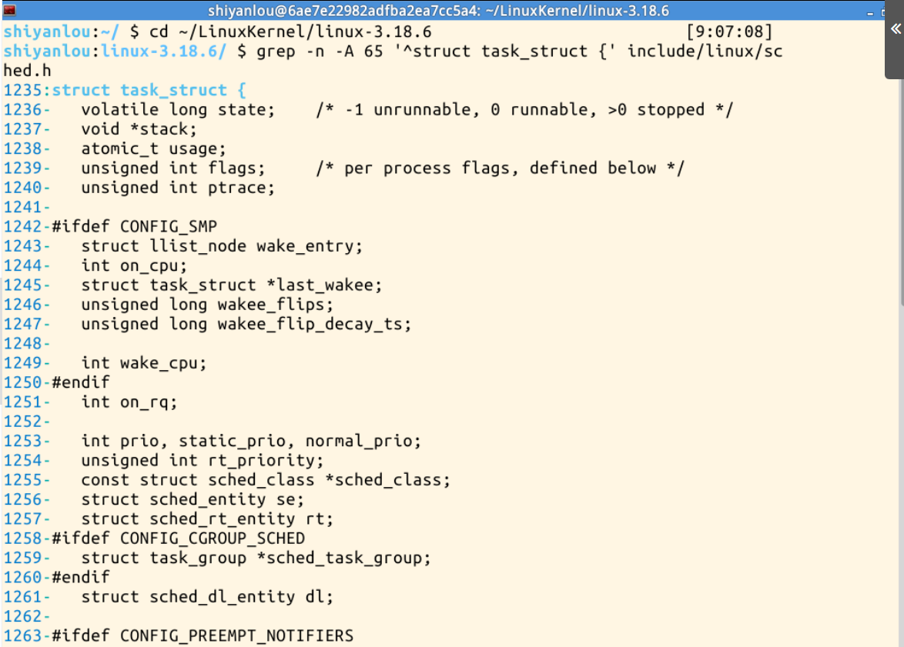

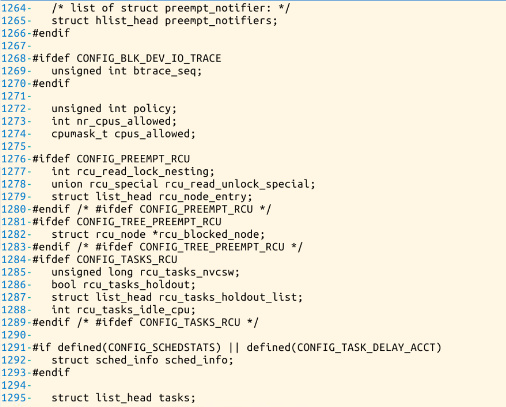

继续筛选与创建任务直接相关的字段，得到以下成员：

| 成员 | 含义 | 与创建新进程的关系 |
| :--- | :--- | :--- |
| `state` | 任务运行状态 | 任务创建、唤醒和阻塞时需要维护状态 |
| `stack` | 内核栈所在内存区域 | 新任务需要独立内核栈 |
| `pid`、`tgid` | 任务 ID、线程组 ID | 普通子进程获得新 PID，并成为新线程组组长 |
| `real_parent`、`parent` | 父任务关系 | 建立父子关系，调试跟踪时二者含义可能不同 |
| `children`、`sibling` | 子任务链表及兄弟链表节点 | 将新任务接入任务关系结构 |
| `group_leader` | 所属线程组组长 | 普通 `fork()` 的子进程以自己为组长 |
| `mm`、`active_mm` | 地址空间及当前使用的地址空间上下文 | 根据创建标志建立相应内存关系 |
| `thread` | 与处理器架构有关的执行现场 | 设置内核栈指针及首次执行位置 |
| `fs`、`files` | 文件系统上下文、文件描述符表 | 根据标志复制或共享相关资源 |

`TASK_RUNNING` 的值为0，表示任务正在运行或可以运行，并不表示它此刻一定占用 CPU。`flags` 保存任务属性，与 `state` 的用途不同。

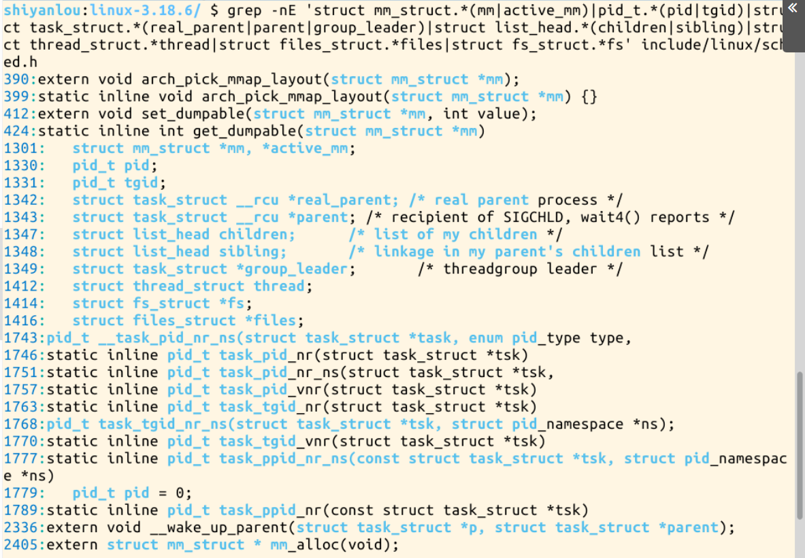

### 3.2 从 `clone` 到 `do_fork`

在 `kernel/fork.c` 中搜索系统调用定义：

```bash
grep -n -A 14 'SYSCALL_DEFINE.*clone' kernel/fork.c
```

源码根据架构配置提供不同的参数排列，但共同的函数体把工作交给 `do_fork()`：

```c
return do_fork(clone_flags, newsp, 0, parent_tidptr, child_tidptr);
```

`clone_flags` 控制资源共享和任务关系等行为。`newsp` 是子任务用户栈指针参数，不能把它与 `task_struct.stack` 所指向的内核栈混为一谈。

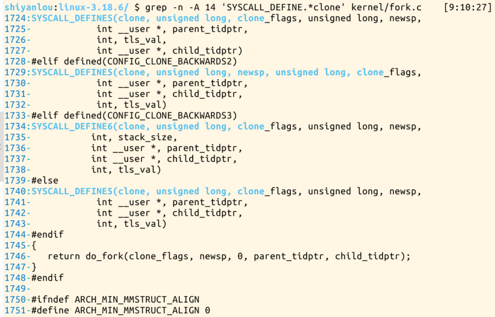

### 3.3 `do_fork`：创建、取得 PID 与唤醒

查看函数：

```bash
sed -n '/^long do_fork(/,/^}/p' kernel/fork.c
```

主要流程是先调用 `copy_process()`，成功后取得子任务 PID，再通过 `wake_up_new_task()` 使新任务进入可调度状态，最终向父进程返回子任务 PID。创建失败时，把错误指针转换为错误码返回。

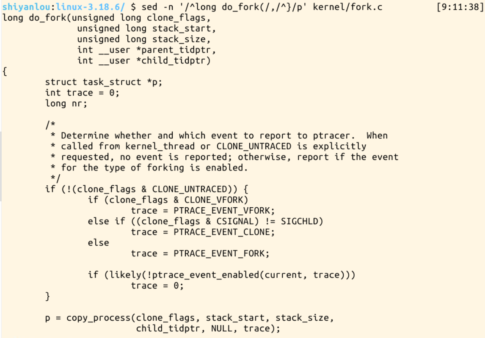

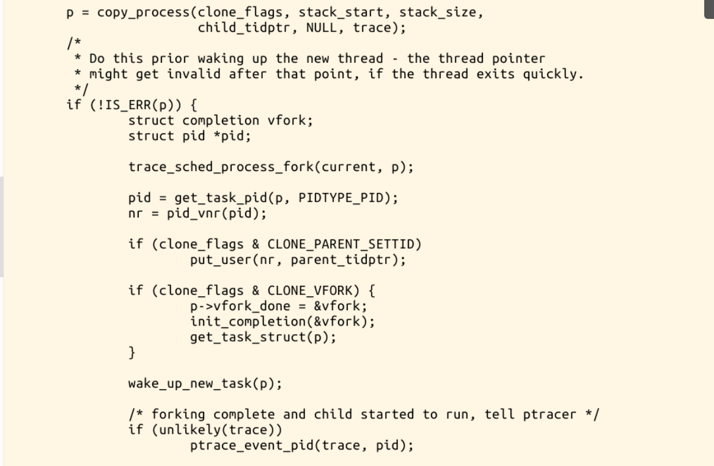

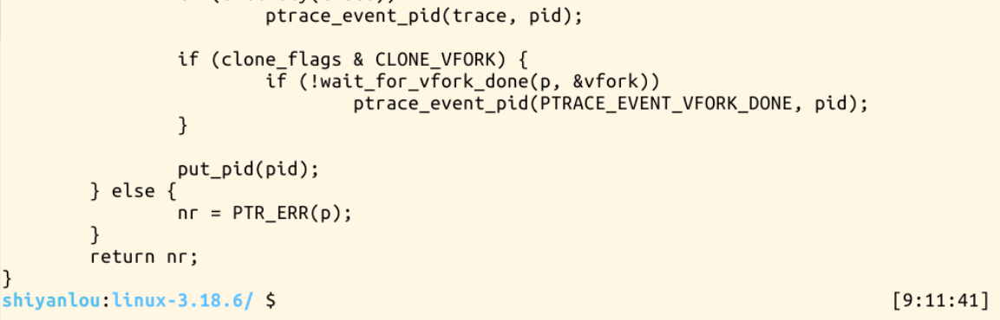

唤醒不等于保证子任务立即执行，父子进程谁先运行由实际调度决定。子进程得到0也不是因为它重新执行了 `do_fork()` 的普通返回语句，而是因为其寄存器保存现场被专门初始化。

### 3.4 `copy_process`：复制基础信息并重建任务身份

`copy_process()` 先通过 `dup_task_struct(current)` 分配并初始化新的任务描述结构和内核栈，再准备凭据、调度信息、文件、内存、命名空间以及架构现场等资源，随后分配 PID 并建立任务关系。

| 关键操作 | 作用 |
| :--- | :--- |
| `dup_task_struct(current)` | 分配新的任务结构和内核栈，以父任务为基础初始化 |
| `copy_creds()` | 准备凭据信息 |
| `sched_fork()` | 初始化调度相关信息 |
| `copy_files()`、`copy_fs()` | 处理文件描述符表和文件系统上下文 |
| `copy_sighand()`、`copy_signal()` | 准备信号相关结构 |
| `copy_mm()` | 根据标志建立地址空间关系 |
| `copy_namespaces()`、`copy_io()` | 准备命名空间和 I/O 上下文 |
| `copy_thread()` | 准备架构相关的初始执行现场 |
| `alloc_pid()` 及身份字段赋值 | 分配任务身份并设置线程组、父子关系 |

普通 `fork()` 不设置 `CLONE_THREAD`，子进程通常具有 `tgid=pid`、`group_leader=p` 和 `real_parent=current`。筛选源码时省略了部分 `else` 和括号，不能把互斥分支中的赋值理解为顺序全部执行。

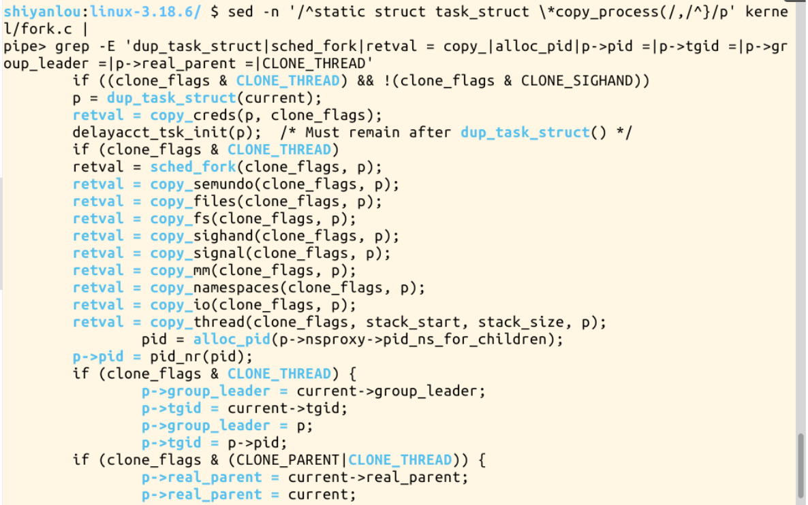

复制任务结构不是把所有资源一次性深复制。普通 `fork()` 建立独立地址空间，但可借助写时复制暂时共享物理页；复制文件描述符表也不等于复制所有底层打开文件对象。本次未逐项检查这些资源的内存结构，它们属于源码机制分析。

### 3.5 `copy_thread`：配套设置执行起点和内核栈

查看本次32位架构的实现：

```bash
sed -n '/^int copy_thread(/,/^}/p' arch/x86/kernel/process_32.c
```

普通用户任务路径中的关键设置为：

```c
struct pt_regs *childregs = task_pt_regs(p);

p->thread.sp = (unsigned long) childregs;
p->thread.sp0 = (unsigned long) (childregs + 1);

/* 普通用户任务路径 */
*childregs = *current_pt_regs();
childregs->ax = 0;
if (sp)
    childregs->sp = sp;

p->thread.ip = (unsigned long) ret_from_fork;
```

这段代码定位子任务内核栈上的 `pt_regs`，复制父任务保存的用户寄存器现场，把子任务返回值槽位改为0，并将内核执行入口设为 `ret_from_fork`。当 `sp=0` 时，不执行用户栈覆盖赋值，保留复制得到的用户栈指针。

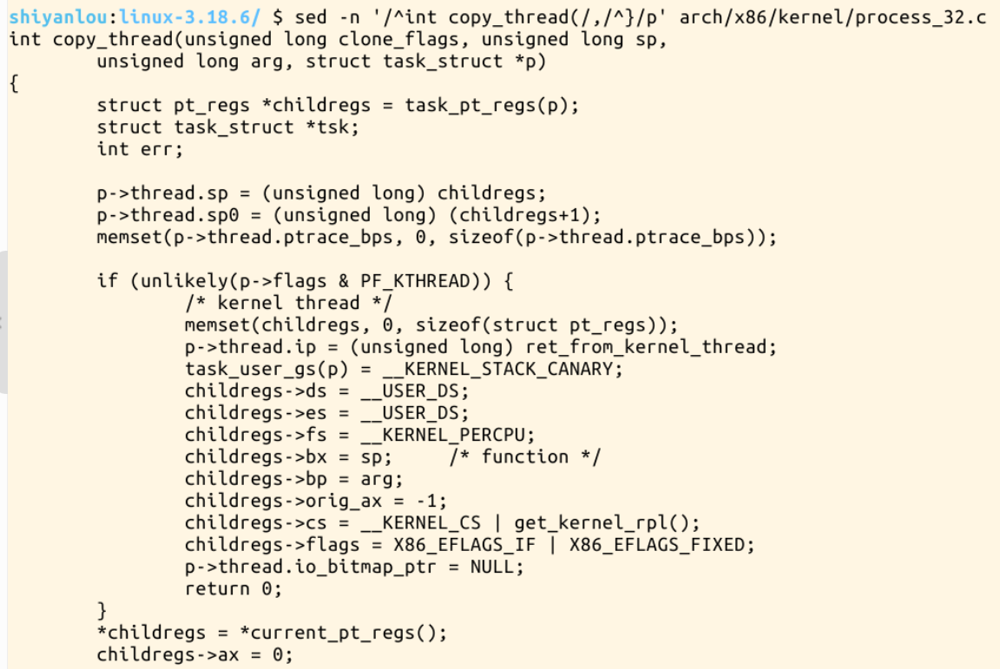

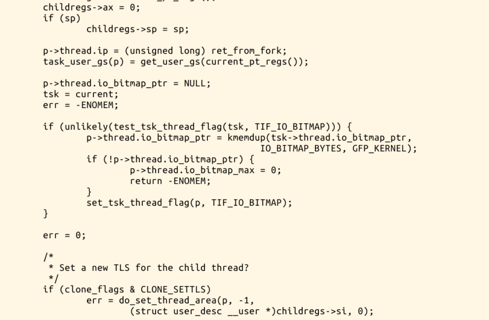

这里必须区分两套执行位置：`thread.ip`、`thread.sp` 供内核切换使用，`childregs->ip`、`childregs->sp` 则供恢复用户态使用。子进程的内核首次执行位置是 `ret_from_fork`；回到用户态后，继续执行复制现场记录的位置，而不是从 `main()` 重新开始。

---

## 04｜构造用户程序并准备调试镜像

### 4.1 检查原 MenuOS

查看当前环境的命令及构建规则：

```bash
cd ~/LinuxKernel/menu
grep -nE '^#include|fork|Fork|clone|Clone|MenuConfig|ExecuteMenu|main\(' test.c
cat Makefile
```

本次原 `test.c` 未提供 `fork` 测试命令。`Makefile` 的 `rootfs` 目标会在编译、打包后直接启动 QEMU，因此本次单独编译并制作专用镜像，再使用明确的调试参数启动。

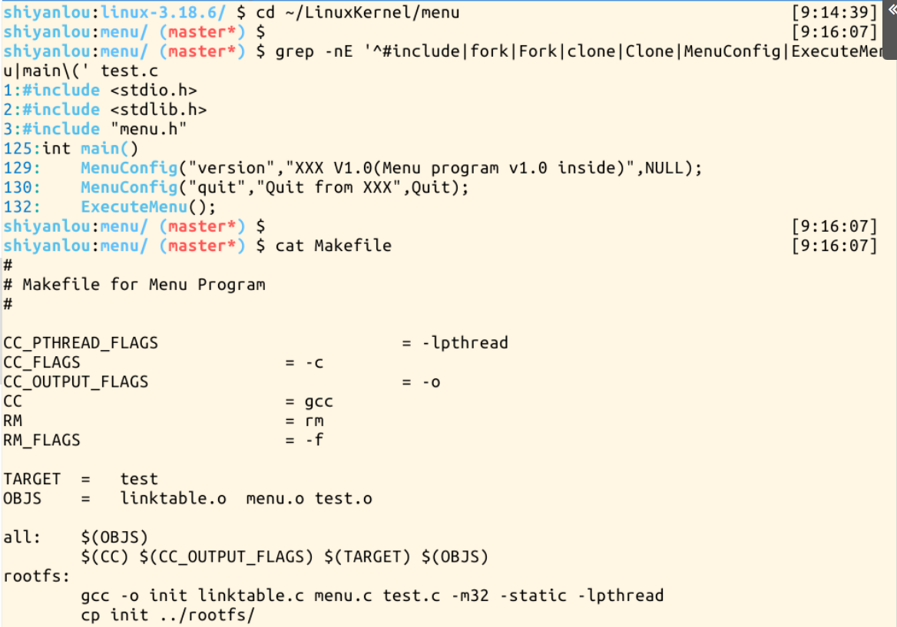

### 4.2 新增 `forktest`

先将原文件备份为 `test.c.week7.bak`，在 `test.c` 中补充头文件：

```c
#include <unistd.h>
#include <sys/types.h>
#include <sys/wait.h>
#include <errno.h>
```

在 `main()` 前添加以下处理函数：

```c
int ForkTest(int argc, char *argv[])
{
    pid_t pid;
    int status;
    pid_t waited;

    printf("Before fork: pid=%ld\n", (long)getpid());
    fflush(stdout);

    pid = fork();
    if (pid < 0) {
        perror("fork");
        return 1;
    }

    if (pid == 0) {
        printf("Child: pid=%ld, ppid=%ld, fork returned=0\n",
               (long)getpid(), (long)getppid());
        fflush(stdout);
        _exit(0);
    }

    printf("Parent: pid=%ld, fork returned=%ld\n",
           (long)getpid(), (long)pid);
    do {
        waited = waitpid(pid, &status, 0);
    } while (waited < 0 && errno == EINTR);

    if (waited < 0) {
        perror("waitpid");
        return 1;
    }

    printf("Parent: child %ld reaped\n", (long)waited);
    return 0;
}
```

在 `ExecuteMenu()` 前注册：

```c
MenuConfig("forktest", "test fork", ForkTest);
```

创建前刷新标准输出，避免尚未输出的缓冲内容随进程复制。子进程输出后刷新并使用 `_exit(0)` 退出，父进程调用 `waitpid()` 等待和回收子进程，并处理等待被信号中断时的重试。

### 4.3 编译与打包

```bash
cd ~/LinuxKernel/menu
gcc -m32 -static -g -O0 -o init-week7 linktable.c menu.c test.c -lpthread
file init-week7
```

实际输出为32位 Intel 80386 ELF、静态链接、`not stripped`。`for GNU/Linux 2.6.24` 是可执行文件的 ABI 标记，不能当成被调试内核版本。这里的 `-O0` 只影响本次新编译的用户程序，没有改变预置内核的优化设置。

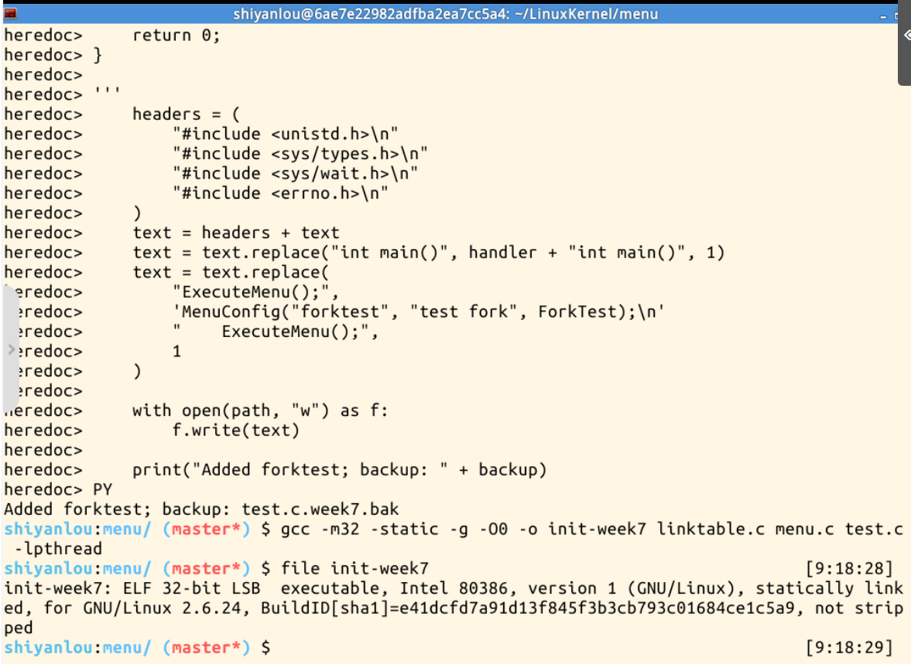

制作独立镜像：

```bash
mkdir -p ../rootfs-week7
cp init-week7 ../rootfs-week7/init
cd ../rootfs-week7
find . -print | cpio -o -H newc | gzip -9 > ../rootfs-week7.img
gzip -dc ../rootfs-week7.img | cpio -it
ls -lh ../rootfs-week7.img
```

镜像列表包含 `.` 和 `init`，打包统计为1883块，压缩文件约409 KB。

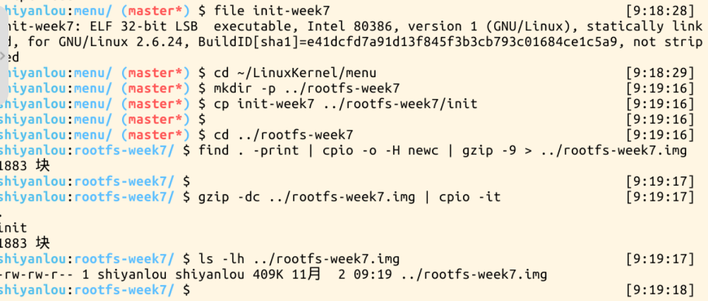

---

## 05｜GDB 跟踪创建新进程

### 5.1 启动 QEMU 并连接

在终端 A 执行：

```bash
cd ~/LinuxKernel
qemu -kernel linux-3.18.6/arch/x86/boot/bzImage -initrd rootfs-week7.img -s -S
```

在终端 B 执行：

```bash
cd ~/LinuxKernel
gdb -q linux-3.18.6/vmlinux
```

然后输入：

```gdb
set pagination off
directory linux-3.18.6
target remote localhost:1234
tbreak start_kernel
continue
info registers eip esp cs
```

初次连接停在 BIOS 地址 `0x0000fff0`，继续后成功命中 `start_kernel()`，当时 `eip=0xc1a2f7c5`、`cs=0x60`。`cs` 的低两位为0，说明在内核态。先运行到内核已装载的位置，再分析内核代码和地址。

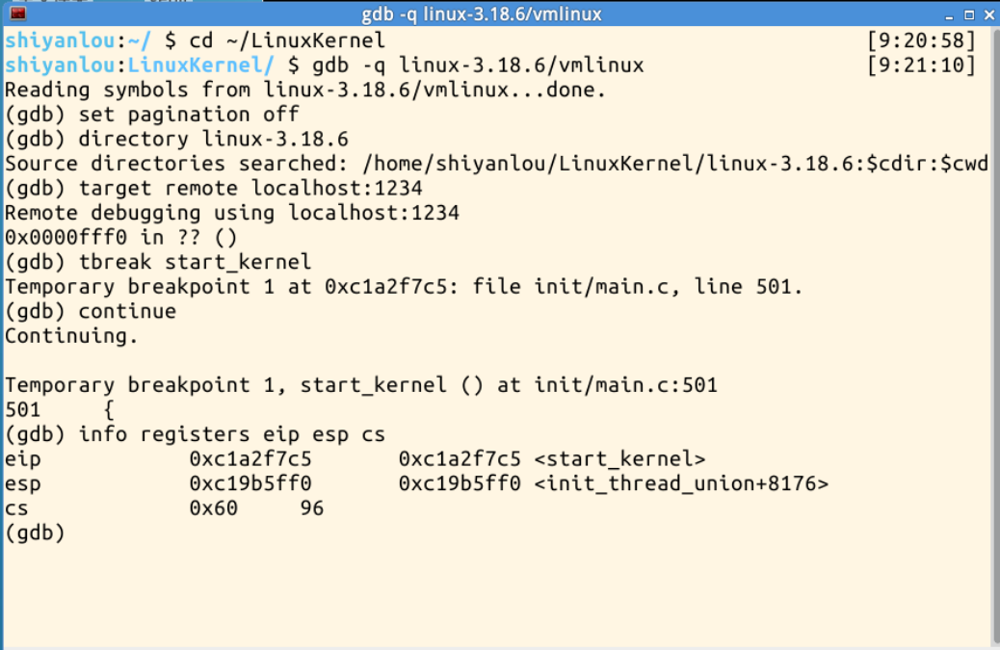

### 5.2 手动触发并命中 `SyS_clone`

继续运行，等待 MenuOS 提示符出现，再在 GDB 中按 Ctrl+C 暂停，设置断点：

```gdb
break sys_clone
continue
```

在 QEMU 的 MenuOS 中执行 `forktest`。输出 `Before fork: pid=1` 后，GDB 命中 `SyS_clone`。随后执行：

```gdb
info args
bt 4
set $fork_flags = clone_flags
p/x $fork_flags
```

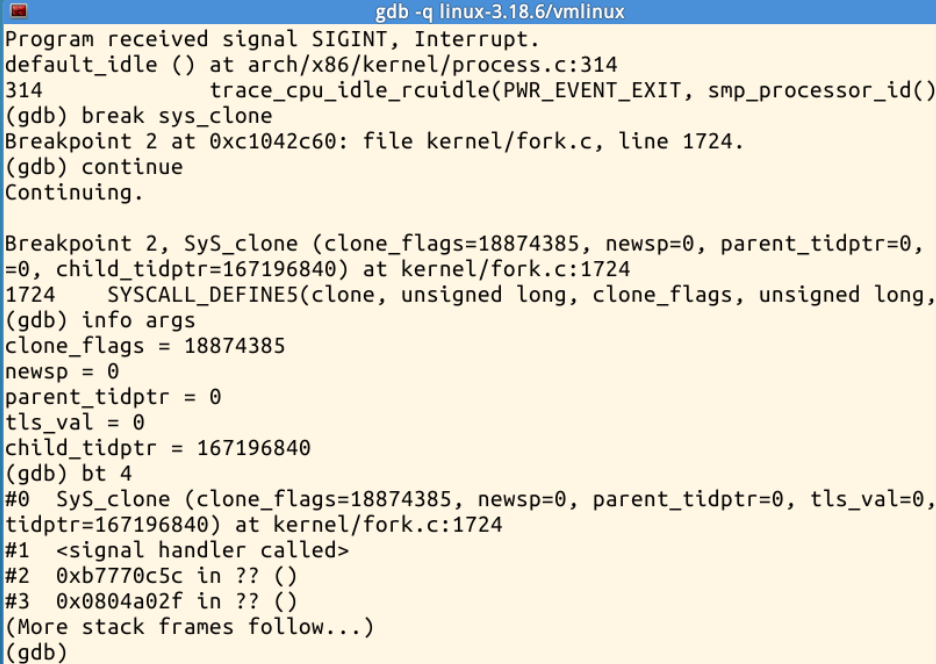

| 参数 | 本次实测值 |
| :--- | :--- |
| `clone_flags` | 十进制18874385，即 `0x01200011` |
| `newsp` | 0 |
| `parent_tidptr` | 0 |
| `tls_val` | 0 |
| `child_tidptr` | 十进制167196840，即 `0x09f738a8` |

本次标志由 `CLONE_CHILD_SETTID`、`CLONE_CHILD_CLEARTID` 和低位退出信号 `SIGCHLD` 组成，没有设置 `CLONE_VM` 和 `CLONE_THREAD`。`newsp=0` 表示不另行覆盖复制现场中的用户栈指针，不表示使用空栈。

`sys_clone`、`SyS_clone` 和回溯中的 `SYSC_clone` 与系统调用定义宏生成的入口或辅助实现有关。本次命中和后续调用链证明，用户程序的 `fork()` 通过 `clone` 系统调用请求内核创建任务。

### 5.3 遇到的问题：优化导致断点作用域与预期不同

原计划在 `dup_task_struct()` 入口读取父任务参数 `orig`，操作如下：

```gdb
disable 2
tbreak dup_task_struct
continue
info args
set $parent = orig
```

实际 GDB 命中时显示的是 `copy_process()` 第1240行，即 `p = dup_task_struct(current)`。部分参数显示为 `<optimized out>`，读取 `orig` 报错：

```text
No symbol "orig" in current context.
```

这说明当前可见调试作用域与原计划不同，不能继续假定正处于独立的 `dup_task_struct()` 栈帧。

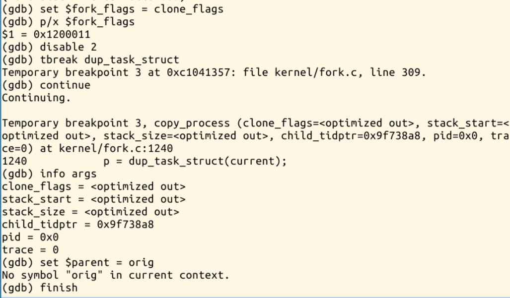

随后执行 `finish`，实际退出的是整个 `copy_process()`，回到 `do_fork()` 第1657行。返回值为新任务指针 `0xc00663e0`。立即保存32位返回寄存器中的指针：

```gdb
set $child = (struct task_struct *)$eax
```

由于 `$parent` 未成功赋值，继续读取它时又出现类型错误；但 `$child` 已正确保存，子任务内核栈可读，为 `0xc7126000`。

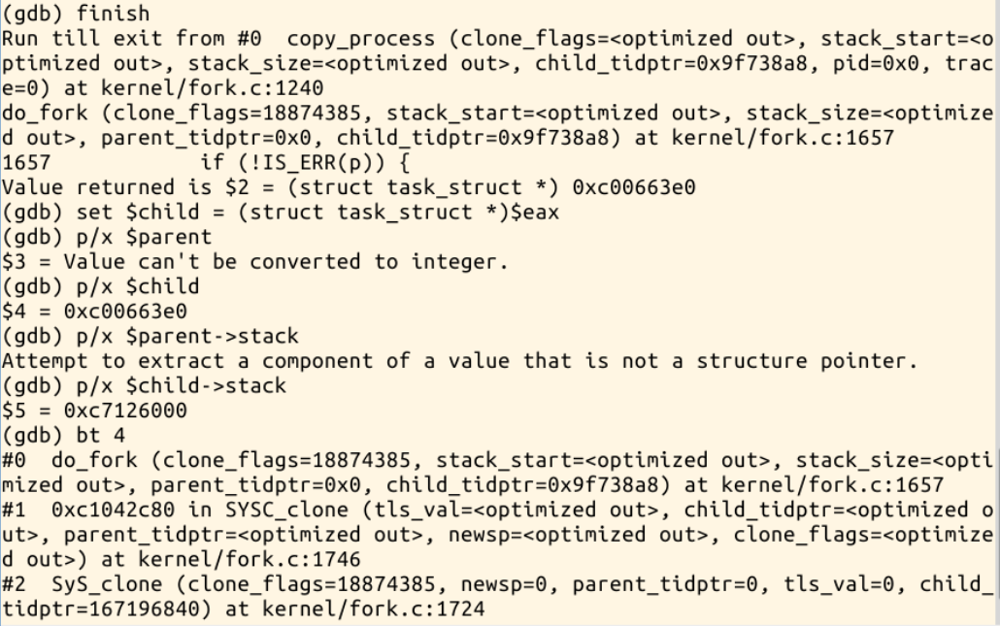

此时 `copy_process()` 已完成身份和关系初始化，且尚未唤醒新任务，因此改为从子任务的 `real_parent` 获取父任务：

```gdb
set $parent = $child->real_parent
p/x $parent
p/x $child
p $parent->pid
p $child->pid
p $child->tgid
p/x $parent->stack
p/x $child->stack
p $child->group_leader == $child
p $child->real_parent == $parent
```

| 项目 | 父任务 | 子任务 |
| :--- | :--- | :--- |
| `task_struct` 地址 | `0xc7850000` | `0xc00663e0` |
| PID | 1 | 866 |
| 子任务 TGID | — | 866 |
| 内核栈基址 | `0xc7858000` | `0xc7126000` |

两个关系比较均为1。父子任务结构和内核栈地址不同，确认新任务具有独立的描述结构和内核栈；`tgid=pid` 且组长为自身，符合普通子进程的关系。

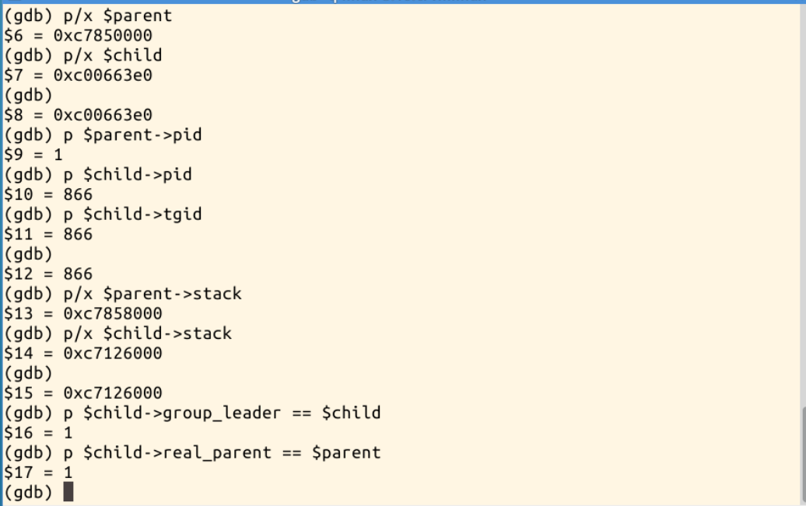

修正后沿用同一次系统调用继续检查，没有重启或伪造一次新的成功现场。这也提醒我：遇到优化代码时，先看当前帧和实际返回位置，再选择读取参数或保存返回值的方法。

### 5.4 检查子任务准备好的初始现场

此时仍停在 `do_fork()` 中，执行：

```gdb
p/x $child->thread.ip
info symbol $child->thread.ip
p/x $child->thread.sp
p/x $child->thread.sp0
set $childregs = (struct pt_regs *)$child->thread.sp
p $childregs->ax
p/x $childregs->ip
p/x $childregs->sp
p/x $childregs->cs
p/x $childregs->ss
p $child->thread.sp0 == (unsigned long)($childregs + 1)
set $user_pc = $childregs->ip
set $user_sp = $childregs->sp
```

将 `thread.sp` 转为 `pt_regs *` 的依据是本版本 `copy_thread()` 的明确赋值，仅适用于此时已经准备好、尚未首次运行的现场。

| 检查项 | 实测结果 |
| :--- | :--- |
| `thread.ip` | `0xc174d700`，符号为 `ret_from_fork` |
| `thread.sp` | `0xc7127fb4` |
| `thread.sp0` | `0xc7127ff8` |
| 保存的 `ax` | 0 |
| 保存的用户 `ip` | `0xb7770c5c` |
| 保存的用户 `sp` | `0xbfef1840` |
| 保存的用户 `cs`、`ss` | `0x73`、`0x7b` |
| `sp0 == childregs + 1` | 1 |

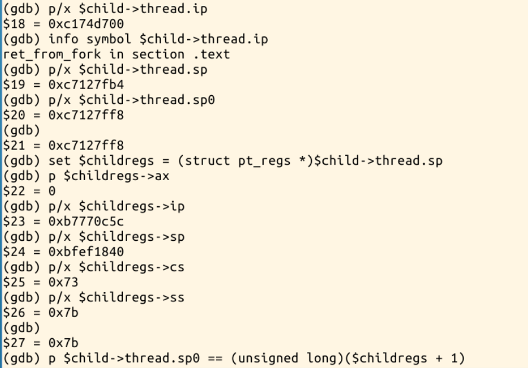

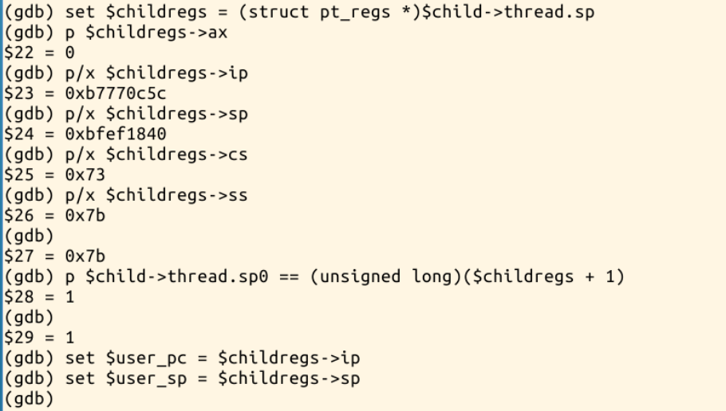

`thread.sp0` 与用户 `sp` 是不同字段。本次 `pt_regs` 占据 `0xc7127fb4` 到 `0xc7127ff7` 的68字节区域，末端下一地址是 `0xc7127ff8`，与 `sp0` 对应。

### 5.5 捕获子任务第一次进入 `ret_from_fork`

用初始栈指针限定断点：

```gdb
tbreak *ret_from_fork if $esp == (unsigned long)$childregs
continue
info registers eip esp cs
p/x $childregs
p $esp == (unsigned long)$childregs
p $child->pid
p $childregs->ax
x/12i $eip
```

成功命中后，`eip=0xc174d700`，即 `ret_from_fork`；`esp=0xc7127fb4`，与准备的 `childregs` 地址相同；子任务 PID 为866，保存的返回值仍为0。此时 `cs=0x60`，仍在内核态。

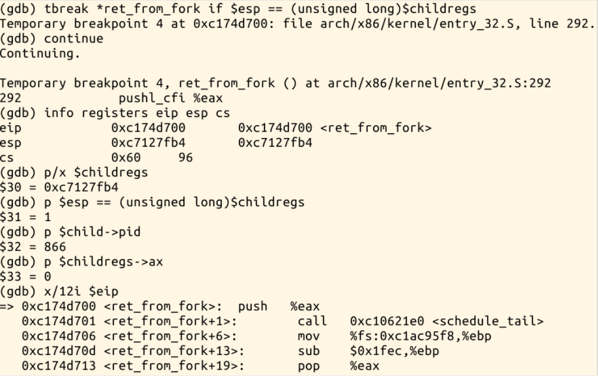

反汇编显示此入口调用 `schedule_tail`，完成相关处理后跳到 `syscall_exit`。其中 `schedule_tail` 是新任务首次切换后的收尾处理，不能简单理解为在这里再次创建进程。

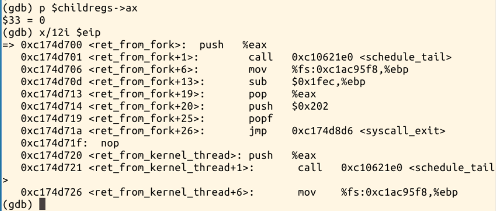

### 5.6 捕获同一子任务的 `iret` 并返回用户态

使用子任务保存区内 `ip` 字段的地址和先前记录的用户指令地址，共同限定返回断点：

```gdb
set $iret_sp = (unsigned long)&$childregs->ip
tbreak *irq_return if $esp == $iret_sp && *(unsigned int *)$esp == $user_pc
continue
x/i $eip
x/5wx $esp
info registers eax eip esp cs
```

成功命中 `irq_return` 的 `iret`，地址为 `0xc174d90c`。此时 `esp=0xc7127fe4`，返回现场如下：

| 栈地址 | 内容 | 含义 |
| :--- | :--- | :--- |
| `0xc7127fe4` | `0xb7770c5c` | 用户 EIP |
| `0xc7127fe8` | `0x00000073` | 用户 CS |
| `0xc7127fec` | `0x00000202` | EFLAGS |
| `0xc7127ff0` | `0xbfef1840` | 用户 ESP |
| `0xc7127ff4` | `0x0000007b` | 用户 SS |

`iret` 前的实际 `eax` 已为0，说明返回路径已将保存的返回值恢复到寄存器；不是由 `iret` 自行产生0。

继续单步：

```gdb
si
info registers eax eip esp cs ss
p $eip == $user_pc
p $esp == $user_sp
```

执行后，`eax=0`、`eip=0xb7770c5c`、`esp=0xbfef1840`、`cs=0x73`、`ss=0x7b`。两个地址比较均为1，证明恢复的用户位置和用户栈与先前准备的现场一致。CS 的低两位为3，已回到用户态。

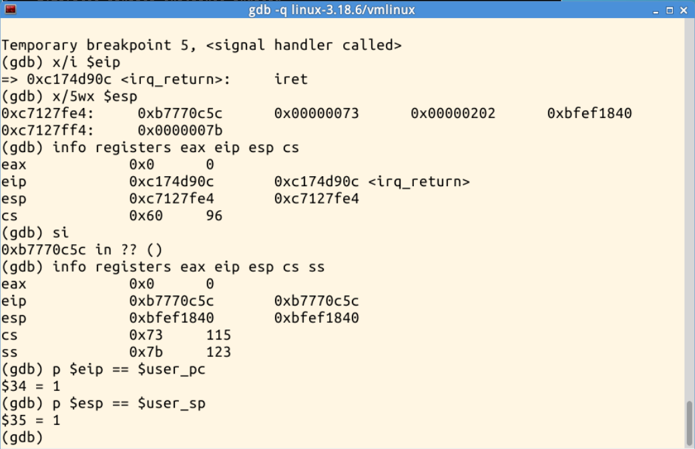

GDB 在汇编入口处显示 `<signal handler called>`，在用户地址处显示 `??`，并不影响这里通过真实指令、栈和寄存器完成验证。不能仅凭这些回溯显示断定用户进程发生了信号处理，也不能认为用户地址无符号就是执行失败。

### 5.7 父子进程输出与回收

在 GDB 中执行 `continue`，QEMU 的完整输出为：

```text
forktest
Before fork: pid=1
Parent: pid=1, fork returned=866
Child: pid=866, ppid=1, fork returned=0
Parent: child 866 reaped
MenuOS>>
```

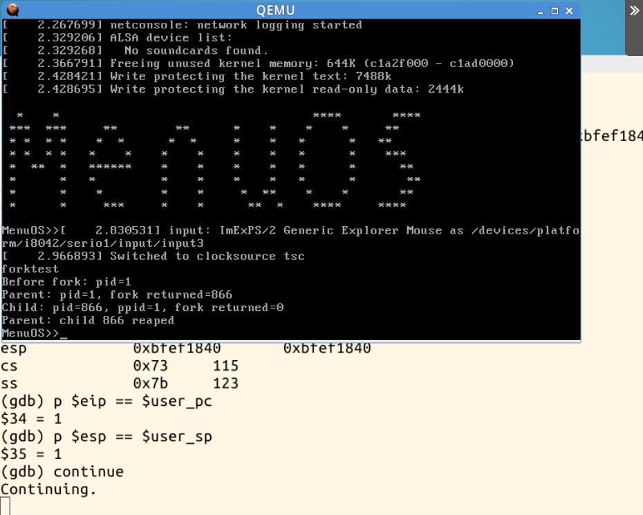

本次父进程的输出先出现，但这只是本次运行顺序，不是 `fork()` 对父子调度顺序的保证。子进程执行到零返回值分支后退出，父进程的 `waitpid()` 返回866并回到菜单。

---

## 06｜执行起点与内核栈为何能够保持一致

### 6.1 创建阶段构造可恢复的现场

新进程没有像父进程那样真实走过完整的内核函数调用链。内核为它分配独立内核栈，在栈上放置复制得到的 `pt_regs`，并把 `ax` 改成0；同时设置 `thread.sp` 指向该保存区，设置 `thread.ip` 为 `ret_from_fork`。这形成一份能够被返回代码使用的初始现场。

### 6.2 首次切换使用配套的栈和入口

在该版本32位 x86 的切换机制中，切换代码保存旧任务的栈指针，加载新任务的 `thread.sp`，把新任务的 `thread.ip` 压到新栈上，再进入 `__switch_to` 完成架构相关切换。返回时取出预置执行位置，于是进入 `ret_from_fork`，而栈指针回到子任务的寄存器保存区。

这是切换源码的机制解释；本次没有逐条单步整个 `switch_to`，而是在 `ret_from_fork` 第一条指令处，实际验证了结果：`eip` 等于设置的入口，`esp` 等于准备的 `pt_regs` 地址。两项同时吻合，说明执行位置和栈现场是配套切换的。

### 6.3 返回代码消费预先准备的现场

`ret_from_fork` 完成首次切换收尾后进入系统调用返回路径。返回路径按规定布局恢复通用寄存器，最终由 `iret` 依据栈中的 EIP、CS、EFLAGS、ESP、SS 恢复用户态。返回前可能存在调度、信号等条件处理；本次没有逐项记录中间工作标志，不把它们写成已经观测到的分支。

本次两次关键现场直接对应：

| 准备内容 | 后续实测 |
| :--- | :--- |
| `thread.ip=ret_from_fork` | 首次入口 `eip=ret_from_fork` |
| `thread.sp=0xc7127fb4` | 首次入口 `esp=0xc7127fb4` |
| `childregs->ax=0` | `iret` 前后 `eax=0` |
| 保存的用户 EIP 为 `0xb7770c5c` | `iret` 后 EIP 相同，比较为1 |
| 保存的用户 ESP 为 `0xbfef1840` | `iret` 后 ESP 相同，比较为1 |

因此，子进程不是从 `main()` 或 `copy_process()` 开始执行，而是从专门准备的内核入口进入恢复路径，再回到复制的用户态现场。本次用户地址位于系统调用返回相关代码中，库函数还会完成自己的后续处理，用户 C 程序最终在 `fork()` 返回后进入 `pid==0` 分支。

父子进程可以具有相同数值的用户虚拟地址，而使用不同的地址空间和独立的内核栈。不能仅因用户地址相同就认为它们是同一个进程，或认为两者共用内核栈。

---

## 07｜实验总结

本次实验把创建进程理解为三个相互配合的过程：分配和初始化新的任务描述结构，按照标志建立资源与身份关系，以及构造可调度、可返回的执行现场。`copy_process()` 完成创建准备，`wake_up_new_task()` 让新任务有机会运行；新任务第一次运行时走专门的恢复入口，而不是重走父进程的创建调用链。

最关键的证据是 `ret_from_fork` 入口与内核栈指针同时匹配准备值，以及 `iret` 后用户地址、用户栈和零返回值全部一致。最终父进程得到子PID 866，子进程得到0，且被父进程成功回收，形成了从源码设置到内核切换、用户态返回和程序输出的完整验证。

调试中实际遇到了编译优化导致参数不可见、断点作用域与预期不同的问题。通过确认 `finish` 的实际返回位置，再从初始化完成的父子关系取得父任务指针，得以保留同一次创建过程继续分析。以后调试优化内核时，需要依据当前栈帧、实际指令和可验证的数据关系选择观察方法，不能只按函数名推断当前状态。
