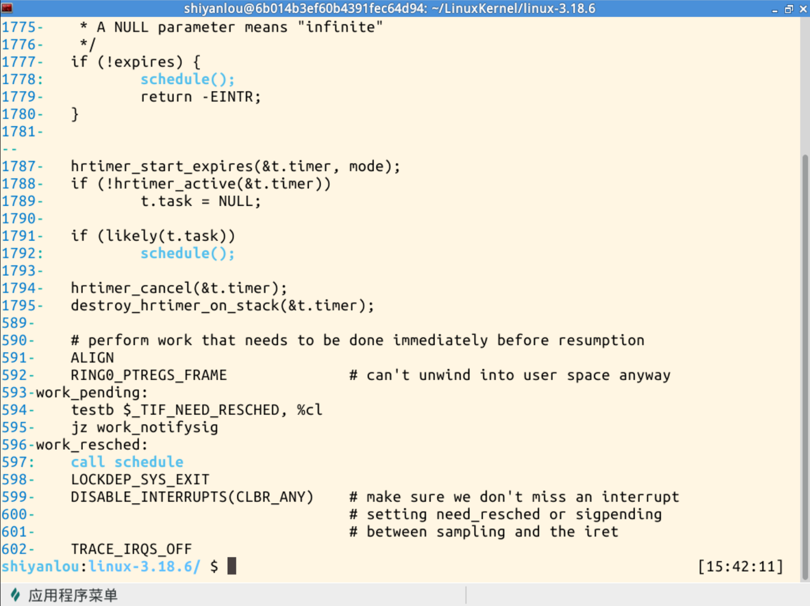
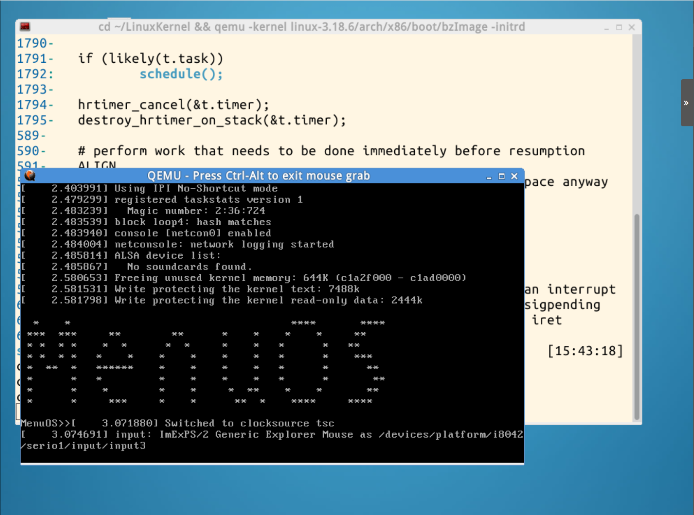
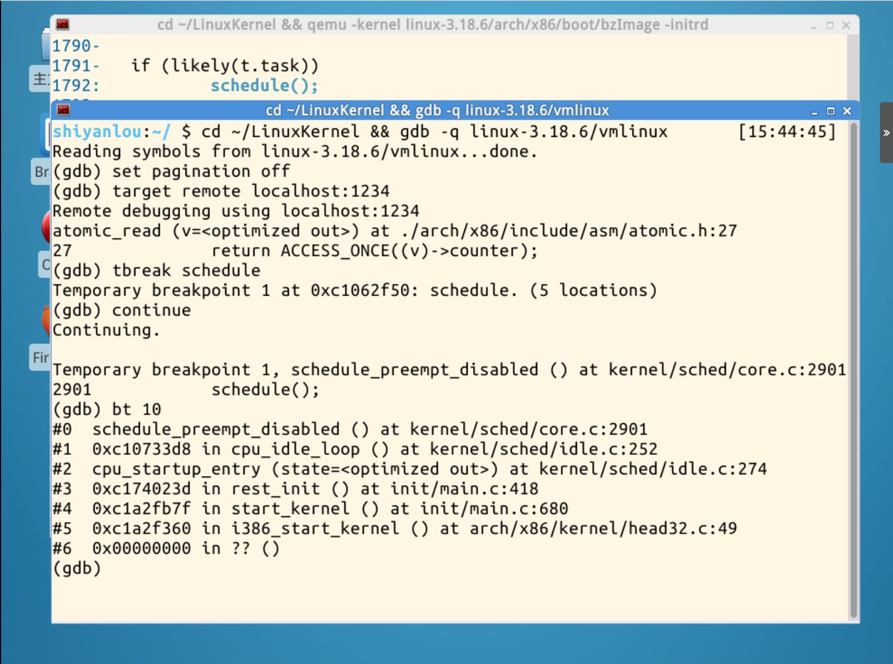
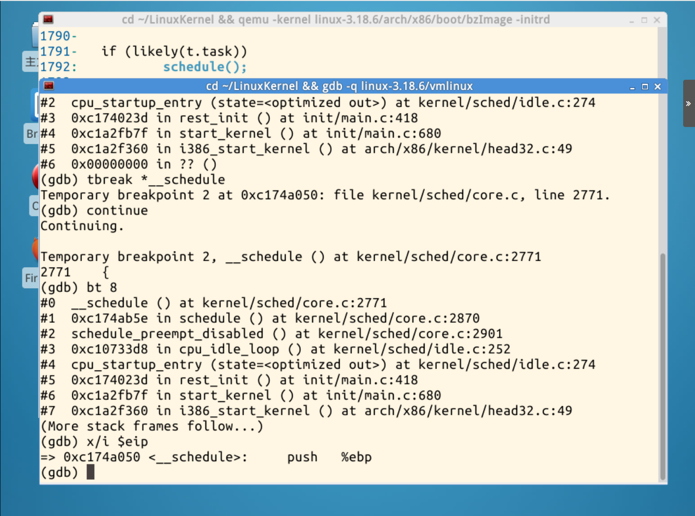
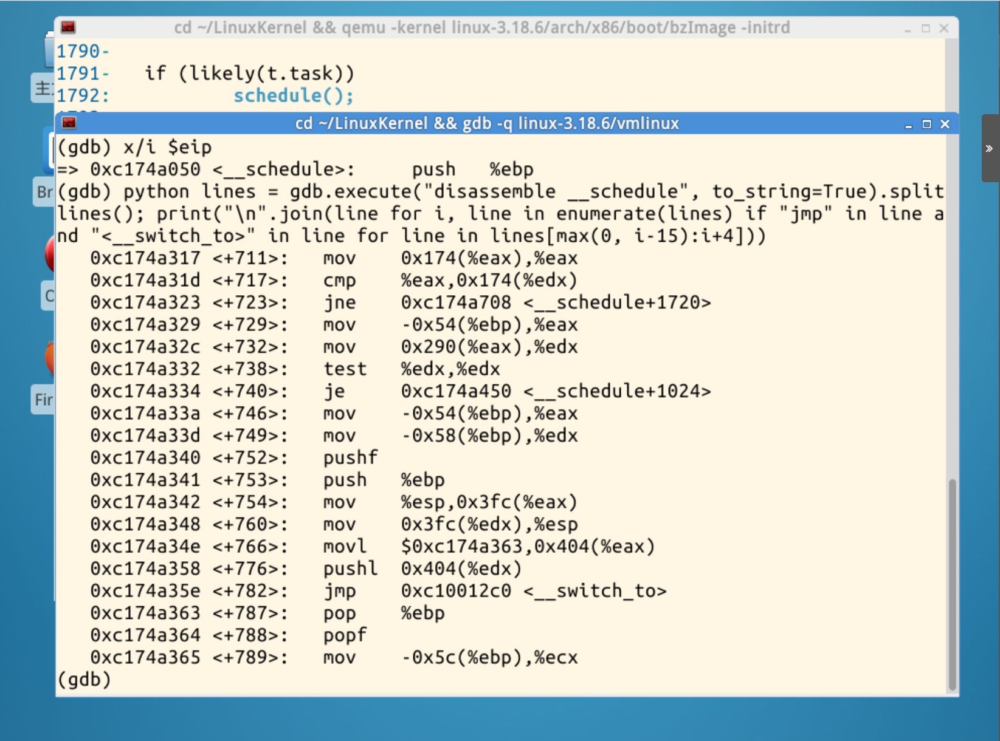
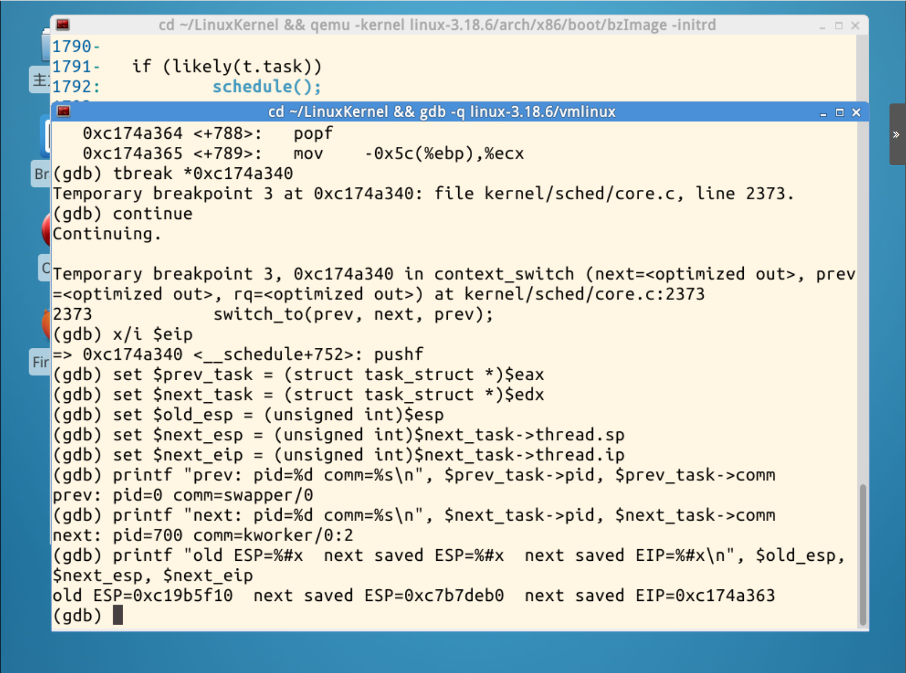
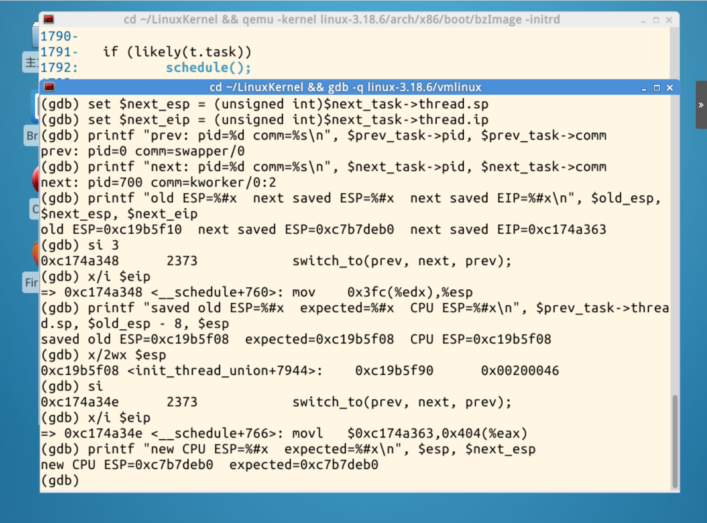
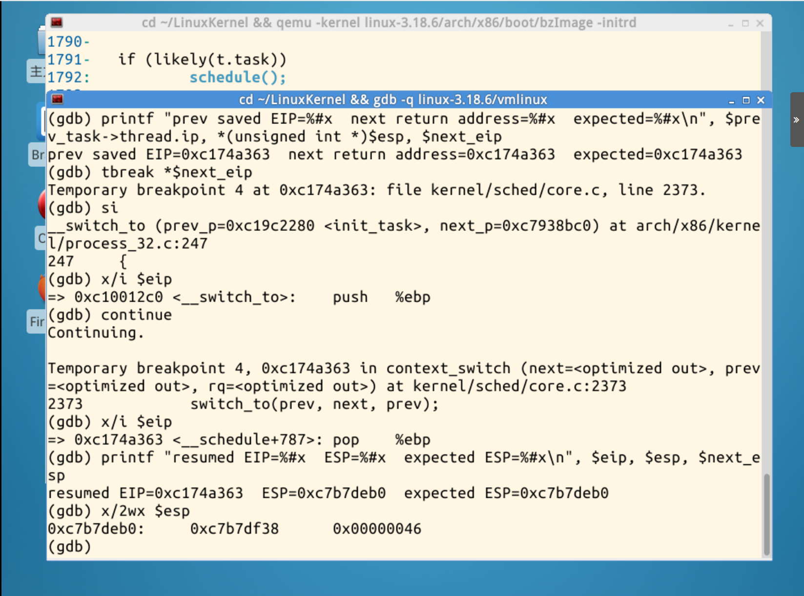
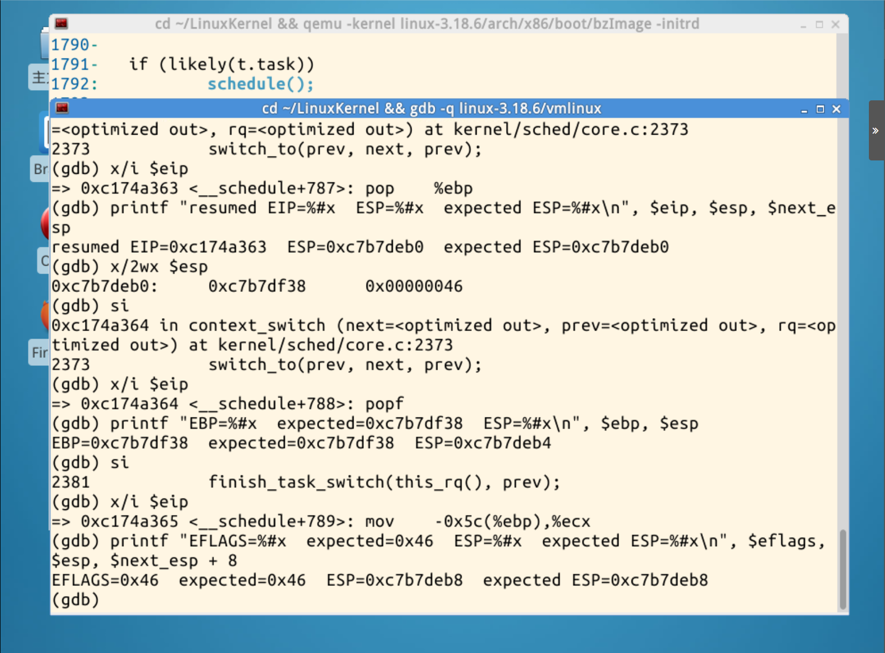

# 20262819《Linux内核原理与分析》第九周作业

本周学习 Linux 操作系统的软件架构，并在实验八中跟踪一次从空闲任务到内核工作线程的调度。实验以蓝桥云课预置的 32 位 x86 Linux 3.18.6 为准。

| 项目 | 内容 |
| --- | --- |
| 姓名 | 刘顺文 |
| 学号 | 20262819 |
| 教材 | 第 9 章《Linux 操作系统的软件架构》 |
| 云班课视频 | 《Linux 系统架构和执行过程概览》，已观看 |
| 实验 | 实验八，理解进程调度时机并跟踪进程调度与切换，已完成 |
| 日期 | 2026-11-21 |

## 01｜教材阅读与理解

Linux 采用可加载模块的宏内核架构。调度、虚拟内存、文件系统、网络和设备驱动等子系统在内核态协作。应用程序在用户态运行，经系统调用接口请求内核服务。通过系统调用进入内核时，内核通常先在当前任务的上下文中执行，仍然可以用当前任务的身份处理读写等请求。

从一次终端读操作看，应用通过系统调用进入内核，由文件系统和具体的终端驱动处理请求。若当前没有可读数据，任务可以进入等待并让出 CPU。设备产生中断后，内核处理输入并唤醒等待读取的任务。唤醒让任务具备参与调度的资格，调度器在合适的时机从可运行任务中选出下一任务。原任务再次被选中后，可以从内核中的等待路径继续处理请求，再返回用户态。

系统调用、中断和调度对应执行过程中的不同环节。系统调用提供进入内核的接口，中断让 CPU 响应异步事件，调度器决定接下来由哪个任务占用 CPU。以本实验为例，内核空闲任务进入调度器后切换到内核工作线程，两个任务都使用各自的内核栈。用 GDB 观察 ESP 和 EIP，就能把抽象的任务切换对应到实际执行的指令。

## 02｜查找调度时机

在实验环境的内核源码目录搜索 C 和 x86 汇编中的直接调用。

```bash
cd ~/LinuxKernel/linux-3.18.6
grep -nE -B 5 -A 3 '^[[:space:]]*schedule[[:space:]]*\([[:space:]]*\);' \
    kernel/time/hrtimer.c
grep -nE -B 8 -A 5 '^[[:space:]]*call[[:space:]]+schedule([[:space:]]|$)' \
    arch/x86/kernel/entry_32.S
```



| 源码位置 | 调用条件 |
| --- | --- |
| `kernel/time/hrtimer.c` 第 1778 行 | `schedule_hrtimeout_range_clock()` 收到空的 `expires`，进入无期限等待分支并调用 `schedule()`。 |
| `kernel/time/hrtimer.c` 第 1792 行 | 有期限的等待先启动高精度定时器。若定时器已不活跃，代码清空 `t.task`。只有 `t.task` 仍有效时才执行这里的 `schedule()`。 |
| `arch/x86/kernel/entry_32.S` 第 594–597 行 | 返回路径在 `work_pending` 检查 `_TIF_NEED_RESCHED`。该位为 1 时进入 `work_resched` 调用 `schedule()`。 |

源码支持课堂对两类时机的总结。任务在显式等待路径中可以主动调用调度器。时钟节拍或唤醒等事件可能设置重新调度标志，由允许调度的路径处理。唤醒本身使任务进入可运行状态，是否需要立即抢占还取决于调度策略和当时的执行上下文。GDB 实测另补充了空闲循环离开时调用调度器的情况。

## 03｜GDB 跟踪调度与任务切换

### 3.1 启动 MenuOS 并捕获 `schedule()`

在终端启动 QEMU。预置的 `bzImage` 和 `rootfs.img` 分别提供内核和 MenuOS 环境，`-s` 开启 GDB 调试端口。QEMU 先运行到 `MenuOS>>`。

```bash
cd ~/LinuxKernel
qemu -kernel linux-3.18.6/arch/x86/boot/bzImage -initrd rootfs.img -s
```



另开终端，在同一目录执行 `gdb -q linux-3.18.6/vmlinux`，随后连接 QEMU。

```gdb
set pagination off
target remote localhost:1234
tbreak schedule
continue
bt 10
```

`tbreak schedule` 解析出 5 个断点位置，当前命中的是 `schedule_preempt_disabled()` 中的 `schedule();` 调用行。调用栈显示其调用者为 `cpu_idle_loop()`。更下方的 `rest_init()` 和 `start_kernel()` 是空闲任务进入循环时留下的调用链。实际捕获发生在 MenuOS 启动之后。



### 3.2 进入核心调度函数

保持当前会话，按符号入口地址下断点。

```gdb
tbreak *__schedule
continue
bt 8
x/i $eip
```

这次命中 `0xc174a050`，当前指令为 `push %ebp`。调用栈补全了 `cpu_idle_loop() → schedule_preempt_disabled() → schedule() → __schedule()`。源码中 `__schedule()` 从运行队列选出 `next`，并在 `prev != next` 时进入 `context_switch()`。



### 3.3 定位 `switch_to` 并记录两个任务

在 `disassemble __schedule` 的输出中定位 `jmp ... <__switch_to>`。它前面的压栈和 ESP 读写指令对应内联展开的 `switch_to(prev, next, prev)`。



在 `pushf` 前停住。源码参数显示为 `<optimized out>`，因此根据该版本 32 位宏的寄存器约束，从 EAX 和 EDX 读取 `prev` 和 `next`。

```gdb
tbreak *0xc174a340
continue
x/i $eip
set $prev_task = (struct task_struct *)$eax
set $next_task = (struct task_struct *)$edx
set $old_esp = (unsigned int)$esp
set $next_esp = (unsigned int)$next_task->thread.sp
set $next_eip = (unsigned int)$next_task->thread.ip
printf "prev: pid=%d comm=%s\n", $prev_task->pid, $prev_task->comm
printf "next: pid=%d comm=%s\n", $next_task->pid, $next_task->comm
printf "old ESP=%#x  next saved ESP=%#x  next saved EIP=%#x\n", $old_esp, $next_esp, $next_eip
```

当前任务是 `swapper/0`（PID 0），初始 ESP 为 `0xc19b5f10`。目标任务是 `kworker/0:2`（PID 700），它保存的 ESP 为 `0xc7b7deb0`，EIP 为 `0xc174a363`。



### 3.4 核对内核栈和恢复地址

从 `pushf` 开始以 `si 3` 执行两次压栈和保存 ESP 的指令。随后读出旧任务的 `thread.sp`、当前 ESP 及栈顶两个字，再用一次 `si` 执行加载 ESP 的指令。



接着用 `si 2` 保存旧任务的恢复地址，并将目标任务的恢复地址压在新栈顶。设置 `tbreak *$next_eip`，再用 `si` 执行跳转。GDB 到达 `__switch_to` 入口后，以 `continue` 运行到目标恢复点。



最后分别单步执行 `pop %ebp` 和 `popf`，将寄存器与之前读到的新栈内容比较。执行结束后 GDB 已停到 `finish_task_switch(this_rq(), prev)` 所对应代码的开头。



| 操作 | 本次实测 |
| --- | --- |
| `pushf`、`push %ebp`，再将 ESP 写入 `prev->thread.sp` | ESP 从 `0xc19b5f10` 降到 `0xc19b5f08`。栈顶依次为 EBP `0xc19b5f90` 和 EFLAGS `0x00200046`。 |
| `mov 0x3fc(%edx),%esp` | ESP 变为 `0xc7b7deb0`，与目标任务保存的 `thread.sp` 一致。 |
| 保存旧任务的恢复点，压入目标任务的恢复地址 | `prev->thread.ip` 和新栈顶的地址均为 `0xc174a363`。两个任务复用同一段内核代码，各自的栈内容不同。 |
| `jmp __switch_to` 后返回 | 进入 `0xc10012c0`。返回时从新栈取出事先压入的恢复地址，EIP 为 `0xc174a363`，ESP 为 `0xc7b7deb0`。 |
| `pop %ebp`、`popf` | 目标任务的 EBP 恢复为 `0xc7b7df38`，EFLAGS 恢复为 `0x46`，两次出栈后 ESP 为 `0xc7b7deb8`。 |

任务切换从 `mov` 改写 ESP 时就开始使用目标任务的内核栈。内联汇编随后把目标 EIP 作为返回地址放在新栈上，供 `__switch_to` 使用。这让工作线程从自己上次挂起的内核调度现场继续执行。本次记录的 PID、地址和结构体偏移均来自当前内核与运行现场。

### 3.5 进程切换与中断现场的关系

32 位 x86 中断入口保存被打断的执行现场。硬件构造包含 EIP、CS 和 EFLAGS 等内容的返回帧，从用户态进入内核时还会保存原来的用户 ESP 和 SS。入口代码再保存通用寄存器等信息。中断处理完成后，返回路径恢复现场，最终由 `iret` 使用硬件返回帧继续被打断的执行。

`switch_to` 保存和恢复的是任务在内核中的调度现场。本次 EIP 恢复到 `pop %ebp`，随后继续执行调度器的收尾代码。若一次中断返回在 `resume_userspace → work_pending → work_resched` 检测到重新调度标志，返回路径可以先调用 `schedule()`，原任务的中断返回现场仍保留在它的内核栈上。等原任务再次被选中，它先恢复内核调度现场，再沿原返回路径恢复中断现场。启用 `CONFIG_PREEMPT` 时，返回到可抢占内核上下文也可走 `preempt_schedule_irq()`。

本次单步实测的是空闲任务到工作线程的内核任务切换。中断返回部分依据同版本 `entry_32.S` 分析，实验中的恢复地址和寄存器证据对应的是 `switch_to` 路径。

## 04｜遇到的问题与解决方法

| 现象 | 定位与处理 |
| --- | --- |
| `tbreak schedule` 解析到 5 个位置，首先停在调用行。 | 先用 `bt` 确认真实路径，再用 `tbreak *__schedule` 捕获核心调度函数入口。 |
| `context_switch()` 的 C 参数显示为 `<optimized out>`。 | 结合 `switch_to` 的 32 位汇编约束，从 EAX 和 EDX 恢复 `prev`、`next`，并读取任务描述符中的保存字段。 |
| 切换前后的代码都映射到同一个 `switch_to` 源码行。 | 用 `si`、`x/i $eip` 和栈内存读取逐条核对。同一源码位置通过不同的 ESP 和保存值区分两个任务的现场。 |

## 05｜实验总结

源码搜索显示，等待路径可以主动请求调度，返回路径则根据重新调度标志决定是否调用调度器。GDB 跟踪的第三种入口来自空闲任务。沿这次调用进入 `__schedule()` 后，旧任务的 ESP 被保存到任务描述符，CPU 改用工作线程的内核栈。工作线程随后沿保存的 EIP 恢复 EBP 和 EFLAGS，继续执行上次挂起的内核路径。对照 `entry_32.S` 可以看到，同一任务在需要先调度再返回的情况下，会依次恢复调度现场和中断现场。
