# 20262819《Linux内核原理与分析》第五周作业

> **本周主题｜理解进程的描述与创建，通过两种方式调用同一个系统调用**
>
> 阅读范围：《庖丁解牛Linux操作系统分析》第5章“进程的描述和创建”。
>
> 视频与实验：“扒开系统调用的三层皮？（上）”；实验四“使用库函数 API 和 C 代码中嵌入汇编代码两种方式使用同一个系统调用”。

| 基本信息 | 内容 |
| :--- | :--- |
| 姓名 | 刘顺文 |
| 学号 | 20262819 |
| 作业周次 | 第五周 |
| 实验与整理日期 | 2026-10-21 |
| 实验平台 | 蓝桥云课 Linux 实验环境 |
| 用户空间系统 | Ubuntu 14.04.1 LTS（Trusty Tahr），64位 |
| 实际运行内核 | Linux 5.15.0-168-generic，x86_64 |
| 程序编译目标 | 32位 x86（i386），使用 `gcc -m32` |
| 编译器与工具 | GCC 4.8.2、objdump、GDB、strace 4.8 |
| 实验目录 | `/home/shiyanlou/linux-week5` |

---

## 01｜本周学习内容与完成情况

本周教材学习围绕进程描述、进程地址空间和进程创建展开，视频与实验则围绕系统调用机制展开。进程是程序运行时的资源和执行状态的集合，系统调用是运行中的进程向内核请求服务的受控入口。两部分可以联系起来理解，但本次实际编程实验选择的是 `write`，没有另外执行进程创建实验。

| 学习任务 | 完成情况 | 本周记录 |
| :--- | :--- | :--- |
| 教材第5章学习与整理 | 已完成 | 整理进程描述、虚拟地址空间、写时复制与进程创建机制 |
| 第五周视频学习 | 已完成 | 围绕系统调用接口、进入内核和参数传递进行理解 |
| 确认实验环境 | 已完成 | 检查实际内核、架构和编译器，验证32位程序能编译并运行 |
| 库函数 API 方式 | 已完成 | 调用 `write()` 输出14字节，返回值为14 |
| C 内嵌汇编方式 | 已完成 | 通过 i386 的4号系统调用及 `int $0x80` 完成相同输出 |
| 汇编与寄存器分析 | 已完成 | 反汇编对比两类传参方式，GDB验证调用前后的寄存器 |
| 系统调用跟踪 | 已完成 | 离线安装 strace 后，跟踪两个程序并核对参数与返回值 |

---

## 02｜教材阅读与理解

### 2.1 进程描述：程序运行时需要哪些信息

程序文件保存代码和数据，进程则是程序执行时的具体实例。同一程序可以对应多个进程，各自具有执行位置、地址空间和资源使用状态。内核需要记录这些信息，才能调度任务、处理系统调用，并在暂停后恢复执行。

Linux 使用 `task_struct` 描述一个任务，相关信息包括任务标识、运行状态、调度信息、亲属关系以及指向内存和文件资源的指针。Linux 的线程也具有各自的任务描述结构，线程之间是否共享资源，需要结合相应的创建标志理解。

| 描述内容 | 我的理解 | 与本周实验的联系 |
| :--- | :--- | :--- |
| 任务标识 | 区分具体任务及其所属线程组 | strace 显示了被跟踪程序的 PID |
| 运行状态与调度信息 | 决定任务是否可以运行，以及怎样参与调度 | 系统调用可能等待资源，但进入内核不等于必然切换进程 |
| 内存描述信息 | 记录进程虚拟地址空间及其映射 | `msg` 是进程地址空间中的局部数组 |
| 文件资源信息 | 将文件描述符与打开的文件对象关联 | `write` 的参数 `1` 需要在当前进程的文件描述符表中解释 |
| 执行上下文 | 保存或组织恢复执行需要的寄存器、栈等状态 | 系统调用完成后，程序继续执行 `int $0x80` 后面的指令 |

`TASK_RUNNING` 包括正在运行和具备运行条件的任务，不能只按名称理解为“正在占用 CPU”。任务因事件而睡眠，与程序已经结束也不是同一状态。

### 2.2 进程地址空间：地址与地址中的数据不同

进程使用虚拟地址访问代码、数据、堆、共享库和栈。虚拟地址需要通过相应映射访问实际内存，不能直接当作物理地址。不同进程中的相同虚拟地址，也不保证对应同一块物理内存。

本次 `main()` 中的 `msg` 是局部数组，实际反汇编显示它位于当前函数的栈空间。`lea ecx,[esp+0x1d]` 取得数组的地址，而不是从数组中取出一个字符作为参数。内核接收到用户地址后，需要按用户内存访问规则获取数据，不能将其当成任意可信的内核地址。

GDB 中观察到的 `0xffb536dd` 是本次运行时的字符串地址，地址随机化和运行条件变化都可能使它改变。因此，程序应使用 `msg` 表达地址，不应把调试时看到的地址写死在代码中。

### 2.3 进程创建与写时复制

`fork()` 创建子进程。创建成功后，父进程得到子进程 PID，子进程得到返回值0；失败时，库函数向调用者返回 `-1` 并设置 `errno`。父子进程从调用之后的执行位置继续，但它们具有不同的任务身份和执行上下文，先后运行顺序也不能仅凭代码排列确定。

“复制父进程”不意味着立即逐字节复制所有物理内存。对于普通私有可写映射，Linux 通常使用写时复制：父子进程先共享底层物理页，在某一方需要写入时，通过相应的缺页处理建立私有副本。这样可以减少创建子进程的初始开销，同时保持私有地址空间的隔离语义。

文件资源的继承也需要区分层次。普通 `fork()` 后，父子进程具有各自的文件描述符表，但继承的描述符可以引用同一个打开文件描述，从而共享文件偏移等状态。“描述符表独立”与“底层文件对象共享”可以同时成立。

### 2.4 创建过程：建立任务、组织资源、准备执行

以 Linux 5.4 的进程创建代码为例，`_do_fork()` 调用 `copy_process()` 建立新任务。主要工作包括分配任务描述结构和内核栈，按创建标志复制或共享文件、内存、信号等资源，准备体系结构相关的线程上下文，分配任务标识，最后通过 `wake_up_new_task()` 使新任务参与调度。

这一过程并非简单复制一个结构体。不同资源有不同的继承与共享规则，创建中途失败也需要释放已经取得的资源。`clone` 的标志控制资源共享方式，是理解 Linux 进程与线程关系的重要线索。这里的函数名用于说明 Linux 5.4 的代码主线，不作为本次在 Linux 5.15 环境中实际跟踪过的函数记录。

进程创建还要与程序装载区分：`fork()` 建立新进程，`execve()` 在当前进程中装载新的程序映像，通常保留进程 PID。创建一个进程与让它执行另一个程序，是两个相关但不同的动作。

### 2.5 与系统调用实验的联系

本次执行 `write` 时，内核需要知道当前进程的文件资源和用户缓冲区地址；调用完成后，还需要恢复其用户态执行状态。进程描述和地址空间为这些操作提供了基础。

用户态与内核态之间的转换发生在当前任务执行过程中，不等于创建了一个进程，也不意味着每次都会发生任务切换。本次 GDB 中，执行 `int $0x80` 后回到 `0x0804850d`，可以观察到同一用户程序继续执行；若系统调用需要等待资源，内核才可能根据实际条件使任务睡眠并安排其他任务运行。

---

## 03｜视频学习与系统调用的工作机制

### 3.1 从接口、入口和内核服务理解系统调用

结合“扒开系统调用的三层皮？（上）”的学习主题，我把本次实验涉及的机制分为三个层次理解：用户程序调用的库函数接口、按体系结构约定进入内核的入口，以及内核中实现具体服务的处理逻辑。

| 层次 | 在本次实验中的体现 | 需要区分的概念 |
| :--- | :--- | :--- |
| 库函数 API | `write(STDOUT_FILENO, msg, 14)` | 调用 C 函数本身并不自动发生权限转换 |
| 系统调用入口 | 内嵌汇编中的 `int $0x80` | 需要按 i386 约定准备调用号和参数 |
| 内核服务处理 | 根据调用号执行写入服务 | 检查描述符、用户缓冲区等条件，并返回处理结果 |

库函数可以封装系统调用，也可以只在用户态完成计算。对本次 `write()`，库函数负责按运行环境组织系统调用并处理返回值。汇编版本直接准备寄存器和执行入口指令，绕过了这个 `write()` 包装函数，但仍由内核提供写入服务。

### 3.2 i386 的调用约定

老师指定的 Linux v3.18-rc6 的32位系统调用表中，`write` 的调用号为4，条目为：

```text
4    i386    write    sys_write
```

本次程序明确使用32位 i386 ABI，因此采用以下寄存器约定：

| 内容 | 寄存器 | 本次取值 |
| :--- | :--- | :--- |
| 系统调用号 | `EAX` | `4` |
| 参数1：文件描述符 | `EBX` | `1` |
| 参数2：缓冲区地址 | `ECX` | `msg` 的地址 |
| 参数3：字节数 | `EDX` | `14`，即 `0xe` |
| 系统调用返回值 | `EAX` | 成功写入后为 `14` |

这里的4是 i386 的 `write` 调用号。x86-64 原生 ABI 的 `write` 调用号为1，入口及传参寄存器也不同，不能混用。本次虽然运行在64位内核上，但目标程序是32位程序，并通过内核的32位兼容支持运行。

### 3.3 从用户态进入内核再返回

```text
用户程序准备 EAX、EBX、ECX、EDX
    ↓
执行 int $0x80，进入内核的32位系统调用入口
    ↓
入口代码组织现场保存，按调用号检查并分派
    ↓
执行 write 服务，处理当前进程的文件描述符和用户缓冲区
    ↓
将返回值置于返回寄存器对应的保存位置
    ↓
完成返回用户态所需工作，恢复用户态执行
    ↓
用户程序从 int $0x80 后继续，通过 EAX 取得结果
```

以 Linux 5.15 主线源码作机制说明，32位 `int $0x80` 的处理涉及 `do_int80_syscall_32()`，分派逻辑通过 `ia32_sys_call_table` 选择服务，并将结果写入保存的 `ax` 字段。实际 Ubuntu 内核还可能包含发行版补丁，不能把老师给出的旧版 `sys_write` 名称当作所有版本中完全相同的入口符号。

本次 GDB 调试的是用户程序，在系统调用指令前后观察寄存器；没有进入运行中内核逐行调试。上述内核处理流程属于机制分析，实际观测证据是反汇编、寄存器、输出与系统调用跟踪。

---

## 04｜实验四：用两种方式调用 write

### 4.1 实验目的与环境确认

本实验选择 `write`，不使用题目排除的13号 `time`。`write` 具有三个参数，输出结果直观，既适合对照调用方式，也便于验证地址和字节数的传递。

首先在蓝桥云课终端检查环境：

```bash
uname -a
uname -m
getconf LONG_BIT
gcc --version
```

实际结果为：内核版本 `5.15.0-168-generic`，机器架构 `x86_64`，用户空间位数为64，GCC版本为 `4.8.2`。随后通过 `/etc/os-release` 确认用户空间为 Ubuntu 14.04.1 LTS。发行版版本、实际内核版本与编译目标是不同信息，不能据 Ubuntu 14.04 就推断内核一定是其早期默认版本。

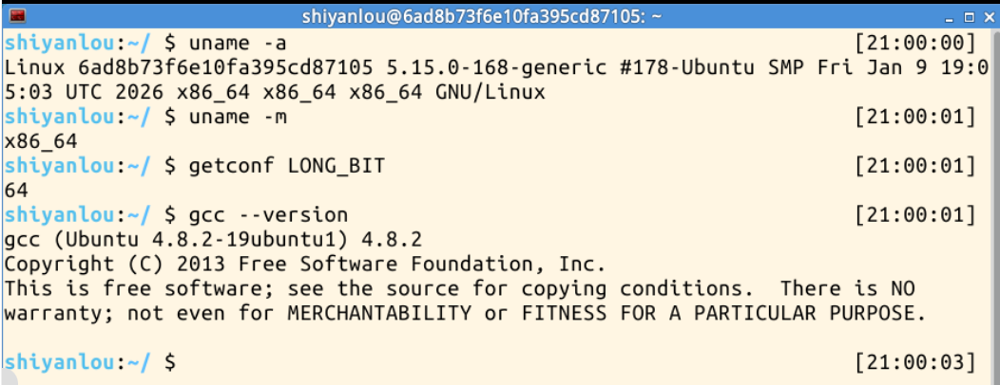

### 4.2 验证32位编译和运行能力

建立独立实验目录：

```bash
mkdir -p ~/linux-week5
cd ~/linux-week5
```

创建 `check32.c`：

```c
#include <stdio.h>
#include <unistd.h>

int main(void)
{
    puts("32-bit build OK");
    return 0;
}
```

编译并运行：

```bash
gcc -m32 -Wall check32.c -o check32
file check32
./check32
```

`file` 显示 `ELF 32-bit LSB executable, Intel 80386`，程序输出 `32-bit build OK`。这说明环境不仅能生成32位程序，而且具备运行本次动态链接程序所需的支持，没有发生32位头文件或链接库缺失问题。

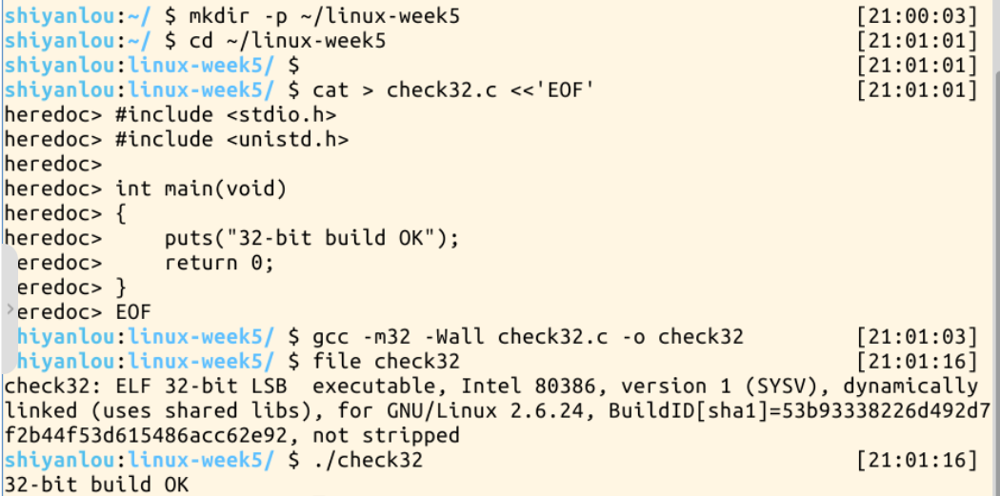

### 4.3 库函数 API 方式

创建 `write_api.c`，源代码如下：

```c
#include <stdio.h>
#include <unistd.h>

int main(void)
{
    const char msg[] = "Hello, Linux!\n";
    ssize_t ret = write(STDOUT_FILENO, msg, sizeof(msg) - 1);

    if (ret == -1) {
        perror("write");
        return 1;
    }

    printf("write returned: %ld\n", (long)ret);
    return 0;
}
```

编译与运行：

```bash
gcc -m32 -O0 -g -Wall -Wextra write_api.c -o write_api
./write_api
```

`-O0` 关闭优化，`-g` 生成调试信息，便于后续对照源代码与汇编。实际输出为：

```text
Hello, Linux!
write returned: 14
```

`STDOUT_FILENO` 的值为1，在本次终端环境中表示标准输出。`msg` 传入字符串首地址；`sizeof(msg)` 为15，减去末尾不需要输出的空字符 `\0` 后为14，换行符 `\n` 包含在这14字节中。

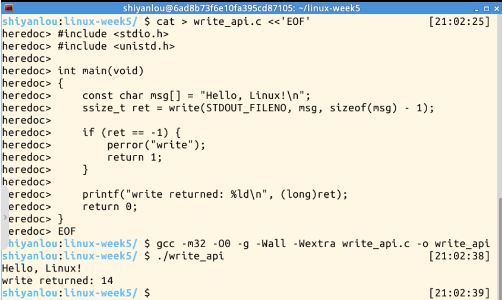

`write()` 成功时返回实际写入字节数，失败时返回 `-1` 并设置 `errno`。成功也可能发生短写，因此生产程序通常还需要考虑部分写入和中断重试；本次小字符串向终端写入的实际结果是完整的14字节。

### 4.4 C 内嵌汇编方式

创建 `write_asm.c`：

```c
#include <stdio.h>

int main(void)
{
    const char msg[] = "Hello, Linux!\n";
    long ret;

    __asm__ volatile (
        "int $0x80"
        : "=a" (ret)
        : "0" (4), "b" (1), "c" (msg), "d" (sizeof(msg) - 1)
        : "memory", "cc"
    );

    if (ret < 0) {
        fprintf(stderr, "raw syscall error: %ld\n", ret);
        return 1;
    }

    printf("asm write returned: %ld\n", ret);
    return 0;
}
```

编译与运行：

```bash
gcc -m32 -O0 -g -Wall -Wextra write_asm.c -o write_asm
./write_asm
```

实际输出为：

```text
Hello, Linux!
asm write returned: 14
```

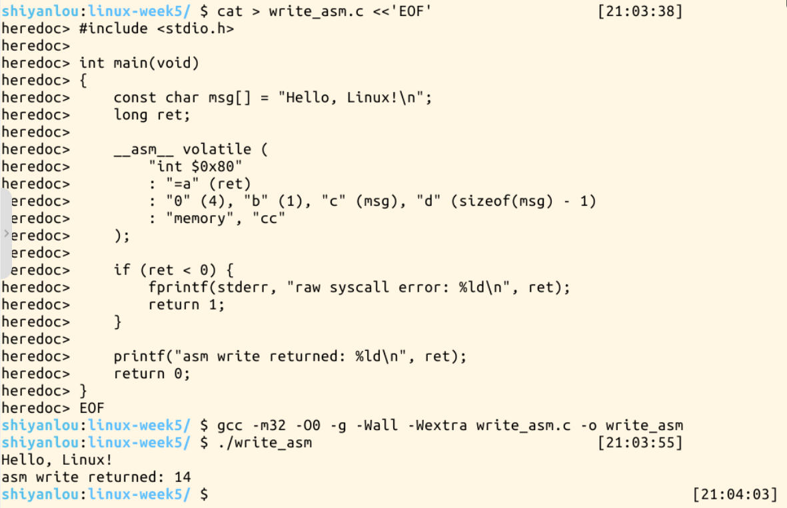

扩展内嵌汇编的冒号依次分隔输出操作数、输入操作数和破坏描述：

| 写法 | 具体作用 |
| :--- | :--- |
| `"=a" (ret)` | 第0个操作数为输出，使用累加器；32位目标下读取 `EAX` 并赋给 `ret` |
| `"0" (4)` | 与第0个输出操作数使用同一位置，进入汇编前把调用号4放入 `EAX` |
| `"b" (1)` | 把文件描述符1放入 `EBX` |
| `"c" (msg)` | 把缓冲区地址放入 `ECX` |
| `"d" (sizeof(msg) - 1)` | 把长度14放入 `EDX` |
| `volatile` | 告诉编译器该汇编有需要保留的副作用，不能仅因输出未使用就随意删除 |
| `"memory"` | 提醒编译器考虑汇编中未由普通内存操作数完整描述的内存访问，避免不恰当的内存优化；它不是CPU硬件内存屏障 |
| `"cc"` | 保守声明条件码可能受到影响 |

寄存器准备指令由 GCC 根据约束生成，所以汇编模板中只需写 `int $0x80`。这不是没有传参，而是使用约束把传参要求交给编译器处理。

本程序直接接收内核返回值，错误表现为负错误码，故用 `ret < 0` 判断。它没有通过 C 库的 `write()` 包装函数，不能假定库函数已替它设置 `errno`。本次没有故意触发错误返回，错误处理差异属于代码与接口机制分析。

### 4.5 反汇编：区分函数传参与系统调用传参

执行：

```bash
objdump -d -M intel write_api | grep -B 10 -A 5 'call.*<write@plt>'
objdump -d -M intel write_asm | grep -B 12 -A 5 'int.*0x80'
```

`-M intel` 采用 Intel 语法，目标操作数在左边，源操作数在右边。库函数版本的关键指令为：

```asm
mov DWORD PTR [esp+0x8],0xe
lea eax,[esp+0x1d]
mov DWORD PTR [esp+0x4],eax
mov DWORD PTR [esp],0x1
call 80483c0 <write@plt>
mov DWORD PTR [esp+0x18],eax
```

在执行 `call` 之前，`[esp]`、`[esp+4]`、`[esp+8]` 分别保存文件描述符、字符串地址和长度。`call` 还会压入返回地址，所以不能把调用前的栈偏移直接当作进入被调函数后的同一偏移。

`write@plt` 是经动态链接调用库函数的入口。这段反汇编显示的是应用程序调用 C 库函数的过程，没有展开库函数内部具体使用的系统调用入口指令。因此，不能凭这个 `call` 就断定库函数内部同样执行了 `int $0x80`；后续 strace 验证的是系统调用名称、参数和结果。

内嵌汇编版本的实际关键指令为：

```asm
080484f8: mov eax,0x4
080484fd: mov ebx,0x1
08048502: lea ecx,[esp+0x1d]
08048506: mov edx,0xe
0804850b: int 0x80
0804850d: mov DWORD PTR [esp+0x18],eax
```

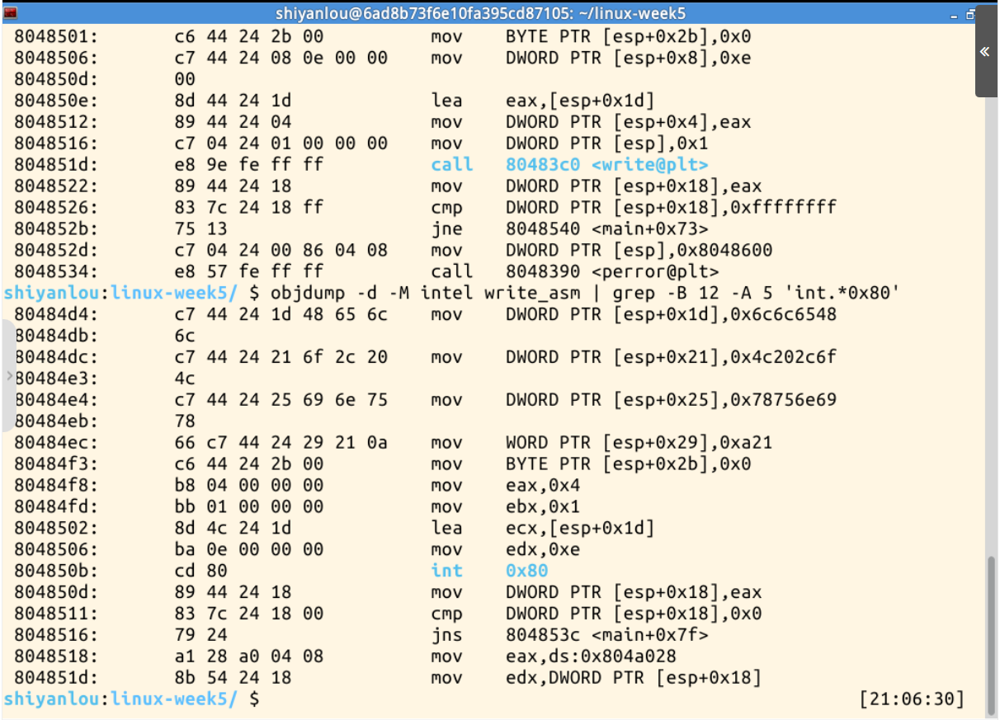

按执行顺序分析：先把4号调用放入 `EAX`，再把输出目标1放入 `EBX`，通过 `lea` 取得字符串地址放入 `ECX`，将14字节放入 `EDX`，最后执行 `int 0x80`。返回后，编译器将 `EAX` 保存到栈上的局部变量 `ret`。

两种写法最终使用同一个内核服务，但当前32位 C 函数调用按栈组织参数，i386 系统调用则按寄存器组织参数。库函数需要衔接这两个层次的调用约定。

### 4.6 GDB：检查调用前的参数与调用后的返回值

启动调试：

```bash
gdb -q ./write_asm
```

在 GDB 中执行：

```gdb
set pagination off
break *0x0804850b
run
info registers eax ebx ecx edx
x/s $ecx
x/i $pc
si
info registers eax
continue
quit
```

断点地址来自本次可执行文件的反汇编，停在 `int $0x80` 执行之前。若更换编译选项、修改代码或重新生成不同布局的可执行文件，需要重新检查地址。

| 观察时机 | 实际结果 | 说明 |
| :--- | :--- | :--- |
| 执行前 `EAX` | `0x4`，十进制4 | 选择 i386 的 `write` |
| 执行前 `EBX` | `0x1`，十进制1 | 写入标准输出 |
| 执行前 `ECX` | `0xffb536dd` | 本次运行的缓冲区地址 |
| `x/s $ecx` | `"Hello, Linux!\n"` | 地址内容与待写字符串一致 |
| 执行前 `EDX` | `0xe`，十进制14 | 待写字节数 |
| `x/i $pc` | `0x804850b <main+78>: int $0x80` | 当前确实停在入口指令处 |
| 执行 `si` 后 | 输出 `Hello, Linux!`，停在 `0x0804850d` | 完成调用并回到下一条用户态指令 |
| 执行后 `EAX` | `0xe`，十进制14 | 实际写入14字节 |
| 继续运行 | `asm write returned: 14`，正常退出 | 返回值被程序正确取得 |

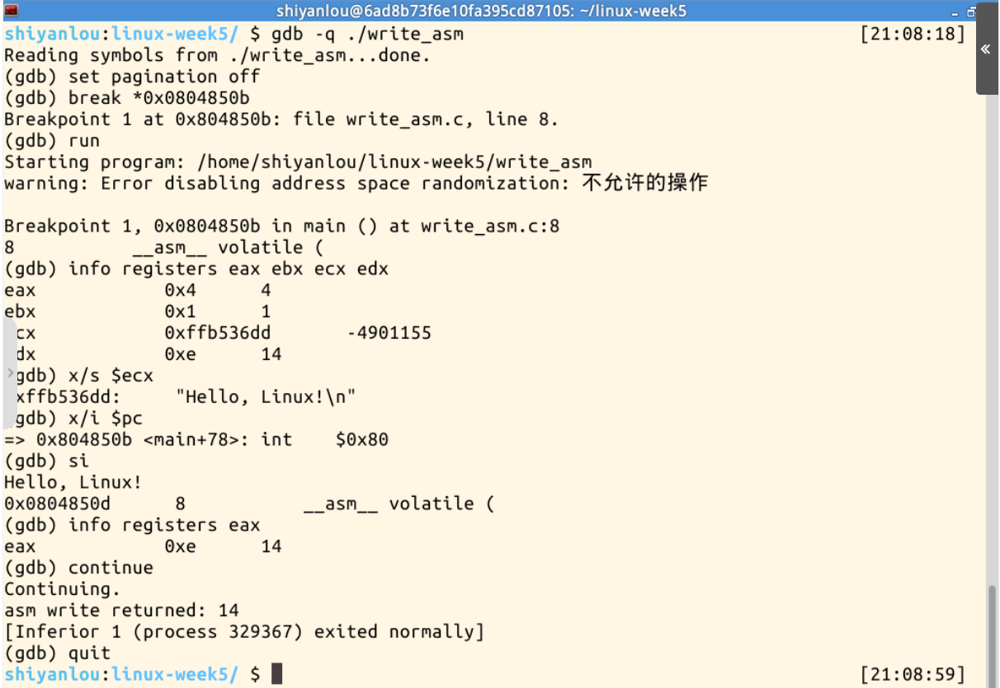

这组结果把源代码约束、机器指令和运行时寄存器联系起来：进入前 `EAX` 表示“请求哪项服务”，返回后同一个寄存器表示“服务执行结果”。

### 4.7 strace：核对两个程序的实际系统调用

初次检查发现工具缺失，经过第05节记录的离线安装后，执行：

```bash
cd ~/linux-week5
strace -e trace=write ./write_api
strace -e trace=write ./write_asm
```

两个程序均出现 `runs in 32 bit mode`，与 `-m32` 编译目标一致。原始截图中的程序输出和跟踪记录共用终端，因此有文字交错。去除交错的程序文字后，关键跟踪记录可整理为：

```text
# write_api
write(1, "Hello, Linux!\n", 14) = 14
write(1, "write returned: 14\n", 19) = 19
+++ exited with 0 +++

# write_asm
write(1, "Hello, Linux!\n", 14) = 14
write(1, "asm write returned: 14\n", 23) = 23
+++ exited with 0 +++
```

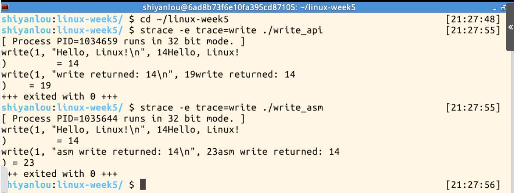

两次第一条 `write` 的文件描述符、字符串、请求字节数和返回值全部一致，说明两种实现都完成了相同的系统调用。第二条 `write` 来自 `printf()` 输出返回值，其中19和23是各自提示文字的字节数，不是第一次写入的返回值发生了变化。两个程序最终退出状态均为0。

---

## 05｜遇到的问题与解决方案

### 5.1 运行环境是64位，题目提供的是32位系统调用表

**问题与判断：** `uname -m` 显示 `x86_64`，`getconf LONG_BIT` 显示64，而题目给出的是 `syscall_32.tbl`。如果沿用64位编译目标，同时直接套用32位调用号和参数规则，容易使汇编分析与实际 ABI 不一致。

**处理与验证：** 先用 `gcc -m32` 编译小程序，再用 `file` 和实际运行确认。验证成功后，两个实验程序统一使用 `-m32`，以 i386 的4号 `write` 及寄存器约定解释。后续 strace 的32位模式提示也与这一选择相符。此处属于环境兼容性预检，实际没有发生编译失败。

### 5.2 GDB 无法关闭地址随机化

**实际现象：** 执行 `run` 时出现：

```text
warning: Error disabling address space randomization: 不允许的操作
```

**原因与处理：** GDB 尝试关闭被调试程序的地址随机化，但当前实验环境不允许该操作。随后程序仍命中断点，寄存器与字符串可读，单步后取得返回值14，并正常退出。因此，本次保留随机化继续调试，没有修改系统安全设置。

以后调试时，可在 `run` 前执行以下命令，让 GDB 不再尝试关闭随机化：

```gdb
set disable-randomization off
```

这是一条后续可用的设置建议，本次截图中没有执行该命令。实际解决依据是警告后各项调试操作均成功，而不是声称已经消除了警告。

### 5.3 ECX 的十进制显示为负数

**实际现象：** GDB 将 `ECX` 同时显示为 `0xffb536dd` 和十进制 `-4901155`，容易误以为传入了非法负数。

**分析与验证：** 同一组32位数据可以按不同类型解释。这里 `ECX` 表示用户地址，不是有符号整数参数。使用 `x/s $ecx` 成功读取到目标字符串，随后系统调用成功写入14字节，说明本次地址有效。应按寄存器用途解释数据，而不是仅凭十进制显示的正负判断参数是否正确。

### 5.4 strace 未安装，在线安装又遇到软件源超时

**实际现象一：** 首次执行两条跟踪命令，终端均提示：

```text
zsh: command not found: strace
```

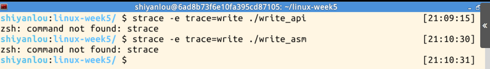

这表示 Shell 没有找到跟踪工具，两个被测程序尚未由 strace 启动，不能把这次操作写成跟踪成功，也不能据此判断程序的系统调用失败。

**实际现象二：** 尝试在线安装：

```bash
sudo apt-get install strace
```

APT 找到了 `strace 4.8-1ubuntu5` 的 amd64 安装包，但访问 `mirrors.aliyuncs.com:80` 时连接超时，安装未能完成。

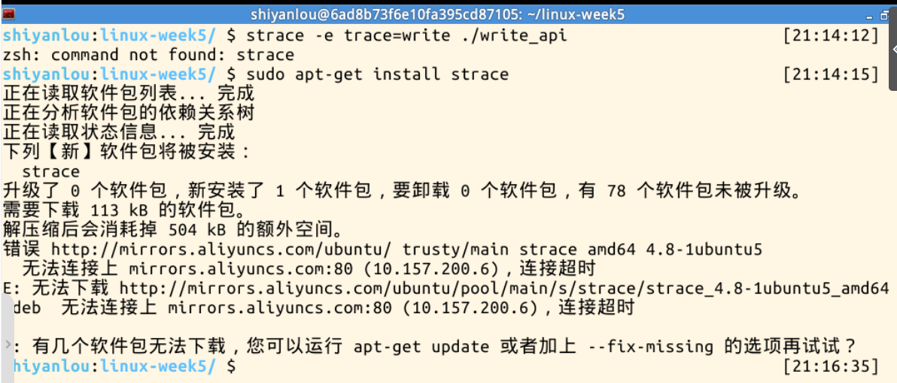

为确认环境与可访问的安装来源，执行：

```bash
cat /etc/os-release
grep -RhE '^[[:space:]]*deb ' /etc/apt/sources.list /etc/apt/sources.list.d
curl -I -L --connect-timeout 10 --max-time 20 https://old-releases.ubuntu.com/ubuntu/dists/trusty/Release
```

结果确认系统为 Ubuntu 14.04.1，配置的软件源使用 `trusty` 系列仓库；归档站的 HTTPS 连接也超时。两次测试说明已尝试的下载路径均不可用，不能据此把原因直接归结为“包不存在”，也没有通过关闭校验或盲目替换系统软件源来安装。

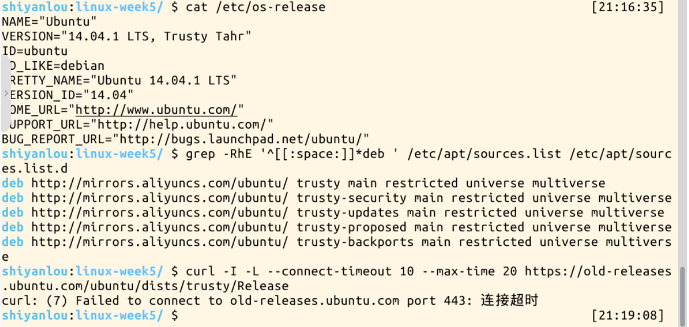

**解决方案：离线安装。** 在本机从 Ubuntu 官方归档站取得与 APT 所列版本一致的 `strace_4.8-1ubuntu5_amd64.deb`。安装包大小为112950字节，约110 KiB，低于实验平台5 MB的上传限制。将其上传至 `/home/shiyanlou/Code` 后执行：

```bash
sudo dpkg -i /home/shiyanlou/Code/strace_4.8-1ubuntu5_amd64.deb
strace -V
```

安装日志显示包解包、配置成功，版本输出为：

```text
strace -- version 4.8
```

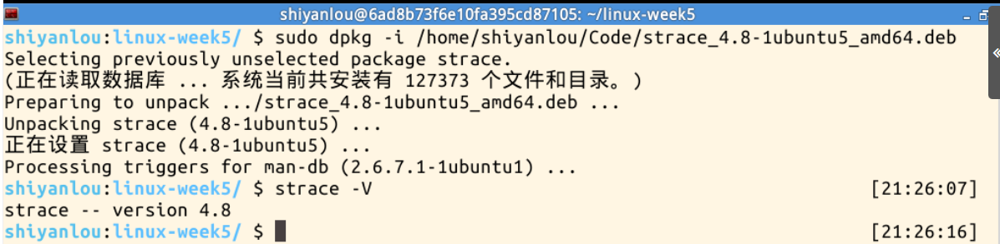

这里安装 amd64 版本，是因为运行 strace 的用户空间为64位；被跟踪程序可以是32位。安装后重新执行两条跟踪命令，实际识别到32位运行模式，并捕获到两个程序的相同 `write` 调用，完成了从发现问题到验证修复的闭环。

### 5.5 strace 输出看起来与整齐的示例不同

**实际现象：** 截图中出现类似 `14Hello, Linux!` 的交错内容，并且每个程序都有两条 `write` 记录。

**原因与处理：** 默认情况下，strace 向标准错误输出跟踪信息，程序向标准输出写入文字；两者都连接当前终端时，显示内容可以交错。因此应按系统调用的参数和返回值识别记录，并区分目标字符串写入与 `printf()` 的提示文字写入。

本次两个目标调用均写入14字节并返回14，额外提示分别写入19和23字节，程序均正常退出，没有把显示交错误判为参数错误。本报告保留原始截图，整理后的文本仅用于辅助阅读。

---

## 06｜本周总结

本周我把进程描述、地址空间与系统调用联系起来理解：内核处理服务请求时，需要结合当前任务的资源和用户内存，系统调用完成后则恢复用户程序继续执行。教材中的进程创建进一步说明了任务身份、资源关系和执行上下文如何建立；创建任务、进入内核和切换任务是不同的概念。

实验中，两种程序输出相同的14字节字符串，返回值也相同。通过反汇编可以区分 C 函数调用的栈传参与系统调用的寄存器传参；通过 GDB 可以验证 `EAX`、`EBX`、`ECX`、`EDX` 的实际内容以及返回值；通过 strace 可以核对两种方式最终调用的服务、参数和结果。这些证据使我能够从接口、指令和运行结果三个角度解释同一次写入操作。

本次遇到的主要问题是 strace 缺失及软件源连接超时。我先依据报错区分工具问题与程序问题，再通过离线安装恢复跟踪能力，并重新运行命令验证。后续分析类似问题时，需要先确认架构、编译目标和实际环境，再按真实输出判断，避免把预期结果直接当作实验事实。
