# 20262819《Linux内核原理与分析》第八周作业

> **本周主题｜Linux 内核如何装载和启动一个可执行程序**
>
> 教材范围：《庖丁解牛Linux操作系统分析》第8章“进程调度与进程切换”。
>
> 实验范围：编译链接与 ELF、exec 库函数、装载时与运行时动态链接、GDB 跟踪 execve，以及静态、动态程序的执行起点对比。

| 基本信息 | 内容 |
| :--- | :--- |
| 姓名 | 刘顺文 |
| 学号 | 20262819 |
| 作业周次 | 第八周 |
| 实验日期 | 2026-11-15 |
| 实验平台 | 蓝桥云课 Linux 实验环境 |
| 用户态实验目标 | x86-64，64位 ELF |
| 内核调试环境 | 课程预置 Linux 3.18.6 目录中的内核与符号文件，32位 x86 |
| 主要工具 | GCC、readelf、nm、ldd、QEMU、GDB、cpio、gzip、Python 3 |
| 练习目录 | `~/week8` |
| 内核调试目录 | `~/LinuxKernel` |
| 本周镜像 | `rootfs-week8.img` |

---

## 01｜本周学习目标与完成情况

本周从源程序的构建过程出发，分析 ELF 文件如何描述程序的入口和装载段，再通过 exec 库函数、共享库和内核调试，把“文件中的程序”与“CPU 正在执行的程序”联系起来。实验重点是区分 ELF 入口、动态链接器入口和 main 函数，并验证成功的 execve 为什么不会回到原程序继续执行。

| 学习任务 | 完成情况 | 本次记录 |
| :--- | :---: | :--- |
| 教材第8章学习与整理 | 已完成 | 理解调度时机、调度与切换的区别，以及执行现场的保存和恢复 |
| 第八周云班课视频学习 | 已完成 | 结合本次给定实验任务整理程序装载与执行机制 |
| 分阶段编译并检查 ELF | 已完成 | 生成 `.i`、`.s`、`.o` 和可执行文件，比较静态、动态版本 |
| 使用 exec 库函数加载程序 | 已完成 | 验证 execl 成功不返回、失败执行错误处理 |
| 装载时动态链接 | 已完成 | 构建 `libcalc.so`，验证 `NEEDED`、`RPATH` 和依赖路径 |
| 运行时动态链接 | 已完成 | 使用 dlopen、dlsym、dlclose，在 main 中加载共享库 |
| 构造32位内核调试目标 | 已完成 | 编译静态、动态目标，准备解释器、libc 和独立镜像 |
| 跟踪 execve 内核装载链 | 已完成 | 命中 SyS_execve、load_elf_binary 和 start_thread |
| 验证静态程序执行起点 | 已完成 | 单步 iret 后进入自身 `_start`，随后到达 main |
| 验证动态程序执行起点 | 已完成 | 核对 AT_BASE、AT_ENTRY，依次捕获链接器入口、主程序入口和 main |
| 验证进程身份与退出 | 已完成 | 替换前后 PID 一致，两种目标均以状态0退出并被父进程回收 |

教材第8章的调度与切换，以及本次给定的可执行程序装载实验，分别组织学习记录。两者通过“任务继续执行所需的现场”建立联系，不把本次 execve 实验写成已经完成了 schedule 函数的单步调试。

---

## 02｜教材阅读与理解

### 2.1 进程调度解决什么问题

进程调度决定当前 CPU 接下来运行哪个可运行任务。需要区分正在运行、已经具备运行条件，以及等待某个事件的任务：处于可运行状态不表示此刻一定占用 CPU，阻塞任务则通常要等到条件满足并被唤醒后才能重新参与选择。

以本次课程内核所处的版本背景理解，普通任务主要采用 CFS 公平调度机制，通过加权的虚拟运行时间衡量已经获得的 CPU 服务；实时任务则有不同的调度策略。优先级、权重和调度类影响任务选择，不能把所有任务简单理解为采用完全相同的固定时间片轮转。

### 2.2 调度发生的时机

任务可能因为等待 I/O、等待子进程或等待资源而主动进入睡眠，让其他任务获得 CPU。调度也可能由抢占需求引起：内核先记录需要重新调度的状态，再在允许调度的位置执行相关处理。

系统调用和中断的返回路径都可能检查待处理工作，但“进入内核”“发生中断”“执行调度函数”和“实际切换任务”不是同一件事。即使执行了调度选择，最终选择的任务也可能仍是当前任务；只有观察到前后任务不同并完成上下文切换，才能确认发生了实际任务切换。

本次测试程序的父进程使用 waitpid 等待子进程。若子进程尚未结束，等待操作可以使父进程睡眠，随后在子进程退出时获得唤醒机会。这说明进程控制接口与调度机制相互配合，但本次没有逐条跟踪这段等待过程中的调度实现。

### 2.3 上下文切换需要保存什么

任务切换需要保存原任务的执行状态，并恢复下一任务的状态。其中包括继续执行所需的寄存器、内核栈及与地址空间有关的上下文。以课程版本的实现脉络理解，调度核心在选择下一任务后，通过 context_switch 组织地址空间和体系结构状态的切换，再由 switch_to 等代码完成关键寄存器与栈的切换。

切换内核栈之后，CPU 使用的是另一个任务先前保存的调用现场。因此，从代码形式上看到的“函数返回”，可能是在恢复另一个任务此前暂停的位置。正确理解这一点，需要同时关注任务身份、栈和保存的执行位置，而不只看某个函数名称。

### 2.4 调度切换、权限切换与 execve 的区别

| 机制 | 主要变化 | 是否一定改变任务身份 |
| :--- | :--- | :--- |
| 用户态进入内核态 | 执行权限和所使用的现场发生变化 | 否 |
| 内核返回用户态 | 恢复用户寄存器和用户栈，继续用户代码 | 否 |
| 任务上下文切换 | 当前 CPU 改为执行另一个任务的现场 | 是，指实际切换到不同任务时 |
| 本次单线程子进程执行 execve | 替换用户程序映像，准备新的用户入口与用户栈 | PID 保持不变 |

本次实验的 start_thread 函数用于设置当前任务的新用户态现场，其名称不表示又创建了一个线程。成功的 execve 使原调用位置失去继续执行的意义，而返回用户态时恢复的是新程序的入口和新栈。这与普通系统调用处理结束后回到原程序不同。

---

## 03｜编译链接与 ELF 文件分析

### 3.1 分阶段构建程序

在蓝桥云课终端创建本周练习目录：

```bash
mkdir -p ~/week8
cd ~/week8
```

编写 `hello.c`：

```c
#include <stdio.h>

int main(void)
{
    printf("Hello, Linux! Student ID: 20262819\n");
    return 0;
}
```

分四个阶段构建：

```bash
gcc -E hello.c -o hello.i
gcc -S -O0 hello.i -o hello.s
gcc -c hello.s -o hello.o
gcc hello.o -o hello
./hello
ls -lh hello.c hello.i hello.s hello.o hello
file hello.o hello
```

| 阶段 | 产物 | 主要作用 |
| :--- | :--- | :--- |
| 预处理 | `hello.i` | 展开头文件、宏和条件编译内容 |
| 编译 | `hello.s` | 把预处理后的 C 程序转换为汇编 |
| 汇编 | `hello.o` | 生成机器代码、符号和重定位等信息 |
| 链接 | `hello` | 组合目标文件及所需的启动代码、库等，形成可执行文件 |

程序实际输出 `Hello, Linux! Student ID: 20262819`。file 显示 `hello.o` 为64位 x86-64 ELF 可重定位目标文件，`hello` 为64位动态链接可执行文件。

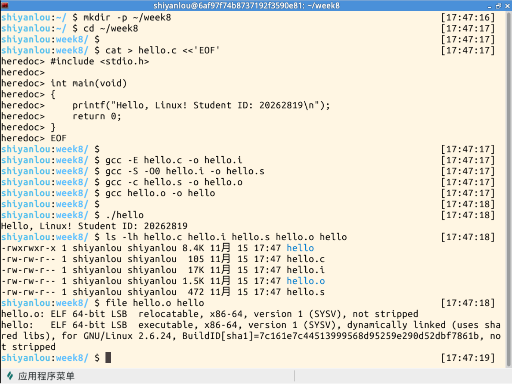

### 3.2 ELF 的节、段和程序入口

使用以下命令检查 ELF：

```bash
LC_ALL=C readelf -h hello
LC_ALL=C readelf -lW hello
nm -n hello | grep -E ' (_start|main)$'
```

ELF 的节视图便于组织链接相关信息，程序头表中的段视图则描述装载所需的映射。实际输出中有两个 LOAD 段，分别具有读、执行权限和读、写权限；INTERP 指定解释器 `/lib64/ld-linux-x86-64.so.2`。

第二个 LOAD 段的文件大小为 `0x230`，内存大小为 `0x238`。内存中比文件多出的部分需要按装载规则补零，与其中的 `.bss` 等内容有关。不能把程序装载简单理解为按文件长度原样复制全部字节。

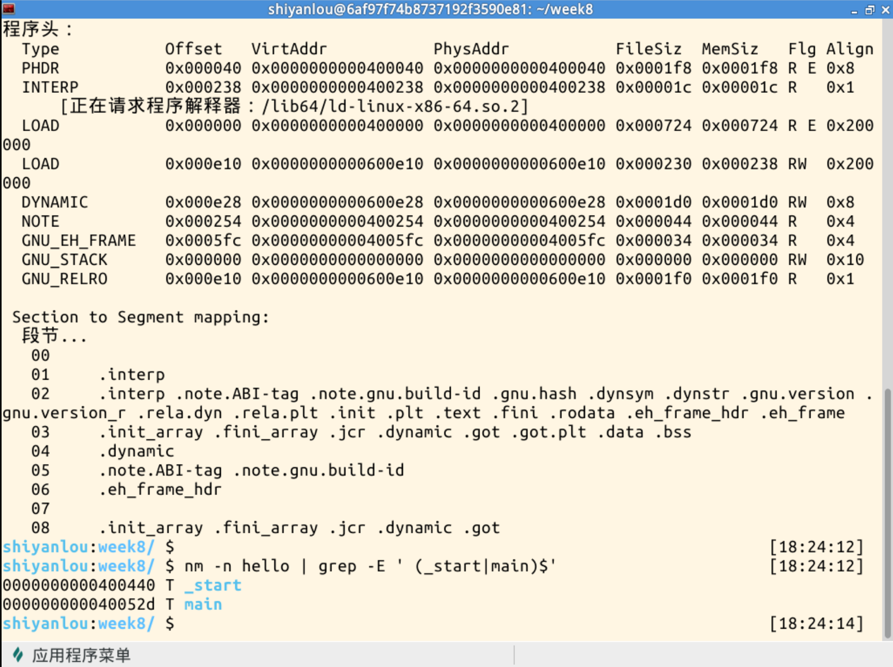

### 3.3 对比静态、动态版本

```bash
gcc -static hello.o -o hello_static
./hello_static
file hello hello_static
ls -lh hello hello_static

for p in hello hello_static
do
    echo "===== $p ====="
    LC_ALL=C readelf -h "$p" | grep -E 'Type:|Entry point'
    LC_ALL=C readelf -lW "$p" | grep -A 1 INTERP
    nm -n "$p" | grep -E ' (_start|main)$'
done
```

| 项目 | `hello` | `hello_static` |
| :--- | :--- | :--- |
| 架构 | 64位 x86-64 | 64位 x86-64 |
| 链接方式 | 动态链接 | 静态链接 |
| 文件大小 | 约8.4K | 约857K |
| ELF 类型 | EXEC | EXEC |
| ELF 入口与 `_start` | `0x400440` | `0x400f4e` |
| main 地址 | `0x40052d` | `0x40105e` |
| INTERP | 有 | 无 |

本次两个文件的 ELF 入口都等于各自的 `_start`，而不等于 main。静态版本包含所需的库代码，因此文件显著增大；动态版本依赖外部共享对象。对于带解释器的动态程序，主文件记录的入口与内核首次返回的用户态地址还需要进一步区分。

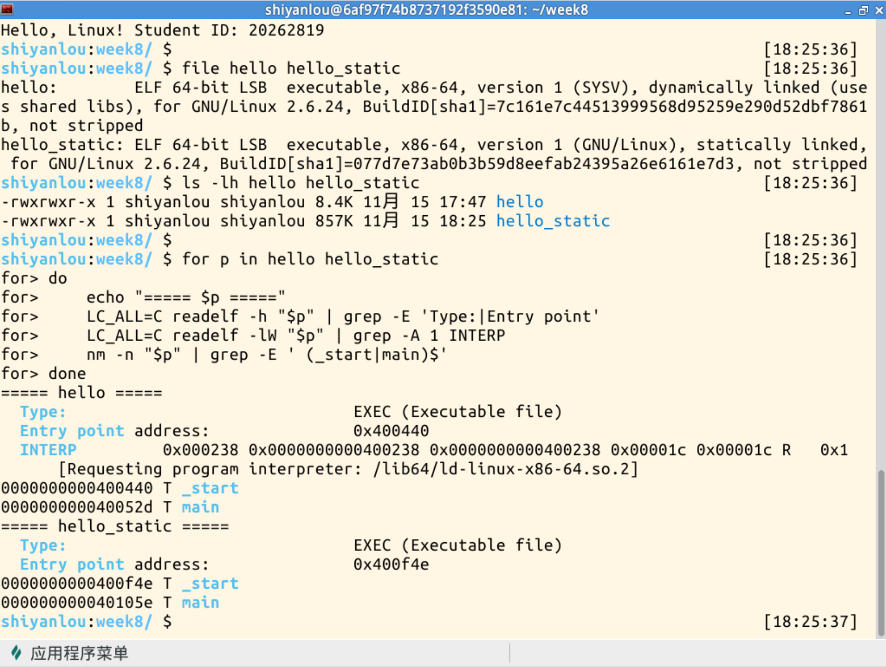

file 输出中的 `for GNU/Linux 2.6.24` 是文件的 ABI 相关标记，不能据此认定宿主系统或被调试内核正在运行该版本。

---

## 04｜使用 exec 库函数加载程序

### 4.1 编写加载器

在 `~/week8` 中编写 `exec_demo.c`：

```c
#include <stdio.h>
#include <unistd.h>

int main(int argc, char *argv[])
{
    const char *path = argc > 1 ? argv[1] : "./hello";

    printf("Before execl: PID=%ld, target=%s\n",
           (long)getpid(), path);
    fflush(stdout);

    execl(path, path, (char *)NULL);

    perror("execl");
    puts("execl returned: this line runs only on failure.");
    return 1;
}
```

```bash
gcc -Wall -Wextra -O0 -g exec_demo.c -o exec_demo
./exec_demo ./hello
echo "exit status=$?"
./exec_demo ./not_exist
echo "exit status=$?"
```

调用前使用 fflush 刷新标准输出，避免原程序尚未刷新的用户态缓冲内容在映像替换时丢失。execl 的列表参数以空指针结束；第二个 path 用作新程序的 argv[0]。

### 4.2 成功与失败的实际结果

加载 hello 成功时，输出原加载器的提示后立即出现 hello 的学号内容，没有执行 execl 后面的错误处理，最终退出状态为0。

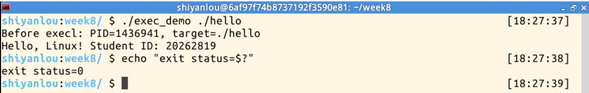

目标不存在时，输出 `No such file or directory`，随后出现失败分支提示，最终退出状态为1。这里的1来自加载器的 `return 1`；execl 自身失败时返回的是 -1。

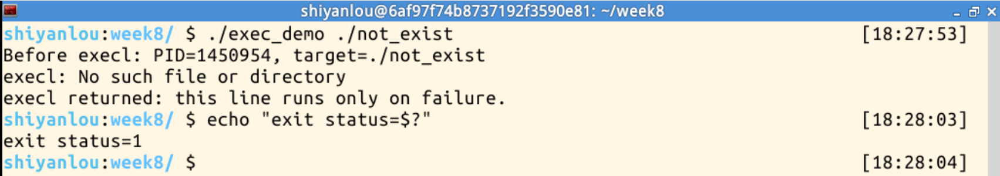

exec 函数族提供不同的参数组织和路径查找方式，最终通过 execve 请求内核执行程序替换。本次实际使用了 execl，以及后续内核触发器中的 execve。成功的 execve 不创建一个新的进程供原程序等待，而是替换调用进程的用户程序映像；父子进程结构由另外的 fork 建立。

---

## 05｜动态链接库的两种使用方式

### 5.1 创建共享库

编写 `calc.c`：

```c
int add(int a, int b)
{
    return a + b;
}
```

```bash
gcc -Wall -Wextra -fPIC -shared calc.c -o libcalc.so
```

`-fPIC` 生成位置无关代码，`-shared` 构建共享对象。本次库只提供一个简单加法函数，以便把观察重点放在链接和装载方式上。

### 5.2 装载时动态链接

编写 `link_load.c`：

```c
#include <stdio.h>

extern int add(int a, int b);

int main(void)
{
    printf("Load-time linking: 2026 + 2819 = %d\n",
           add(2026, 2819));
    return 0;
}
```

```bash
gcc -Wall -Wextra link_load.c -L. -lcalc \
    -Wl,-rpath,'$ORIGIN' -o link_load
./link_load
LC_ALL=C readelf -d link_load | grep -E 'NEEDED|RPATH|RUNPATH'
ldd ./link_load
```

`-L.` 指定链接时的库搜索目录，`-lcalc` 引用该库；`$ORIGIN` 由动态链接器解释为可执行文件所在目录，因此使用单引号保留其字面内容。

程序实际输出4845。动态段中有 `NEEDED: libcalc.so` 和 `NEEDED: libc.so.6`，搜索路径为 `RPATH: $ORIGIN`。ldd 把 libcalc.so 解析到 `/home/shiyanlou/week8/./libcalc.so`。

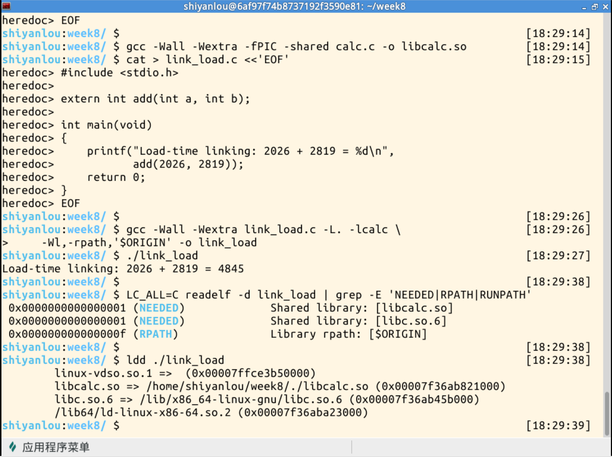

这种方式在构建可执行文件时记录共享库依赖，由动态链接器在程序启动过程中加载依赖。库的自动装载与函数符号的绑定时机需要区分：在允许延迟绑定的配置下，部分函数引用可以到第一次调用时才解析，不能由“装载时动态链接”推断所有符号一定已立即绑定。

### 5.3 运行时动态链接

编写 `link_runtime.c`：

```c
#include <stdio.h>
#include <dlfcn.h>

int main(void)
{
    void *handle;
    int (*add_fn)(int, int);
    const char *error;

    puts("Entered main; loading libcalc.so now.");

    handle = dlopen("./libcalc.so", RTLD_NOW);
    if (handle == NULL) {
        fprintf(stderr, "dlopen: %s\n", dlerror());
        return 1;
    }

    dlerror();
    add_fn = (int (*)(int, int))dlsym(handle, "add");
    error = dlerror();
    if (error != NULL) {
        fprintf(stderr, "dlsym: %s\n", error);
        dlclose(handle);
        return 1;
    }

    printf("Runtime linking: 2026 + 2819 = %d\n",
           add_fn(2026, 2819));

    dlclose(handle);
    return 0;
}
```

```bash
gcc -Wall -Wextra link_runtime.c -o link_runtime -ldl
./link_runtime
LC_ALL=C readelf -d link_runtime | grep NEEDED
ldd ./link_runtime
```

dlopen 打开共享库并取得句柄，dlsym 查询函数地址，dlclose 释放引用。`RTLD_NOW` 要求 dlopen 返回前完成所需的未定义符号解析。查询前清理 dlerror，再通过新的错误信息判断 dlsym 是否失败。

实际先输出已经进入 main，随后计算得到4845。NEEDED 和 ldd 输出中有 libdl、libc 等，但没有 libcalc.so，说明它没有被记录为启动时的依赖，而是由 main 中的 dlopen 主动加载。

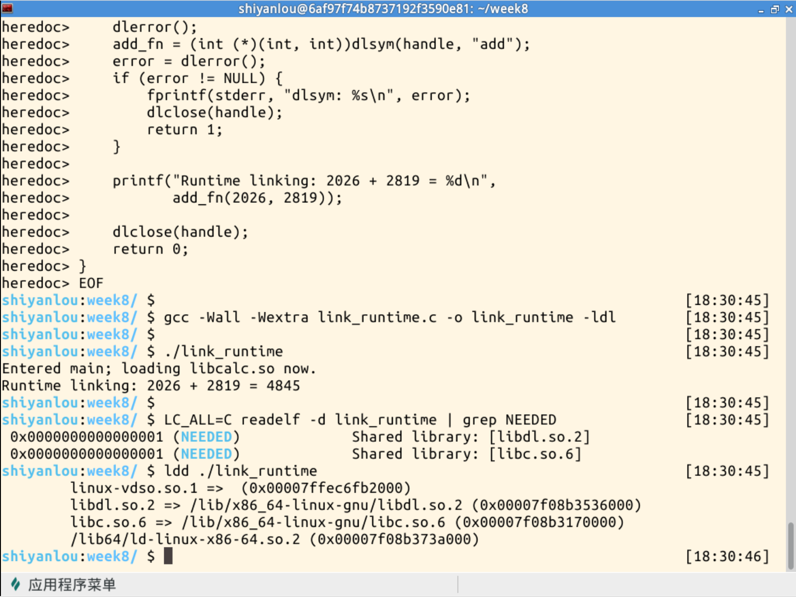

| 对比项目 | 装载时动态链接 | 运行时动态链接 |
| :--- | :--- | :--- |
| 本次程序 | `link_load` | `link_runtime` |
| 构建时是否使用 `-lcalc` | 是 | 否 |
| libcalc.so 是否出现在 NEEDED 中 | 是 | 否 |
| 加载触发点 | 程序启动时按依赖加载 | 执行到 dlopen |
| 调用方式 | 直接引用 add | 通过 dlsym 获得的函数指针 |
| 本次计算结果 | 4845 | 4845 |

---

## 06｜准备32位内核调试程序与镜像

### 6.1 编译两个目标程序

前面的用户态练习采用64位程序。后续使用课程预置的32位内核，因此重新构建目标，不能直接把此前64位 hello 放入镜像使用。

在 `~/week8` 编写 `target.c`：

```c
#include <stdio.h>
#include <unistd.h>

int main(int argc, char *argv[])
{
    printf("New program: Student ID=20262819\n");
    printf("PID=%ld, argc=%d, argv[0]=%s\n",
           (long)getpid(), argc, argv[0]);
    return 0;
}
```

```bash
gcc -m32 -static -O0 -g target.c -o target_static
gcc -m32 -O0 -g target.c -o target_dynamic
file target_static target_dynamic

for p in target_static target_dynamic
do
    echo "===== $p ====="
    LC_ALL=C readelf -h "$p" | grep 'Entry point'
    LC_ALL=C readelf -lW "$p" | grep -A 1 INTERP
    nm -n "$p" | grep -E ' (_start|main)$'
done

ldd ./target_dynamic
```

| 项目 | `target_static` | `target_dynamic` |
| :--- | :--- | :--- |
| 架构 | 32位 Intel 80386 | 32位 Intel 80386 |
| 链接方式 | 静态 | 动态 |
| ELF 入口 / `_start` | `0x08048d0a` | `0x08048380` |
| main | `0x08048e24` | `0x0804847d` |
| 动态解释器 | 无 | `/lib/ld-linux.so.2` |
| 宿主环境中解析出的 libc | 不需要外置 libc | `/lib32/libc.so.6` |

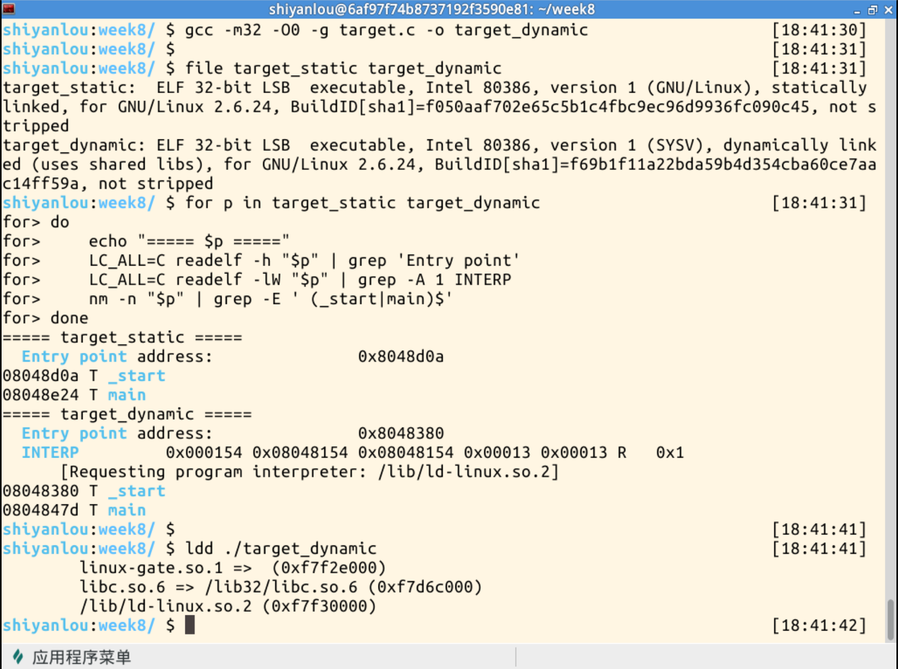

ldd 中的 linux-gate.so.1 是内核提供的虚拟映射，不需要作为磁盘文件复制进镜像。

### 6.2 编写 execve 测试命令

为避免用新程序替换 MenuOS 的 PID 1 后直接退出，命令处理函数先 fork，由子进程执行 execve，父进程使用 waitpid 等待并回收子进程。在 `~/LinuxKernel/menu/week8_exec.c` 中编写：

```c
#include <stdio.h>
#include <unistd.h>
#include <sys/types.h>
#include <sys/wait.h>
#include <errno.h>

static int RunTarget(const char *path)
{
    pid_t pid, waited;
    int status;

    fflush(NULL);
    pid = fork();
    if (pid < 0) {
        perror("fork");
        return 1;
    }

    if (pid == 0) {
        char *args[] = {(char *)path, "week8", NULL};
        char *env[] = {"PATH=/", NULL};

        printf("Before execve: PID=%ld, target=%s\n",
               (long)getpid(), path);
        fflush(stdout);

        execve(path, args, env);
        perror("execve");
        _exit(127);
    }

    do {
        waited = waitpid(pid, &status, 0);
    } while (waited < 0 && errno == EINTR);

    if (waited < 0) {
        perror("waitpid");
        return 1;
    }

    if (WIFEXITED(status))
        printf("Parent: child=%ld, exit=%d\n",
               (long)pid, WEXITSTATUS(status));
    else if (WIFSIGNALED(status))
        printf("Parent: child=%ld, signal=%d\n",
               (long)pid, WTERMSIG(status));

    return 0;
}

int ExecStatic(int argc, char *argv[])
{
    (void)argc;
    (void)argv;
    return RunTarget("/target_static");
}

int ExecDynamic(int argc, char *argv[])
{
    (void)argc;
    (void)argv;
    return RunTarget("/target_dynamic");
}
```

### 6.3 注册命令并构建 MenuOS

原 Makefile 的 rootfs 目标会在构建、打包后直接启动 QEMU。本次保留原 test.c，生成专用的 test-week8.c，再单独编译、打包。

最初使用 pathlib 的 read_text 读取文件时失败，随后采用以下基础文件操作生成副本：

```bash
cd ~/LinuxKernel/menu
python3 - <<'PY'
with open("test.c", "rb") as f:
    source = f.read()

marker = b"ExecuteMenu();"
assert source.count(marker) == 1, "Stop: check ExecuteMenu location"

declarations = b"""int ExecStatic(int, char **);
int ExecDynamic(int, char **);
"""

commands = b"""MenuConfig("execstatic", "exec static target", ExecStatic);
    MenuConfig("execdynamic", "exec dynamic target", ExecDynamic);
    ExecuteMenu();"""

result = declarations + source.replace(marker, commands)
with open("test-week8.c", "wb") as f:
    f.write(result)
print("Created test-week8.c")
PY

gcc -m32 -static -g -O0 -o init-week8 \
    linktable.c menu.c test-week8.c week8_exec.c -lpthread
file init-week8
grep -nE 'execstatic|execdynamic' test-week8.c
```

实际编译结果为32位静态 ELF，两个命令分别注册在 test-week8.c 第134、135行。`-O0` 仅作用于本次构建的用户程序，没有改变课程预置内核的优化设置。

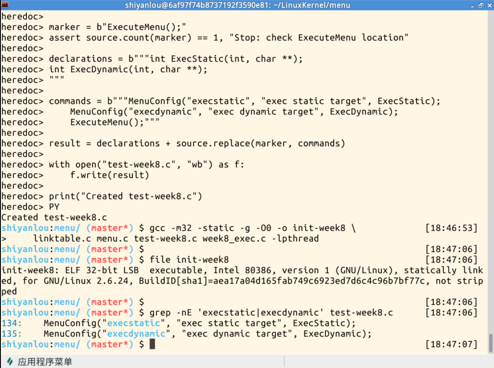

### 6.4 打包程序与动态依赖

```bash
cd ~/LinuxKernel
mkdir -p rootfs-week8/lib
cp menu/init-week8 rootfs-week8/init
cp ~/week8/target_static rootfs-week8/target_static
cp ~/week8/target_dynamic rootfs-week8/target_dynamic
cp -L /lib/ld-linux.so.2 rootfs-week8/lib/ld-linux.so.2
cp -L /lib32/libc.so.6 rootfs-week8/lib/libc.so.6

file rootfs-week8/init rootfs-week8/target_static \
     rootfs-week8/target_dynamic \
     rootfs-week8/lib/ld-linux.so.2 rootfs-week8/lib/libc.so.6

cd ~/LinuxKernel/rootfs-week8
find . -print | cpio -o -H newc | gzip -9 > ../rootfs-week8.img
cd ~/LinuxKernel
gzip -dc rootfs-week8.img | cpio -it
ls -lh rootfs-week8.img
```

cp 使用 -L 复制链接指向的实际文件，避免镜像中留下目标不存在的符号链接。解释器放到 ELF 指定的 `/lib/ld-linux.so.2`；libc 放到镜像的默认库搜索目录 `/lib/libc.so.6`。

实际镜像包含 init、两个目标程序、解释器和 libc，以及对应目录，cpio 统计7002块，压缩镜像约1.5 MB。

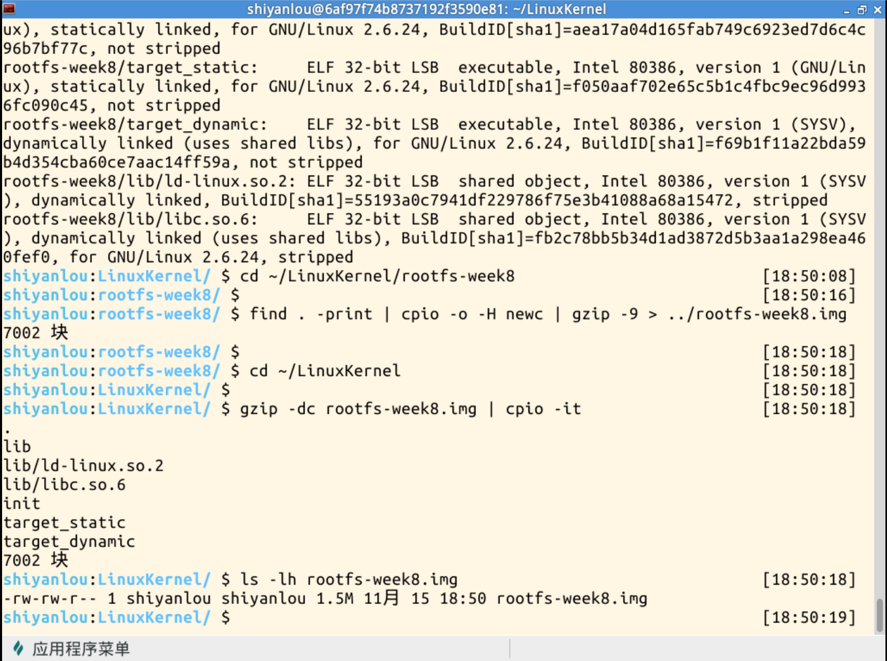

---

## 07｜GDB 跟踪静态程序的装载与执行

### 7.1 启动 QEMU 并连接内核 GDB

终端 A：

```bash
cd ~/LinuxKernel
qemu -kernel linux-3.18.6/arch/x86/boot/bzImage \
     -initrd rootfs-week8.img -s -S
```

终端 B：

```bash
cd ~/LinuxKernel
gdb -q linux-3.18.6/vmlinux
```

在 GDB 中执行：

```gdb
set pagination off
directory linux-3.18.6
target remote localhost:1234
tbreak start_kernel
continue
info registers eip esp cs
```

首次连接时位于 BIOS 地址 `0x0000fff0`，随后命中 start_kernel，EIP 为 `0xc1a2f7c5`，CS 为 `0x60`。CS 的低两位为0，表明此时处于内核态。先运行到内核已经装载的位置，再分析内核代码，避免把启动早期未装载的内容误当成函数指令。

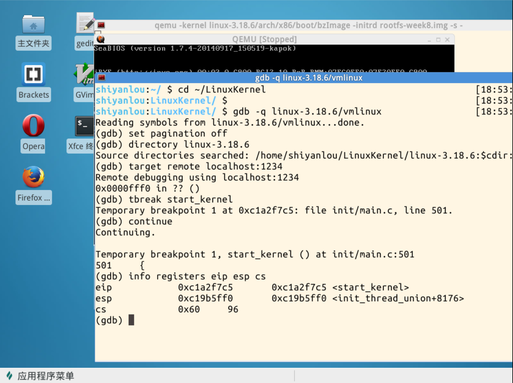

### 7.2 先验证两个命令可正常运行

在 GDB 中 continue，等待 MenuOS 启动，再在 QEMU 中依次运行 execstatic、execdynamic。

| 预运行目标 | execve 前 PID | 新程序 PID | 退出状态 |
| :--- | :---: | :---: | :---: |
| 静态目标 | 866 | 866 | 0 |
| 动态目标 | 867 | 867 | 0 |

两次都输出了学号、argc=2 和对应的 argv[0]。动态目标的正常执行也验证了解释器和 libc 可以在镜像中使用。

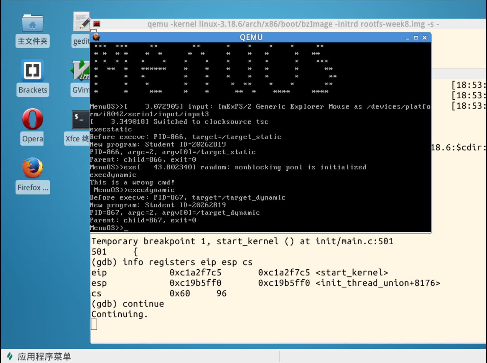

### 7.3 捕获 sys_execve 并核对参数

在 GDB 中按 Ctrl+C 暂停，设置断点：

```gdb
break sys_execve
continue
```

在 QEMU 中再次执行 execstatic，命中 SyS_execve：

```gdb
info args
bt 5
info registers eip esp cs
```

本次断点地址为 `0xc11314a0`，实际显示的源码位置为 `fs/exec.c:1604`，CS 为 `0x60`。sys_execve、SyS_execve、SYSC_execve 等名字与系统调用定义宏及其生成的入口有关，分析时结合实际地址和回溯判断。

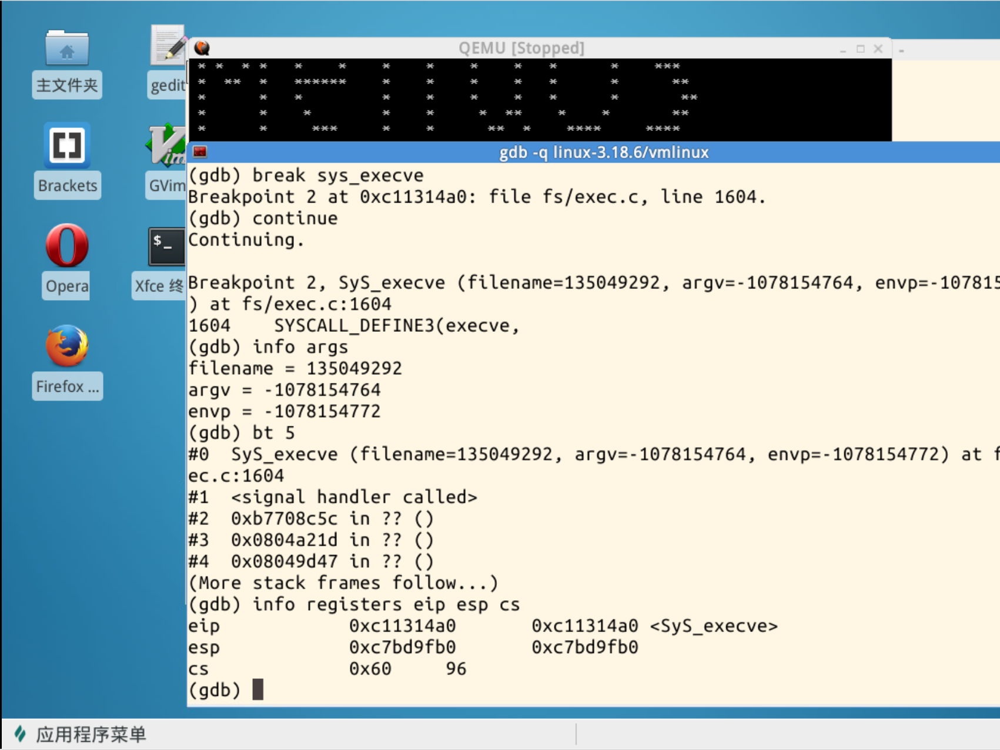

参数显示为整数时，转成对应的指针读取：

```gdb
set $exec_name = (char *)filename
set $exec_argv = (char **)argv
set $exec_envp = (char **)envp
x/s $exec_name
x/3wx $exec_argv
x/s $exec_argv[0]
x/s $exec_argv[1]
x/s $exec_envp[0]
tbreak load_elf_binary
continue
info args
bt 6
```

截图中可读到 `/target_static`、`week8` 和 `PATH=/`，并实际命中 load_elf_binary。回溯确认装载链为：

```text
execve 系统调用实现
    → do_execve
    → do_execve_common
    → exec_binprm
    → search_binary_handler
    → load_elf_binary
```

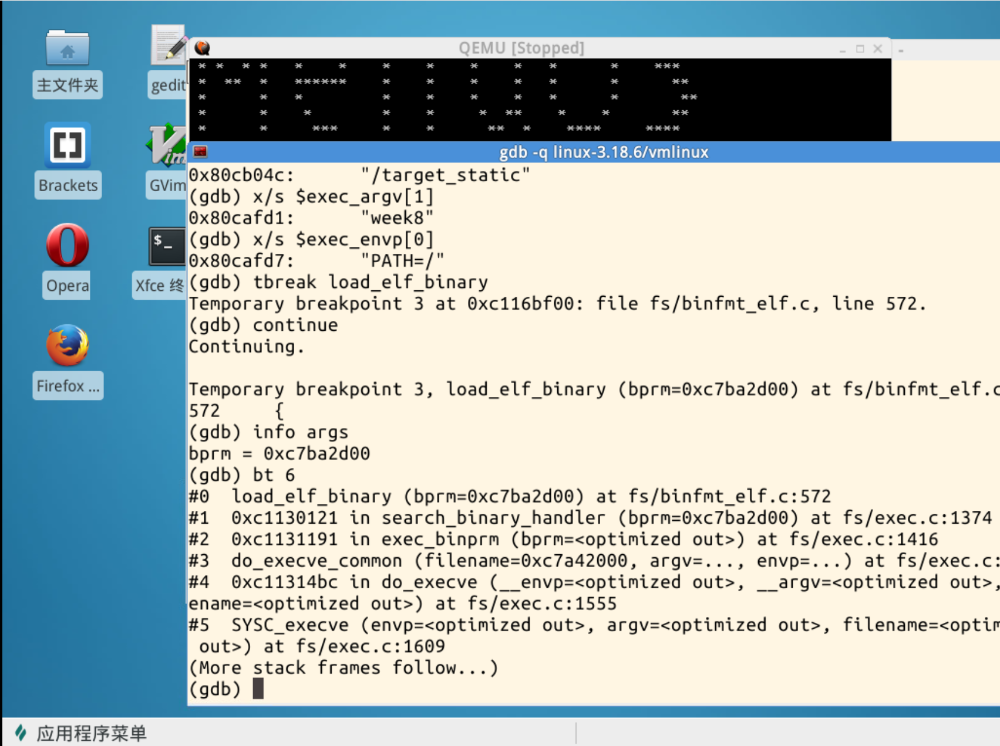

### 7.4 在内核中读取 ELF 头

在 load_elf_binary 入口保存本次装载参数，读取文件头：

```gdb
set $static_bprm = bprm
x/s $static_bprm->filename
p $static_bprm->argc
p $static_bprm->envc
x/4bx $static_bprm->buf
set $static_ehdr = (struct elf32_hdr *)$static_bprm->buf
set $static_entry = $static_ehdr->e_entry
p/x $static_entry
tbreak start_thread
continue
info args
x/i $eip
```

实际 ELF 魔数为 `7f 45 4c 46`，读出的入口为 `0x08048d0a`，与文件工具查询结果一致。随后命中 start_thread，regs 指向 `0xc7bd9fb4`，new_ip 为新程序入口，new_sp 为新的用户栈。

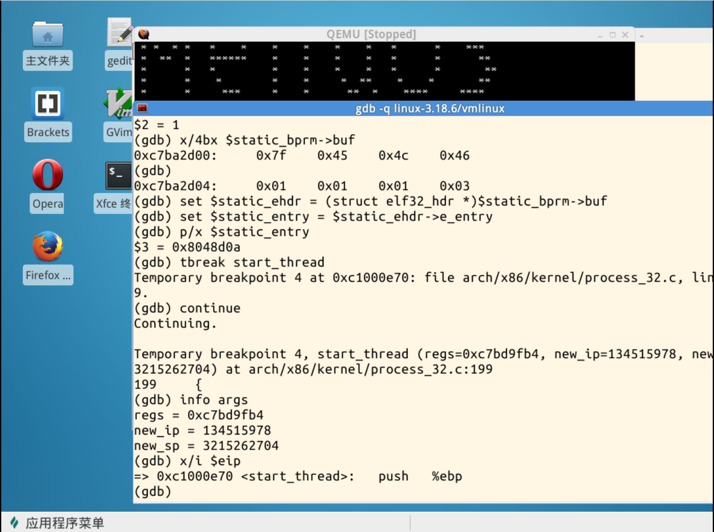

### 7.5 验证保存的用户现场被修改

在确认当前确实位于 start_thread 第一条指令后，保存参数和原现场，再执行函数：

```gdb
set $static_regs = regs
set $static_new_ip = new_ip
set $static_new_sp = new_sp
set $static_old_ip = $static_regs->ip
set $static_old_sp = $static_regs->sp
p/x $static_old_ip
p/x $static_old_sp
p/x $static_new_ip
p/x $static_new_sp
p $static_new_ip == $static_entry
finish
p/x $static_regs->ip
p/x $static_regs->sp
p/x $static_regs->cs
p/x $static_regs->ss
p $static_regs->ip == $static_new_ip
p $static_regs->sp == $static_new_sp
info registers eip cs
```

后续截图显示，执行位置已经回到 search_binary_handler，load_elf_binary 返回0。此时保存的 IP 为 `0x08048d0a`，SP 为 `0xbfa503f0`，CS/SS 为 `0x73/0x7b`，与准备参数的比较均为1；当前 CPU 的 CS 仍为 `0x60`。

这说明“修改保存的用户态现场”与“CPU 已经进入用户态”是两个阶段。即使装载函数已经返回，CPU 仍然要完成内核返回路径才能恢复新用户现场。

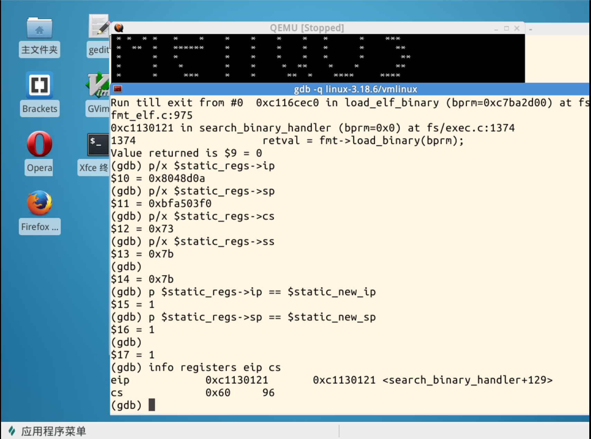

### 7.6 捕获同一次 iret 并单步返回

使用返回栈地址与目标 IP 两个条件捕获本次返回：

```gdb
set $static_iret_sp = (unsigned int)&$static_regs->ip
tbreak *irq_return if $esp == $static_iret_sp && *(unsigned int *)$esp == $static_new_ip
continue
x/i $eip
x/5wx $esp
info registers eip esp cs
si
info registers eip esp cs ss
p $eip == $static_entry
p $esp == $static_new_sp
```

实际停在 `0xc174d90c <irq_return>` 的 iret。此时内核栈顶五项分别为：

| 位置含义 | 实际值 |
| :--- | :--- |
| 用户 EIP | `0x08048d0a` |
| 用户 CS | `0x00000073` |
| 用户 EFLAGS | `0x00000200` |
| 用户 ESP | `0xbfa503f0` |
| 用户 SS | `0x0000007b` |

单步 iret 后，EIP 为 `0x08048d0a`，ESP 为 `0xbfa503f0`，CS/SS 为 `0x73/0x7b`；两个比较结果均为1，验证 CPU 已经恢复到静态程序的入口和新用户栈。

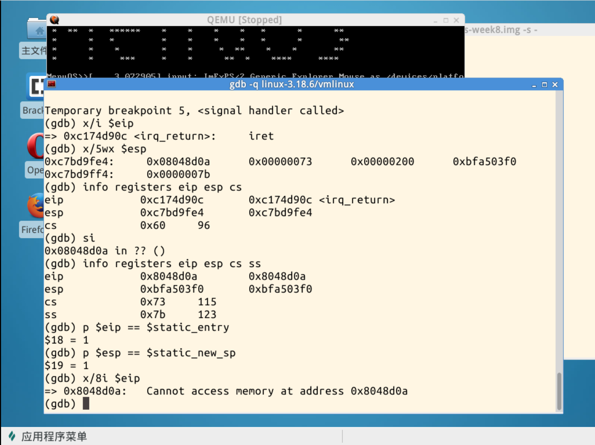

### 7.7 从入口运行到 main

刚返回用户态时，尝试反汇编入口出现读内存失败。随后使用临时硬件断点运行到已核对的 main 地址：

```gdb
thbreak *0x08048e24
continue
info registers eip esp cs
x/8i $static_entry
x/4i $eip
```

实际命中 `0x08048e24`，CS 为 `0x73`。此时 `_start` 处的代码已经可以读取，包括清零 EBP、取出栈上参数及调整栈对齐等指令，main 入口也可以正常反汇编。

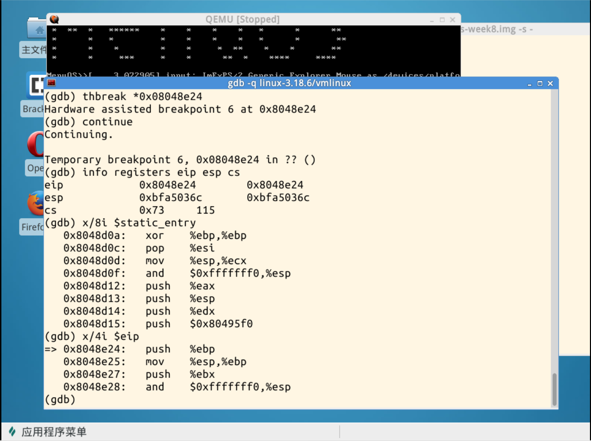

静态程序的执行位置由此形成连续证据：内核准备新现场，iret 恢复到自身 `_start`，启动代码随后使流程到达 main。这里没有逐条单步所有 C 运行库初始化指令。

---

## 08｜GDB 跟踪动态程序的执行起点

### 8.1 读取主程序入口并跟到解释器装载位置

让静态目标结束并回到 MenuOS 后，执行 execdynamic。原 sys_execve 断点继续有效，随后再次跟到 ELF 处理函数：

```gdb
x/s (char *)filename
tbreak load_elf_binary
continue
set $dynamic_bprm = bprm
x/s $dynamic_bprm->filename
set $dynamic_entry = ((struct elf32_hdr *)$dynamic_bprm->buf)->e_entry
p/x $dynamic_entry
tbreak load_elf_interp
continue
info args
bt 3
```

实际主程序文件名为 `/target_dynamic`，入口为 `0x08048380`。解释器断点最初定位到 load_elf_interp，但真正命中时当前帧仍是 load_elf_binary，显示在 `elf_entry = load_elf_interp(&loc->interp_elf_ex, ...)` 的调用位置。这是优化后的实际调试表现，不能按独立的 load_elf_interp 栈帧直接执行 finish。

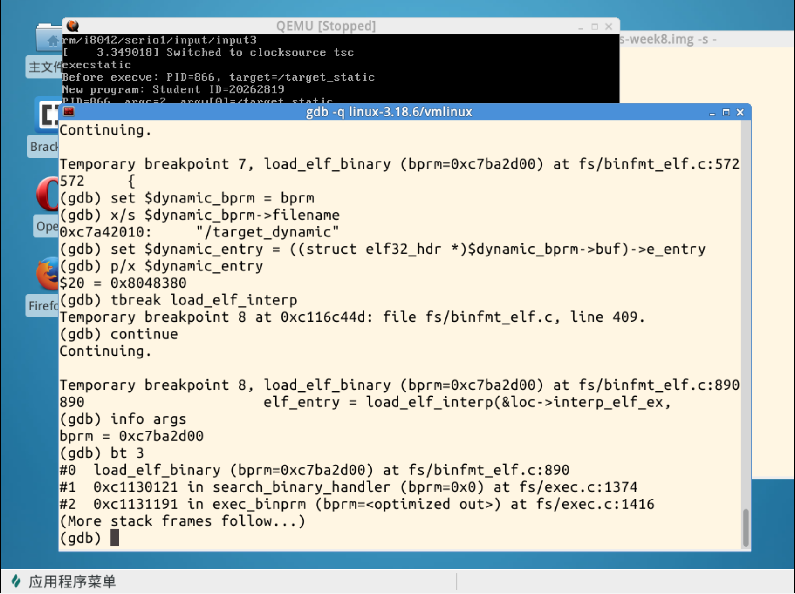

### 8.2 比较 start_thread 参数与主程序入口

继续通过临时断点跟到 start_thread，保存本次参数：

```gdb
tbreak start_thread
continue
info args
x/i $eip
set $dynamic_regs = regs
set $dynamic_new_ip = new_ip
set $dynamic_new_sp = new_sp
p/x $dynamic_new_ip
p/x $dynamic_new_sp
p $dynamic_new_ip == $dynamic_entry
```

| 参数 | 实际值 |
| :--- | :--- |
| new_ip | `0xb77900d0` |
| new_sp | `0xbfd64680` |
| 主程序 ELF 入口 | `0x08048380` |
| new_ip 是否等于主程序入口 | 0，即不相等 |

这与静态目标不同：内核准备的首次用户态地址没有直接采用主程序入口。

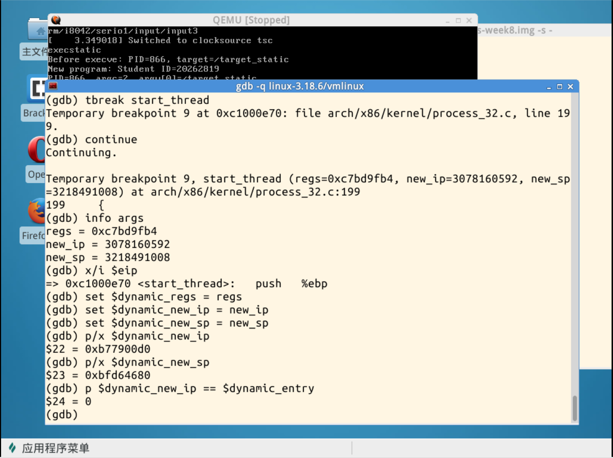

### 8.3 用辅助向量核对链接器基址

在 start_thread 入口读取已经构建好的初始用户栈，并查询镜像内解释器文件的入口：

```gdb
x/6wx $dynamic_new_sp
x/32wx ($dynamic_new_sp + 24)
shell LC_ALL=C readelf -h rootfs-week8/lib/ld-linux.so.2 | grep 'Entry point'
```

本次参数表有两个参数和一个环境变量，初始栈开头依次为 argc、两个 argv 指针、NULL、一个 envp 指针和 NULL，共六个32位字段。因此辅助向量从本次新 SP 加24字节开始；这个偏移不能直接套用于参数数量不同的程序。

辅助向量按类型和值成对排列，截图中可以识别：

| 项目 | 类型 | 实际值 | 含义 |
| :--- | :--- | :--- | :--- |
| AT_BASE | 7 | `0xb778f000` | 动态链接器装载基址 |
| AT_ENTRY | 9 | `0x08048380` | 主程序运行时入口 |
| 链接器自身 e_entry | 文件头字段 | `0x10d0` | 解释器文件记录的入口值 |

由此核对：

```text
0xb778f000 + 0x10d0 = 0xb77900d0
```

计算结果与 start_thread 的 new_ip 完全一致。主程序入口通过 AT_ENTRY 留在初始栈中，供后续用户态启动流程使用。

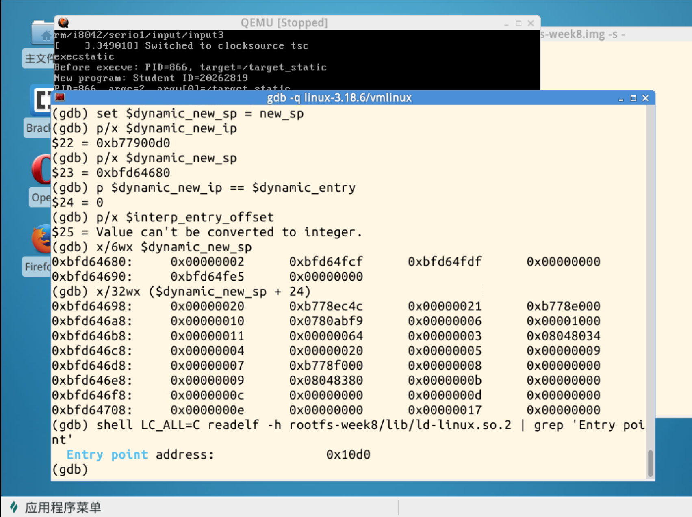

之前尝试读取 `$interp_entry_offset` 时出现不能转换为整数的提示，说明该便利变量没有可用的整数值。本次最终采用同一镜像中解释器文件的 readelf 结果，并与用户栈中的基址和 new_ip 交叉核对，没有把不可见的局部变量写成成功读取。

### 8.4 单步 iret 到动态链接器

根据已经查询到的值完成比较，再执行 start_thread 并捕获本次返回：

```gdb
set $interp_entry_offset = 0x10d0
set $interp_base = 0xb778f000
p $dynamic_new_ip == $interp_base + $interp_entry_offset
finish
p $dynamic_regs->ip == $dynamic_new_ip
p $dynamic_regs->sp == $dynamic_new_sp
set $dynamic_iret_sp = (unsigned int)&$dynamic_regs->ip
tbreak *irq_return if $esp == $dynamic_iret_sp && *(unsigned int *)$esp == $dynamic_new_ip
continue
x/i $eip
x/5wx $esp
si
info registers eip esp cs ss
p $eip == $dynamic_new_ip
p $esp == $dynamic_new_sp
p $eip == $dynamic_entry
```

本次 iret 返回栈包含：

| 位置含义 | 实际值 |
| :--- | :--- |
| 用户 EIP | `0xb77900d0` |
| 用户 CS | `0x00000073` |
| 用户 EFLAGS | `0x00000200` |
| 用户 ESP | `0xbfd64680` |
| 用户 SS | `0x0000007b` |

单步之后，EIP 为链接器入口 `0xb77900d0`，ESP 为 `0xbfd64680`，CS/SS 为 `0x73/0x7b`。与新 IP、新 SP、主程序入口的比较依次为1、1、0，直接验证了首次返回用户态时先执行动态链接器。


### 8.5 捕获链接器向主程序的交接

在主程序入口设置临时硬件断点：

```gdb
thbreak *$dynamic_entry
continue
info registers eip esp cs
p $eip == $dynamic_entry
x/8i $eip
```

实际停在 `0x08048380`，ESP 仍为初始用户栈位置 `0xbfd64680`，CS 为 `0x73`，与主程序入口的比较为1。

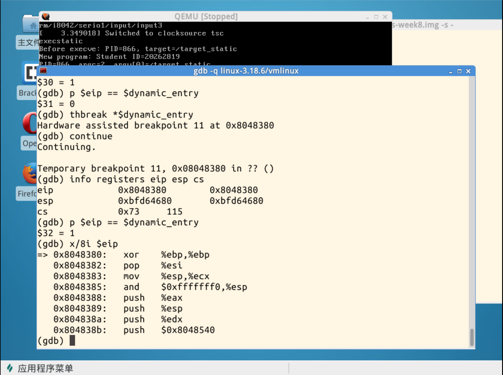

继续捕获 main：

```gdb
thbreak *0x0804847d
continue
info registers eip esp cs
x/4i $eip
```

实际到达 `0x0804847d`，ESP 为 `0xbfd645ec`，CS 仍为 `0x73`。动态程序的本次执行顺序由此得到验证：

```text
内核返回路径
    → iret
    → 动态链接器入口 0xb77900d0
    → 主程序 _start 0x08048380
    → C 运行库启动流程
    → main 0x0804847d
```

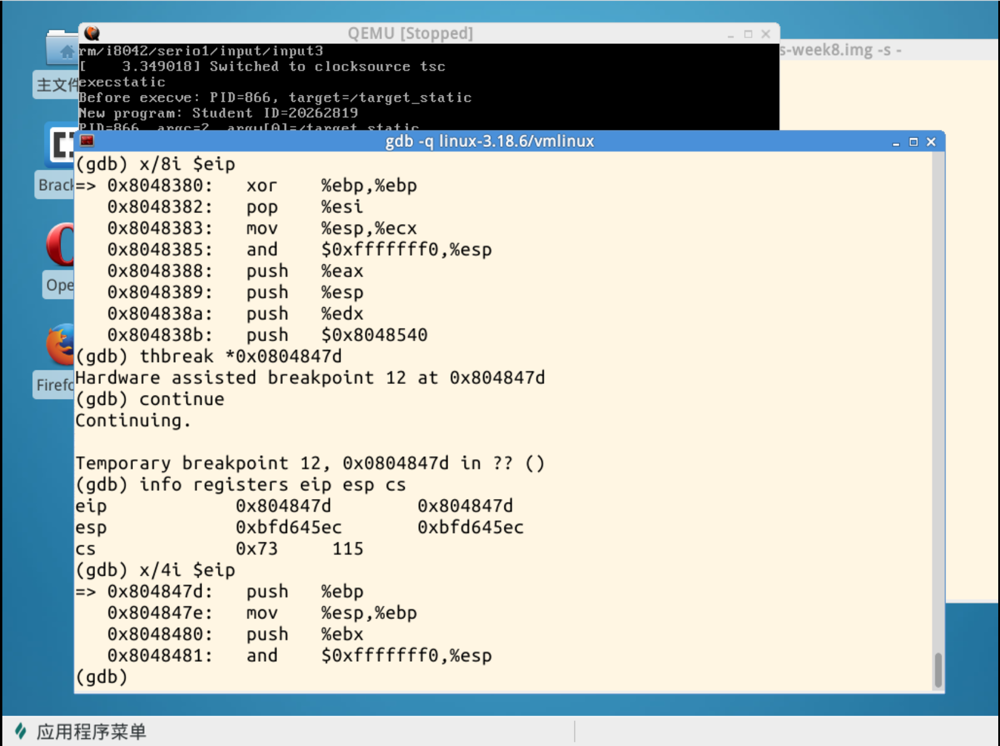

内核负责识别并映射主程序及其 ELF 解释器，准备用户栈和执行现场；普通共享库依赖的装载、重定位等启动工作主要由用户态动态链接器继续完成。本次捕获了这些阶段的关键执行位置，没有逐条调试动态链接器内部的全部库搜索和符号绑定过程。

### 8.6 正常退出并完成回收

从 main 继续运行，两个正式跟踪目标最终均正常结束。最终 QEMU 输出补齐了本次调试的任务身份：

| 正式跟踪目标 | 替换前 PID | 新程序 PID | 父进程回收的子进程 | 退出状态 |
| :--- | :---: | :---: | :---: | :---: |
| 静态目标 | 868 | 868 | 868 | 0 |
| 动态目标 | 869 | 869 | 869 | 0 |

最终重新出现 MenuOS 提示符。预运行的866、867与正式跟踪的868、869是不同次执行，不能混成同一个任务记录。

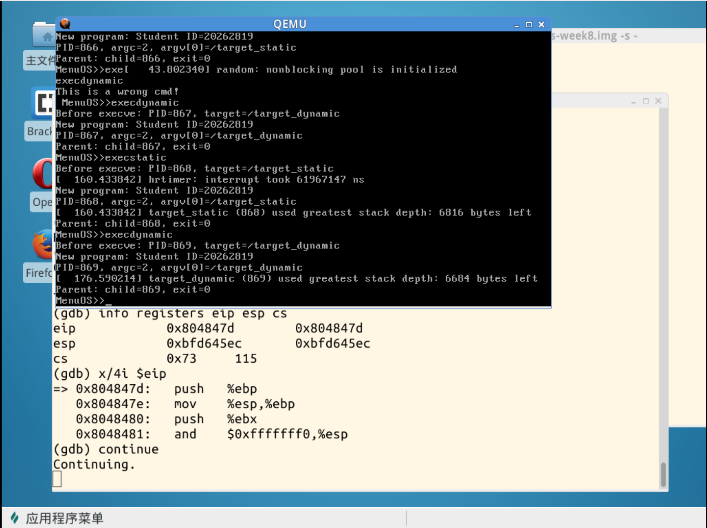

---

## 09｜装载机制与重点问题分析

### 9.1 execve 需要完成哪些准备

结合本次命中的调用链和相应版本的实现机制，可以把工作分为四部分。首先读取和检查路径、参数及可执行文件，建立程序装载所需的信息；随后由二进制格式处理机制选择 ELF 装载器，按程序头建立新映像的映射，并为数据、栈等区域安排空间。对于带 PT_INTERP 的程序，还要映射指定解释器。最后构建参数、环境和辅助向量，设置新用户执行现场，再经过内核返回路径进入用户态。

本次直接观察了系统调用参数、ELF 魔数和入口、装载调用链、初始用户栈、start_thread 参数、保存现场及 iret 前后的寄存器。映射和各种检查的每条内部指令并未全部单步执行，不能把机制分析等同于每一分支均已实测。

### 9.2 新可执行程序从哪里开始执行

本次普通静态 ELF 没有解释器，首次用户态执行位置就是自身 ELF 入口 `0x08048d0a`，对应 `_start`，之后才到 main。

本次动态 ELF 指定了 `/lib/ld-linux.so.2`。内核首次返回的位置是该解释器的运行时入口 `0xb77900d0`；主程序入口 `0x08048380` 通过辅助向量保留，动态链接器完成必要启动处理后把控制权交到该入口，再由主程序启动代码进入 main。

这些具体数值属于本次构建和本次运行。其他构建选项、体系结构或带地址随机化的运行可能得到不同地址，不能把本次地址当作所有程序的固定入口。

### 9.3 为什么 execve 后新程序能够顺利执行

新程序能够执行，需要地址空间、用户栈、参数以及返回寄存器现场相互匹配。start_thread 将保存的用户 IP、SP 和段选择子等设置为新程序所需的值；当 iret 恢复这些值时，CPU 进入的是新的用户程序。

本次静态和动态返回栈都包含新 EIP、用户 CS、EFLAGS、新 ESP 和用户 SS，单步后寄存器与保存值一致。这证明新程序的执行不是“内核像调用普通 C 函数一样调用 main”，而是通过内核返回用户态的机制恢复新的执行现场。

成功的 execve 不会返回原程序的调用点。“execve 不返回”描述原用户程序的控制流；“系统调用返回用户态”描述 CPU 权限和现场的恢复过程。两者并不矛盾。

### 9.4 静态与动态程序返回时的不同

| 对比项目 | 本次静态目标 | 本次动态目标 |
| :--- | :--- | :--- |
| 是否需要 ELF 解释器 | 否 | 是 |
| 主程序入口 | `0x08048d0a` | `0x08048380` |
| iret 后首次 EIP | `0x08048d0a` | `0xb77900d0` |
| 首次执行主体 | 主程序启动代码 | 用户态动态链接器 |
| 后续路径 | `_start` → 启动流程 → main | 链接器 → 主程序 `_start` → 启动流程 → main |
| 是否回到原 execve 后续语句 | 否 | 否 |
| 本次子进程 PID 是否保留 | 是 | 是 |

---

## 10｜实验中的问题与解决方案

### 10.1 旧环境的 pathlib 缺少 read_text

最初生成 test-week8.c 时出现：

```text
AttributeError: 'PosixPath' object has no attribute 'read_text'
```

由于副本没有生成，后续编译、file 和 grep 又连续报告文件不存在。这些不是三个独立故障，而是同一文件生成失败的后续结果。

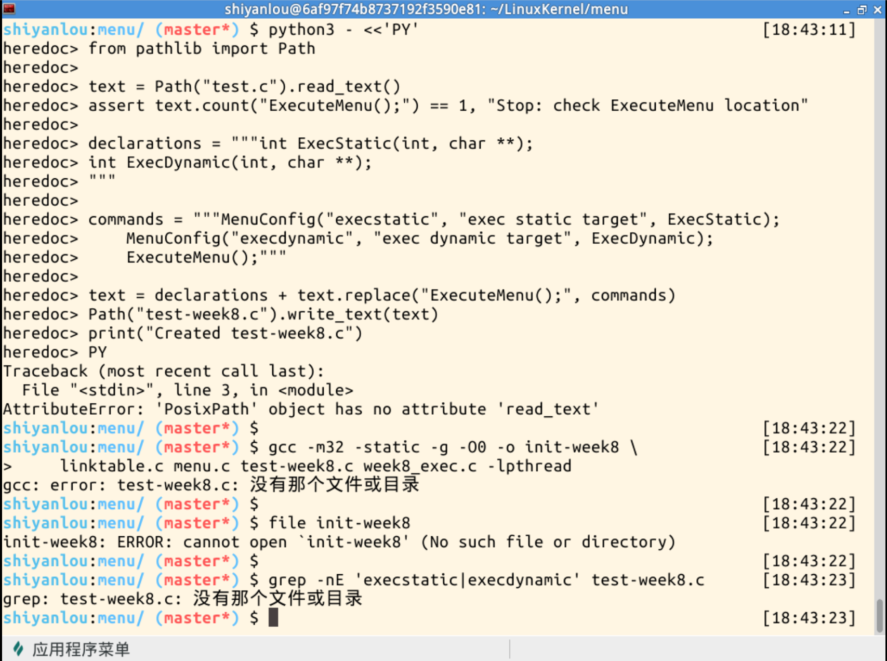

修复时不安装新的 Python 或 pathlib，而是用基础 open 接口按二进制读取、替换并写入，保留原文件字节内容。重新生成副本后，32位静态 MenuOS 编译成功，两个命令注册行也能查询到。

### 10.2 优化导致断点作用域和变量可见性变化

load_elf_interp 的断点实际停在 load_elf_binary 的调用位置，当前参数仍为 bprm，因此不能假定已经拥有独立的解释器装载函数栈帧。处理时核对 bt 和实际源码行，改用 start_thread 临时断点继续。

另一次读取解释器入口便利变量时出现 `Value can't be converted to integer`。最终通过镜像内链接器文件的 ELF 入口、用户栈 AT_BASE 和 start_thread 的 new_ip 完成交叉验证，得到 `0xb778f000 + 0x10d0 = 0xb77900d0`，没有依赖不可用的局部变量。

### 10.3 刚到静态入口时反汇编读内存失败

单步 iret 后，寄存器已经准确恢复到静态入口，但 `x/8i $eip` 提示无法访问该地址。随后使用硬件断点运行到 main，再读取同一入口，能够正常显示指令，程序最终也正常退出。

该现象与程序代码页按需装入的机制相容，但本次没有捕获对应的缺页处理函数，不能把具体原因写成已经单步证实。实际确认的是：瞬时的调试器读内存失败没有阻止程序从入口运行到 main，也不表示 execve 装载失败。

### 10.4 区分 GDB 提示与程序真实故障

内核系统调用边界的回溯出现 `<signal handler called>`，只能结合具体展开方式解释，不能直接认定目标进程收到了某个信号。用户地址按有符号整数显示为负数时，也应先按指针读取实际内容。

GDB 中只加载了内核符号，用户代码位置显示 `??` 属于本次符号配置的表现。通过事先用 nm 核对的地址设置硬件断点，仍然可以验证 `_start` 和 main 的执行位置。还需注意空白回车会重复上一条命令，尤其在 finish 或 si 后应避免无意重复执行。

QEMU 控制台中出现过一次 `This is a wrong cmd!`，重新输入 execdynamic 后成功。正式调试时还出现计时和内核栈使用信息，但两个目标都输出完成、exit=0 并回到提示符，没有出现目标程序退出失败的结果。

---

## 11｜本周总结

本次实验把程序的编译链接、ELF 文件结构、共享库使用和内核装载过程连接了起来。分阶段编译说明了源文件如何变成可重定位目标文件和可执行文件；两种共享库练习说明了启动依赖与运行中主动装载的区别，也让我明确了程序入口、库装载和符号解析并不是同一个概念。

通过 GDB 跟踪，我验证了成功的 execve 会准备新的用户栈并改写保存的返回现场，iret 随后将 CPU 带到新的用户态入口。静态目标直接进入自身 `_start`；动态目标先进入解释器，再交给主程序 `_start`，最终到达 main。两次正式跟踪的子进程 PID 分别保持为868和869，均正常退出，说明程序映像替换与进程身份保留可以同时成立。

教材中的调度与切换帮助我进一步理解了现场的作用：能否恢复执行，取决于任务、地址空间、栈和寄存器是否匹配。本次也体会到调试中需要以实际帧、实际寄存器和程序输出为依据，不能把优化后的变量不可见、用户符号缺失或短暂的读内存失败直接当作程序执行错误。
