# 20262819《Linux内核原理与分析》第六周作业

> **本周主题｜跟踪 write 系统调用，分析 system_call 到 iret 的内核执行过程**
>
> 教材范围：《庖丁解牛Linux操作系统分析》第6章“可执行程序工作原理”。
>
> 视频与实验：“扒开系统调用的三层皮？（下）”；实验五“分析 system_call 中断处理过程”。

| 基本信息 | 内容 |
| :--- | :--- |
| 姓名 | 刘顺文 |
| 学号 | 20262819 |
| 作业周次 | 第六周 |
| 实验日期 | 2026-10-31 |
| 实验平台 | 蓝桥云课 Linux 实验环境 |
| 被调试内核 | 课程预置 Linux 3.18.6，32位 x86 |
| 实验工具 | QEMU、GDB、GCC、cpio、gzip |
| 跟踪对象 | 延续第五周选择的 `write`，i386 系统调用号为4 |
| 工作目录 | `/home/shiyanlou/LinuxKernel` |
| 用户程序 | MenuOS 中新增的 `write80` 命令 |

---

## 01｜本周学习内容与完成情况

| 学习任务 | 完成情况 | 本周记录 |
| :--- | :--- | :--- |
| 教材第6章学习与整理 | 已完成 | 理解 ELF、编译链接、程序装载及 fork 与 execve 的关系 |
| 第六周视频学习 | 已完成 | 理解系统调用内核入口、寄存器保存和返回用户态的过程 |
| 构造可控的系统调用 | 已完成 | 注册 `write80`，显式执行 `int $0x80` |
| GDB 内核跟踪 | 已完成 | 跟踪入口、系统调用表、`SyS_write`、返回工作处理和 `iret` |
| 返回前调度分析 | 已完成 | 实测工作标志为 `0x8`，进入 `work_resched` 并调用 `schedule()` |
| 用户态返回验证 | 已完成 | 返回地址、用户栈、段寄存器、标志寄存器恢复，`eax=14` |
| 简要流程图 | 已完成 | 区分实际执行主线与其他条件分支 |

本次实验继续使用上周的 `write`，但观察范围由用户态调用扩展到内核处理和返回。教材第6章讨论可执行程序的构建与装载，视频和实验讨论系统调用入口与出口，两部分分别整理，并通过新 MenuOS 程序的构建和执行建立联系。

## 02｜教材阅读与理解

### 2.1 ELF：文件中的组织方式与运行时映像

ELF 是 Linux 中常见的目标文件格式，可用于可重定位目标文件、可执行文件和共享对象。文件头描述位数、机器类型、入口地址以及各类表的位置。理解 ELF 时，需要区分链接时常用的节视图和装载时使用的段视图：节组织代码、数据、符号和重定位信息，程序头表中的可装载段则说明如何建立运行时映射。

程序入口并不简单等于 C 语言的 `main()`。执行可执行文件时，系统首先根据装载规则准备运行现场，从入口代码开始执行，运行库再组织调用 `main()`。本次 `file init-week6` 明确显示程序为32位 Intel 80386 ELF，可据此判断它与32位实验内核的指令集相匹配。

### 2.2 从源文件到可执行程序

程序构建通常经过预处理、编译、汇编和链接。预处理展开头文件与宏；编译把 C 代码转换为目标架构的汇编；汇编生成目标文件；链接组合目标文件和库，处理符号引用及重定位，形成最终程序。

本次命令同时编译 `linktable.c`、`menu.c` 和 `test.c`。`-m32` 指定32位目标，`-g` 保留调试信息，`-static` 选择静态链接。仅修改源文件不会影响已经启动的 QEMU，必须重新编译并将新程序打包进本次使用的镜像，再启动该镜像。

### 2.3 链接与库

静态链接把所需库代码加入最终程序；动态链接则需要在装载和运行阶段使用共享对象。动态 ELF 程序通常还依赖解释器所指定的动态装载器。制作只有一个 `init` 的最小实验镜像时，静态链接可以避免额外准备这些动态依赖。本次 `file` 输出中的 `statically linked` 是实际编译结果，不是仅凭命令选项推断的结论。

库函数与系统调用也需要区分。库函数可以在用户态完成工作，也可以通过系统调用请求内核服务；同一个 `write` 内核服务可以由不同入口触发。本次 MenuOS 原有输出经 `sysenter` 路径进入内核，新命令则明确使用 `int $0x80`。

### 2.4 装载、fork 与 execve

装载需要识别可执行文件格式，建立地址空间中的代码和数据映射，准备用户栈及参数环境，并设置新程序的执行入口。动态链接程序还需要相应的解释器和共享库。可执行文件中的入口地址是装载信息的一部分，不能把文件在磁盘上的偏移直接当成运行时地址。

`fork()` 创建新任务，`execve()` 则以新程序映像替换调用进程原来的程序映像。成功的 `execve()` 不回到旧程序的调用后位置，也不因此创建一个新的 PID。相比之下，本次成功的 `write` 完成后返回原用户程序，在 `int $0x80` 后继续执行，并通过 `eax` 提供实际写入字节数。

## 03｜实验目标与准备

### 3.1 目标和环境边界

本实验用 QEMU 启动课程预置的32位 Linux 3.18.6，用 GDB 加载同目录的 `vmlinux` 符号文件，跟踪 `write(1, msg, 14)`。用户空间系统、宿主运行内核与 QEMU 中被调试的内核属于不同层次；本次未重新采集宿主版本和工具版本，不将上周的版本直接作为本周事实。

主要文件如下：

| 文件 | 作用 |
| :--- | :--- |
| `linux-3.18.6/arch/x86/boot/bzImage` | QEMU 启动的内核镜像 |
| `linux-3.18.6/vmlinux` | GDB 使用的符号文件 |
| `rootfs.img` | 课程原有根文件系统，用于初始观察 |
| `menu/init-week6` | 本次编译出的32位静态 MenuOS 程序 |
| `rootfs-week6.img` | 包含新 `/init` 的本周专用镜像 |

### 3.2 初次启动和连接

在终端 A 启动内核并暂停：

```bash
cd ~/LinuxKernel
qemu -kernel linux-3.18.6/arch/x86/boot/bzImage -initrd rootfs.img -s -S
```

`-s` 提供默认1234端口的 GDB 调试服务，`-S` 让 CPU 在启动时暂停。

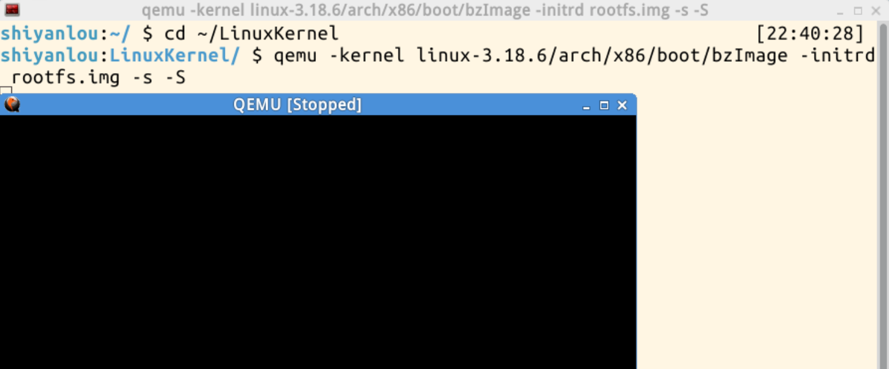

终端 B 加载符号并连接：

```bash
cd ~/LinuxKernel
gdb -q linux-3.18.6/vmlinux
```

```gdb
set pagination off
directory linux-3.18.6
target remote localhost:1234
info address system_call
info address sys_write
```

连接后 CPU 位于 `0x0000fff0`。在这一阶段过早反汇编内核运行地址，看到的是连续的 `add %al,(%eax)`，不能作为入口真实指令分析。运行到 `start_kernel` 后，重新查看才得到了实际代码。

```gdb
tbreak start_kernel
continue
x/12i system_call
info registers eip cs
```

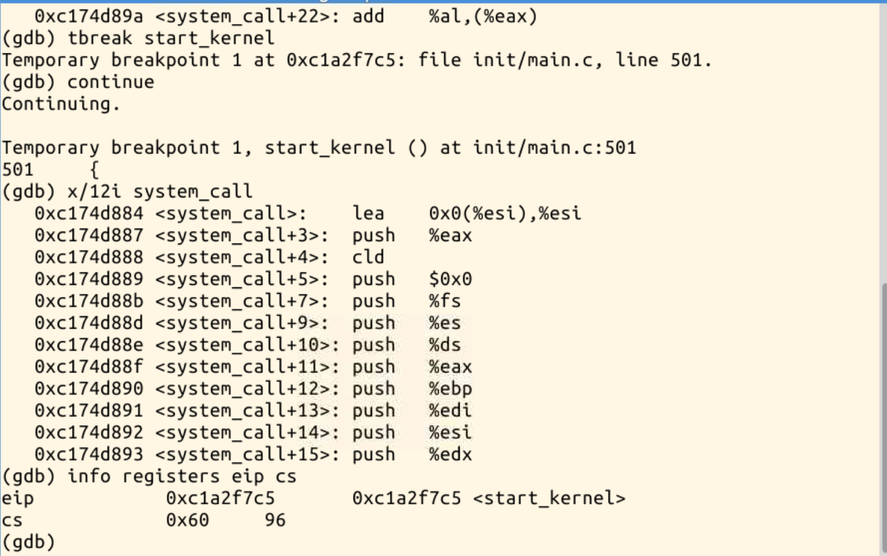

### 3.3 原 MenuOS 输出为什么没有命中入口

首次设置 `tbreak *system_call if $eax == 4` 后，MenuOS 已经启动并输出，但断点没有命中。于是暂停 GDB，禁用原入口断点，改在 `sys_write` 设置临时断点，再在 MenuOS 执行 `help`。

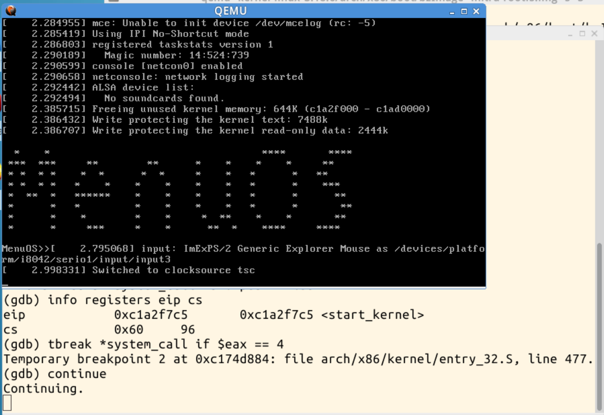

实际捕获到 `fd=1`、`count=18`。在函数第一条指令处读取栈顶返回地址，符号为 `sysenter_after_call`；缓冲区内容为 `help - Menu List:\n`。这说明这次输出使用了 `sysenter` 路径，不能据此认为 `write` 没有进入内核。

```gdb
bt 3
x/wx $esp
info symbol *(unsigned int *)$esp
p/x buf
x/18cb (unsigned int)buf
```

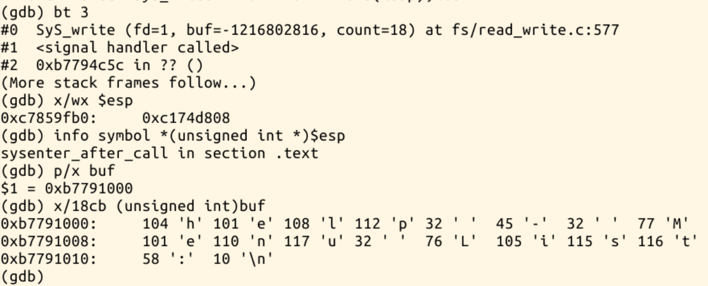

## 04｜构造 int 0x80 调用并制作镜像

### 4.1 新增 write80 命令

在 `menu/test.c` 中备份原文件，添加如下函数，并在 `ExecuteMenu()` 前注册命令。本次只修改用户程序，没有重编内核。

```c
int Write80(int argc, char *argv[])
{
    const char msg[] = "Hello syscall\n";
    int ret;

    __asm__ volatile (
        "int $0x80"
        : "=a" (ret)
        : "0" (4), "b" (1), "c" (msg),
          "d" ((unsigned int)(sizeof(msg) - 1))
        : "memory", "cc"
    );

    printf("write returned: %d\n", ret);
    return 0;
}
```

注册语句为：

```c
MenuConfig("write80", "write via int 0x80", Write80);
```

`eax` 输入调用号4并输出返回值，`ebx` 输入文件描述符1，`ecx` 输入字符串地址，`edx` 输入14字节长度。长度不包含末尾的空字符。后面的 `printf` 用于显示返回结果，不作为本次 `int $0x80` 跟踪对象。

### 4.2 编译和打包

```bash
cd ~/LinuxKernel/menu
gcc -m32 -static -g -o init-week6 linktable.c menu.c test.c -lpthread
file init-week6
```

实际结果为 `ELF 32-bit`、`Intel 80386`、`statically linked`、`not stripped`。

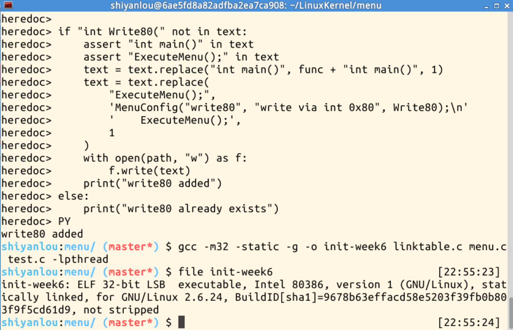

```bash
mkdir -p ../rootfs-week6
cp init-week6 ../rootfs-week6/init
cd ../rootfs-week6
find . -print | cpio -o -H newc | gzip -9 > ../rootfs-week6.img
gzip -dc ../rootfs-week6.img | cpio -it
ls -lh ../rootfs-week6.img
```

镜像目录列表包含 `.` 和 `init`，打包统计为1878块，压缩后约408 KB。课程 `Makefile` 的 `rootfs` 目标会自动启动 QEMU，因此本次单独完成编译与打包，再使用调试参数启动。

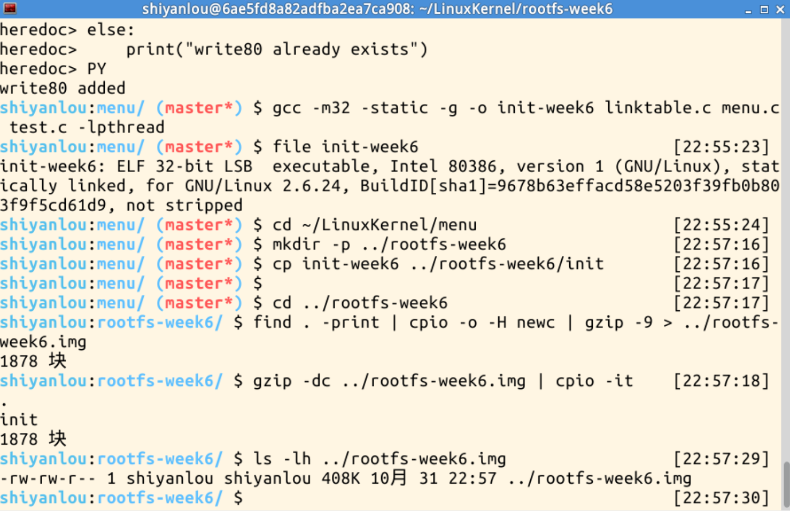

### 4.3 使用新镜像重新启动

先在 GDB 执行 `disconnect`，关闭旧 QEMU。在终端 A 启动新实例：

```bash
cd ~/LinuxKernel
qemu -kernel linux-3.18.6/arch/x86/boot/bzImage -initrd rootfs-week6.img -s -S
```

GDB 删除原来的旧入口断点，重新连接并停在内核初始化入口：

```gdb
delete 2
target remote localhost:1234
tbreak start_kernel
continue
```

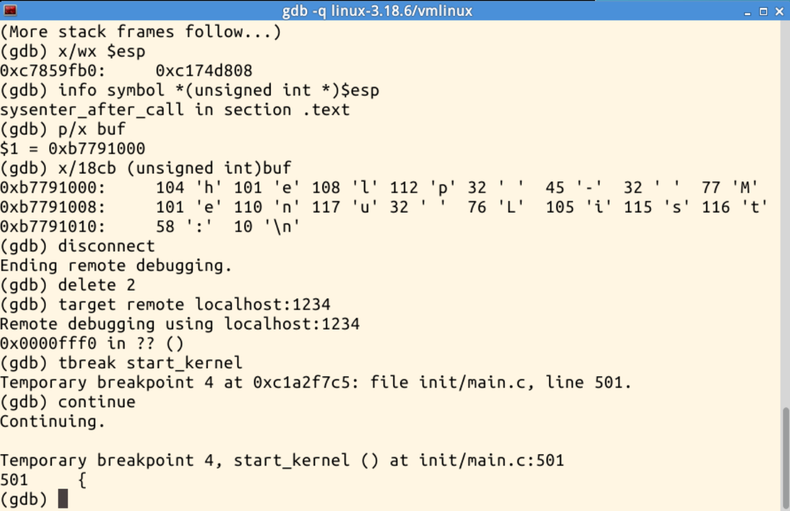

## 05｜从 system_call 到 iret 的实际跟踪

### 5.1 进入 system_call：参数与硬件返回现场

在内核启动入口设置精确入口断点：

```gdb
tbreak *system_call if $eax == 4
continue
```

MenuOS 启动后输入 `write80`，成功停在 `0xc174d884 <system_call>`。查看参数和返回现场：

```gdb
info registers eax ebx ecx edx eip esp cs ss
x/14cb $ecx
x/5wx $esp
```

| 寄存器 | 实测值 | 含义 |
| :--- | :--- | :--- |
| EAX | `4` | 系统调用号 |
| EBX | `1` | 标准输出 |
| ECX | `0xbff64f5d` | 用户缓冲区地址 |
| EDX | `14` | 请求写入的字节数 |
| ESP | `0xc7859fe4` | 进入内核后的栈位置 |
| CS / SS | `0x60` / `0x68` | 当前内核代码段和栈段 |

在 `int $0x80` 从用户态进入内核时，CPU 根据特权级切换规则使用内核栈，并保存返回所需现场。此时软件入口尚未压栈，按地址递增读取到：

| 返回现场 | 实测值 |
| :--- | :--- |
| 用户态 EIP | `0x0804a04d` |
| 用户态 CS | `0x73` |
| 用户态 EFLAGS | `0x246` |
| 用户态 ESP | `0xbff64f40` |
| 用户态 SS | `0x7b` |

用户态 `CS=0x73` 的低两位为3，内核态 `CS=0x60` 的低两位为0，体现了权限级切换。该返回 EIP 对应 `int $0x80` 后面的用户指令。

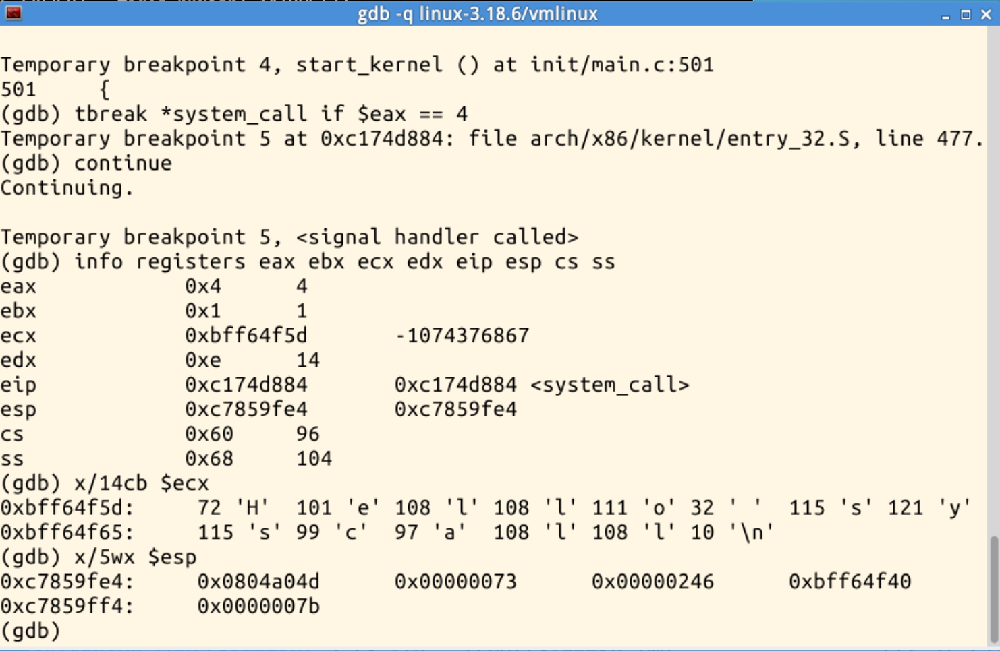

### 5.2 保存软件现场并按系统调用号分派

入口先保存原系统调用号，通过 `SAVE_ALL` 保存寄存器并准备内核执行环境，取得当前线程信息，检查入口工作标志和调用号范围。需要跟踪等入口工作时可进入相应处理分支；调用号越界时返回 `-ENOSYS`。本次实际继续到正常分派位置。

```gdb
set $entry_sp = $esp
set $user_pc = *(unsigned int *)$esp
tbreak *syscall_call
continue
x/i $eip
info registers eax esp
x/17wx $esp
x/wx ((char *)&sys_call_table + 16)
info address sys_write
```

此时 `ESP=0xc7859fb4`，比入口时低48字节，新增12个32位槽位，连同硬件现场组成完整寄存器现场。栈顶依次保存 `ebx`、`ecx`、`edx` 等内容；`EAX` 槽位偏移24字节，原始调用号槽位偏移44字节，用户 EIP 偏移48字节。GS 槽位是否保存实际 GS 取决于构建配置，本次看到的该槽位为0。

间接调用的地址为 `0xc174d8cb`。GDB 将表基址显示为带符号位移形式，其含义是按 `eax × 4` 索引系统调用表。表中第4号条目位于 `sys_call_table+16`，内容为 `0xc112b7d0`，与 `sys_write` 的符号地址完全一致。

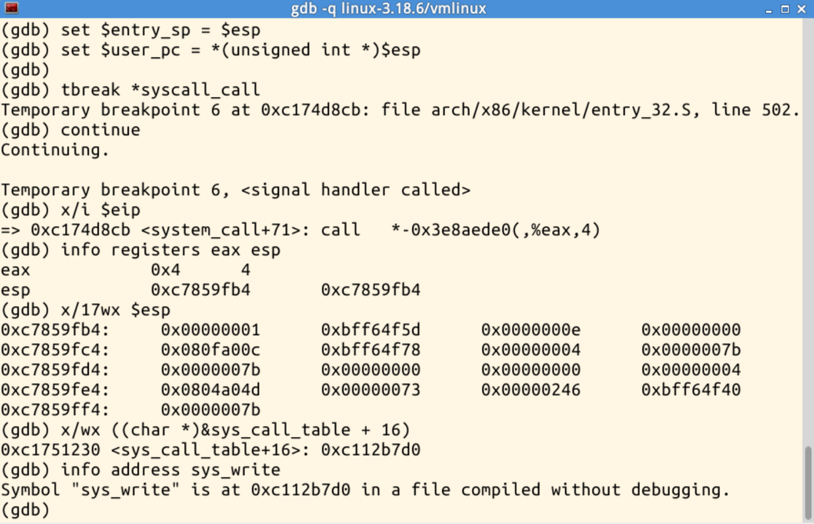

### 5.3 进入 SyS_write 并执行写入

在间接调用处执行一条指令：

```gdb
si
info args
list
x/14cb (unsigned int)buf
```

实际进入 `SyS_write`，源码位于 `fs/read_write.c:577`，对应 `SYSCALL_DEFINE3(write, ...)`。参数为 `fd=1`、`count=14`，缓冲区地址仍为 `0xbff64f5d`，内容为 `Hello syscall\n`。`sys_write` 与 `SyS_write` 的名称差异来自内核系统调用宏生成的相关符号，不是进入了另一项系统调用。

写入处理根据文件描述符取得文件对象，交给 `vfs_write()` 执行，按结果更新位置并释放引用，最后返回结果。源码初始化 `ret=-EBADF`，只有不能取得有效文件对象等情况下才沿相应错误路径返回；不能把初始赋值当成本次调用失败。

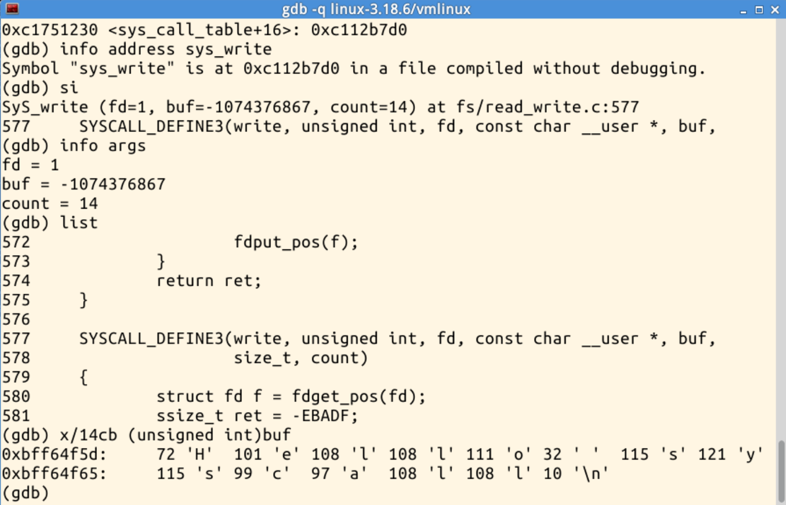

执行 `finish` 后返回到 `syscall_after_call`，实际显示 `Value returned is ... = 14`，`eax=0xe`。这表明本次请求的14字节已经全部写入。

```gdb
list 577,597
finish
info registers eax eip
x/12i $eip
```

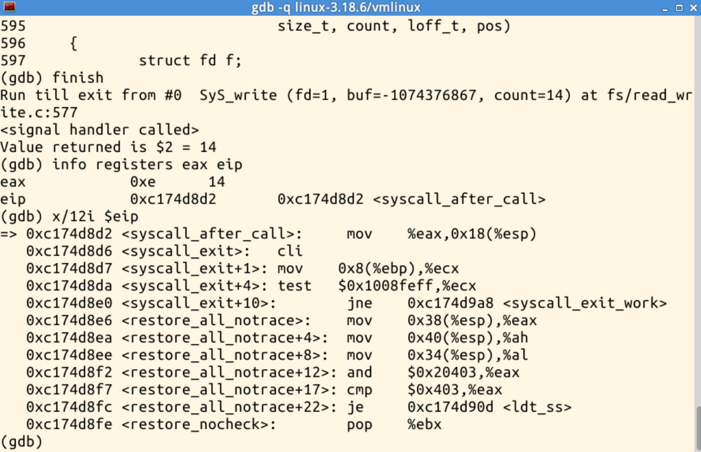

### 5.4 保存返回值并检查退出工作

当前指令为：

```asm
mov %eax,0x18(%esp)
```

它将内核函数返回值保存到现场中的 `EAX` 槽位。执行后，该槽位为 `0x0000000e`。即使后续工作处理临时使用 `eax`，最后恢复寄存器时仍可取出返回值14。

```gdb
x/wx ($esp + 24)
si
x/wx ($esp + 24)
p/x (*(unsigned int *)($ebp + 8) & 0x1008feff)
x/24i restore_nocheck
```

`syscall_exit` 在关中断的条件下读取工作标志，避免检查后到返回之间遗漏新的调度或信号请求。本次掩码计算结果为 `0x8`，因此进入退出工作处理，不能直接将它描述成无待处理工作时的恢复路径。

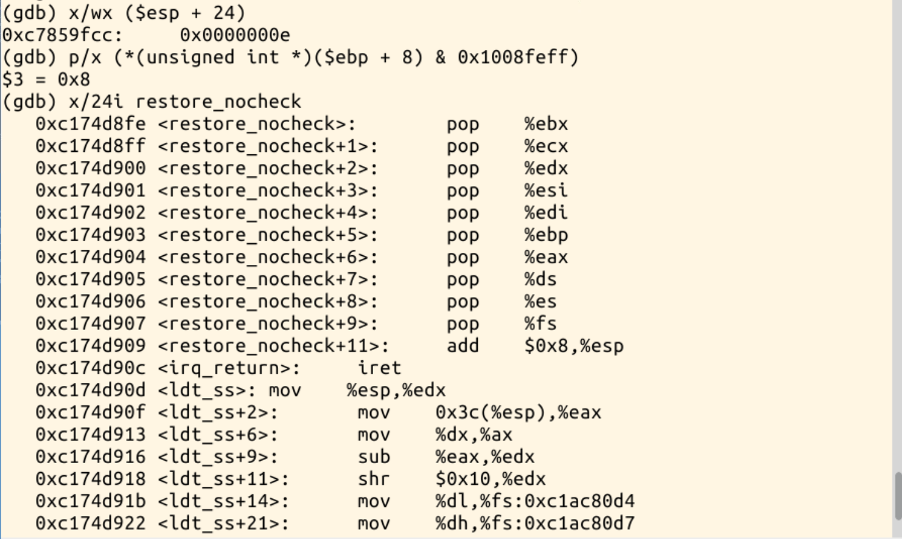

### 5.5 本次实际进入重新调度分支

```gdb
tbreak *syscall_exit_work
continue
x/20i $eip
list *syscall_exit_work
```

该处首先检查 `_TIF_WORK_SYSCALL_EXIT`。本次的 `0x8` 不属于退出跟踪标志，因此跳转到 `work_pending`，没有据此执行 `syscall_trace_leave()`。进入退出工作入口与实际执行退出跟踪函数不是同一回事。

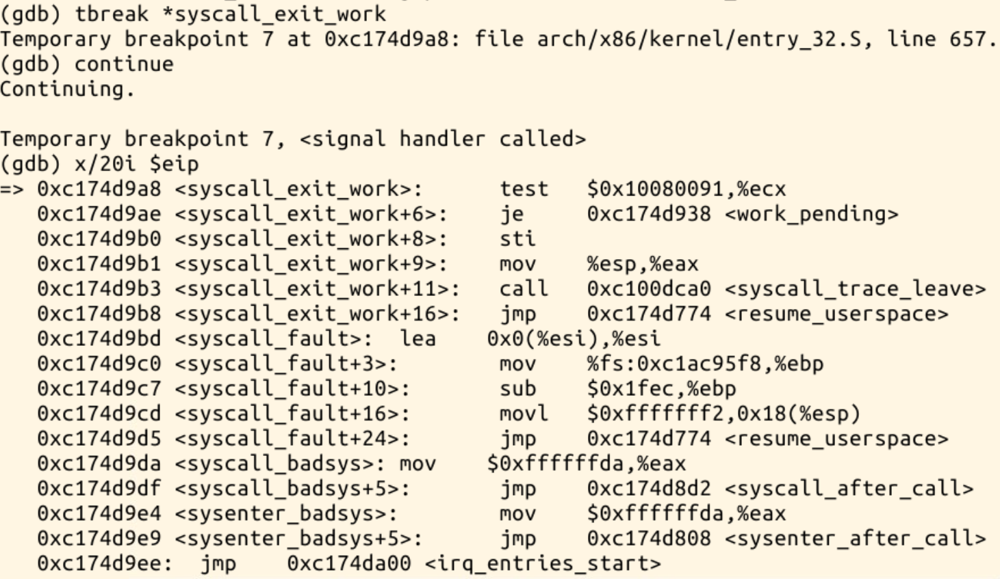

`0x8 = 1 << 3`，对应 `_TIF_NEED_RESCHED`。继续设置断点并单步进入：

```gdb
tbreak *work_resched
continue
x/8i $eip
si
bt 3
```

实际停在 `0xc174d93d` 的 `call schedule`，随后进入 `kernel/sched/core.c:2866` 的 `schedule()`。调用后会再次关闭中断并重新读取待处理工作；仍需调度则重复处理，有信号或通知则进入相应分支，工作完成后才恢复寄存器。本次证据确认调用了调度函数，没有继续记录调度器选中的任务，因此不额外断言切换到了哪个进程。

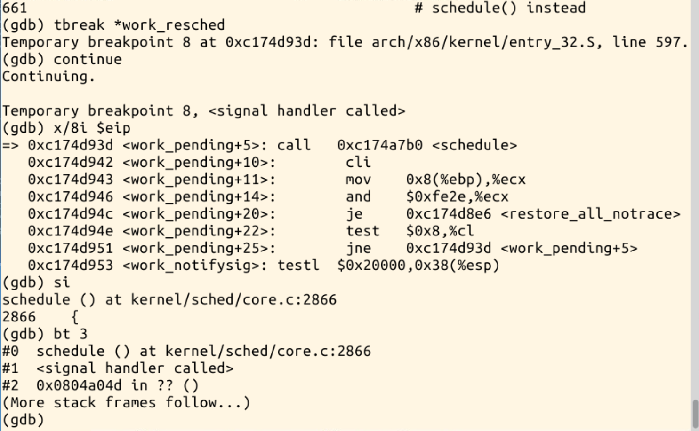

### 5.6 恢复寄存器并停在 iret 前

为捕获同一次调用的返回，使用先前记录的栈位置和用户返回地址作为条件：

```gdb
tbreak *irq_return if $esp == $entry_sp && *(unsigned int *)$esp == $user_pc
continue
x/i $eip
info registers eax ebx ecx edx eip esp cs ss
x/5wx $esp
```

实际停在 `0xc174d90c <irq_return>`，指令是 `iret`。此前的恢复代码依次弹出通用寄存器和段寄存器，并按本次构建的布局跳过剩余 GS 槽位及原始系统调用号槽位，使栈顶重新指向硬件返回现场。

此时 `eax=14`，`ebx=1`、`ecx=0xbff64f5d`、`edx=14` 均已恢复；`esp=0xc7859fe4` 与入口一致。栈顶五项仍为原先的用户态 EIP、CS、EFLAGS、ESP、SS。当前 `CS=0x60`，说明 `iret` 执行前 CPU 仍处于内核态。

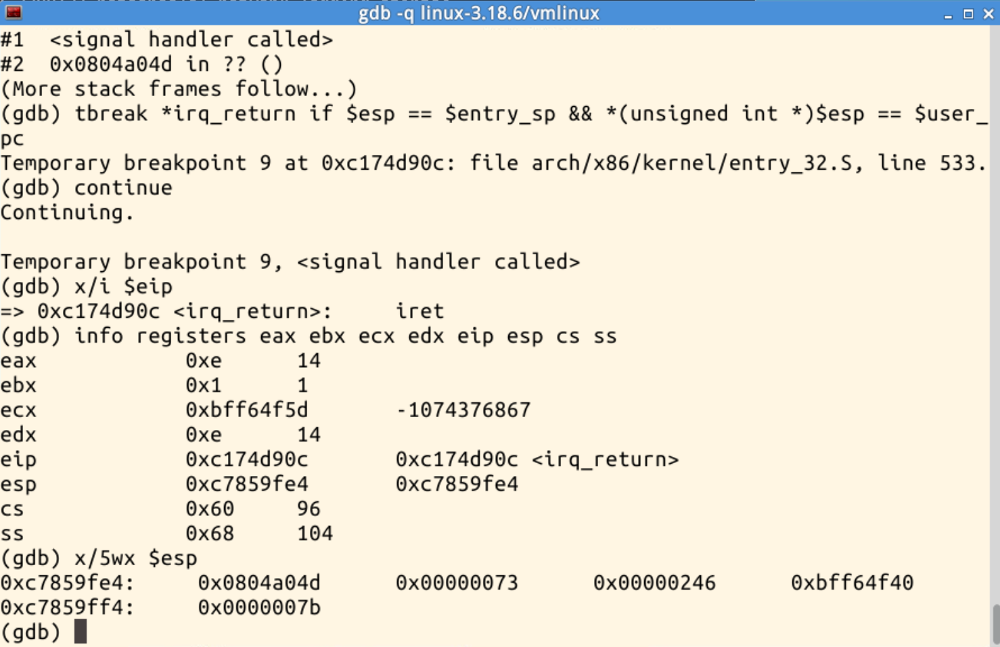

### 5.7 单步执行 iret，验证回到用户态

```gdb
si
info registers eax eip esp cs ss eflags
x/5i $eip
p $eip == $user_pc
```

| 检查项 | 执行 iret 后的实测值 | 结论 |
| :--- | :--- | :--- |
| EIP | `0x0804a04d` | 与入口保存的返回地址一致 |
| ESP | `0xbff64f40` | 恢复用户栈 |
| CS / SS | `0x73` / `0x7b` | 恢复用户段，CS 的 RPL 为3 |
| EFLAGS | `0x246` | 与保存现场一致 |
| EAX | `14` | 保留本次 write 的返回值 |
| `$eip == $user_pc` | `1` | 返回地址核对通过 |

`iret` 恢复执行位置、代码段、标志及跨权限级返回所需的用户栈信息。返回值14则已由此前的寄存器恢复代码放入 `eax`。用户态下一条指令为 `mov %eax,-0x20(%ebp)`，将返回值写入局部变量，然后用于输出。

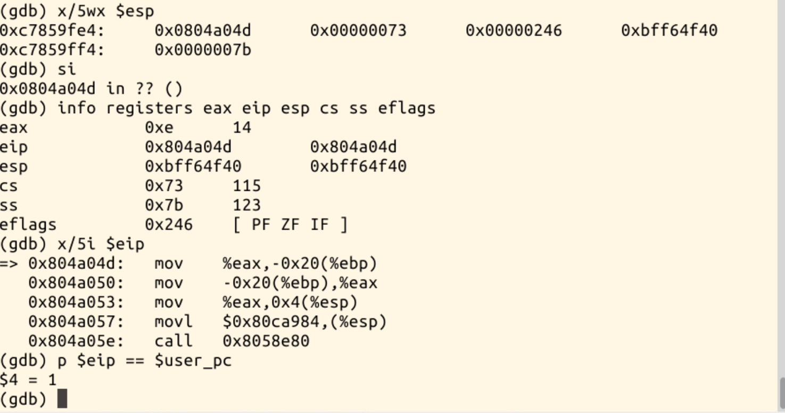

执行 `continue` 后，QEMU 中实际输出：

```text
write80
Hello syscall
write returned: 14
MenuOS>>
```

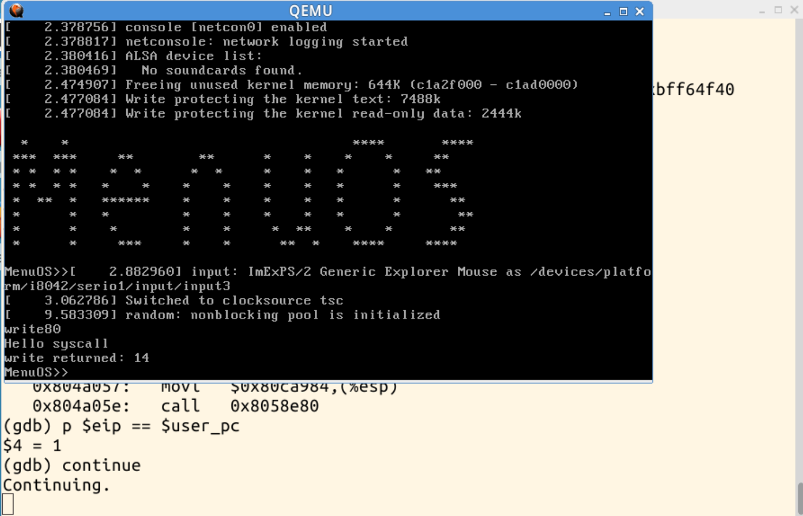

## 06｜系统调用处理流程图与分析

### 6.1 简要流程图

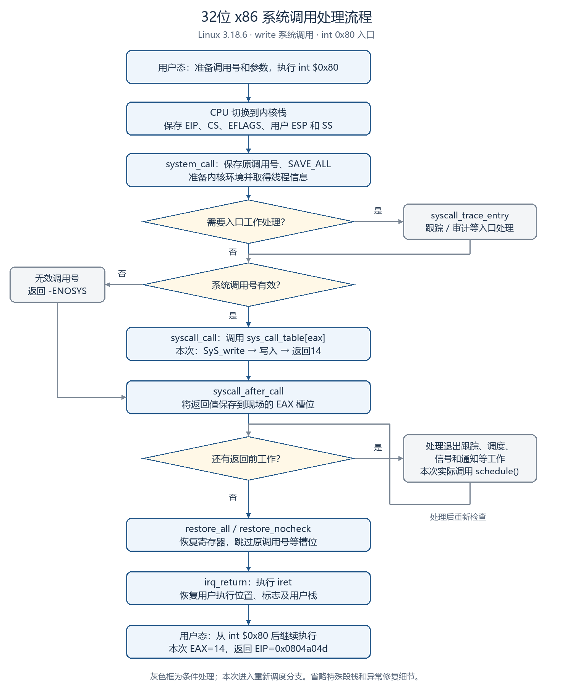

图中的条件分支概括正常返回过程中可能出现的处理，不表示本次全部执行。本次选择合法调用号4，没有进入非法调用号分支；返回前实际发生了重新调度处理。图中省略了 VM86、特殊段栈修复、返回异常等与本次普通32位用户程序无关的细节。

### 6.2 本次实测执行主线

```text
用户程序设置 eax=4、ebx=1、ecx=msg、edx=14
→ int $0x80，切换内核栈并保存用户返回现场
→ system_call 保存原调用号及寄存器
→ syscall_call 按 sys_call_table[4] 分派
→ SyS_write 执行写入，返回14
→ syscall_after_call 将14保存到现场的 EAX 槽位
→ syscall_exit 检查到待处理工作0x8
→ syscall_exit_work → work_pending → work_resched
→ schedule()，返回后继续处理并检查工作标志
→ 恢复寄存器，EAX恢复为14
→ irq_return 中执行 iret
→ 返回用户地址0x0804a04d，继续保存并输出 ret
```

### 6.3 入口、函数返回和返回用户态的区别

进入 `system_call` 需要通过受控入口切换权限级和栈，不能等同于普通 C 函数调用。系统调用表中的间接 `call` 是内核态内部调用，`SyS_write` 的普通函数返回只回到入口汇编，CPU 此时仍在内核态。只有完成退出工作处理、恢复寄存器并执行 `iret` 后，才真正回到用户态。

系统调用期间可以发生调度，但进入内核并不必然意味着立刻切换进程。本次明确观察到了返回前调用 `schedule()`；这是实际执行分支，而不是每次 `write` 都必须固定经过的步骤。

## 07｜遇到的问题和解决方法

### 7.1 在 BIOS 阶段查看内核指令不准确

初次连接时 CPU 位于 `0x0000fff0`，提前反汇编得到连续的零字节解码。处理方法是先断在 `start_kernel`，待内核装载并建立执行环境后，再读取入口代码。符号地址存在与目标地址中已经有对应的运行时代码，需要分别判断。

### 7.2 原有输出通过 sysenter，未命中 system_call

MenuOS 已输出却没有命中 `system_call`，不能直接归因于断点无效。通过在 `sys_write` 捕获输出并检查栈顶返回地址，确认其返回到 `sysenter_after_call`。随后新增显式 `int $0x80` 的 `write80` 命令，成功获得题目要求的入口跟踪。

### 7.3 GDB 把入口回溯显示为信号处理现场

多处断点显示 `<signal handler called>`，跨越汇编入口的调用栈还可能出现不可访问内存。该显示反映 GDB 对底层现场的解释，不能作为收到用户信号的证据。本次结合 EIP、实际指令、栈内容和符号地址判断执行阶段，没有依赖不完整回溯拼接普通函数调用链。

`buf` 也曾按有符号整数显示为负数。将其转换为十六进制并读取地址内容后，确认参数有效。地址的显示格式与指针是否有效不是同一问题。

### 7.4 返回前存在重新调度请求

退出工作标志实际为 `0x8`，因此不能直接继续到恢复寄存器并省略中间过程。本次进入退出工作分支，捕获 `work_resched` 并实际单步进入 `schedule()`，随后通过带栈位置和返回地址条件的断点捕获本次 `iret`，完成同一次调用的入口与出口核对。

## 08｜本周总结

本周将上周的用户态 `write` 调用与内核处理过程连接起来。系统调用先通过规定入口进入内核，保存硬件返回现场和软件寄存器现场，再由系统调用表分派到相应处理函数。处理函数返回后，内核保存返回值，检查调度、信号和通知等工作，完成必要处理后恢复寄存器，最后用 `iret` 回到用户态。

本次最关键的验证是把入口记录与出口现场逐项对应：用户返回 EIP、ESP、CS、SS 和 EFLAGS 一致，`eax` 从调用号4变成返回值14，程序最终输出正确结果。入口选择不同、GDB 回溯不完整和返回前的调度请求，都说明需要结合源码、指令、寄存器与真实输出判断执行过程。教材中的可执行文件构建和装载知识，也通过32位静态 MenuOS 程序的编译、打包和启动得到了具体联系。
