# 20262819《Linux内核原理与分析》第四周作业

> **本周主题｜理解系统调用，跟踪 Linux 内核从初始化到用户态程序启动的过程**
> 阅读范围：《庖丁解牛Linux操作系统分析》第4章“深入理解系统调用”
>
> 配套实验：在蓝桥云课使用 QEMU 和 GDB 跟踪 Linux 3.18.6 从 `start_kernel()` 到 init 进程启动。

| 基本信息 | 内容 |
| :--- | :--- |
| 姓名 | 刘顺文 |
| 学号 | 20262819 |
| 作业周次 | 第四周 |
| 实验与整理日期 | 2026-10-18 |
| 实验平台 | 蓝桥云课 Linux 实验环境 |
| 实验内核／目标架构 | Linux 3.18.6／32位 x86（i386） |
| 主要工具 | QEMU、GNU GDB 7.7.1 |

---

## 01｜本周学习内容与完成情况

本周教材主要讨论用户态程序怎样通过系统调用请求内核服务，实验则从启动方向观察内核怎样建立运行环境、创建初始任务并加载用户程序。两部分共同涉及用户态与内核态、执行上下文以及程序运行所需的基础条件，但分析的入口和执行方向不同。

| 学习任务 | 完成情况 | 本周记录 |
| :--- | :--- | :--- |
| 阅读教材第4章 | 已完成 | 覆盖 §4.1–§4.4及章末实验说明，整理系统调用机制与架构差异 |
| 正常启动 MenuOS | 已完成 | 使用指定内核和根文件系统进入菜单，执行 `help`、`version` |
| 建立 QEMU/GDB 调试连接 | 已完成 | 加载 `vmlinux`，连接本机1234端口，修正首次未连接目标的问题 |
| 跟踪内核初始化主线 | 已完成 | 观察 `start_kernel`、`rest_init`、`kernel_init`、`kernel_init_freeable` 相关执行位置与源码 |
| 验证 init 加载和用户态运行 | 已完成 | 实际加载路径为 `/init`，返回值为0，继续执行后进入 MenuOS |

老师提供的豆列“[Linux内核及安全](https://www.douban.com/doulist/37723150/)”作为拓展资料入口，本报告的阅读总结以本地教材第4章为依据。

---

## 02｜教材阅读与理解

### 2.1 本章主线：从调用接口到内核执行

第4章按照“系统调用概述 → 触发系统调用的方法 → x86 内核实现 → ARM64 内核实现”的顺序展开。它把平时使用的 C 语言库函数，与背后的系统调用指令、体系结构入口和内核处理函数联系起来。

理解系统调用，不能只记住某个函数名，还需要回答三个问题：用户程序怎样说明自己需要哪项服务，CPU 怎样切换到内核的执行入口，以及内核怎样保存执行状态并在处理结束后返回。教材通过时间相关函数和两类体系结构的源码，逐步说明了这些问题。

本章内核源码分析主要采用 Linux 5.4 系列示例，ARM64 部分明确使用 Linux 5.4.34；本周启动实验使用 Linux 3.18.6。阅读时以机制建立联系，分析实验时则保留其实际函数名、源码路径和32位寄存器约定。

### 2.2 用户态、内核态与系统调用的三层关系

用户态与内核态的区别首先是执行权限。普通应用程序不能任意执行特权指令或访问受保护的内核资源，需要通过操作系统提供的受控入口请求服务。在常见 x86 Linux 环境中，Ring 3 对应用户态，Ring 0 对应内核态；教材介绍的 ARM64 Linux 则使用 EL0 和 EL1 分别运行用户程序与内核。

系统调用本身属于内核提供的接口，而 C 语言库函数是用户程序经常直接使用的编程接口。二者不能一一等同：有的库函数完全在用户态计算，有的封装一次系统调用，也有的需要组织多次系统调用。

| 层次 | 主要作用 | 理解重点 |
| :--- | :--- | :--- |
| C 语言库函数 API | 提供便于应用程序调用的接口 | 库函数名不一定与系统调用名相同 |
| 系统调用入口与分派过程 | 完成权限切换、保存状态、检查调用号并分派 | 具体入口依体系结构和内核版本变化 |
| 内核处理函数 | 实现文件、进程、时间等具体服务 | 处理结果需要通过返回约定交给用户程序 |

因此，用户态调用一个普通 C 函数，并不自动意味着进入内核态；只有执行到相应的系统调用或异常入口，才涉及对应的权限和上下文转换。库函数还可能把内核返回的错误转换为 `-1` 并设置 `errno`，分析错误时也要区分观察的是哪一层。

### 2.3 触发方式与参数传递的架构差异

教材以时间相关操作为例，对比通过 C 库函数和内嵌汇编触发系统调用的方法。直接使用汇编时，程序需要按照目标架构的约定放置系统调用号和参数，执行入口指令，再读取返回值。

| 目标架构 | 教材分析的入口指令 | 系统调用号 | 前6个参数所在寄存器 | 返回值 |
| :--- | :--- | :--- | :--- | :--- |
| 32位 x86 | `int $0x80` | `EAX` | `EBX`、`ECX`、`EDX`、`ESI`、`EDI`、`EBP` | `EAX` |
| x86-64 | `syscall` | `RAX` | `RDI`、`RSI`、`RDX`、`R10`、`R8`、`R9` | `RAX` |
| ARM64 | `svc #0` | `X8` | `X0`–`X5` | `X0` |

这里尤其需要区分 x86-64 的普通函数调用约定和系统调用约定：普通函数的第4个整数参数通常使用 `RCX`，Linux x86-64 系统调用的第4个参数使用 `R10`。教材书内第129页所列入口源码对此有明确注释；不能直接把概述中的普通函数传参寄存器列表套给系统调用。

同一种服务在不同架构下，也不一定具有相同的调用号。教材中32位 x86 的 `time` 调用号为13，x86-64 为201；ARM64 示例则通过 `gettimeofday` 获取时间，其调用号为169。这里体现的是相同功能可以通过不同接口实现，不能把调用号脱离架构记忆。

### 2.4 x86 系统调用：入口初始化、保存现场和返回

教材将 x86 系统调用分为初始化和实际执行两个阶段。初始化阶段需要建立“发生系统调用时到哪里执行”的对应关系：`int $0x80` 方式依赖中断描述符表 IDT，64位 `syscall` 方式则通过相应 MSR 配置入口地址。

在实际执行时，入口代码组织寄存器保存和内核执行环境，将调用号和参数交给分派逻辑，再通过系统调用表找到具体处理函数。这里的 `struct pt_regs` 保存了进入内核时的重要寄存器状态，是理解用户程序状态与内核处理过程之间联系的关键结构。

```text
用户程序／库函数准备调用号和参数
    ↓
执行系统调用指令，进入体系结构相关入口
    ↓
保存执行现场，检查调用号并查找系统调用表
    ↓
执行具体内核处理函数，保存返回值
    ↓
按需处理调度、信号等返回前工作
    ↓
恢复现场，通过相应返回路径回到用户态
```

系统调用处理函数结束后，不一定马上恢复用户程序。教材通过返回路径中的标志检查，说明需要重新调度或处理信号时，还会先完成这些工作；这不表示每次系统调用都会发生进程切换。

另外，32位中断入口与64位快速系统调用入口的硬件动作不同。64位 `syscall` 的保存状态、栈切换等需要结合入口代码分析，不能概括为所有架构都由硬件自动完成同样的压栈操作。

### 2.5 ARM64 系统调用：异常向量与寄存器状态

ARM64 使用 `svc` 触发同步异常。用户程序运行在 EL0，进入内核后由 EL1 的异常入口处理。教材介绍的异常向量表分为4组，每组包含同步异常、IRQ、FIQ 和系统错误4类入口，共16个入口，每个向量槽占128字节。

| 寄存器／结构 | 在教材分析中的作用 |
| :--- | :--- |
| `VBAR_EL1` | 保存异常向量表的基地址 |
| `ESR_EL1` | 记录异常原因，帮助区分系统调用与其他同步异常 |
| `ELR_EL1` | 保存异常返回所需的程序位置 |
| `SPSR_EL1` | 保存异常发生前的处理器状态 |
| `struct pt_regs` | 在内核栈中组织通用寄存器和相关上下文 |

教材中的主要执行线索为 `el0_sync → el0_svc → el0_svc_handler`。处理逻辑从保存的 `X8` 取得系统调用号，通过系统调用表查找内核函数，并把返回值写入保存 `X0` 的位置。返回前检查待处理工作，恢复寄存器和状态，最后执行 `eret` 回到用户态。

这一过程与 x86 在实现细节上不同，但都需要建立入口、保存现场、按调用号分派以及恢复执行状态。ARM64 的内容在本周属于阅读比较，不作为本次 x86 虚拟机实验的实际运行记录。

### 2.6 与本周启动实验的联系

教材主要分析“已有用户程序怎样进入内核”，启动实验则分析“内核怎样准备并启动第一个用户程序”。理解用户态和内核态的差别后，可以进一步区分 PID 1 的创建、PID 1 在内核中继续初始化，以及 PID 1 加载用户态 init 这三个阶段。

本次在 `run_init_process()` 中看到的是内核直接调用 `do_execve()`，并不是某个已经运行的用户程序执行 `int $0x80`。它们与程序装载机制有关，但进入路径不同。因此，本周的启动跟踪与教材章末要求的系统调用跟踪可以相互帮助理解，不能用同一组截图代替两个不同实验的实际记录。

---

## 03｜实验三：跟踪分析 Linux 内核启动过程

### 3.1 实验目的与环境

本实验使用 QEMU 运行 Linux 3.18.6，通过 GDB 在启动主线中设置断点，观察内核初始化、初始任务创建和 init 程序加载。最终结合 `/init` 的加载返回值与 MenuOS 的交互，判断内核是否已经启动用户态程序。

| 环境项目 | 实际记录 |
| :--- | :--- |
| 工作目录 | `/home/shiyanlou/LinuxKernel` |
| 内核镜像 | `linux-3.18.6/arch/x86/boot/bzImage`，目录输出大小为5.6M |
| 调试符号文件 | `linux-3.18.6/vmlinux`，目录输出大小为198M |
| 根文件系统镜像 | `rootfs.img`，目录输出大小为406K |
| QEMU 可执行文件 | `/usr/bin/qemu` |
| 调试器 | GNU GDB 7.7.1，启动信息显示其配置为 `x86_64-linux-gnu` |
| 被调试目标 | GDB 自动识别为 `i386`；调用栈涉及 `arch/x86/kernel/entry_32.S` |
| 远程调试地址 | `localhost:1234` |

GDB 的构建配置与被调试内核架构是两回事。本次寄存器输出使用 `EIP`、`ESP`、`EBP` 等32位名称，结合 `i386` 识别结果和32位入口源码，可以确定本次分析的是32位 x86 目标。现有截图未包含 `uname`、GCC 和 QEMU 具体版本的最终输出，因此不将这些版本补写成实验事实。

### 3.2 检查实验文件与模拟器

进入课程目录，检查内核镜像、符号文件和根文件系统：

```bash
cd ~/LinuxKernel
pwd
ls -lh linux-3.18.6/arch/x86/boot/bzImage linux-3.18.6/vmlinux rootfs.img
```

目录输出表明三个文件均已存在。本次直接使用实验环境准备好的 Linux 3.18.6，没有重新编译或替换为第三周的 mykernel。随后准备实验记录目录，并输入环境采集命令。

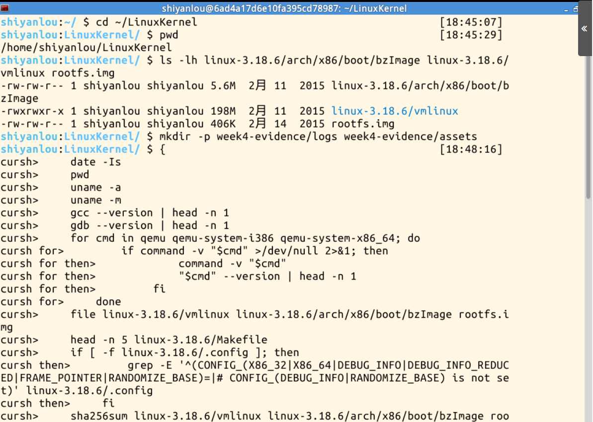

确认实际使用的 QEMU 命令后，`command -v "$QEMU"` 输出 `/usr/bin/qemu`。后续在同一终端用 `"$QEMU"` 启动，它在本次环境中对应 `qemu`。

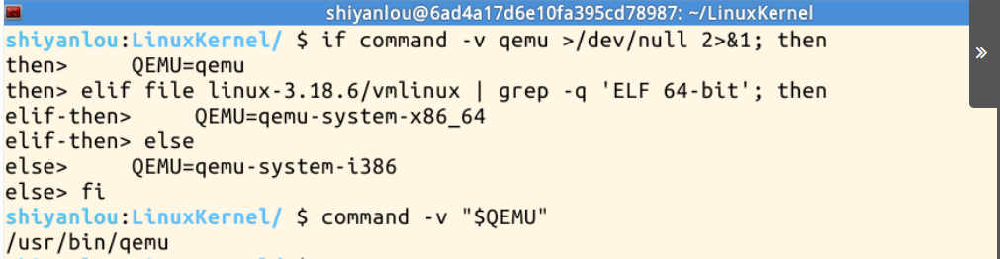

这里需要区分三个输入文件的职责：`bzImage` 用来启动内核，`vmlinux` 用来加载调试符号，`rootfs.img` 提供初始用户态环境。GDB 加载的是未压缩的 `vmlinux`，不是启动用的 `bzImage`。

### 3.3 正常启动并观察 MenuOS

首先不启用调试暂停，确认内核与根文件系统能够正常启动：

```bash
qemu -kernel linux-3.18.6/arch/x86/boot/bzImage -initrd rootfs.img
```

QEMU 窗口出现启动信息和 MenuOS 标识，随后显示 `MenuOS>>` 提示符。在控制台输入 `help`，可以看到以下命令说明：

```text
help - Menu List:
version - XXX V1.0(Menu program v1.0 inside)
quit - Quit from XXX
```

输入 `version` 后再次出现菜单提示符。截图中版本文字位于 `help` 列出的命令说明中，没有显示另一行独立的版本输出，因此这里以实际可见内容记录菜单行为。

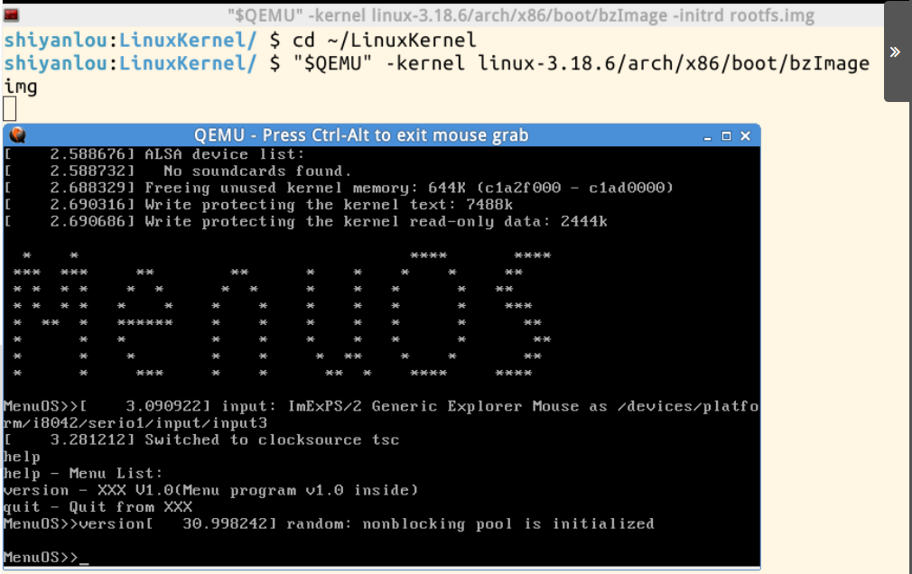

正常启动说明这组实验文件可以进入用户态交互环境，也为后续带调试的启动提供了对照。

### 3.4 暂停启动并建立 GDB 连接

关闭第一次 QEMU 后，增加 `-s -S` 重新启动：

```bash
qemu -kernel linux-3.18.6/arch/x86/boot/bzImage -initrd rootfs.img -s -S
```

其中，`-s` 开启默认1234端口的 GDB 调试服务，`-S` 让 CPU 在启动时暂停。此时窗口标题显示 `QEMU [Stopped]`，黑屏与暂停参数相符。

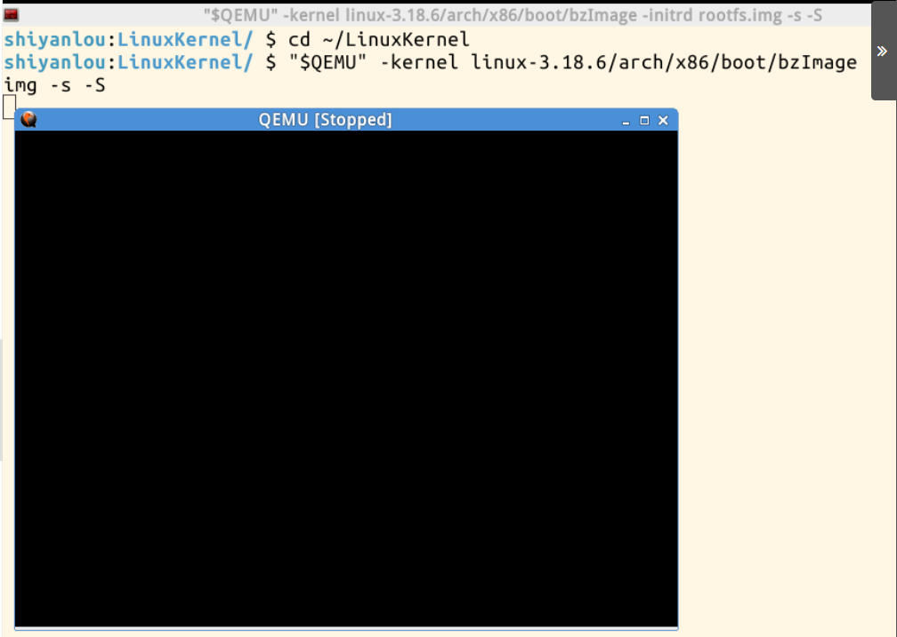

另开终端运行 GDB。启动信息确认本次版本为 GNU GDB 7.7.1，并在调试前设置日志、加载符号与源码搜索目录：

```bash
cd ~/LinuxKernel
gdb
```

```gdb
set pagination off
set logging file week4-evidence/logs/gdb-boot.log
set logging overwrite off
set logging on
file linux-3.18.6/vmlinux
directory linux-3.18.6
show architecture
info address start_kernel
```

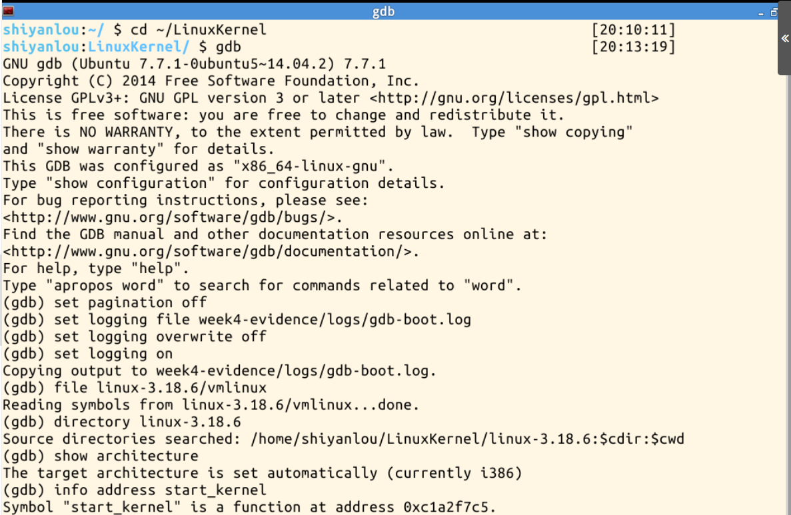

首次调试时，加载符号后没有完成远程目标连接，后续执行 `continue` 报错。修正时补上连接命令：

```gdb
target remote localhost:1234
```

连接成功后，GDB 输出 `Remote debugging using localhost:1234`，CPU 停在 `0x0000fff0 in ?? ()`。此时尚处于早期启动位置，没有对应 C 源码并不意味着内核启动失败。

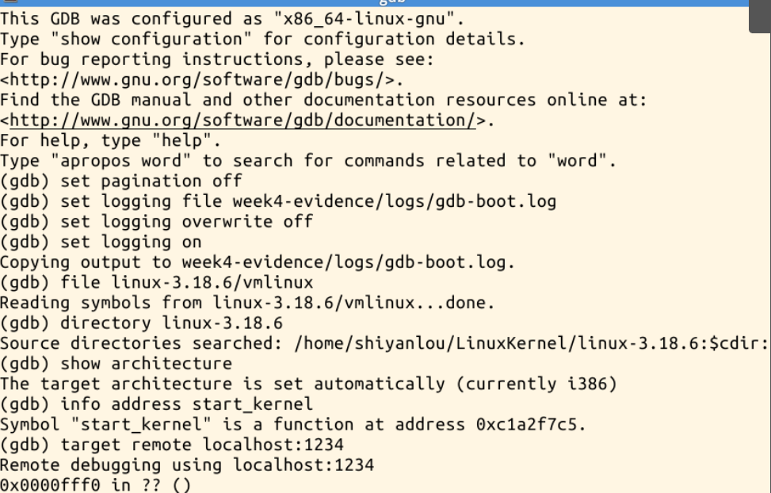

### 3.5 start_kernel：进入主要 C 初始化入口

设置临时断点并继续执行，随后查看源码、调用栈和寄存器：

```gdb
tbreak start_kernel
continue
bt
list
info registers
```

截图中的 `EIP` 为 `0xc1a2f7c5`，对应 `<start_kernel>`，源码显示 `init/main.c` 第500行附近的函数定义；`ESP`、`EBP` 指向启动阶段使用的栈区域。这表明目标已经从早期启动位置运行到内核 C 初始化入口。

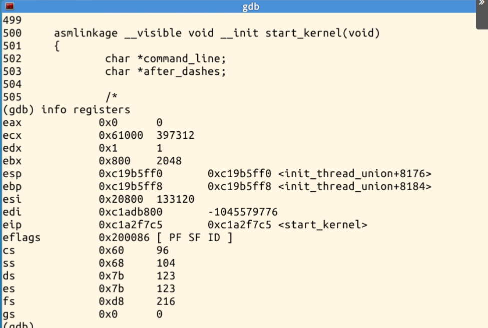

`start_kernel()` 组织体系结构设置、内存管理、调度器和中断等初始化。它是本次跟踪的起点，但不是 CPU 上电后执行的第一条指令。在它之前，体系结构相关代码已经为 C 代码运行准备了必要环境。

### 3.6 rest_init：分析初始任务的创建

继续设置断点，查看 `rest_init()` 及其关键语句：

```gdb
tbreak rest_init
continue
bt
list rest_init
list
```

本次源码中，第403行和第405行分别出现：

```c
kernel_thread(kernel_init, NULL, CLONE_FS);
/* 中间还有 numa_default_policy() 等语句 */
pid = kernel_thread(kthreadd, NULL, CLONE_FS | CLONE_FILES);
```

第一条创建以 `kernel_init` 为入口的任务，使其获得 PID 1；第二条创建 `kthreadd`，对应 PID 2。截图中的源码注释说明，先创建 init 是为了使它获得1号 PID，同时后续初始化还需要等待 `kthreadd` 准备好。

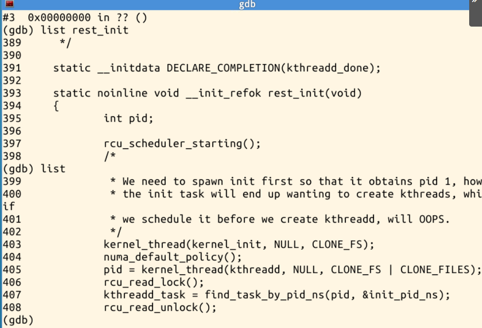

这里发生的是任务创建。`rest_init()` 由启动任务 PID 0 执行，而 `kernel_init()` 会在新任务获得调度后执行，不能把它们简单理解成普通的父子函数调用。PID 0 在后续调度后进入空闲路径，PID 2 则承担后续内核线程创建请求的服务工作。

### 3.7 kernel_init：观察 PID 1 的内核执行阶段

```gdb
tbreak kernel_init
continue
bt
list kernel_init
```

GDB 实际命中：

```text
Temporary breakpoint 3, kernel_init (unused=0x0)
at init/main.c:931
```

调用栈中能够看到 `kernel_init` 和 `ret_from_kernel_thread`，后者位于32位 x86 的 `entry_32.S`。这与前一步“创建新任务后通过线程入口执行”的分析相符，而不是继续沿用 `start_kernel → rest_init` 的普通调用栈。

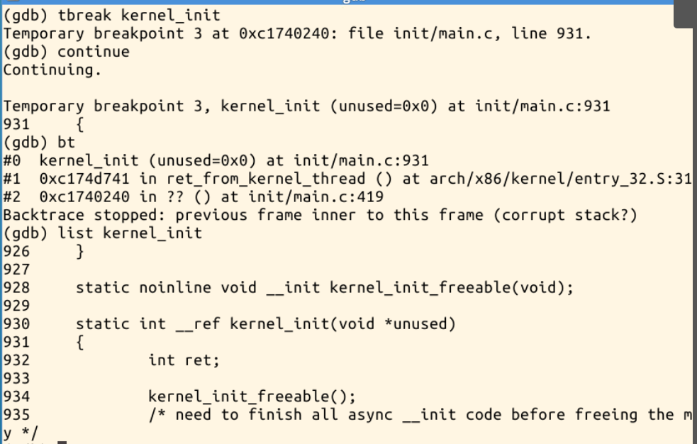

此时 PID 1 已经开始执行，但仍在内核中完成初始化。源码第934行调用 `kernel_init_freeable()`，还没有进入用户态 `/init`。

### 3.8 kernel_init_freeable：继续完成启动初始化

```gdb
tbreak kernel_init_freeable
continue
bt
list kernel_init_freeable
```

GDB 命中 `init/main.c:976`。调用栈中，第0帧为 `kernel_init_freeable`，第1帧为 `kernel_init`，对应源码第934行，能够直接观察到二者的调用关系。函数开头还显示：

```c
wait_for_completion(&kthreadd_done);
```

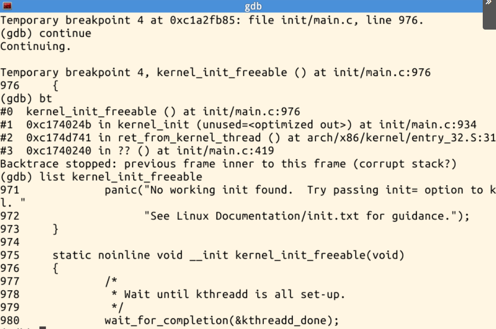

这一步等待 `kthreadd` 的创建与相关准备完成。结合 Linux 3.18.6 的源码继续分析，该函数还组织后续初始化、执行 `do_basic_setup()`、准备控制台文件描述符，并检查早期用户态 init。截图直接展示的是函数入口与等待语句，后续步骤的职责来自源码分析。

返回 `kernel_init()` 后，还需要同步异步初始化、释放初始化内存并设置系统运行状态，之后才进入 init 程序装载阶段。

### 3.9 run_init_process：确定本次实际加载的 init

```gdb
tbreak run_init_process
continue
bt
info args
list
x/s init_filename
```

GDB 实际命中 `run_init_process`，参数、调用栈和字符串检查都指向同一个路径：

```text
init_filename = 0xc18d295d "/init"
0xc18d295d: "/init"
```

调用栈显示该次调用来自 `kernel_init` 的第945行，说明本次实际尝试的是根文件系统中的 `/init`，不能将默认回退路径 `/sbin/init` 写成本次已经执行的路径。

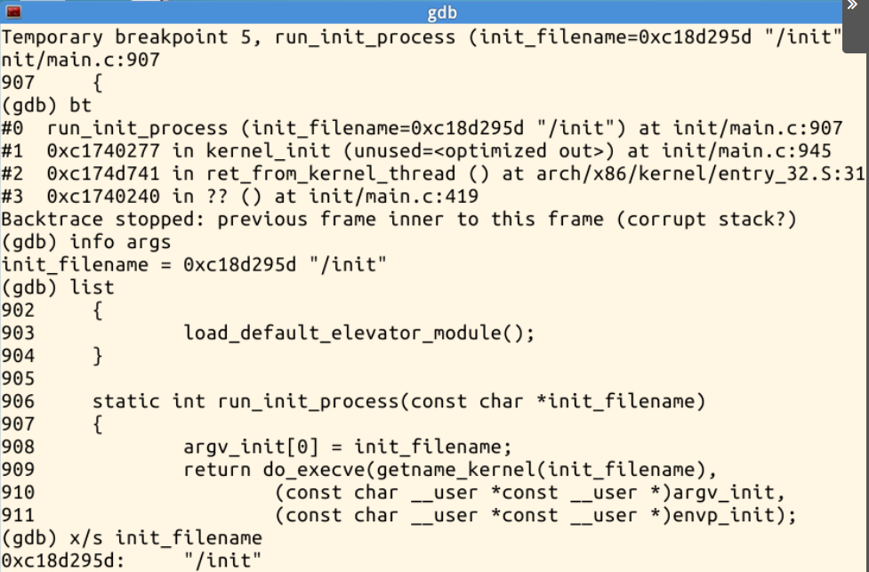

截图中的 Linux 3.18.6 源码为：

```c
static int run_init_process(const char *init_filename)
{
    argv_init[0] = init_filename;
    return do_execve(getname_kernel(init_filename),
        (const char __user *const __user *)argv_init,
        (const char __user *const __user *)envp_init);
}
```

它把程序路径设置为初始参数，然后调用 `do_execve()` 装载用户程序。本次没有另设 `do_execve` 断点逐步跟踪其内部实现，因此对装载内部机制的说明属于源码分析，直接调试证据是本函数入口、实际参数及下一步的返回值。

### 3.10 使用 finish 检查加载返回值

停在 `run_init_process` 时执行：

```gdb
finish
```

GDB 返回到 `kernel_init` 的 `init/main.c:946`，对应 `if (!ret)` 判断，并显示：

```text
Value returned is $1 = 0
```

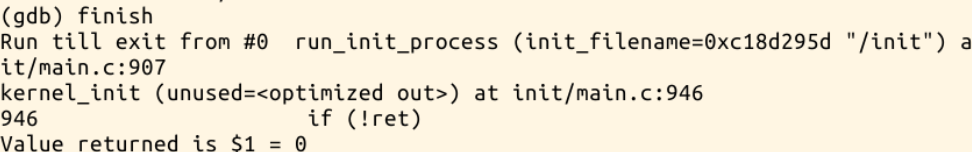

返回值为0，表明本次 `/init` 的 exec 装载成功。此时仍停在内核内部返回点，需要继续运行，才能观察后续用户态程序的执行。

### 3.11 继续运行并验证 MenuOS 交互

```gdb
info breakpoints
continue
```

GDB 显示 `No breakpoints or watchpoints.`，说明已命中的临时断点没有继续保留。随后 QEMU 出现 MenuOS 标识和提示符，输入 `help` 后列出菜单命令，输入 `version` 后再次返回提示符。

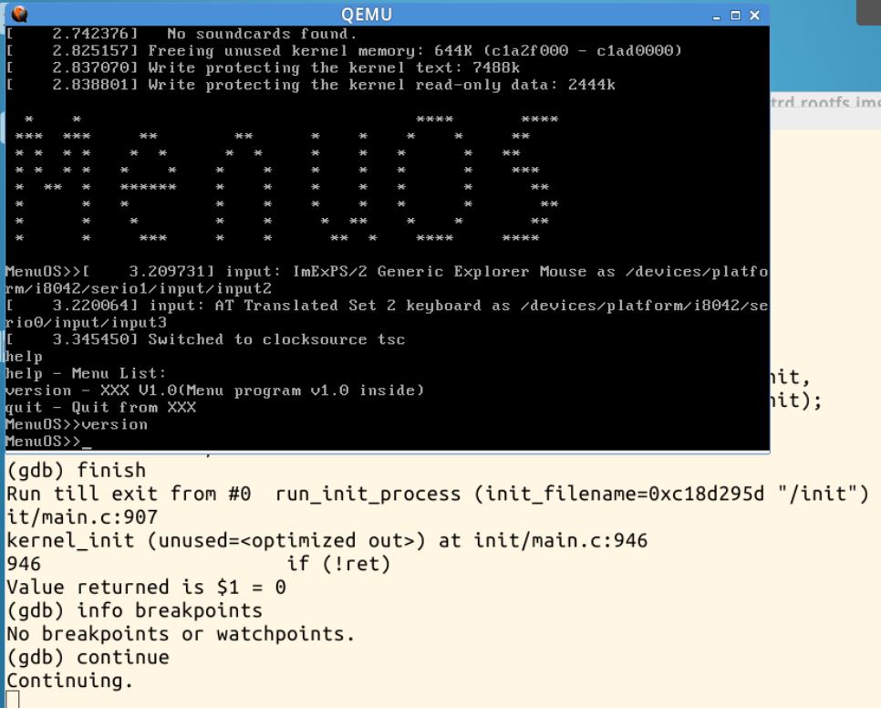

这张截图同时保留了后方 GDB 的加载返回值与 `continue` 操作，以及前方 QEMU 的用户态交互。结合前面记录的 `/init` 路径和返回值，可以确认本次从内核初始化推进到了用户程序实际运行，完成老师要求的启动过程跟踪。

现有材料没有展开 `rootfs.img` 的内部内容，因此不进一步断言 menu 可执行文件本身就是 PID 1。可以确认的是：内核成功装载 `/init`，继续执行后进入了它所启动的 MenuOS 交互环境。

---

## 04｜启动过程的整体分析

### 4.1 关键执行关系

```text
早期引导与体系结构初始化
    ↓
start_kernel()
    ↓ 普通函数调用
rest_init()                         [PID 0 执行]
    ├─ 创建 kernel_init 任务         [PID 1]
    │       ↓ 获得调度后开始执行
    │   kernel_init()
    │       ├─ kernel_init_freeable()
    │       ├─ 完成同步、释放初始化内存等工作
    │       └─ run_init_process("/init")
    │               └─ do_execve(...)，本次返回0
    │                       ↓ 后续体系结构返回路径
    │                   用户态 /init → MenuOS 交互
    ├─ 创建 kthreadd                [PID 2]
    └─ 调度后进入空闲路径             [PID 0]
```

图中 `rest_init` 创建 PID 1 后到 `kernel_init` 的箭头表示任务获得执行机会，不是一次普通的函数调用；`kernel_init` 到 `kernel_init_freeable` 则是可以在调用栈中直接观察到的函数调用关系。

### 4.2 PID 0、PID 1 和 PID 2 的职责

| 任务 | 来源与职责 | 与本次观察的关系 |
| :--- | :--- | :--- |
| PID 0 | 启动任务，完成启动工作后进入空闲路径 | 执行 `start_kernel`、`rest_init` 所在的启动主线 |
| PID 1 | 由 `rest_init` 创建，先执行 `kernel_init`，再装载 init 用户程序 | 本次实际尝试 `/init`，装载返回0 |
| PID 2 | `kthreadd`，处理后续内核线程创建请求 | 创建语句和 `kthreadd_done` 等待关系解释了初始化依赖 |

上述 PID 职责依据本次源码及 Linux 3.18.6 的启动机制分析，截图没有额外打印三个任务对象的 `pid` 字段。不能把 GDB 的回溯帧号、断点编号或虚拟 CPU 线程编号当作 Linux PID。

### 4.3 创建 PID 1、装载 init 与进入用户态的区别

命中 `kernel_init()`，说明 PID 1 已开始执行内核代码；命中 `run_init_process()` 并读取 `/init`，说明内核正尝试装载该程序；`finish` 返回0说明装载成功；继续执行后出现 menu 命令交互，才进一步提供了用户程序实际运行的证据。

exec 装载改变的是当前任务运行的程序映像，不是为 init 再分配一个新的 PID。这里从内核初始化阶段推进到用户程序执行，也不能直接等同于普通用户程序发起一次系统调用再回到原调用点。两种过程都涉及执行状态和返回路径，但起点与目标不同。

---

## 05｜实验中出现的问题与分析

### 5.1 加载了符号，但没有连接到运行目标

首次设置 `start_kernel` 断点后，执行 `continue` 出现：

```text
The program is not being run.
No stack.
The program has no registers now.
```

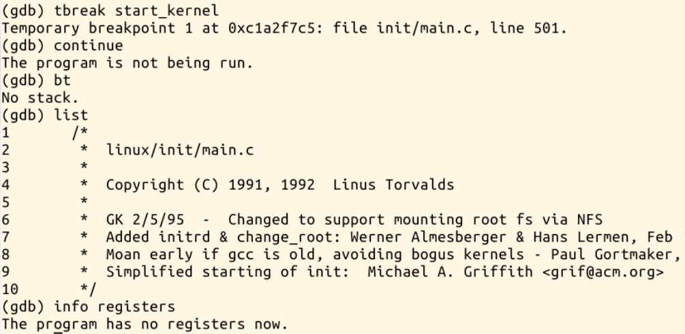

当时 GDB 已能加载符号、定位断点和列出源码，但还没有连接 QEMU，所以不存在可继续执行的远程目标，也无法读取当前调用栈与寄存器。`list` 能显示文件内容，只能说明源码可读，不能证明内核已经运行到该位置。

补上 `target remote localhost:1234` 后，GDB 显示远程连接成功，后续 `kernel_init`、`kernel_init_freeable` 和 `run_init_process` 均有实际命中记录，`start_kernel` 处也能读取寄存器。问题由此得到修正，不需要更换内核或重新编译。

### 5.2 回溯在内核线程入口附近停止

成功调试后，部分 `bt` 输出仍提示：

```text
Backtrace stopped: previous frame inner to this frame (corrupt stack?)
```

这一提示出现在跨越内核线程启动／汇编入口的回溯中。现有截图不足以证明真的发生了内核栈破坏，也不足以确定具体是帧布局、展开信息还是其他因素导致 GDB 无法继续回溯。

因此，分析时保留能可靠识别的帧，例如 `kernel_init_freeable → kernel_init → ret_from_kernel_thread`，不手工补造更深层的调用栈。后续 `/init` 装载返回0且 MenuOS 正常交互，说明这条回溯提示没有阻止本次启动跟踪完成。

### 5.3 调试中需要区分的几类输出

| 输出或现象 | 本次应作的解释 |
| :--- | :--- |
| 刚连接时出现 `0x0000fff0 in ?? ()` | CPU 尚在早期启动位置，没有对应 C 函数符号 |
| `unused=<optimized out>` | 编译优化后 GDB 无法恢复该参数值，不等于函数没有执行 |
| `Value returned is $1 = 0` | 内核内部 `run_init_process` 的返回值，说明本次装载成功 |
| `No breakpoints or watchpoints.` | 已命中的临时断点已删除，可继续推进启动 |
| `No soundcards found.` | 声卡相关的启动信息；本次其后仍成功进入菜单 |

其中 `run_init_process` 返回0，不与“用户态 exec 成功后不返回原程序”的规则矛盾：本次观察的是内核辅助函数返回到 `kernel_init`，之后才经后续路径运行装载的用户程序。

---

## 06｜本周总结

通过第4章阅读，可以把系统调用理解为用户程序请求内核服务的一套完整机制：库函数提供接口，体系结构指令建立受控入口，内核保存状态、按调用号分派服务，并在处理返回前工作后恢复用户态执行。x86 与 ARM64 在指令、寄存器和异常入口上不同，但都需要明确执行权限与上下文的转换关系。

本次实验从另一方向验证了这些概念。Linux 内核先建立基础运行环境，再由 `rest_init()` 创建初始任务；PID 1 先执行 `kernel_init()` 继续初始化，随后装载用户态 init。本次实际装载的是 `/init`，返回值为0，继续执行后 MenuOS 能接受命令，形成了从内核 C 入口到用户程序运行的连续观察主线。

调试过程中，首次“符号已加载但目标未连接”的报错说明，源码可读与目标可执行是两个条件；内核线程入口附近的回溯提示则说明，不能把调试器的每条诊断都直接当成内核故障。结合源码、断点、参数、返回值和最终运行现象进行判断，比单独依赖某一张截图更能说明程序的真实执行过程。
