# main 函数参数实验

| 项目 | 内容 |
| --- | --- |
| 姓名 | 刘顺文 |
| 学号 | 20262819 |
| 作业类型 | Linux 课上检验 |
| 实验主题 | C 程序的命令行参数与选项解析 |
| 实践环境 | linux虚拟机 |
| 整理日期 | 2026-10-12 |
| 实践日期 | 2026-10-12 |
| 完成状态 | 已完成 |

## 一、学习内容

本次实验围绕 `main` 函数的命令行参数展开，依次完成打印参数、参数加法、短选项解析、多个文件的换行符统计，以及带值选项解析五个例子。重点是理解启动命令怎样对应到 `argc` 和 `argv`，以及程序如何检查、转换和使用这些参数。

带参数的 `main` 函数可以写成：

```c
int main(int argc, char *argv[])
```

| 项目 | 含义 |
| --- | --- |
| `argc` | 参数总数；通常从终端启动时包含程序名 |
| `argv` | 保存参数字符串指针的数组 |
| `argv[0]` | 通常为启动程序时使用的程序名或路径 |
| `argv[1]` | 用户提供的第一个参数 |
| `argv[argc - 1]` | 当 `argc > 0` 时，最后一个参数 |
| `argv[argc]` | 空指针 `NULL`，表示参数数组的结束位置 |

例如，运行 `./printargs a.txt 100` 时，`argc` 为3，`argv[0]` 为 `./printargs`，`argv[1]` 为 `a.txt`，`argv[2]` 为 `100`。数字参数 `100` 此时仍然是字符串，进行数值运算前需要转换。

Shell 先处理空格、引号等，再启动程序。`hello world` 通常会形成两个参数，而 `"hello world"` 会形成一个包含空格的参数；用于分组的引号本身通常不会传入程序。

## 二、实践准备

### 2.1 确认环境并创建目录

以下命令均在 Linux 终端中执行，实验文件统一放在个人主目录下的 `main_args_homework` 中。

```bash
uname -a
uname -m
gcc --version
mkdir -p ~/main_args_homework
cd ~/main_args_homework
pwd
```

`uname -a` 用于查看系统信息，`uname -m` 用于查看体系结构，`gcc --version` 用于确认编译器可用。环境版本应根据实际输出填写，不直接沿用以前作业中的版本。

如果提示找不到 `gcc`，先确认当前实验平台和 Linux 发行版，再处理编译环境。后续步骤以 GCC 已可正常使用为前提。

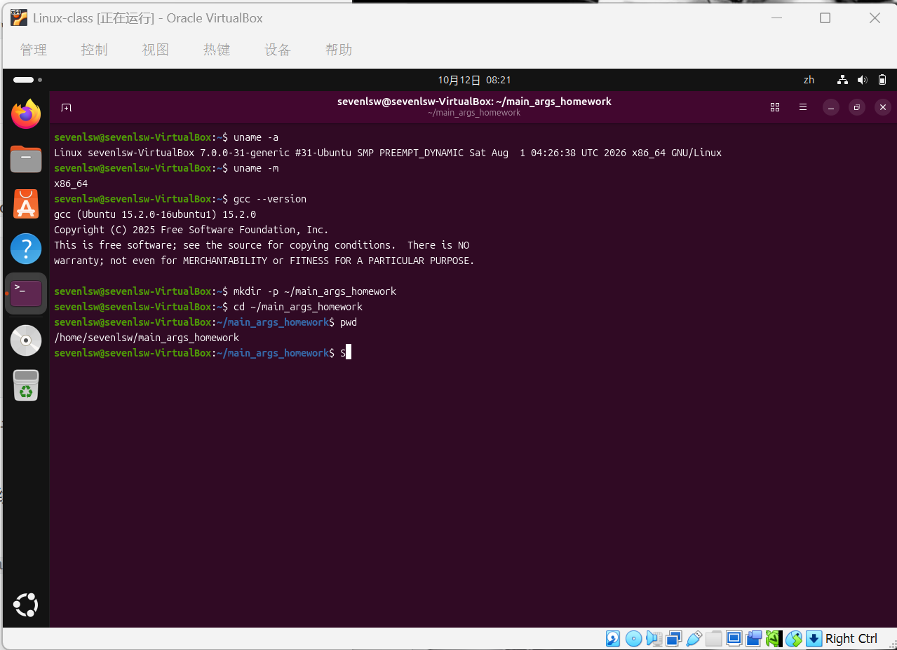

### 2.2 编写、编译与记录的方法

每个例子分别保存为一个 `.c` 文件。在终端执行对应的 `vim 文件名.c` 后，按 `i` 进入插入模式，输入或粘贴本节代码；完成后按 `Esc`，输入 `:wq` 并回车保存退出。也可以使用 Linux 环境中的图形文本编辑器保存同名文件。

本次统一采用以下编译形式：

```bash
gcc -std=c11 -Wall -Wextra 源文件.c -o 程序名
```

实际操作时需要替换源文件和程序名，具体命令见各实验小节。`-std=c11` 指定 C11 标准，`-Wall -Wextra` 开启常用警告，`-o` 指定输出程序名。编译成功时通常没有终端输出；若有错误，先修正再运行，避免误用以前生成的程序。

## 三、main 函数参数实践

### 3.1 遍历并打印所有参数

**实验目的：** 理解参数个数、数组下标和程序名之间的关系，并比较有无参数、带空格参数时的区别。

**第一步：创建源文件。**

```bash
cd ~/main_args_homework
vim printargs.c
```

写入以下代码：

```c
#include <stdio.h>

int main(int argc, char *argv[])
{
    printf("参数总数: %d\n", argc);
    for (int i = 0; i < argc; i++) {
        printf("argv[%d]: %s\n", i, argv[i]);
    }
    return 0;
}
```

**第二步：编译并运行。**

```bash
gcc -std=c11 -Wall -Wextra printargs.c -o printargs
./printargs
./printargs hello world 123
./printargs "hello world" 123
```

**参考结果与观察点：**

| 运行命令 | 预期 `argc` | 用户提供的参数 |
| --- | --- | --- |
| `./printargs` | 1 | 无 |
| `./printargs hello world 123` | 4 | `hello`、`world`、`123` |
| `./printargs "hello world" 123` | 3 | `hello world`、`123` |

第二条命令的参考输出为：

```text
参数总数: 4
argv[0]: ./printargs
argv[1]: hello
argv[2]: world
argv[3]: 123
```

循环从0开始，因此程序名也会被打印。循环条件为 `i < argc`，不应写成 `i <= argc`：`argv[argc]` 是 `NULL`，不能当作普通字符串交给 `%s` 输出。

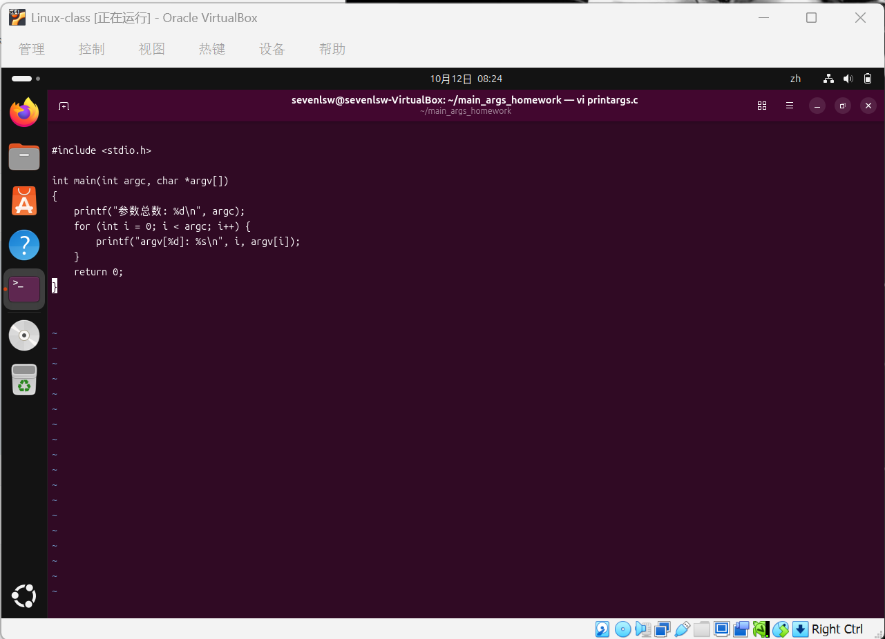

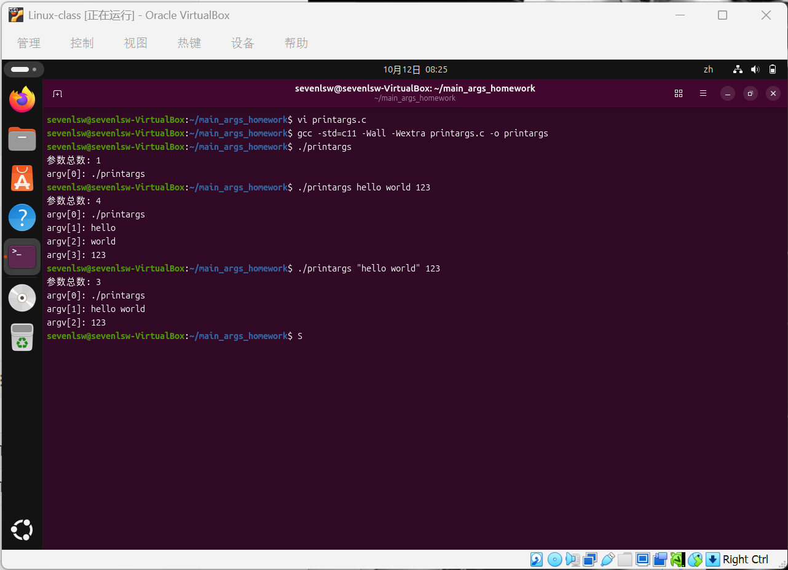

### 3.2 将字符串参数转换为整数并做加法

**实验目的：** 理解命令行数字也是字符串，学习参数个数检查和 `atoi` 的基本用法。

**第一步：创建源文件。**

```bash
vim add.c
```

写入以下代码：

```c
#include <stdio.h>
#include <stdlib.h>

int main(int argc, char *argv[])
{
    if (argc != 3) {
        printf("用法: %s 数字1 数字2\n", argv[0]);
        printf("例子: %s 12 34\n", argv[0]);
        return 1;
    }

    int a = atoi(argv[1]);
    int b = atoi(argv[2]);
    printf("%d + %d = %d\n", a, b, a + b);
    return 0;
}
```

**第二步：编译并测试正常输入和参数不足的情况。**

```bash
gcc -std=c11 -Wall -Wextra add.c -o add
./add 12 34
echo $?
./add -5 8
./add 12
echo $?
./add 12 34 56
```

**参考结果与观察点：**

| 输入 | 参考结果 |
| --- | --- |
| `./add 12 34` | `12 + 34 = 46`，退出状态为0 |
| `./add -5 8` | `-5 + 8 = 3` |
| `./add 12` | 显示用法和例子，退出状态为1 |
| `./add 12 34 56` | 显示用法和例子 |

两个用户参数加上程序名，要求 `argc == 3`。检查参数个数后再访问 `argv[1]` 和 `argv[2]`，可以避免参数不足时访问无效位置。

`atoi` 声明在 `<stdlib.h>` 中。本例用于练习格式正确、数值较小的整数输入；它没有完整的输入合法性检查。例如 `atoi("abc")` 得到0，`atoi("12abc")` 得到12，不能据此判断输入是合法整数。实际工具通常使用 `strtol` 检查非法字符和范围，做加法时还需要考虑结果溢出。

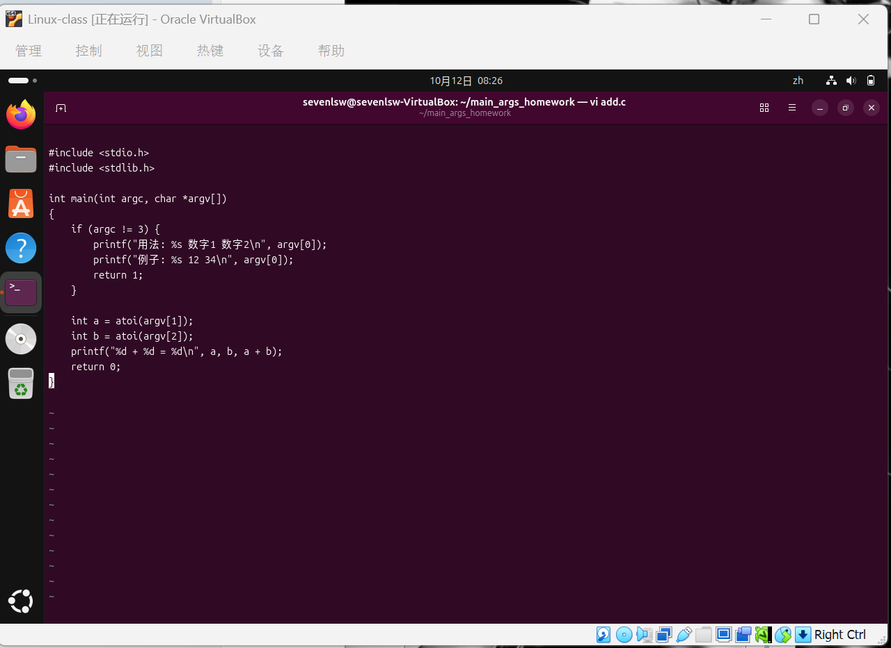

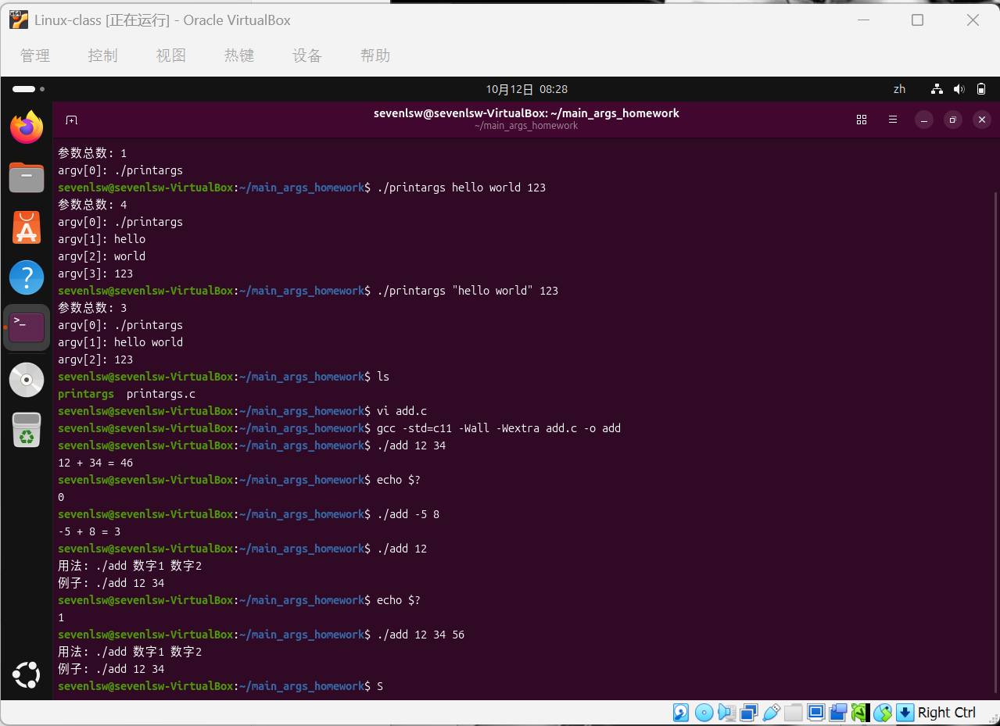

### 3.3 解析不带值的短选项

**实验目的：** 模拟 `ls -l -a` 中独立短选项的解析，理解字符串比较和功能标志。

**第一步：创建源文件。**

```bash
vim myfind.c
```

写入以下代码：

```c
#include <stdio.h>
#include <string.h>

int main(int argc, char *argv[])
{
    int show_detail = 0;
    int show_all = 0;

    for (int i = 1; i < argc; i++) {
        if (strcmp(argv[i], "-l") == 0) {
            show_detail = 1;
        } else if (strcmp(argv[i], "-a") == 0) {
            show_all = 1;
        }
    }

    printf("详细模式: %s\n", show_detail ? "开启" : "关闭");
    printf("显示所有文件: %s\n", show_all ? "开启" : "关闭");
    return 0;
}
```

**第二步：编译并比较不同选项。**

```bash
gcc -std=c11 -Wall -Wextra myfind.c -o myfind
./myfind
./myfind -l
./myfind -a
./myfind -l -a
./myfind -a -l
./myfind -la
```

**参考结果与观察点：**

| 用户参数 | 详细模式 | 显示所有文件 |
| --- | --- | --- |
| 无 | 关闭 | 关闭 |
| `-l` | 开启 | 关闭 |
| `-a` | 关闭 | 开启 |
| `-l -a` 或 `-a -l` | 开启 | 开启 |
| `-la` | 关闭 | 关闭 |

循环从1开始，跳过程序名。`strcmp` 返回0表示两个字符串内容相同；不能使用 `argv[i] == "-l"` 判断字符串内容是否相等。

本例只匹配独立的 `-l` 和 `-a`，没有实现组合选项 `-la`，也没有对未知选项报错。因此它与真实 `ls` 的行为不同。程序只输出模式是否开启，没有真正列出或查找文件。Linux 下更完整的短选项解析可以使用 `getopt`。

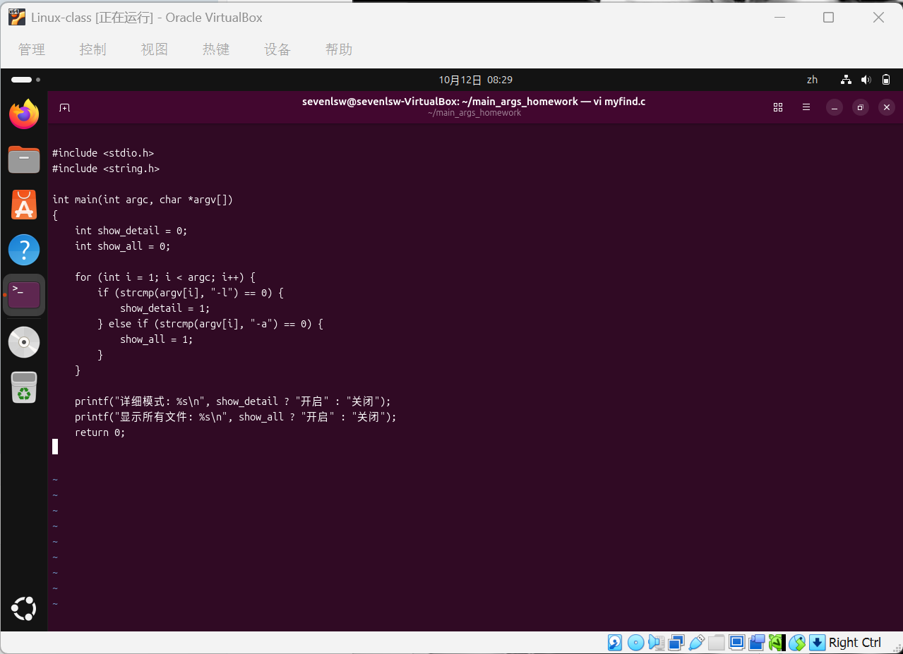

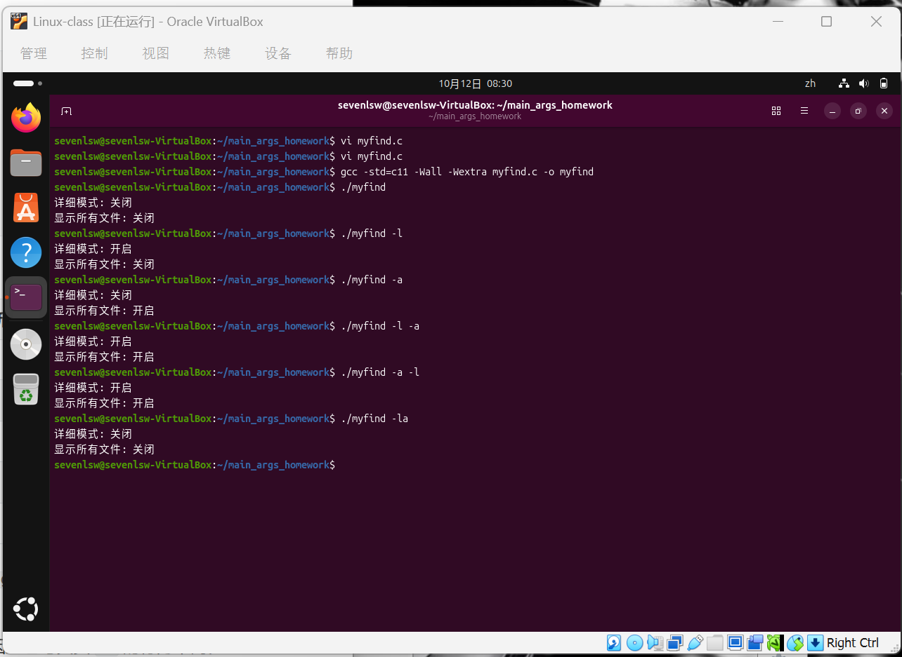

### 3.4 接收多个文件名并批量统计换行符

**实验目的：** 将每个用户参数作为文件名处理，理解循环、文件打开失败后的继续处理，以及行数统计的具体规则。

**第一步：准备测试文件。**

```bash
cd ~/main_args_homework
printf '第一行\n第二行\n第三行\n' > a.txt
printf '第一行\n第二行\n' > b.txt
printf '这一行末尾没有换行符' > c.txt
printf '包含空格的文件名\n' > 'space name.txt'
wc -l a.txt b.txt c.txt 'space name.txt'
```

这些命令创建本目录中的测试文件，再次执行会覆盖同名文件。`a.txt` 含3个换行符，`b.txt` 含2个，`c.txt` 含0个，`space name.txt` 含1个。`wc -l` 可以作为换行符计数的对照。

**第二步：创建源文件。**

```bash
vim countline.c
```

写入以下代码：

```c
#include <stdio.h>

int count_lines(FILE *fp)
{
    int lines = 0;
    int ch;
    rewind(fp);
    while ((ch = fgetc(fp)) != EOF) {
        if (ch == '\n') {
            lines++;
        }
    }
    return lines;
}

int main(int argc, char *argv[])
{
    if (argc < 2) {
        printf("用法: %s 文件1 文件2 ...\n", argv[0]);
        return 1;
    }

    for (int i = 1; i < argc; i++) {
        FILE *fp = fopen(argv[i], "r");
        if (fp == NULL) {
            perror(argv[i]);
            continue;
        }
        int lines = count_lines(fp);
        printf("%s: %d行\n", argv[i], lines);
        fclose(fp);
    }
    return 0;
}
```

**第三步：编译并测试多个文件。**

```bash
gcc -std=c11 -Wall -Wextra countline.c -o countline
./countline a.txt b.txt c.txt
./countline
./countline a.txt ./not-created-for-test.txt b.txt
./countline "space name.txt"
```

执行第三条运行命令前，确认本目录中没有 `not-created-for-test.txt`；若已经存在，改用另一个不存在的文件名即可，无需删除已有文件。

**参考结果与观察点：**

第一条运行命令的参考输出为：

```text
a.txt: 3行
b.txt: 2行
c.txt: 0行
```

本例沿用材料中的显示文字“行”，实际统计的是 `\n` 的个数。`c.txt` 虽然有文字，但没有换行符，所以输出0；若要把末尾没有换行符的非空文本也计为一行，需要修改计数逻辑。

`fgetc` 的返回值使用 `int` 保存，以便区分字符值与 `EOF`。`rewind` 将文件位置移回开头；本例刚打开文件时本就在开头，保留它便于理解函数行为。每个成功打开的文件处理完后使用 `fclose` 关闭。

文件不存在时，`fopen` 返回 `NULL`，`perror` 输出相关错误，`continue` 跳过当前文件并继续处理下一个。错误文字可能因系统语言而不同。此示例即使有文件打开失败，循环结束仍返回0，因此退出状态不能证明所有文件都处理成功。含空格的文件名需要使用引号，使其作为一个参数传入。

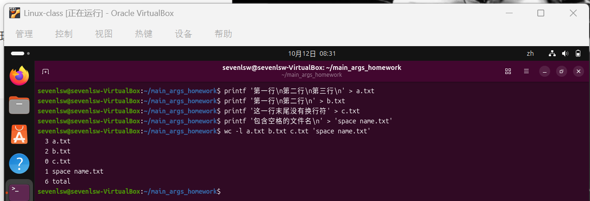

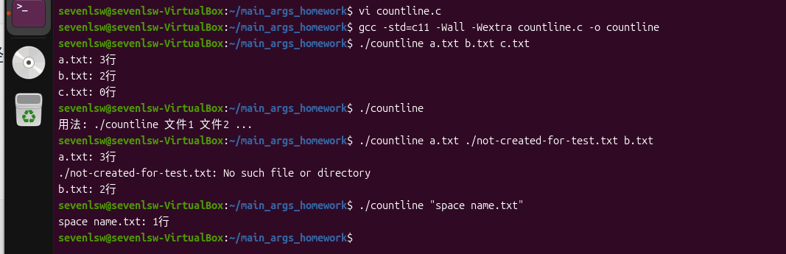

### 3.5 解析带值的选项

**实验目的：** 模拟 `gcc -o output hello.c` 中的带值选项，理解索引移动和边界检查。

**第一步：创建源文件。**

```bash
vim compile.c
```

写入以下代码：

```c
#include <stdio.h>
#include <string.h>

int main(int argc, char *argv[])
{
    char *output_file = NULL;
    char *input_file = NULL;
    int i = 1;

    while (i < argc) {
        if (strcmp(argv[i], "-o") == 0) {
            if (i + 1 >= argc) {
                printf("-o选项需要指定输出文件名\n");
                return 1;
            }
            output_file = argv[++i];
        } else {
            if (input_file == NULL) {
                input_file = argv[i];
            }
        }
        i++;
    }

    if (input_file == NULL) {
        printf("必须指定输入文件名\n");
        return 1;
    }

    printf("输入文件: %s\n", input_file);
    if (output_file != NULL) {
        printf("输出文件: %s\n", output_file);
    }
    return 0;
}
```

**第二步：编译并测试参数顺序和缺失情况。**

```bash
gcc -std=c11 -Wall -Wextra compile.c -o compile
./compile hello.c -o myrun
./compile -o myrun hello.c
./compile hello.c
./compile -o
echo $?
./compile -o myrun
echo $?
```

**参考结果与观察点：**

| 用户参数 | 参考结果 |
| --- | --- |
| `hello.c -o myrun` | 输入文件为 `hello.c`，输出文件为 `myrun` |
| `-o myrun hello.c` | 与上一条相同 |
| `hello.c` | 仅打印输入文件 |
| `-o` | 提示 `-o选项需要指定输出文件名`，退出状态为1 |
| `-o myrun` | 提示 `必须指定输入文件名`，退出状态为1 |

第一条运行命令的参考输出为：

```text
输入文件: hello.c
输出文件: myrun
```

程序识别 `-o` 后，先检查后面是否还有参数，再通过 `argv[++i]` 取得输出文件名。循环末尾的 `i++` 会继续前进，避免将刚取得的输出文件名再次作为输入文件处理。

例如 `./compile hello.c -o myrun` 中，遇到 `-o` 时 `i == 2`，执行 `++i` 后变为3，取得 `argv[3]`，随后循环末尾将 `i` 增至4并结束。

本程序只解析并打印文件名，不会真正编译文件或生成 `myrun`，也不检查输入文件是否存在，因此测试时无需创建 `hello.c`。它只保存第一个未匹配 `-o` 的参数，未实现未知选项、多个输入文件等情况的完整检查。

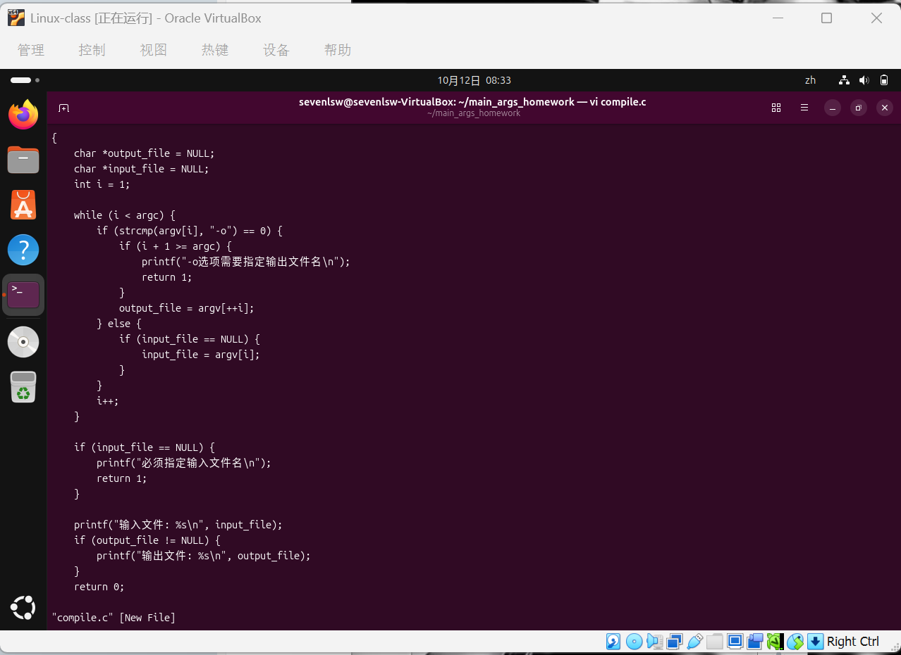

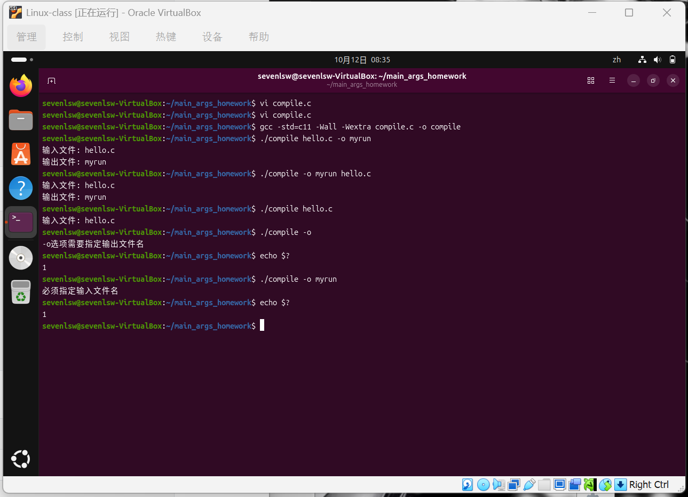

## 四、易错点与注意事项

| 容易出错的位置 | 需要注意的内容 |
| --- | --- |
| 执行环境 | 本文命令在 Linux 终端中执行 |
| 参数个数 | 通常从终端启动时，程序名也计入 `argc` |
| 参数类型 | 所有命令行参数都以字符串形式传入，数字需要转换 |
| 数组边界 | 打印参数使用 `i < argc`；取下一个参数前先检查边界 |
| 字符串比较 | 使用 `strcmp`，返回0表示内容相同 |
| 空格与引号 | 含空格的参数或文件名用引号包围 |
| 短选项解析 | 本例不支持 `-la`，不能直接按真实 `ls` 的规则理解 |
| 数字转换 | `atoi` 不适合完整的输入校验；本例使用合法的小整数 |
| 文件计数 | 本例统计换行符，末尾无换行符的文本不会额外计为一行 |
| 退出状态 | `echo $?` 要紧接所需检查的命令执行 |
| 实验记录 | 参考输出与实际输出分开，截图应来自本人真实操作 |

## 五、实验总结

本次实验的知识联系是：启动命令经过 Shell 处理后，参数以字符串形式进入 `main`；`argc` 用于确定参数数量，`argv` 用于访问具体内容。打印参数是基础，数字转换、选项匹配和多个文件处理都建立在这一机制上。

参数解析还需要与后续处理区分：识别 `-l` 不等于真正显示文件详情，识别输入、输出文件名也不等于真正完成编译。程序是否按预期处理，应结合实际输出、错误提示和必要的退出状态判断。
