# 课上测试：C编程工具测试（AI）

| 项目 | 内容 |
| --- | --- |
| 姓名 | 刘顺文 |
| 学号 | 20262819 |
| 作业类型 | Linux 课上检验 |
| 实验主题 | 分步编译、端序判断、静态库与共享库、目录组织和 Makefile |
| 推荐系统 | openEuler |
| 实践环境 | Linux虚拟机 |
| 整理日期 | 2026-10-12 |
| 实践日期 | 2026-10-12 |
| 完成状态 | 已完成 |

## 一、学习内容

本次实验分为五项任务：编写输出学号和姓名的程序并完成四个编译阶段，使用联合和指针两种方法判断端序，制作并使用静态库和共享库，按指定目录组织文件，以及编写放在 `bin/` 中且不使用变量的 Makefile。

实验主线是“源代码 → 预处理文件 → 汇编文件 → 目标文件 → 可执行文件”。在多文件程序中，头文件提供函数声明，源文件实现函数，目标文件经过链接后形成程序。静态库和共享库提供了组织、复用函数实现的两种方式，Makefile 则根据文件依赖关系组织这些构建命令。

| 实验任务 | 需要保留的主要证据 |
| --- | --- |
| 任务1：hello 与 Git | 四个独立编译命令、阶段文件、运行结果和提交记录 |
| 任务2：端序判断 | 两个判断函数、主函数调用、编译和运行结果 |
| 任务3：库的制作与使用 | `.a`、`.so` 的生成命令及两个版本的运行结果 |
| 任务4：目录结构 | `bin/`、`include/`、`lib/`、`src/` 的文件分布 |
| 任务5：Makefile | Makefile 内容、从清理后开始的构建输出及测试结果 |

## 二、实践准备

### 2.1 确认系统与工具

以下命令均在 Linux 终端执行。

```bash
cat /etc/os-release
uname -a
uname -m
gcc --version
git --version
ar --version
make --version
```

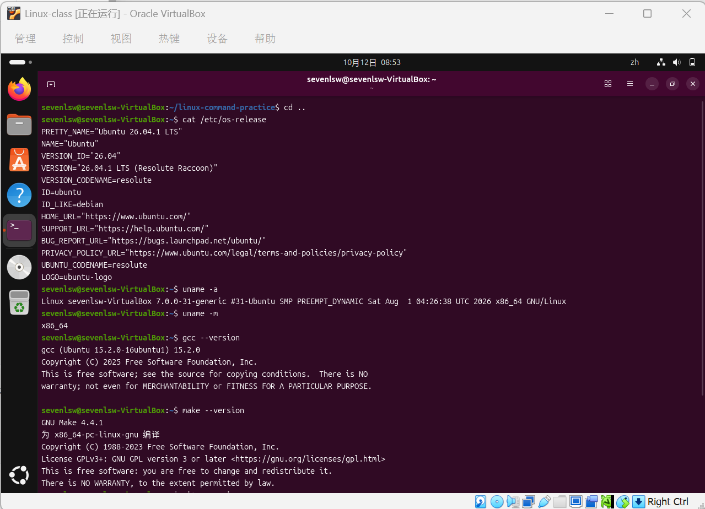

### 2.2 创建独立实验目录

```bash
mkdir -p ~/gcc_library_homework
cd ~/gcc_library_homework
mkdir -p bin include lib src
pwd
```

本次所有操作集中在 `~/gcc_library_homework`，不与上一份 main 函数参数实验混用。四个目录提前创建，任务2起直接在指定位置编写文件；任务4再统一整理任务1的文件，无需重复移动已经放好的文件。

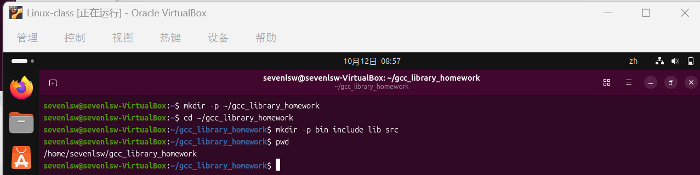

## 三、实验过程

### 3.1 任务1：编写 hello.c，分步编译并使用 Git 记录

**实验目的：** 区分预处理、编译、汇编和链接四个阶段，并通过 Git 保存代码和阶段产物。

#### 第一步：编写源代码

在实验根目录执行：

```bash
cd ~/gcc_library_homework
vim hello.c
```

写入以下代码：

```c
#include <stdio.h>

int main(void)
{
    printf("hello 20262819 刘顺文\n");
    return 0;
}
```

`main(void)` 明确表示本程序不使用参数。字符串中使用本人学号20262819和姓名刘顺文，源码保存为 UTF-8。

#### 第二步：分别执行四个编译阶段

依次执行，每一步结束后确认生成了对应文件：

```bash
gcc -E hello.c -o hello.i
ls -l hello.i
gcc -S hello.i -o hello.s
ls -l hello.s
gcc -c hello.s -o hello.o
ls -l hello.o
gcc hello.o -o hello
ls -l hello
```

| 阶段 | 命令关键部分 | 输出文件 | 作用 |
| --- | --- | --- | --- |
| 预处理 | `gcc -E` | `hello.i` | 展开头文件、处理宏和条件编译、去除注释 |
| 编译 | `gcc -S` | `hello.s` | 将预处理后的 C 代码转换为汇编代码 |
| 汇编 | `gcc -c` | `hello.o` | 将汇编代码转换为可重定位目标文件 |
| 链接 | `gcc hello.o` | `hello` | 组合目标文件、启动代码及必要库，生成可执行程序 |

本任务必须保留这四个独立阶段，不能用一次 `gcc hello.c -o hello` 替代。`hello.o` 尚不是完整程序，不能直接像 `hello` 一样运行。

#### 第三步：查看阶段产物并运行

```bash
head -n 15 hello.i
head -n 30 hello.s
file hello.i hello.s hello.o hello
./hello
echo $?
```

运行的参考输出为：

```text
hello 20262819 刘顺文
```

紧接着执行 `echo $?`，正常返回值为0。`hello.i` 中可见预处理后的声明，`hello.s` 中可见汇编指令，`file` 可以帮助区分文本文件、目标文件和可执行文件。汇编内容与架构、编译器版本有关，不要求与其他同学完全一致。

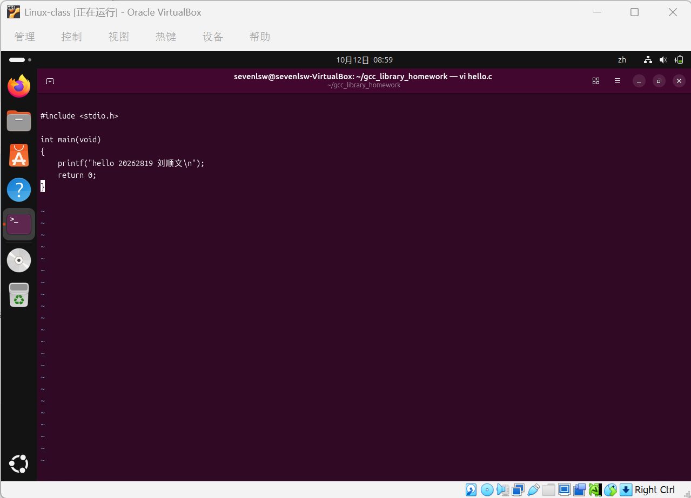

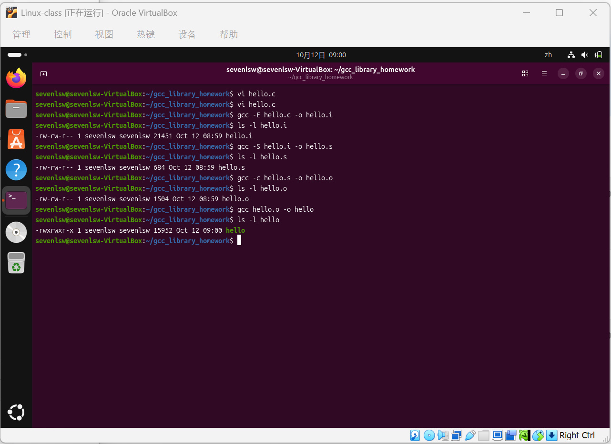

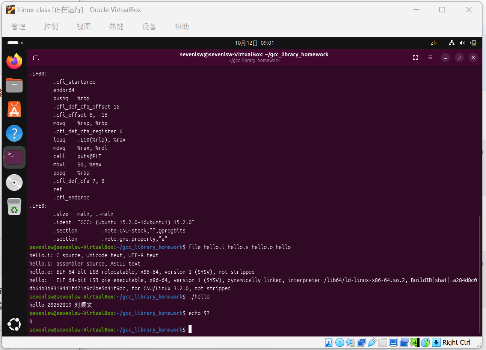

#### 第四步：初始化 Git 并提交

仍在实验根目录执行：

```bash
git init
git config --get user.name
git config --get user.email
```

如果姓名或邮箱没有配置，先在当前实验仓库设置身份。下面邮箱文字是需要替换的说明，执行前改为本人的真实邮箱：

```bash
git config user.name "刘顺文"
git config user.email "替换为本人的真实邮箱"
```

这里不加 `--global`，设置只作用于本次仓库。已有有效配置时可以跳过这两条设置命令。

然后添加和提交文件：

```bash
git add .
git commit -m "完成任务1，添加hello代码和编译过程"
git status
git log --oneline -n 3
git show --stat HEAD
```

本次按题目要求把阶段文件一起提交，便于查看 `hello.c`、`hello.i`、`hello.s`、`hello.o` 和 `hello`。`git add` 把当前文件变化放入暂存区，`git commit` 形成提交，`git log` 查看历史。

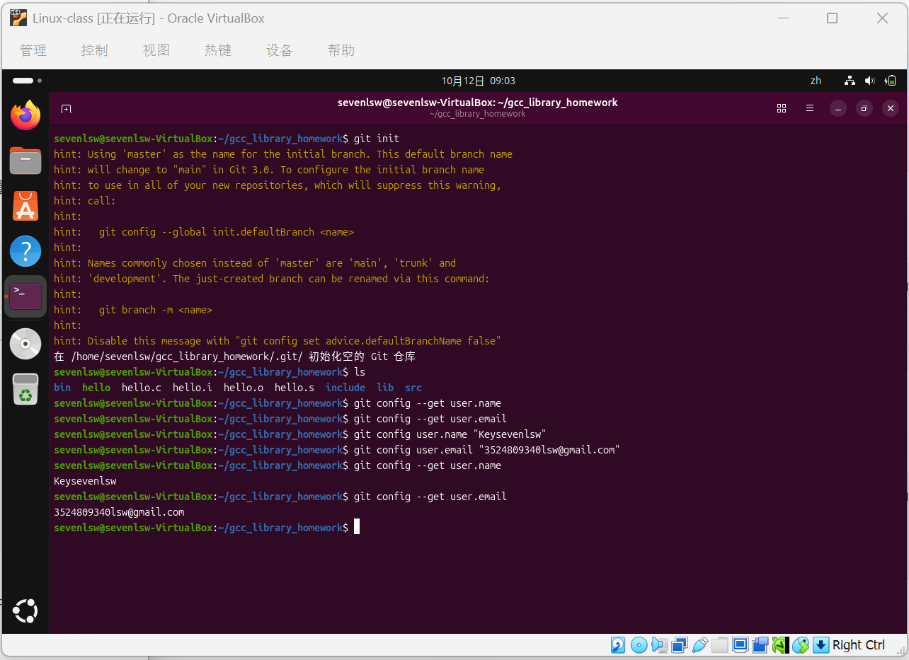

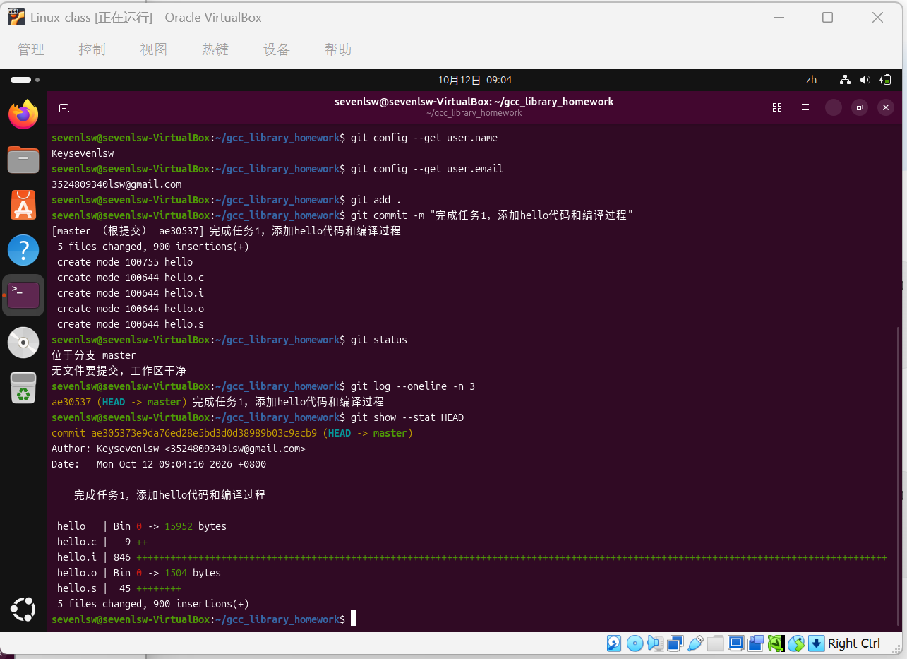

### 3.2 任务2：用联合和指针判断大端、小端

**实验目的：** 从多字节整数的第一个内存字节判断端序，并在主函数中调用两个独立函数。

对于32位数值 `0x12345678`，在常见8位字节机器上，两种存储顺序为：

| 模式 | 从低地址到高地址的字节顺序 | 第一个字节 |
| --- | --- | --- |
| 小端 | `78 56 34 12` | `0x78` |
| 大端 | `12 34 56 78` | `0x12` |

以下代码面向常见的 openEuler x86-64、AArch64 等环境，使用 `<stdint.h>` 中的 `uint32_t` 表示32位无符号整数，避免直接假设所有平台的 `unsigned int` 都是4字节。代码按通常的大端或小端两类情况判断。

#### 第一步：编写头文件 include/endian.h

```bash
cd ~/gcc_library_homework
vim include/endian.h
```

```c
#ifndef ENDIAN_H
#define ENDIAN_H

int is_little_endian_by_union(void);
int is_little_endian_by_pointer(void);

#endif
```

头文件只放函数声明，头文件保护宏避免重复包含。函数实现放在独立源文件中。

#### 第二步：编写实现文件 src/endian.c

```bash
vim src/endian.c
```

```c
#include <stdint.h>
#include "endian.h"

int is_little_endian_by_union(void)
{
    union {
        uint32_t num;
        unsigned char bytes[sizeof(uint32_t)];
    } u;

    u.num = 0x12345678;
    return u.bytes[0] == 0x78;
}

int is_little_endian_by_pointer(void)
{
    uint32_t num = 0x12345678;
    const unsigned char *p = (const unsigned char *)&num;
    return p[0] == 0x78;
}
```

联合的成员共享存储空间，写入整数后读取字节数组的第一个元素，可以观察低地址处的字节。指针方法将整数地址转换为字符类型指针，读取同一个位置；通过字符类型访问对象的字节表示是 C 语言支持的方式。两种方法都在比较首字节是否为 `0x78`。

#### 第三步：编写主函数 src/main.c

```bash
vim src/main.c
```

```c
#include <stdio.h>
#include "endian.h"

int main(void)
{
    if (is_little_endian_by_union()) {
        printf("通过联合判断：当前系统是小端模式\n");
    } else {
        printf("通过联合判断：当前系统是大端模式\n");
    }

    if (is_little_endian_by_pointer()) {
        printf("通过指针判断：当前系统是小端模式\n");
    } else {
        printf("通过指针判断：当前系统是大端模式\n");
    }

    return 0;
}
```

#### 第四步：分别编译、链接并运行

在实验根目录执行：

```bash
gcc -std=c11 -Wall -Wextra -c src/main.c -I include -o src/main.o
gcc -std=c11 -Wall -Wextra -c src/endian.c -I include -o src/endian.o
gcc src/main.o src/endian.o -o bin/endian_test
./bin/endian_test
echo $?
```

`-I include` 指定头文件搜索目录。主函数和函数实现分别编译，最后通过链接将函数调用与定义连接起来。

常见小端环境中的参考输出为：

```text
通过联合判断：当前系统是小端模式
通过指针判断：当前系统是小端模式
```

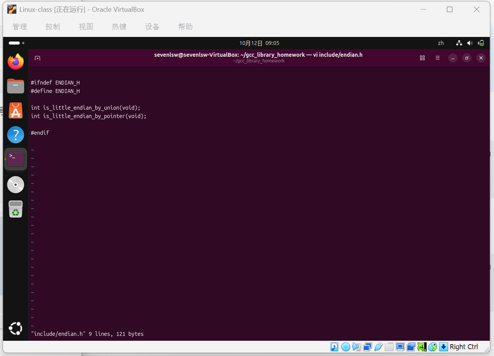

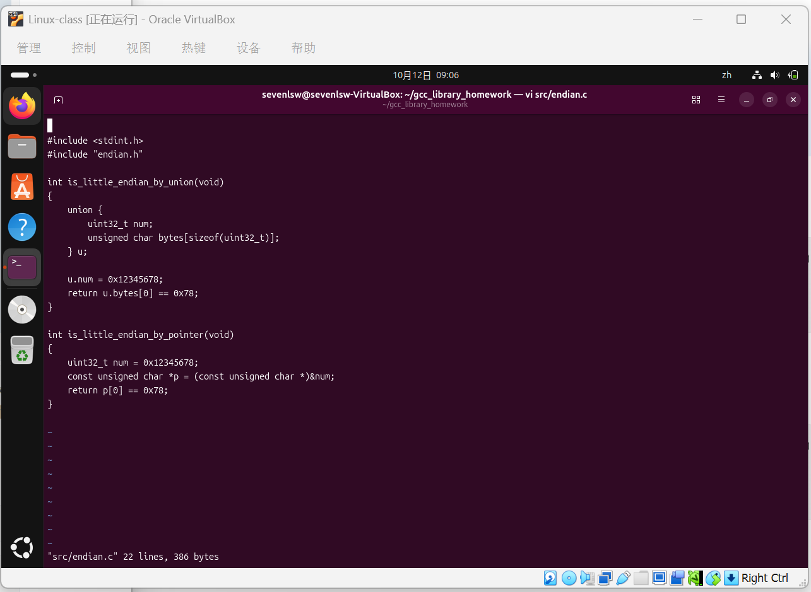

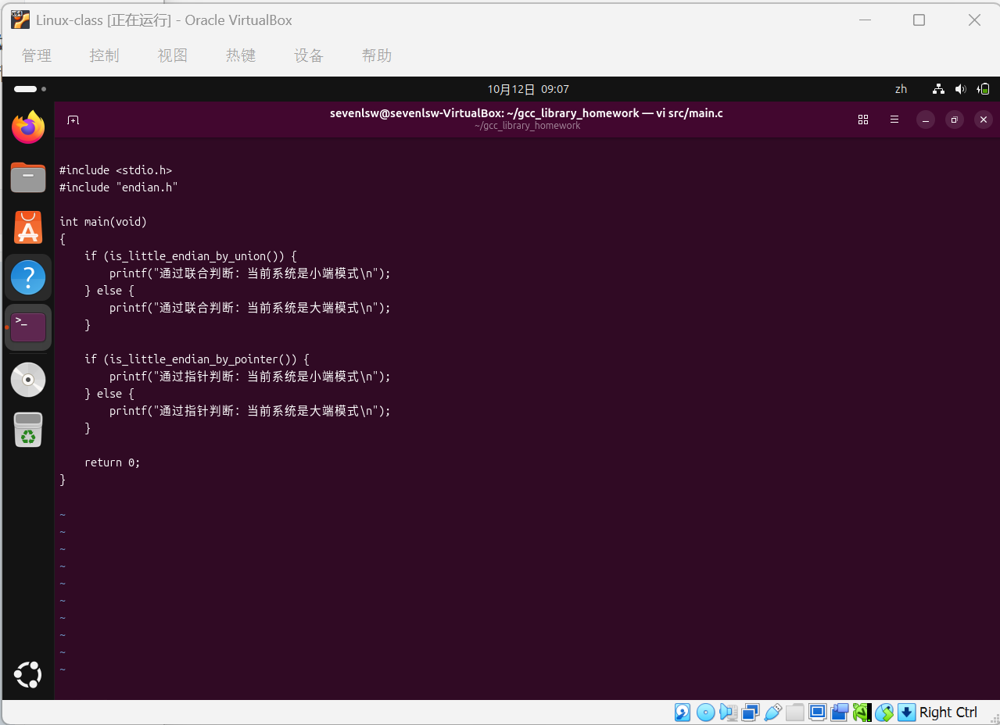

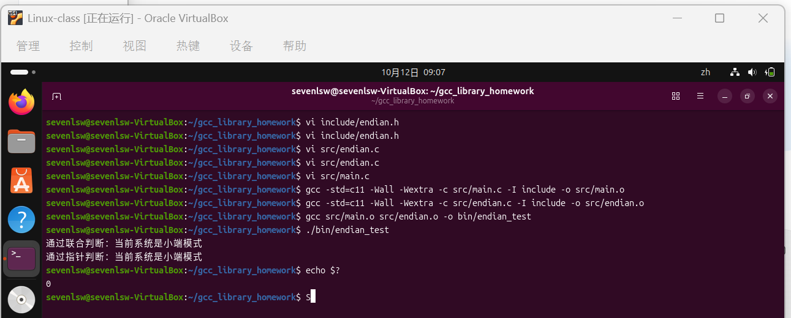

### 3.3 任务3：制作并使用静态库和共享库

**实验目的：** 将端序判断函数制作为两种库，再分别链接主程序，观察链接与运行时的差别。

| 项目 | 静态库 | 共享库 |
| --- | --- | --- |
| 本次文件 | `lib/libendian.a` | `lib/libendian.so` |
| 制作方法 | 用 `ar` 归档目标文件 | 用 `gcc -shared` 链接位置无关目标文件 |
| 库代码使用时机 | 链接时把需要的目标模块加入程序 | 运行时由动态加载器加载 |
| 运行是否需要本次库文件 | 不需要 `libendian.a` | 需要能找到 `libendian.so` |

静态链接通常从归档中选择需要的目标模块，不是无条件复制整座库。这里只将自定义的 `libendian.a` 静态链接进程序，系统 C 库仍可能采用动态链接；因此“静态库版本”不等于“整个程序完全静态链接”。

#### 第一步：制作静态库并链接主程序

在实验根目录执行：

```bash
cd ~/gcc_library_homework
gcc -std=c11 -Wall -Wextra -c src/endian.c -I include -o src/endian.o
ar rcs lib/libendian.a src/endian.o
ar t lib/libendian.a
gcc -std=c11 -Wall -Wextra -c src/main.c -I include -o src/main.o
gcc src/main.o lib/libendian.a -o bin/endian_static
./bin/endian_static
```

`ar rcs` 中，`r` 表示插入或替换成员，`c` 表示创建归档，`s` 表示建立符号索引。`ar t` 列出库内成员，本例应能看到 `endian.o`。

这里直接指定 `lib/libendian.a`，确保程序使用静态库。当 `.a` 和 `.so` 同时存在时，通常只写 `-L lib -lendian` 会优先选择共享库，不适合用来证明本次的静态链接。

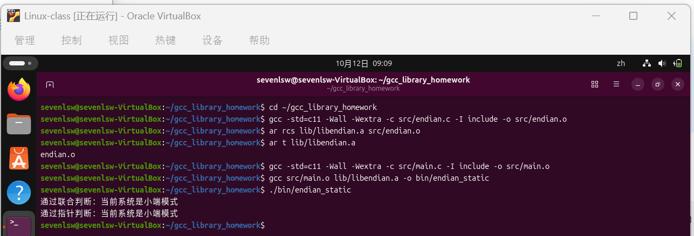

#### 第二步：验证静态库程序的运行依赖

在本次独立实验目录中，临时改名再恢复库文件：

```bash
mv lib/libendian.a lib/libendian.a.saved
./bin/endian_static
mv lib/libendian.a.saved lib/libendian.a
```

首次执行前确认没有同名 `.saved` 文件，避免覆盖已有备份。第二条命令仍应能运行，因为需要的端序判断代码已经在链接时进入可执行文件。无论测试结果如何，都执行第三条命令恢复库文件；不需要删除库。

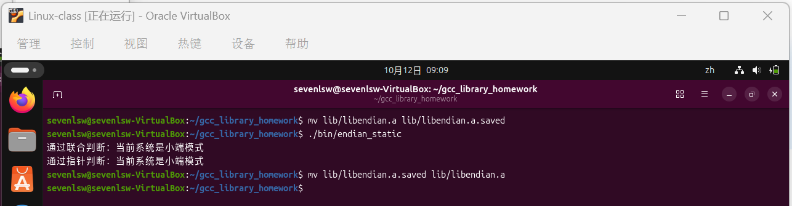

#### 第三步：制作共享库并链接主程序

仍在实验根目录执行：

```bash
gcc -std=c11 -Wall -Wextra -fPIC -c src/endian.c -I include -o src/endian.pic.o
gcc -shared src/endian.pic.o -o lib/libendian.so
gcc src/main.o -L lib -lendian -o bin/endian_shared
```

`-fPIC` 在编译源代码时生成位置无关代码，`-shared` 在链接时生成共享库。普通目标文件保存为 `src/endian.o`，共享库目标文件另存为 `src/endian.pic.o`，避免混用。

`-L lib` 指定链接阶段的库搜索目录，`-lendian` 表示查找名为 endian 的库，通常对应 `libendian.so` 或 `libendian.a`。本步骤已经生成 `.so`，在通常的 GCC 链接配置下会选用共享库。

#### 第四步：配置运行时搜索路径并测试

从实验根目录执行：

```bash
export LD_LIBRARY_PATH="$PWD/lib${LD_LIBRARY_PATH:+:$LD_LIBRARY_PATH}"
./bin/endian_shared
ldd bin/endian_shared
ldd bin/endian_static
```

`$PWD/lib` 是本次库目录的绝对路径，追加原有值的写法仅在原变量非空时加入冒号。此设置作用于当前终端及其后续启动的程序，不修改系统配置文件。重新打开终端后需要重新设置。

`-L` 只解决链接阶段的搜索，不能替代运行时路径设置。`ldd bin/endian_shared` 应显示 `libendian.so` 解析到本次目录中的路径；`ldd bin/endian_static` 不应依赖 `libendian.so`，但可能仍列出 `libc.so` 等系统共享库。

两个程序在同一环境中的端序输出应一致；常见小端环境的参考结果为：

```text
通过联合判断：当前系统是小端模式
通过指针判断：当前系统是小端模式
```

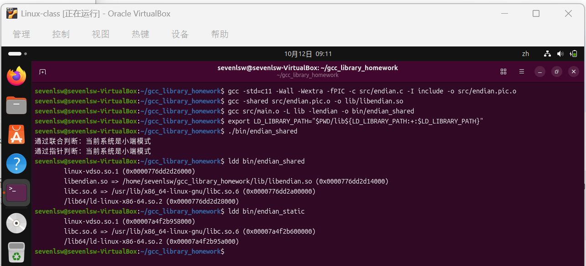

### 3.4 任务4：按指定目录整理文件并展示完整构建过程

**实验目的：** 将可执行文件、头文件、库和源代码分开存放，使构建命令与目录结构一致。

前面已经把端序判断文件写入指定目录。此时只需将任务1的文件移入相应位置，在实验根目录执行一次：

```bash
cd ~/gcc_library_homework
mv hello.c hello.i hello.s hello.o src/
mv hello bin/
find bin include lib src -maxdepth 2 -type f | sort
./bin/hello
```

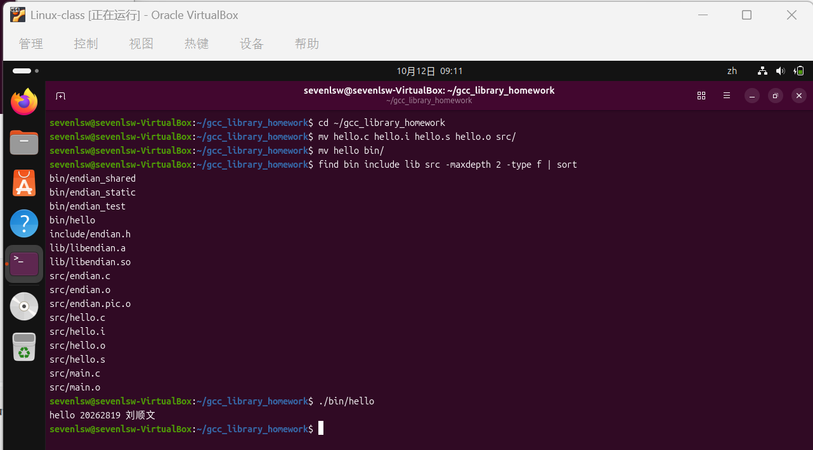

任务1文件移动后，原来的 `./hello` 改为 `./bin/hello`。不要重复执行已经完成的移动命令。整理后的结构如下，`bin/Makefile` 在任务5创建：

```text
gcc_library_homework/
├── bin/
│   ├── hello
│   ├── endian_test
│   ├── endian_static
│   ├── endian_shared
│   └── Makefile
├── include/
│   └── endian.h
├── lib/
│   ├── libendian.a
│   └── libendian.so
└── src/
    ├── hello.c
    ├── hello.i
    ├── hello.s
    ├── hello.o
    ├── main.c
    ├── main.o
    ├── endian.c
    ├── endian.o
    └── endian.pic.o
```

Git 的 `.git/` 位于项目根目录，是本地版本记录，不放入上述四个功能目录。`.i`、`.s` 和 `.o` 是本实验特意保留的编译过程文件，不等同于原始 C 源代码。

目录整理后，可在根目录重复下面的完整手动构建，核对文件位置。这些命令会更新本次同名构建产物：

```bash
gcc -std=c11 -Wall -Wextra -c src/main.c -I include -o src/main.o
gcc -std=c11 -Wall -Wextra -c src/endian.c -I include -o src/endian.o
ar rcs lib/libendian.a src/endian.o
gcc src/main.o lib/libendian.a -o bin/endian_static
gcc -std=c11 -Wall -Wextra -fPIC -c src/endian.c -I include -o src/endian.pic.o
gcc -shared src/endian.pic.o -o lib/libendian.so
gcc src/main.o -L lib -lendian -o bin/endian_shared
./bin/endian_static
export LD_LIBRARY_PATH="$PWD/lib${LD_LIBRARY_PATH:+:$LD_LIBRARY_PATH}"
./bin/endian_shared
```

不再执行题目中从根目录移动 `endian.h`、`endian.c`、`main.c` 的命令，因为本报告从一开始就将它们写在正确目录，根目录不存在这些同名源文件。

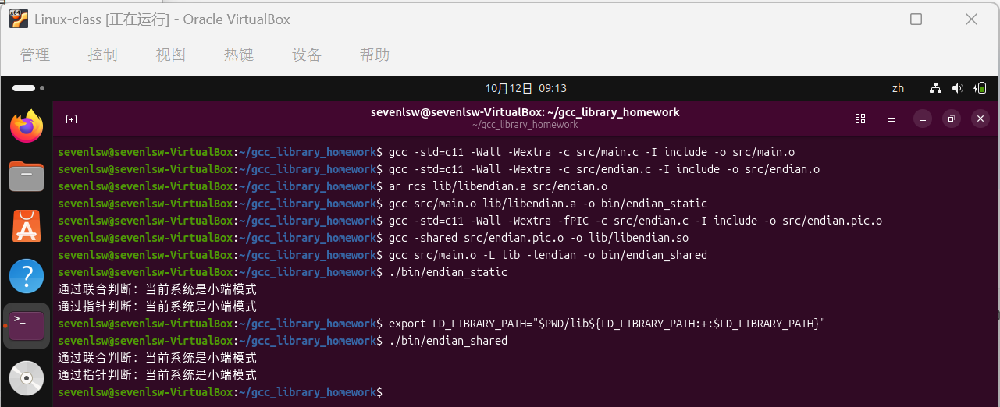

### 3.5 任务5：编写位于 bin/ 的无变量 Makefile

**实验目的：** 通过目标、依赖和命令描述构建关系，使用 `make -C bin` 完成两个库和两个程序的自动构建。

#### 第一步：编写 bin/Makefile

在项目根目录执行：

```bash
cd ~/gcc_library_homework
vim bin/Makefile
```

文件内容如下。没有自定义变量、变量引用或自动变量，每条命令行开头必须是一个真正的 Tab，不能用普通空格代替：

```makefile
.PHONY: all clean

all: endian_static endian_shared

endian_static: ../src/main.o ../lib/libendian.a
	gcc ../src/main.o ../lib/libendian.a -o endian_static

endian_shared: ../src/main.o ../lib/libendian.so
	gcc ../src/main.o -L ../lib -lendian -o endian_shared

../src/main.o: ../src/main.c ../include/endian.h
	gcc -std=c11 -Wall -Wextra -c ../src/main.c -I ../include -o ../src/main.o

../src/endian.o: ../src/endian.c ../include/endian.h
	gcc -std=c11 -Wall -Wextra -c ../src/endian.c -I ../include -o ../src/endian.o

../src/endian.pic.o: ../src/endian.c ../include/endian.h
	gcc -std=c11 -Wall -Wextra -fPIC -c ../src/endian.c -I ../include -o ../src/endian.pic.o

../lib/libendian.a: ../src/endian.o
	ar rcs ../lib/libendian.a ../src/endian.o

../lib/libendian.so: ../src/endian.pic.o
	gcc -shared ../src/endian.pic.o -o ../lib/libendian.so

clean:
	rm -f ../src/main.o ../src/endian.o ../src/endian.pic.o ../lib/libendian.a ../lib/libendian.so endian_static endian_shared
```

`make -C bin` 会先切换工作目录到 `bin/`，因此源代码写成 `../src/main.c`，头文件目录写成 `../include`，库目录写成 `../lib`，生成的程序直接写成 `endian_static` 和 `endian_shared`。题目原样的 `src/`、`lib/`、`bin/` 路径若配合 `-C bin` 使用，会从错误的目录查找文件。

普通目标文件和位置无关目标文件使用不同名称和规则。仅在共享库链接阶段补上 `-fPIC`，不能把已经生成的普通目标文件重新转换成位置无关代码，因此必须在 `.c → .o` 的编译阶段设置它。

`.PHONY` 声明 `all` 和 `clean` 为伪目标，不是变量定义。`clean` 明确列出本次端序库构建产物，不使用 `lib/*` 这样的范围删除，也不清理源码、头文件、Makefile、Git 记录或 hello 的阶段文件。

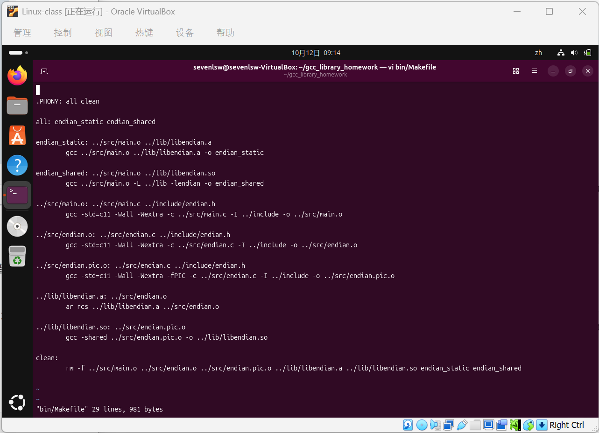

#### 第二步：检查 Tab 并从清理后开始构建

在项目根目录执行：

```bash
cat -T bin/Makefile
make -C bin clean
make -C bin
echo $?
```

`cat -T` 将 Tab 显示为 `^I`，便于检查每条构建命令的缩进。`make -C bin clean` 删除上面规则列出的可重新生成产物，再执行 `make -C bin`，可以看到完整的编译、归档、共享库链接和程序链接命令。

正常构建结束后的退出状态为0。具体命令顺序由依赖关系决定，不要求与其他机器的输出逐行相同。

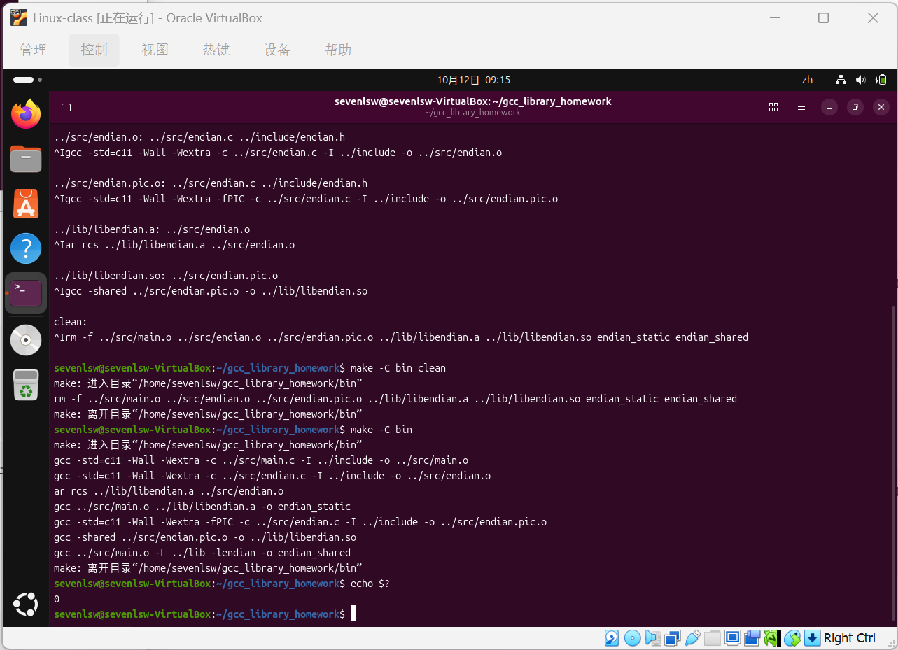

#### 第三步：测试自动构建产物

```bash
./bin/endian_static
export LD_LIBRARY_PATH="$PWD/lib${LD_LIBRARY_PATH:+:$LD_LIBRARY_PATH}"
./bin/endian_shared
ldd bin/endian_shared
make -C bin
```

两个程序应给出一致的端序判断。最后再次执行 `make`，如果源码、头文件和产物未变化，通常会提示无需继续构建；这体现了 Make 根据时间戳和依赖判断是否需要更新目标的机制。

如果提示 `missing separator`，先检查是否把 Tab 变成空格；如果提示找不到源文件，检查是否从项目根目录执行 `make -C bin`，以及文件是否按任务4放好。若共享库程序提示无法加载 `libendian.so`，在项目根目录重新设置本节的 `LD_LIBRARY_PATH` 后再运行。

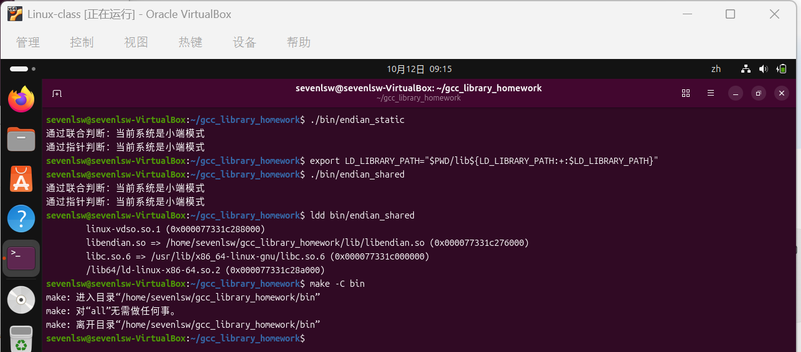

#### 第四步：保存后续任务的 Git 记录

回到项目根目录执行：

```bash
cd ~/gcc_library_homework
git add .
git commit -m "完成端序判断、静态共享库、目录整理和Makefile"
git status
git log --oneline -n 5
git show --stat HEAD
```

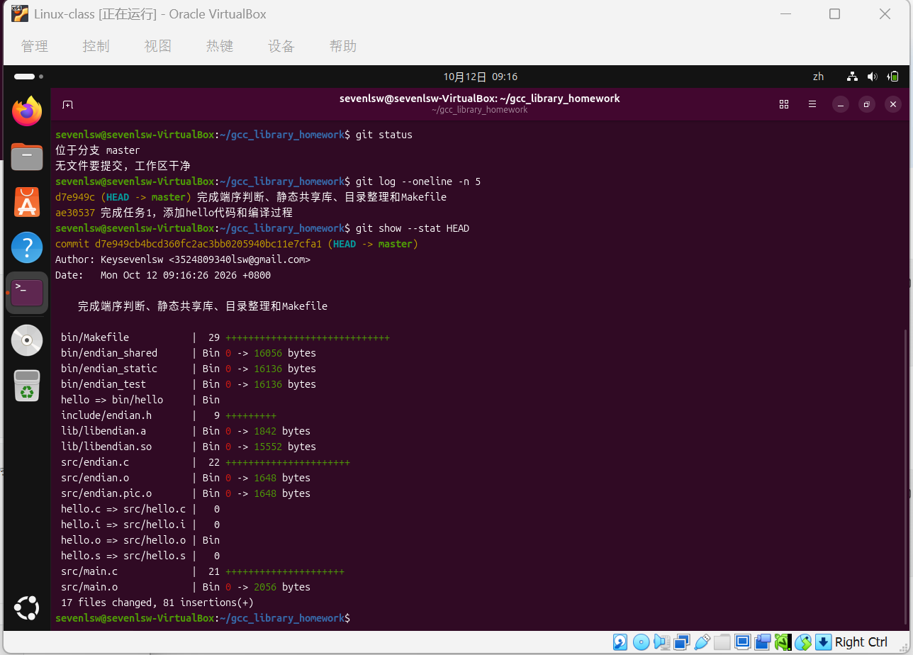

## 四、易错点与注意事项

| 容易出错的位置 | 本次处理方法 |
| --- | --- |
| 四阶段编译 | hello 单独执行 `-E`、`-S`、`-c` 和链接，不用一次编译替代 |
| 端序依据 | 观察首字节，结合实际运行架构判断，不按系统名称猜测 |
| 整数宽度 | 使用 `uint32_t` 表示32位数值，避免未经确认地假设 `int` 宽度 |
| 静态库含义 | 加入需要的目标模块，不是无条件复制整座库 |
| 同名 `.a` 和 `.so` | 静态版本显式链接 `.a`，共享版本使用已生成的 `.so` |
| 位置无关代码 | 编译 `endian.pic.o` 时就加入 `-fPIC` |
| 链接与运行搜索路径 | `-L` 用于链接；本例运行共享库程序时设置 `LD_LIBRARY_PATH` |
| Make 工作目录 | `make -C bin` 后，路径以 `bin/` 为起点，需要使用 `../` |
| Makefile 格式 | 命令行以 Tab 开头，文件名为 `Makefile`，不写成 `.txt` |
| Makefile 清理范围 | 只删除明确列出的可重建产物，保留代码与过程记录 |
| Git 身份与证据 | 使用本人身份；Git 保存文件变化，编译命令仍需截图 |

## 五、实验总结

本次实验把 C 程序从源代码到可执行文件的过程拆成四个阶段，也将单文件程序扩展为由头文件、函数实现和主函数组成的多文件程序。端序判断通过读取对象的字节表示，将“高位、低位”和“高地址、低地址”的概念联系起来。

静态库与共享库的主要差别在于代码进入程序的时机和运行依赖。目录结构让文件职责更清楚，Makefile 则把编译命令和依赖关系固定下来；Git 保存各阶段文件变化，真实截图展示实际操作与测试结果。
