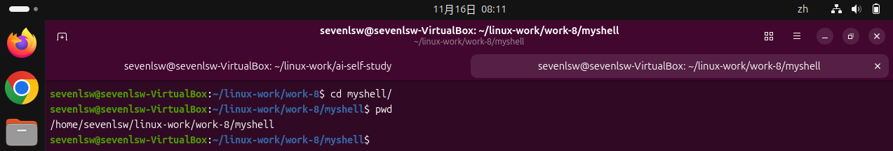
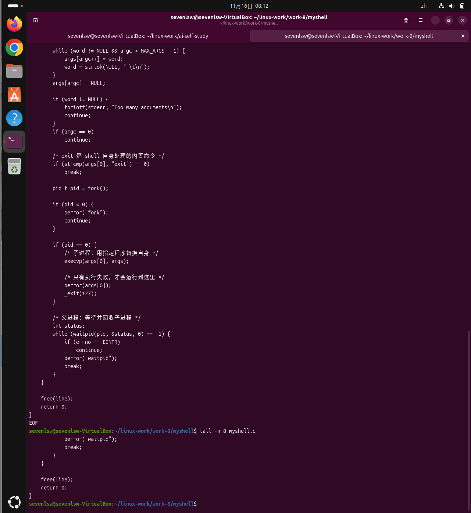
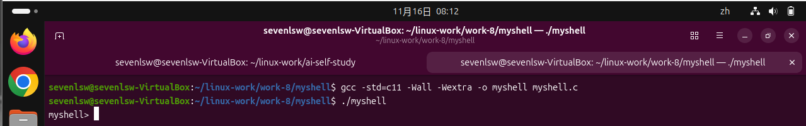
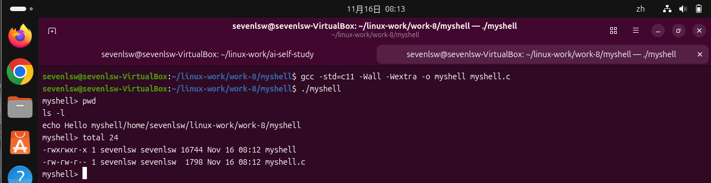
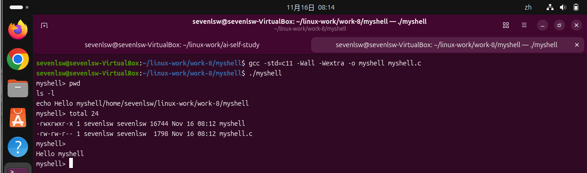
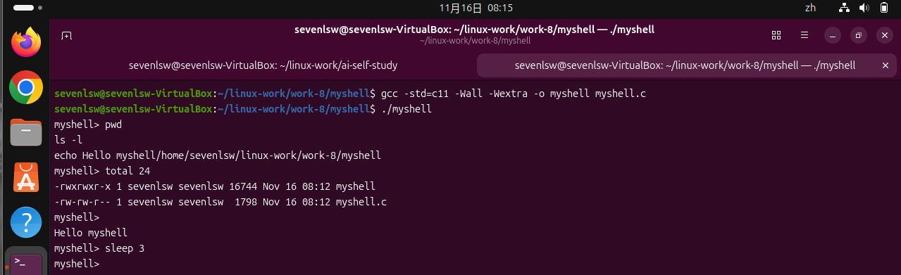
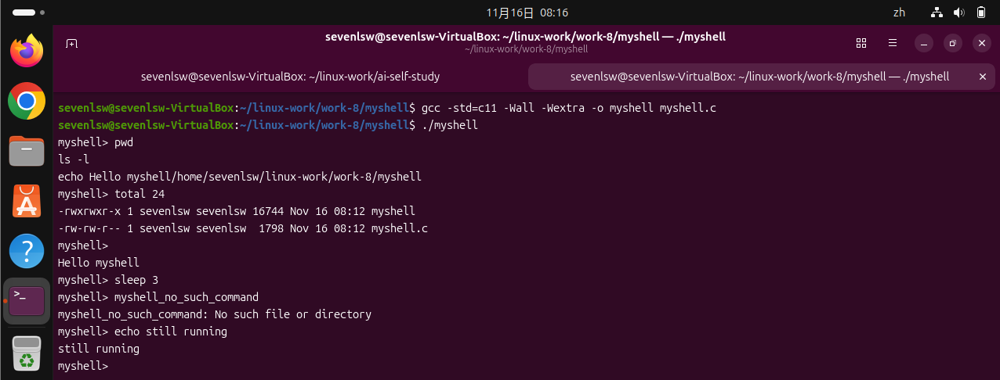
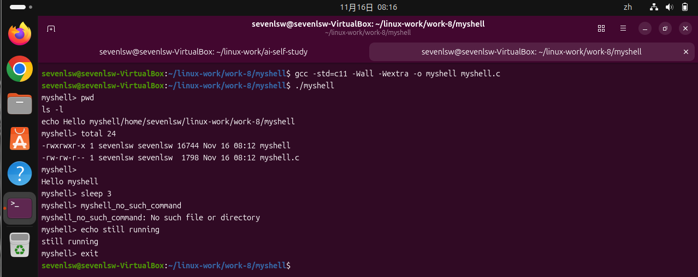

# myshell：简单命令解释器实验

| 项目 | 内容 |
| --- | --- |
| 姓名 | 刘顺文 |
| 学号 | 20262819 |
| 作业类型 | Linux 课上测试 |
| 实验要求 | 利用 fork、exec、wait 编写具有执行命令功能的 shell |
| 实践环境 | VirtualBox 中的 Ubuntu 虚拟机 |
| 实践日期 | 2026-11-16 |
| 实验目录 | `/home/sevenlsw/linux-work/work-8/myshell` |
| 完成状态 | 核心任务已完成 |

## 一、学习内容

本次实验用 C 语言实现简单的命令解释器。程序循环读取一行输入，将其拆分成命令名和参数，通过 `fork()` 创建子进程，在子进程中调用 `execvp()` 执行命令，父进程通过 `waitpid()` 等待并回收子进程，然后继续接收输入。

`execvp()` 属于 exec 函数族，`waitpid()` 属于 wait 系列函数。本程序采用这两个接口实现题目要求的程序执行和等待功能。

| 接口 | 作用 | 本实验中的处理 |
| --- | --- | --- |
| `fork()` | 创建子进程 | 返回值小于0表示失败；等于0进入子进程；大于0进入父进程 |
| `execvp()` | 用目标程序替换当前进程映像 | 根据 PATH 查找命令，传入以 NULL 结尾的参数数组；成功后不返回 |
| `waitpid()` | 等待指定子进程并回收其退出信息 | 父进程阻塞等待；被信号中断时重试 |

## 二、实践准备

在虚拟机终端创建并进入实验目录：

```bash
mkdir -p ~/linux-work/work-8/myshell
cd ~/linux-work/work-8/myshell
pwd
```

实际确认的目录为 `/home/sevenlsw/linux-work/work-8/myshell`，后续源码和可执行程序均放在该目录。



## 三、实验过程

### 3.1 编写 myshell.c

在实验目录执行 `nano myshell.c`，输入下面的代码，按 Ctrl+O、回车保存，再按 Ctrl+X 退出。实际实验采用 `cat > myshell.c <<'EOF'` 的方式写入相同代码，随后用 `tail -n 8 myshell.c` 检查文件末尾。

```c
#define _POSIX_C_SOURCE 200809L
#include <stdio.h>
#include <stdlib.h>
#include <string.h>
#include <unistd.h>
#include <sys/types.h>
#include <sys/wait.h>
#include <errno.h>

#define MAX_ARGS 64

int main(void)
{
    char *line = NULL;
    size_t capacity = 0;
    char *args[MAX_ARGS];

    while (1) {
        printf("myshell> ");
        fflush(stdout);

        /* 读取一整行；Ctrl+D 表示结束输入 */
        if (getline(&line, &capacity, stdin) == -1) {
            if (ferror(stdin))
                perror("getline");
            putchar('\n');
            break;
        }

        /* 按空格、制表符和换行符拆分参数 */
        int argc = 0;
        char *word = strtok(line, " \t\n");
        while (word != NULL && argc < MAX_ARGS - 1) {
            args[argc++] = word;
            word = strtok(NULL, " \t\n");
        }
        args[argc] = NULL;

        if (word != NULL) {
            fprintf(stderr, "Too many arguments\n");
            continue;
        }
        if (argc == 0)
            continue;

        /* exit 是 shell 自身处理的内置命令 */
        if (strcmp(args[0], "exit") == 0)
            break;

        pid_t pid = fork();

        if (pid < 0) {
            perror("fork");
            continue;
        }

        if (pid == 0) {
            /* 子进程：用指定程序替换自身 */
            execvp(args[0], args);

            /* 只有执行失败，才会运行到这里 */
            perror(args[0]);
            _exit(127);
        }

        /* 父进程：等待并回收子进程 */
        int status;
        while (waitpid(pid, &status, 0) == -1) {
            if (errno == EINTR)
                continue;
            perror("waitpid");
            break;
        }
    }

    free(line);
    return 0;
}
```

`getline()` 负责读取完整的一行，并按需要分配输入缓冲区。`strtok()` 将输入拆成参数；`args[0]` 为命令名，`args[argc]` 必须为 `NULL`，用于标记参数数组结束。数组最多容纳63个字符串参数，其中包含命令名。

子进程执行 `execvp()` 成功后运行的是目标程序，不再执行原 shell 的后续代码。执行失败时才会调用 `perror()`，随后用 `_exit(127)` 结束子进程。父进程继续保留 shell 循环。



### 3.2 编译与启动

```bash
gcc -std=c11 -Wall -Wextra -o myshell myshell.c
./myshell
```

`-Wall -Wextra` 开启常用编译警告。实际编译没有显示错误或警告，启动后出现 `myshell>` 提示符。



### 3.3 验证命令执行和参数传递

在 myshell 提示符后逐条输入，每条命令均按回车提交：

```bash
pwd
ls -l
echo Hello myshell
```

实际 `pwd` 输出实验目录，`ls -l` 列出了 `myshell` 和 `myshell.c` 的详细信息，说明命令及其选项能够传入目标程序。



第一次批量粘贴时，终端对输入的回显与命令输出发生交错，最后一条命令尚需回车提交。补按回车后，实际出现 `Hello myshell`，随后重新显示提示符，确认多个参数传递成功。后续采用逐条输入的方式观察结果。



### 3.4 验证父进程等待

```bash
sleep 3
```

命令没有文字输出。实际执行后，用户确认发生休眠，随后重新出现 `myshell>`。该现象与父进程通过 `waitpid()` 等待子进程结束的逻辑一致；静态截图本身不能测量等待时长。



### 3.5 验证错误命令与继续运行

逐条输入：

```bash
myshell_no_such_command
echo still running
```

实际结果：

```text
myshell_no_such_command: No such file or directory
myshell> echo still running
still running
myshell>
```

不存在的命令使 `execvp()` 失败，子进程报告错误后退出。父进程回收该子进程后继续循环，第二条命令仍成功执行，说明一次命令失败不会使整个 shell 退出。



### 3.6 验证退出

```bash
exit
```

实际执行后回到原终端提示符：

```text
sevenlsw@sevenlsw-VirtualBox:~/linux-work/work-8/myshell$
```

`exit` 在创建子进程之前由 shell 自身识别，跳出循环并释放输入缓冲区。



### 3.7 补充边界说明

代码中为空行、输入结束和参数过多提供了处理：空行通过 `argc == 0` 跳过；在空输入行按 Ctrl+D 产生文件结束条件后退出；超过参数容量时报错并继续。以上分支未在本次截图中单独核验，不计入实测通过项目。

## 四、易错点与注意事项

- 输入命令时不需要键入 `myshell>`。逐条输入并按回车，便于区分终端回显与实际输出。
- `fork()` 创建子进程，`execvp()` 替换调用进程的程序映像，二者作用不同；执行 exec 不会另外创建进程。
- `execvp()` 必须放在子进程分支。父进程保留循环，负责等待和继续接收命令。
- `waitpid()` 回收已结束的子进程，避免其退出信息长期占用进程表项。程序保存了退出状态，但没有将其显示给用户。
- 本程序只按空白字符分词，支持普通外部命令及其参数，没有实现引号、变量展开、管道、重定向、后台任务和 cd 内置命令，也没有增加作业控制或信号处理。

## 五、实验总结

本次完成了基于 fork、exec 和 wait 系列接口的简单 shell，并实际验证了外部命令执行、多个参数传递、等待子进程、错误命令处理和正常退出。父进程负责交互和回收，子进程负责执行命令，两者配合形成连续的命令处理循环。

实验将进程创建、程序替换和进程等待串联起来。命令成功执行时，子进程进入目标程序；执行失败时，子进程报告错误并结束，父进程仍然能够继续接收命令。这是本次简单 shell 的核心工作机制。
