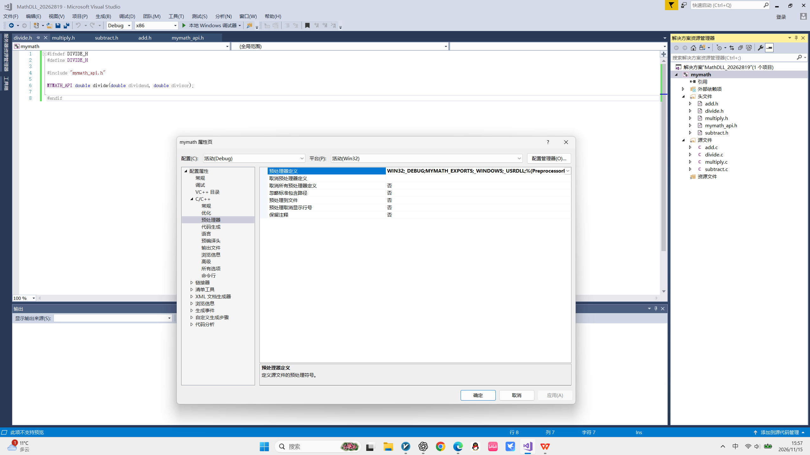
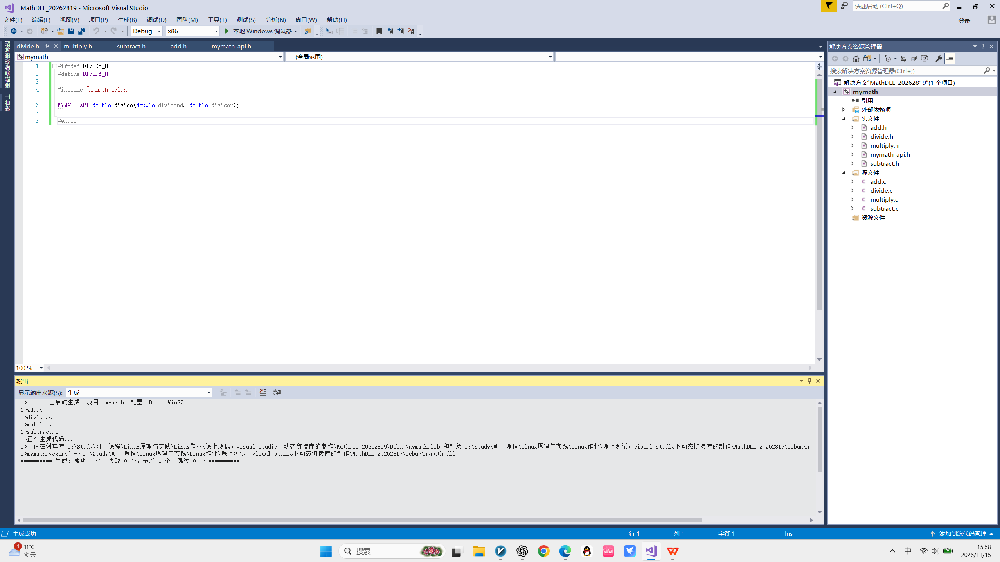
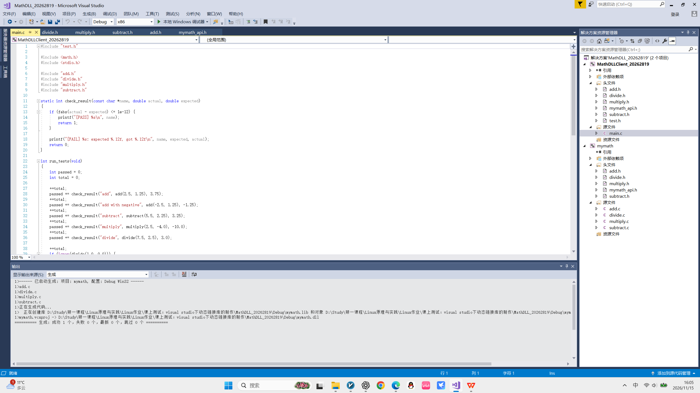
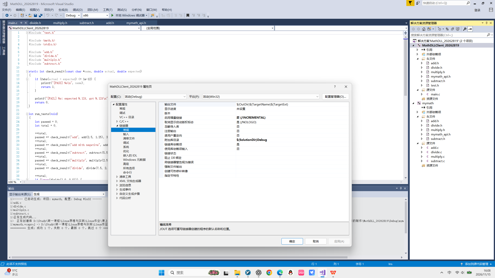
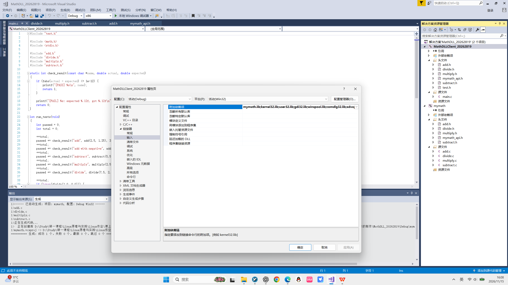
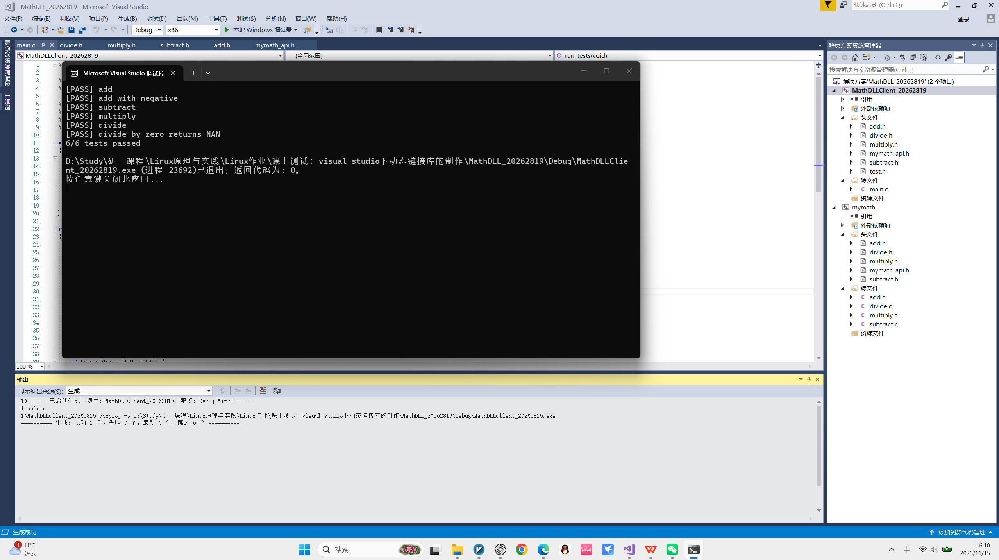
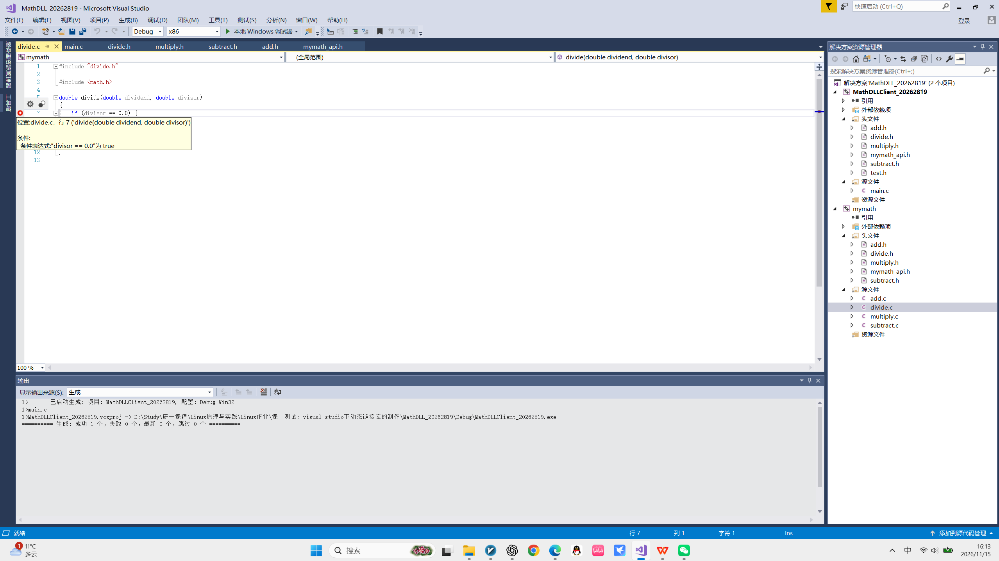
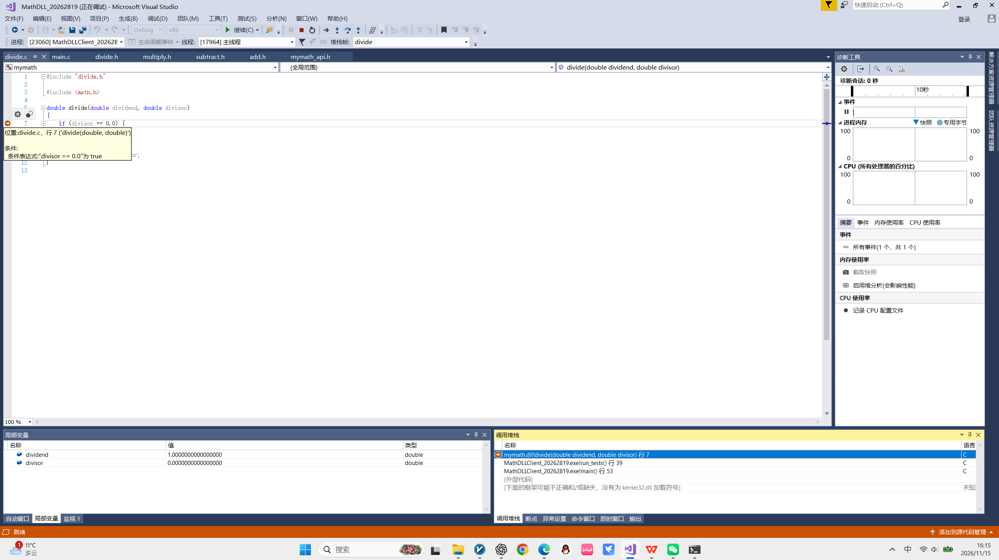
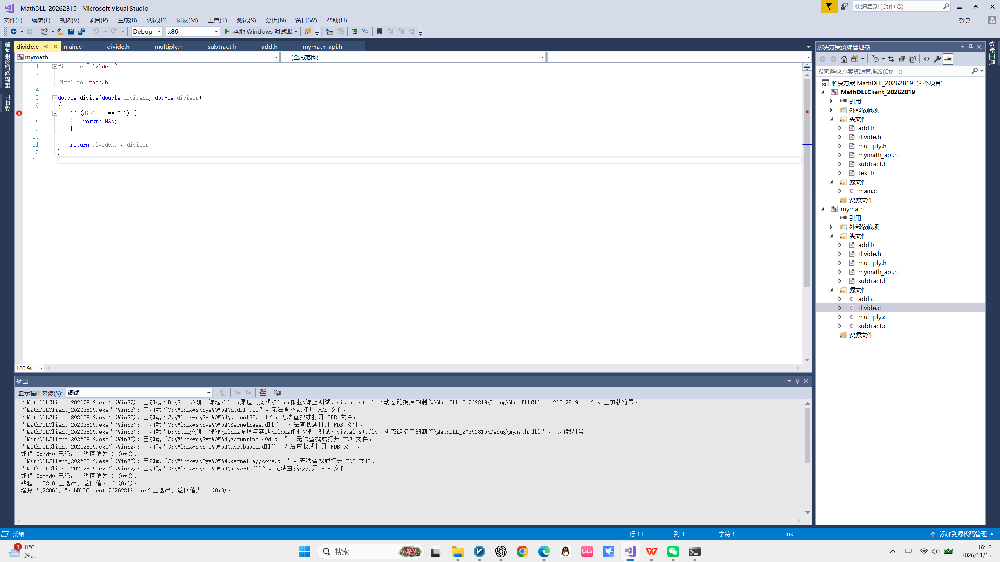

# 课上测试：Visual Studio 下动态链接库的制作

| 项目 | 内容 |
| --- | --- |
| 姓名 | 刘顺文 |
| 学号 | 20262819 |
| 实验日期 | 2026年11月15日 |
| 开发工具 | Visual Studio Community 2017 |
| 构建配置 | Debug，x86 / Win32 |
| 解决方案 | MathDLL_20262819 |

## 一、实验目的

将加、减、乘、除四个模块编译为 mymath.dll 动态链接库，通过独立控制台项目中的 main.c 调用，并使用条件断点验证 DLL 内部的除零处理过程。使用者通过公开头文件、导入库和 DLL 调用函数，无需获得四个模块的源代码。

本次沿用 testmath.zip 中的代码，实际文件名为 add.c、subtract.c、multiply.c、divide.c。原 test.c 包含 main 函数，复制到调用项目后重命名为 main.c，保持原有六项测试逻辑。

## 二、创建 DLL 项目与导出函数

通过“文件 → 新建 → 项目 → Visual C++ → Windows 桌面 → Windows 桌面向导”创建 mymath 项目，解决方案名称为 MathDLL_20262819。应用程序类型选择动态链接库（.dll），勾选空项目，不使用预编译头。

将四个运算模块及对应头文件复制到新项目目录并加入项目，不修改之前静态库实验的文件。四个模块的运算代码保持原样，为头文件增加导出／导入声明。

新建 mymath_api.h：

```c
#ifndef MYMATH_API_H
#define MYMATH_API_H

#ifdef MYMATH_EXPORTS
#define MYMATH_API __declspec(dllexport)
#else
#define MYMATH_API __declspec(dllimport)
#endif

#endif
```

四个模块的头文件均包含 mymath_api.h，并在函数声明前添加 MYMATH_API。声明分别为：

```c
MYMATH_API double add(double a, double b);
MYMATH_API double subtract(double a, double b);
MYMATH_API double multiply(double a, double b);
MYMATH_API double divide(double dividend, double divisor);
```

DLL 项目的“C/C++ → 预处理器 → 预处理器定义”包含 MYMATH_EXPORTS，因此 MYMATH_API 展开为 __declspec(dllexport)。调用项目不定义这个宏，同一组头文件在调用项目中使用 __declspec(dllimport)。



保持 Debug、Win32 配置，右键 mymath 项目执行“生成”。输出显示四个源文件完成编译，生成 Debug 目录中的 mymath.dll 和 mymath.lib，结果为成功1个、失败0个。



这里的 mymath.lib 是导入库，提供链接 DLL 所需的信息；四则运算函数的实现位于 mymath.dll 中。它与之前静态库实验生成的同名文件作用不同，不能混用。

## 三、main.c 调用 mymath.dll

在当前解决方案中新增空控制台项目 MathDLLClient_20262819，并设为启动项目。将原 test.c 复制后重命名为 main.c，加入 test.h，以及 DLL 项目中修改后的五个公开头文件：add.h、subtract.h、multiply.h、divide.h、mymath_api.h。

调用项目的源文件中只有 main.c，不加入四个运算模块的 .c 文件，也不定义 MYMATH_EXPORTS。



本次使用导入库进行隐式链接。在调用项目 Debug、Win32 配置中设置：

| 属性位置 | 配置 |
| --- | --- |
| 链接器 → 常规 → 附加库目录 | `$(SolutionDir)Debug` |
| 链接器 → 输入 → 附加依赖项 | 添加 `mymath.lib`，保留系统默认依赖及继承项 |





两个项目的输出均位于当前解决方案的 Debug 目录，生成后调用程序的 .exe 与 mymath.dll 处于同一目录。链接器使用导入库完成链接，程序启动时由 Windows 加载器加载 DLL，实际调用 DLL 中的函数实现。

按 Ctrl+F5 生成并运行调用程序，六项测试全部通过，退出代码为0。

| 测试 | 调用或检查 | 预期结果 |
| --- | --- | --- |
| 加法 | `add(2.5, 1.25)` | 3.75 |
| 含负数加法 | `add(-2.5, 1.25)` | -1.25 |
| 减法 | `subtract(5.5, 2.25)` | 3.25 |
| 乘法 | `multiply(2.5, -4.0)` | -10.0 |
| 除法 | `divide(7.5, 2.5)` | 3.0 |
| 除数为零 | `isnan(divide(1.0, 0.0))` | 成立 |



## 四、DLL 条件断点调试

在 mymath 项目的 divide.c 第7行 `if (divisor == 0.0)` 处按 F9 添加断点，打开断点条件，选择条件表达式 `divisor == 0.0`，判断方式为“为 true 时”。



按 F5 启动调试。程序在除数为零的调用中暂停，黄色执行箭头停在 divide.c 第7行，局部变量显示 dividend 为1、divisor 为0，断点提示显示条件成立时暂停。

调用堆栈显示：

```text
mymath.dll!divide(...)                         行7
MathDLLClient_20262819.exe!run_tests()          行39
MathDLLClient_20262819.exe!main()               行53
```

堆栈中的 mymath.dll!divide 表明当前执行位置位于 DLL 内部，主程序通过动态链接调用了除法模块。



继续按 F5 后，程序正常结束。调试输出确认当前解决方案 Debug 目录中的 mymath.dll 已加载且已加载符号，最后显示程序返回值为0。普通运行的六项测试通过截图与本次调试的退出日志共同验证了调用和调试过程。



系统 DLL 的“无法查找或打开 PDB 文件”信息表示未加载这些系统模块的调试符号；本次 mymath.dll 已加载符号，条件断点正常命中，程序正常退出。

## 五、文件交付与注意事项

向其他开发者提供 mymath.dll、配套的导入库 mymath.lib 和五个公开头文件，即可供其编译和运行调用程序，无需提供四个模块的源代码。运行时必须能找到 DLL，最直接的方式是将其放在可执行程序同一目录。库和调用程序的目标架构需要匹配，本次均为 x86；本次测试使用 Debug 构建，不能据此认定其他电脑无需安装匹配的运行库即可运行。

| 文件 | 作用 |
| --- | --- |
| 四个模块头文件及 mymath_api.h | 提供公开函数声明和导入／导出宏 |
| mymath.lib | 本次为导入库，供调用程序链接使用 |
| mymath.dll | 保存函数实现，运行时需要加载 |
| mymath.pdb | 调试符号，本次开发调试使用，普通调用不要求交付 |

不提供源代码能够隐藏源文件中的具体写法，但 DLL 仍可能被反汇编分析，不能视为对实现进行了加密。

## 六、实验总结

本次完成了四则运算 DLL 的生成、主程序的导入库链接和运行验证。与静态链接相比，函数实现保存在独立 DLL 中，调用程序除了在构建时使用导入库，还需要在运行时找到对应的 DLL。

通过条件断点，在除数为零时进入 mymath.dll 的 divide 函数，结合参数值和跨模块调用堆栈确认了实际执行位置。继续运行后程序以0退出，完成了动态库生成、调用和调试的完整过程。
