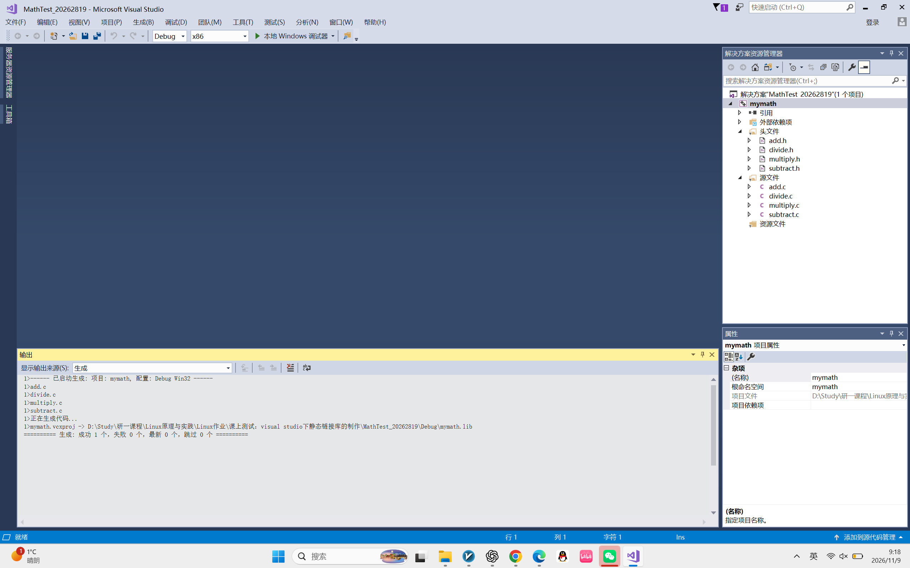
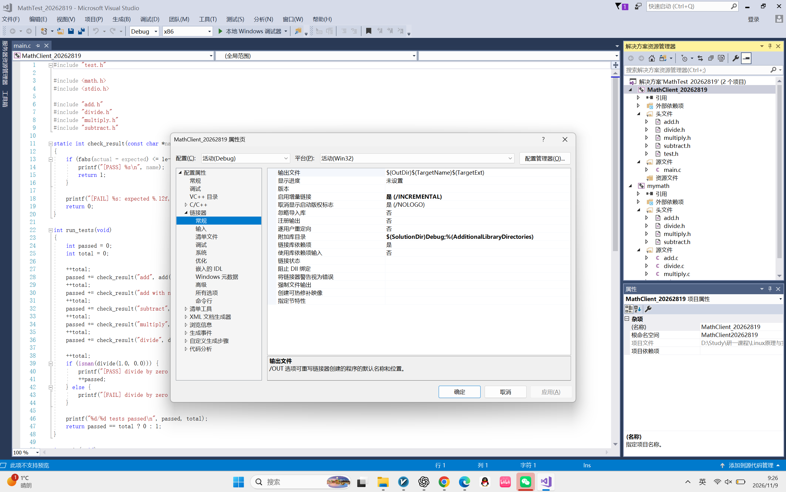
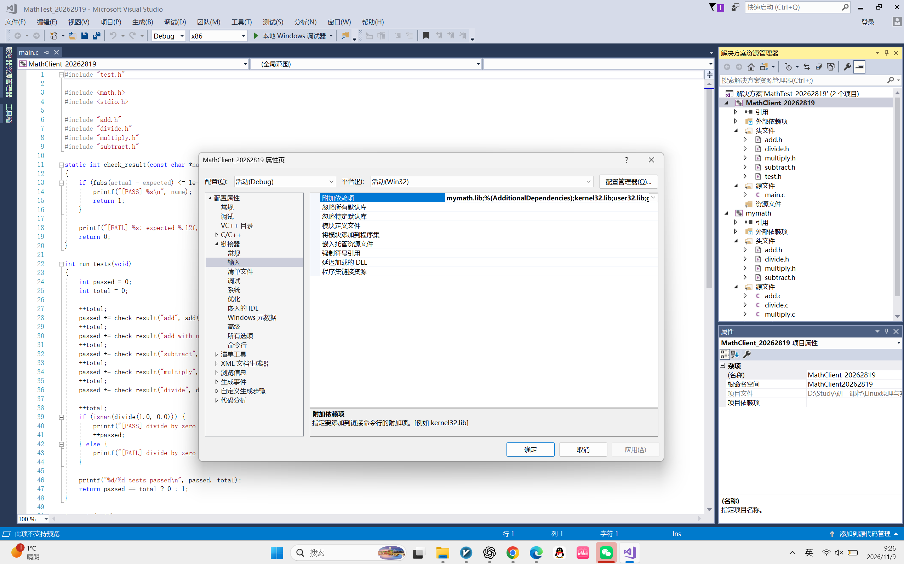
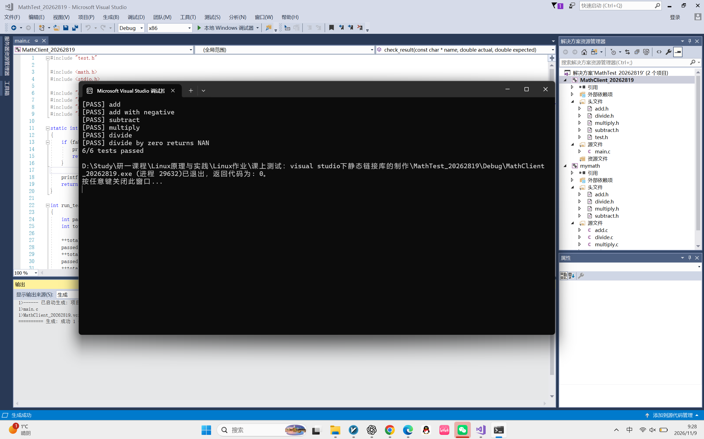
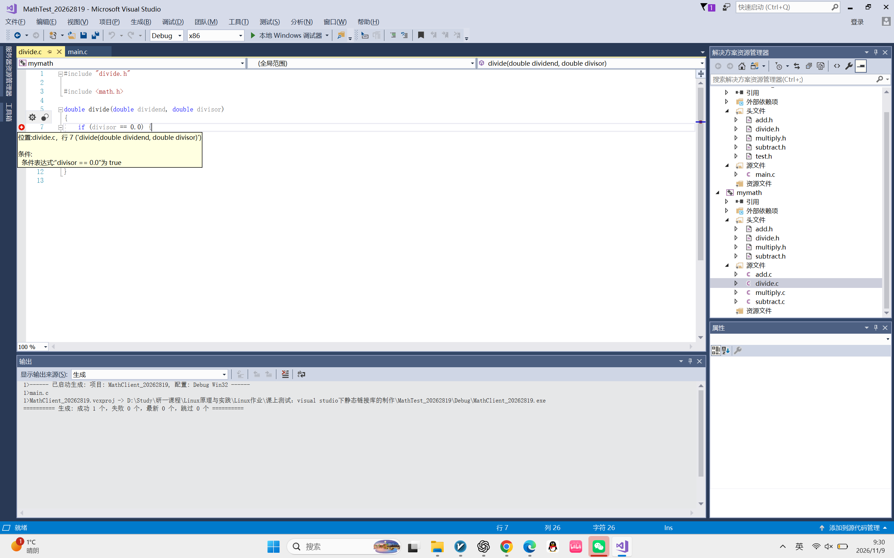
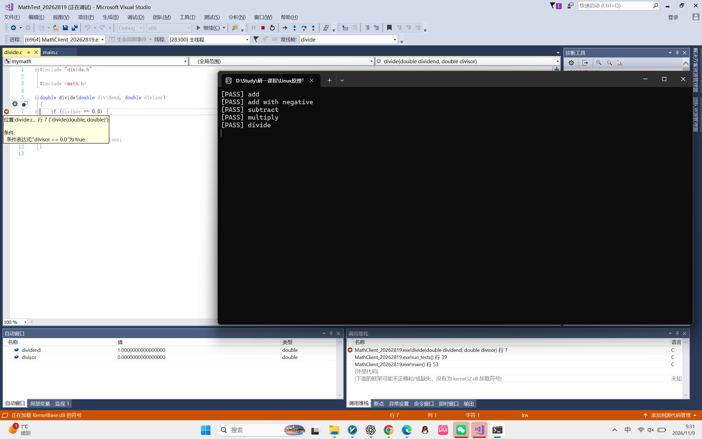
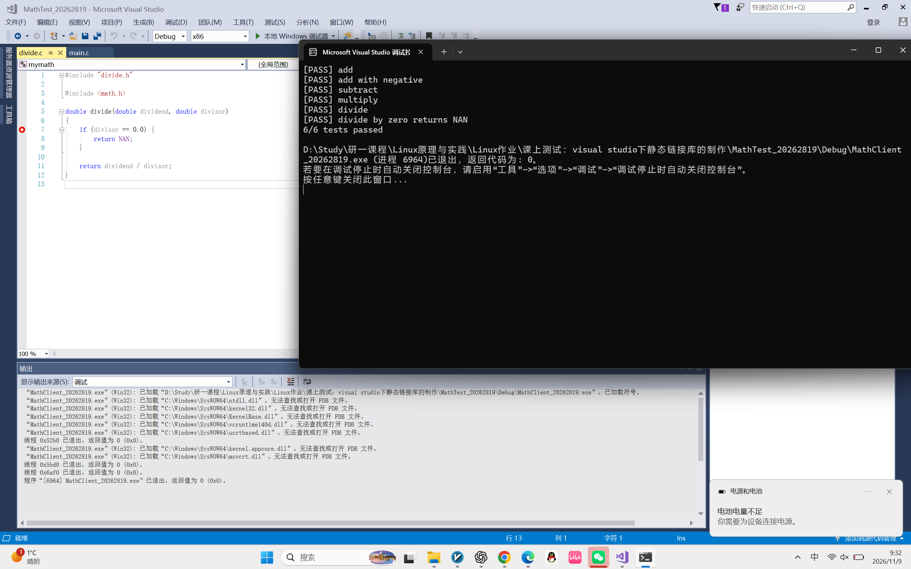

# 课上测试：Visual Studio 下静态链接库的制作

| 项目 | 内容 |
| --- | --- |
| 姓名 | 刘顺文 |
| 学号 | 20262819 |
| 日期 | 2026年11月9日 |
| 开发环境 | Visual Studio Community 2017（15.9.84），Windows |
| 构建配置 | Debug，x86 / Win32 |

## 一、实验目的

将加、减、乘、除四个模块编译为 mymath.lib 静态链接库，在独立的控制台项目中通过 main.c 调用库中的函数，并使用条件断点检查除数为零时的执行过程。

本次使用 testmath.zip 中的现有代码，四个模块分别为 add.c、subtract.c、multiply.c 和 divide.c。原 test.c 包含 main 函数，将其复制到调用项目后重命名为 main.c，保留原有测试逻辑。

## 二、制作 mymath.lib

在解决方案 MathTest_20262819 中，通过 Windows 桌面向导创建 mymath 项目，应用程序类型选择“静态库（.lib）”，勾选空项目，不使用预编译头。

将四个运算模块及对应的 add.h、subtract.h、multiply.h、divide.h 加入项目。静态库项目不加入主程序。采用 Debug、Win32 配置，右键项目执行“生成”。

输出显示四个源文件完成编译，并生成解决方案 Debug 目录中的 mymath.lib，生成结果为成功1个、失败0个。

## 三、main.c 调用静态库

在同一解决方案中新增 MathClient_20262819 空控制台项目，并设为启动项目。调用项目只加入 main.c 和五个头文件（四个模块的头文件及 test.h），不加入四个运算模块的源文件。

头文件提供函数声明，链接器从 mymath.lib 中取得函数实现。在调用项目的属性页中设置以下内容：

| 设置位置 | 设置内容 |
| --- | --- |
| 链接器 → 常规 → 附加库目录 | `$(SolutionDir)Debug;%(AdditionalLibraryDirectories)` |
| 链接器 → 输入 → 附加依赖项 | `mymath.lib;%(AdditionalDependencies)` |

保留原有默认依赖和继承设置，库与调用程序均使用 Debug、Win32 配置。

按 Ctrl+F5 生成并执行调用程序，六项测试全部通过，程序退出代码为0。

| 测试 | 调用或检查 | 预期结果 |
| --- | --- | --- |
| 加法 | `add(2.5, 1.25)` | 3.75 |
| 含负数加法 | `add(-2.5, 1.25)` | -1.25 |
| 减法 | `subtract(5.5, 2.25)` | 3.25 |
| 乘法 | `multiply(2.5, -4.0)` | -10.0 |
| 除法 | `divide(7.5, 2.5)` | 3.0 |
| 除数为零 | `isnan(divide(1.0, 0.0))` | 成立 |

如果向其他使用者提供该库，只需提供 mymath.lib 和四个运算模块的公开头文件，并说明匹配的目标架构与构建要求。对方在自己的主程序中包含头文件、配置库目录与依赖项，即可调用函数，不需要四个模块的源代码。链接时所需的目标代码会被链接进可执行程序，运行时不需要加载 mymath.lib。静态库不等同于对实现进行加密，仍可能被反汇编分析。

## 四、条件断点调试

在 divide.c 第7行的 `if (divisor == 0.0)` 处按 F9 添加断点，打开断点条件设置，将条件表达式设为 `divisor == 0.0`，判断方式为“为 true 时”。

按 F5 启动调试。普通除法测试通过后，程序在除数为零的调用中暂停。现场显示 dividend 为1、divisor 为0，黄色执行箭头停在第7行，断点提示中显示条件表达式。调用堆栈显示 main → run_tests → divide，与主程序的测试流程一致。

继续按 F5 后，divide 函数在除数为零时返回 NAN，主程序通过 isnan 验证结果。最终输出 `6/6 tests passed`，退出代码为0。

## 五、实验总结

本次完成了四则运算静态库的生成和独立主程序的链接调用。头文件负责提供函数声明，静态库负责提供已编译的实现，调用项目无需加入四个模块的源文件即可完成构建。

条件断点使程序只在 divisor 为0时暂停，避免普通除法调用触发暂停。通过参数值、调用堆栈以及继续运行后的测试结果，验证了除零处理分支的执行过程。
