# wait、waitpid 学习测试

| 项目 | 内容 |
| --- | --- |
| 姓名 | 刘顺文 |
| 学号 | 20262819 |
| 作业类型 | Linux 课上测试 |
| 实验要求 | 用 man 学习 wait、waitpid，编写 wait 测试代码并解释状态各位的含义 |
| 实践环境 | VirtualBox 中的 Ubuntu 虚拟机 |
| 实践日期 | 2026-11-16 |
| 实验目录 | `/home/sevenlsw/linux-work/work-8/wait_waitpid` |
| 完成状态 | 已完成手册学习、wait 退出与错误测试、waitpid 状态测试 |

## 一、学习内容

本次实验学习父进程如何等待子进程、获取状态并完成回收。首先通过手册区分函数返回值和状态参数，再编写代码，验证正常退出、退出码截断、信号终止、core 标志，以及没有子进程时的错误返回。最后使用 waitpid 观察暂停、继续和非阻塞查询。

**wait 的直接返回值是子进程 PID 或 -1；状态编码通过指针参数另外传出。题目中“每一位的含义”在本实验中具体落实为对子进程状态 status 的解码，不能将 PID 当作退出状态。**

## 二、实践准备与手册学习

### 2.1 创建实验目录

在虚拟机终端执行：

```bash
mkdir -p ~/linux-work/work-8/wait_waitpid
cd ~/linux-work/work-8/wait_waitpid
```

本次在该目录编写 `wait_test.c`、`wait_error.c` 和 `waitpid_states.c`。终端目录由本次截图确认，不沿用上一次 myshell 的工作目录。

### 2.2 查看 wait 与 waitpid 手册

依次执行以下命令，每次按 `q` 退出手册后再打开下一份：

```bash
man 2 wait
man 2 waitpid
```

指定第2节可以打开进程等待接口的手册，避免与同名 shell 命令混淆。实际观察到两个入口共用 `wait(2)` 手册，其中列出以下函数声明：

```c
#include <sys/wait.h>

pid_t wait(int *wstatus);
pid_t waitpid(pid_t pid, int *wstatus, int options);
```

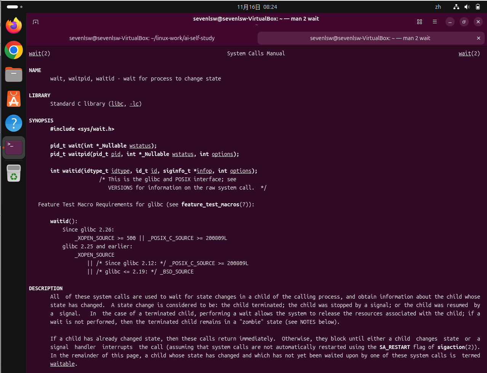

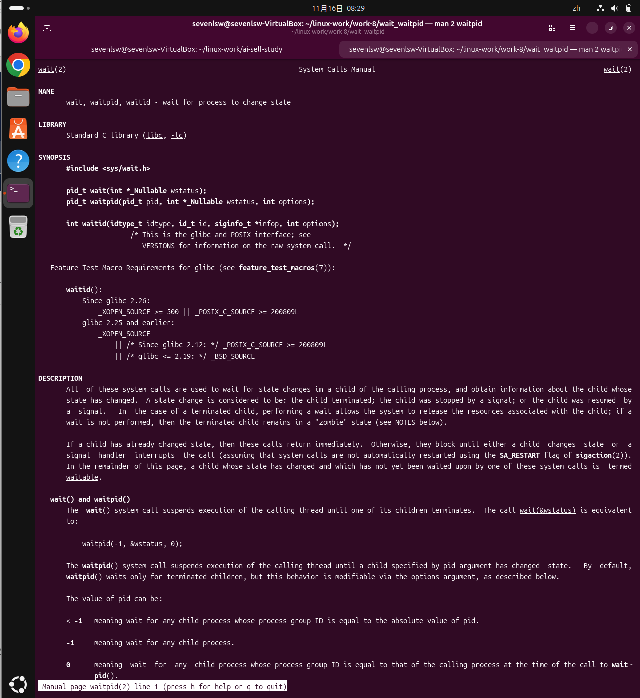

普通的 `wait(&status)` 等价于 `waitpid(-1, &status, 0)`。当没有可报告的终止状态时会等待；已经有可等待的子进程终止状态时可以立即返回。获取终止状态后，系统释放该子进程保留的退出信息，完成回收。手册同时说明，受跟踪子进程的停止状态存在特殊处理，本实验不涉及 ptrace。

### 2.3 waitpid 的参数和选项

| pid 参数 | 等待对象 |
| --- | --- |
| 大于0 | PID 等于该值的指定子进程 |
| 等于 -1 | 任意子进程 |
| 等于0 | 与调用者属于同一进程组的子进程，以调用时的组为准 |
| 小于 -1 | 进程组 ID 等于该值绝对值的子进程 |

| options | 含义 |
| --- | --- |
| 0 | 默认等待终止状态 |
| WNOHANG | 没有可报告状态时立即返回0，不阻塞 |
| WUNTRACED | 也报告未被跟踪子进程的暂停状态 |
| WCONTINUED | 也报告子进程收到 SIGCONT 后的继续状态 |

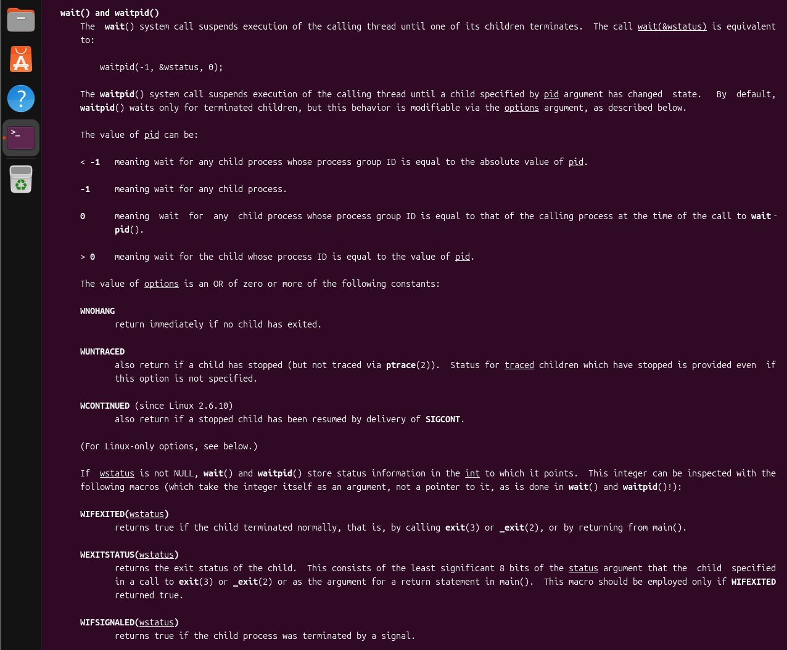

### 2.4 返回值、错误码和状态宏

| 接口返回结果 | 含义 |
| --- | --- |
| wait 返回正 PID | 成功获取并回收对应子进程的终止状态 |
| waitpid 返回正 PID | 成功获取对应子进程的状态；可能是终止、暂停或继续 |
| waitpid 返回0 | 指定 WNOHANG，存在符合等待条件的子进程，但当前没有可报告状态 |
| 返回 -1 | 调用失败，查看 errno；不能据此解码 status |

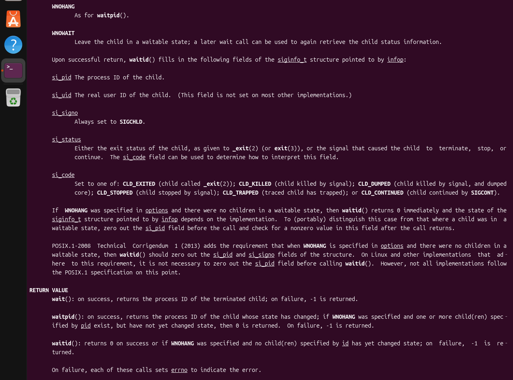

`ECHILD` 表示没有符合条件的可等待子进程；`EINTR` 表示等待被信号中断，测试程序对此重试。子进程终止后，如果退出信息尚未被父进程取走，会处于僵尸状态。暂停和继续通知不会回收仍存活的子进程。

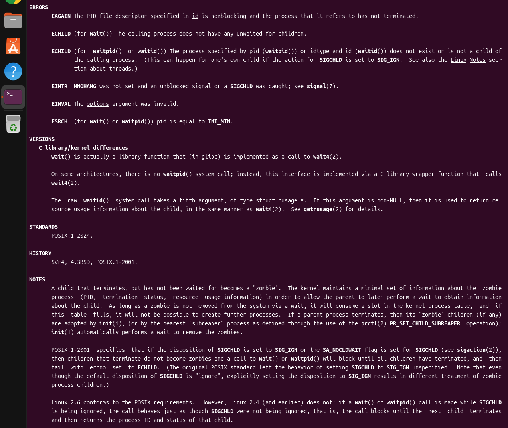

| 判断宏 | 判断成立后使用的提取宏 |
| --- | --- |
| WIFEXITED(status)：正常退出 | WEXITSTATUS(status)：退出码低8位 |
| WIFSIGNALED(status)：信号终止 | WTERMSIG(status)：终止信号；WCOREDUMP(status)：core 标志 |
| WIFSTOPPED(status)：暂停 | WSTOPSIG(status)：暂停信号 |
| WIFCONTINUED(status)：继续 | 直接判断继续事件 |

这些宏接收的是 `status` 的值，不是 `&status`。只有取得有效状态、判断其类型后，才能使用对应的提取宏。

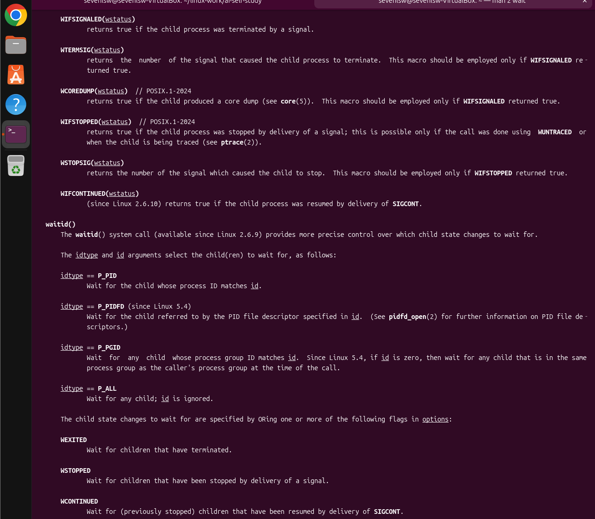

## 三、status 各位的含义

以下按本次 Linux 环境的普通 wait/waitpid 状态编码解释低16位，位编号从右向左，第0位为最低位。status 的类型是 int，不意味着其全部位都分别表示一个状态字段；本实验不将第16位及以上解释为退出码。其他扩展场景可能有额外编码。可移植代码应使用状态宏，位运算用于理解本次结果。

| 状态类型 | 第15～8位 | 第7位 | 第6～0位 |
| --- | --- | --- | --- |
| 正常退出 | 退出参数的低8位 | 0 | 0 |
| 信号终止 | 不作为退出码解释 | core dump 标志 | 终止信号编号 |
| 暂停 | 暂停信号编号 | 与低7位合成暂停标记 | 低8位整体为 0x7f |
| 继续 | 与低8位一起组成特殊状态 0xffff | 特殊编码的一部分 | 特殊编码的一部分 |

正常退出的高8位中，第8位的权重为1，第9位为2，依次到第15位的128；低7位作为信号编号时，第0～6位的权重依次为1、2、4、8、16、32、64。第7位只在信号终止语境中解释为 core 标志，不能对所有状态无条件使用同一解释。

例如退出码165为 `10100101`，对应 status 为：

```text
位编号：15......8 7 6.....0
二进制：10100101 0 0000000
含义：  退出码165  无core 低7位为0
```

暂停状态 `0x137f` 的低8位是固定标记 `01111111`；继续状态 `0xffff` 必须整体识别，不能误读为退出码255、信号127或 core 标志为1。

## 四、wait 终止状态测试

### 4.1 编写 wait_test.c

在实验目录保存以下代码为 `wait_test.c`。实际通过 `cat > wait_test.c <<'EOF'` 写入代码，并用 `tail -n 12 wait_test.c` 检查文件末尾。

```c
#define _GNU_SOURCE
#include <stdio.h>
#include <stdlib.h>
#include <string.h>
#include <unistd.h>
#include <signal.h>
#include <errno.h>
#include <sys/types.h>
#include <sys/wait.h>

static void show_status(int status)
{
    unsigned int s = (unsigned int)status;

    printf("raw status = %d, hex = 0x%04x\n", status, s);
    printf("bits 15..0 = ");
    for (int i = 15; i >= 0; --i) {
        printf("%u", (s >> i) & 1U);
        if (i == 8 || i == 7)
            putchar(' ');
    }
    putchar('\n');

    printf("bits 15..8 = %u\n", (s >> 8) & 0xffU);
    printf("bit 7      = %u\n", (s >> 7) & 1U);
    printf("bits 6..0  = %u\n", s & 0x7fU);

    if (WIFEXITED(status)) {
        printf("normal exit: WEXITSTATUS = %d\n",
               WEXITSTATUS(status));
    } else if (WIFSIGNALED(status)) {
        printf("signal termination: WTERMSIG = %d\n",
               WTERMSIG(status));
#ifdef WCOREDUMP
        printf("core flag: WCOREDUMP = %d\n",
               WCOREDUMP(status) ? 1 : 0);
#endif
    }
}

int main(int argc, char *argv[])
{
    if (argc != 2 ||
        (strcmp(argv[1], "normal") != 0 &&
         strcmp(argv[1], "overflow") != 0 &&
         strcmp(argv[1], "term") != 0 &&
         strcmp(argv[1], "abort") != 0)) {
        fprintf(stderr,
                "Usage: %s normal|overflow|term|abort\n", argv[0]);
        return 1;
    }

    pid_t child = fork();
    if (child == -1) {
        perror("fork");
        return 1;
    }

    if (child == 0) {
        if (strcmp(argv[1], "normal") == 0)
            _exit(165);

        if (strcmp(argv[1], "overflow") == 0)
            _exit(421);

        if (strcmp(argv[1], "term") == 0) {
            signal(SIGTERM, SIG_DFL);
            raise(SIGTERM);
            _exit(1);
        }

        abort();
    }

    int status;
    pid_t result;

    do {
        result = wait(&status);
    } while (result == -1 && errno == EINTR);

    if (result == -1) {
        perror("wait");
        return 1;
    }

    printf("child PID = %ld\n", (long)child);
    printf("wait return PID = %ld\n", (long)result);
    show_status(status);

    return 0;
}
```

父进程检查 wait 成功后才调用 `show_status`。该函数同时输出原始数值、二进制字段和宏解析结果，以便比较。WCOREDUMP 的结果只作为真假值判断，程序将其归一化为0或1。

### 4.2 编译与正常退出

```bash
gcc -std=c11 -Wall -Wextra -o wait_test wait_test.c
./wait_test normal
```

实际编译未显示错误或警告。子进程执行 `_exit(165)`，输出确认：

```text
child PID = 5824
wait return PID = 5824
raw status = 42240, hex = 0xa500
bits 15..0 = 10100101 0 0000000
bits 15..8 = 165
bit 7      = 0
bits 6..0  = 0
normal exit: WEXITSTATUS = 165
```

wait 返回的5824是 PID；status 为 `165 << 8`，即42240。两者承担不同含义。低8位为0，WIFEXITED 判断为正常退出，高8位保存退出码165。

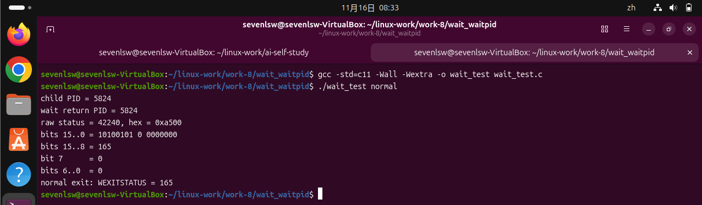

### 4.3 退出码截断

```bash
./wait_test overflow
```

子进程执行 `_exit(421)`，实际 wait 返回5832，status 仍为 `0xa500`，WEXITSTATUS 为165。

```text
421 = 0x01a5
421 & 0xff = 0xa5 = 165
```

这说明父进程取得的是退出参数的低8位，而不是完整的421。

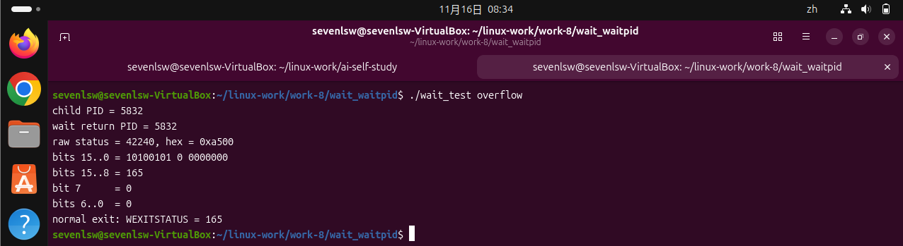

### 4.4 SIGTERM 信号终止

```bash
./wait_test term
```

测试子进程向自身发送 SIGTERM。实际 wait 返回5839，status 为15，即 `0x000f`：

```text
bits 15..0 = 00000000 0 0001111
bits 6..0  = 15
signal termination: WTERMSIG = 15
core flag: WCOREDUMP = 0
```

此时低7位是终止信号15，第7位为0。程序走 WIFSIGNALED 分支，不用 WEXITSTATUS 解释退出码。

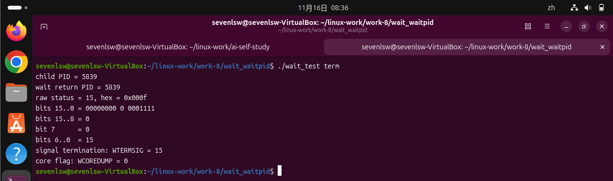

### 4.5 SIGABRT 与 core 标志

```bash
./wait_test abort
```

子进程调用 abort，实际 wait 返回5847，status 为134，即 `0x0086`：

```text
bits 15..0 = 00000000 1 0000110
bit 7      = 1
bits 6..0  = 6
signal termination: WTERMSIG = 6
core flag: WCOREDUMP = 1
```

`0x86 = 0x80 | 6`，其中低7位的6表示 SIGABRT，第7位为 core dump 标志。134是本次原始状态编码，不是正常退出码134。本次没有进一步检查 core 文件路径，标志为1不能用于断言当前目录存在名为 core 的文件；转储位置与系统配置有关。

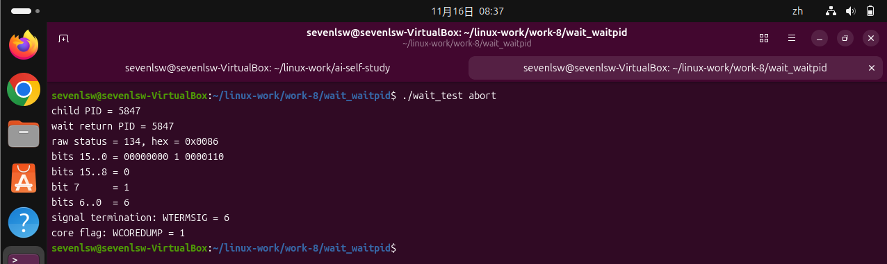

## 五、wait 错误返回测试

### 5.1 编写 wait_error.c

该程序不创建子进程，直接调用 wait，以验证 ECHILD。

```c
#include <stdio.h>
#include <errno.h>
#include <string.h>
#include <sys/types.h>
#include <sys/wait.h>

int main(void)
{
    int status = 0;
    pid_t result = wait(&status);

    if (result == -1) {
        int saved_errno = errno;
        printf("wait return = %ld\n", (long)result);
        printf("errno = %d (%s)\n",
               saved_errno, strerror(saved_errno));
        printf("errno == ECHILD: %s\n",
               saved_errno == ECHILD ? "yes" : "no");
        puts("wait failed: status must not be decoded.");
        return 0;
    }

    fprintf(stderr, "Unexpected return: %ld\n", (long)result);
    return 1;
}
```

### 5.2 编译与结果

```bash
gcc -std=c11 -Wall -Wextra -o wait_error wait_error.c
./wait_error
```

实际编译未显示错误或警告，输出为：

```text
wait return = -1
errno = 10 (No child processes)
errno == ECHILD: yes
wait failed: status must not be decoded.
```

status 虽然初始化为0，但失败调用没有取得有效的子进程状态，因此不能将0解释为“子进程以0正常退出”。程序自身返回0表示已成功演示预期错误，不代表内部 wait 调用成功。

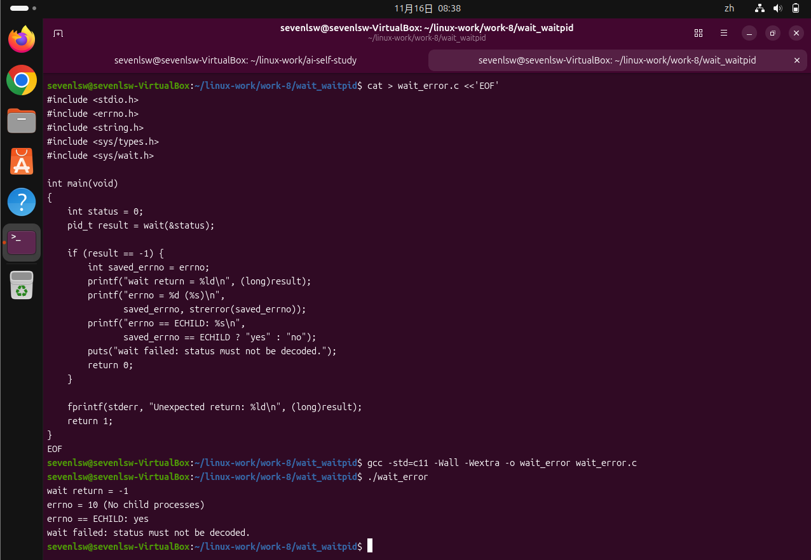

## 六、waitpid 暂停、继续与非阻塞测试

### 6.1 编写 waitpid_states.c

为使状态观察顺序明确，子进程先暂停，恢复后一直等待信号，不自行退出。父进程依次获取暂停通知、进行非阻塞查询、恢复子进程、取得继续通知，最后发送 SIGTERM 并回收。所有信号只发送给本程序创建的子进程。

```c
#define _GNU_SOURCE
#include <stdio.h>
#include <unistd.h>
#include <signal.h>
#include <errno.h>
#include <sys/types.h>
#include <sys/wait.h>

static pid_t wait_retry(pid_t pid, int *status, int options)
{
    pid_t result;
    do {
        result = waitpid(pid, status, options);
    } while (result == -1 && errno == EINTR);
    return result;
}

static void show_bits(int status)
{
    printf("status = 0x%04x, bits = ", (unsigned int)status);
    for (int i = 15; i >= 0; --i) {
        printf("%u", ((unsigned int)status >> i) & 1U);
        if (i == 8)
            putchar(' ');
    }
    putchar('\n');
}

int main(void)
{
    pid_t child = fork();
    if (child == -1) {
        perror("fork");
        return 1;
    }

    if (child == 0) {
        raise(SIGSTOP);
        for (;;)
            pause();
    }

    int status;
    pid_t result;

    result = wait_retry(child, &status, WUNTRACED);
    if (result == -1)
        goto fail;

    printf("stopped: waitpid return PID = %ld\n", (long)result);
    show_bits(status);
    if (WIFSTOPPED(status))
        printf("WSTOPSIG = %d\n", WSTOPSIG(status));

    /* 暂停状态已经取走，子进程仍存活且暂停 */
    result = wait_retry(child, &status, WNOHANG);
    if (result == -1)
        goto fail;
    printf("WNOHANG return = %ld (no new report)\n", (long)result);
    /* 返回0时，不解析 status */

    if (kill(child, SIGCONT) == -1)
        goto fail;

    result = wait_retry(child, &status, WCONTINUED);
    if (result == -1)
        goto fail;

    printf("continued: waitpid return PID = %ld\n", (long)result);
    show_bits(status);
    printf("WIFCONTINUED = %d\n", WIFCONTINUED(status) ? 1 : 0);

    /* 最后终止并回收本程序创建的子进程 */
    if (kill(child, SIGTERM) == -1)
        goto fail;

    result = wait_retry(child, &status, 0);
    if (result == -1)
        goto fail;

    printf("terminated: waitpid return PID = %ld\n", (long)result);
    show_bits(status);
    if (WIFSIGNALED(status))
        printf("WTERMSIG = %d\n", WTERMSIG(status));

    return 0;

fail:
    perror("waitpid or kill");
    kill(child, SIGKILL);
    wait_retry(child, &status, 0);
    return 1;
}
```

### 6.2 编译与实际结果

```bash
gcc -std=c11 -Wall -Wextra -o waitpid_states waitpid_states.c
./waitpid_states
```

实际编译未显示错误或警告，结果如下：

```text
stopped: waitpid return PID = 5931
status = 0x137f, bits = 00010011 01111111
WSTOPSIG = 19
WNOHANG return = 0 (no new report)
continued: waitpid return PID = 5931
status = 0xffff, bits = 11111111 11111111
WIFCONTINUED = 1
terminated: waitpid return PID = 5931
status = 0x000f, bits = 00000000 00001111
WTERMSIG = 15
```

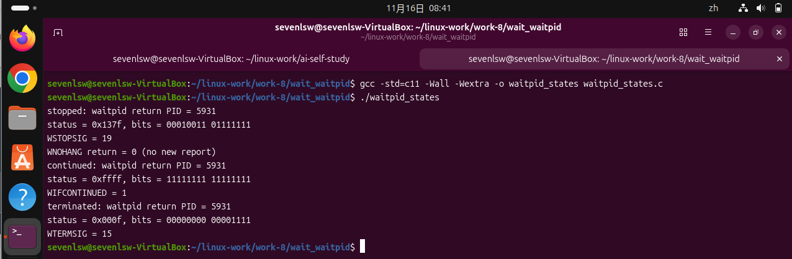

暂停时高8位为19，即本环境的 SIGSTOP，低8位为固定标记 `0x7f`。随后 WNOHANG 返回0，说明子进程仍存在，但没有此次调用可报告的新状态；不能把0当成成功回收或 ECHILD。恢复后得到特殊编码 `0xffff`，WIFCONTINUED 为真。最后同一个 PID 5931 被 SIGTERM 终止并回收。

## 七、实验结果与总结

| 测试 | 实际返回值 | 实际 status | 解析结果 |
| --- | --- | --- | --- |
| 正常退出165 | 5824 | 0xa500 | 正常退出，退出码165 |
| 退出参数421 | 5832 | 0xa500 | 正常退出，低8位为165 |
| SIGTERM终止 | 5839 | 0x000f | 终止信号15，core标志0 |
| SIGABRT终止 | 5847 | 0x0086 | 终止信号6，core标志1 |
| 没有子进程 | -1 | 不解析 | errno为ECHILD，本环境数值10 |
| 暂停通知 | 5931 | 0x137f | 暂停信号19 |
| 非阻塞查询 | 0 | 不解析 | 当前没有可报告状态 |
| 继续通知 | 5931 | 0xffff | WIFCONTINUED为真 |
| 最终终止回收 | 5931 | 0x000f | SIGTERM终止并完成回收 |

上述 PID 是本次实际观察值，重新运行时可能不同。程序中包含 EINTR 重试和异常清理分支，但本次没有人为触发这些故障分支，不将它们列为实测项目。

本次实验将函数返回值和子进程状态编码区分开来：返回值用于判断调用结果和识别子进程，status 用于描述取得的状态。正常退出时读取高8位，信号终止时读取低7位及 core 标志；暂停和继续则需要按各自编码和宏进行判断。

通过同一子进程的多阶段测试，可以看到“收到状态通知”和“回收子进程”并不总是同一件事。暂停、继续时子进程仍然存在，只有终止后取得退出信息才完成回收。实际编程应先检查返回值，再判断状态类型，最后提取相应字段。
