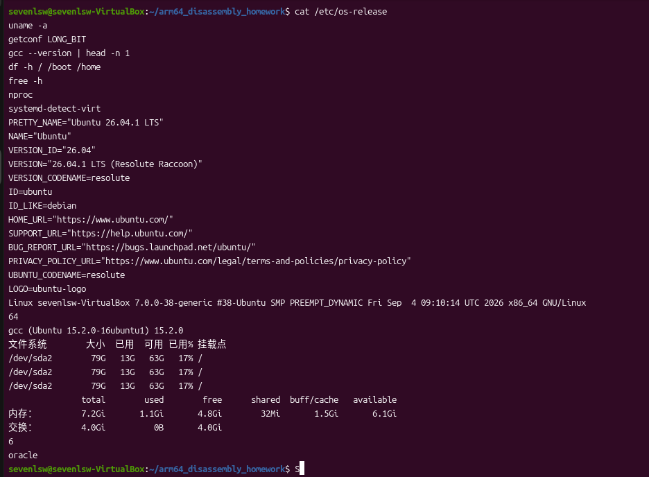
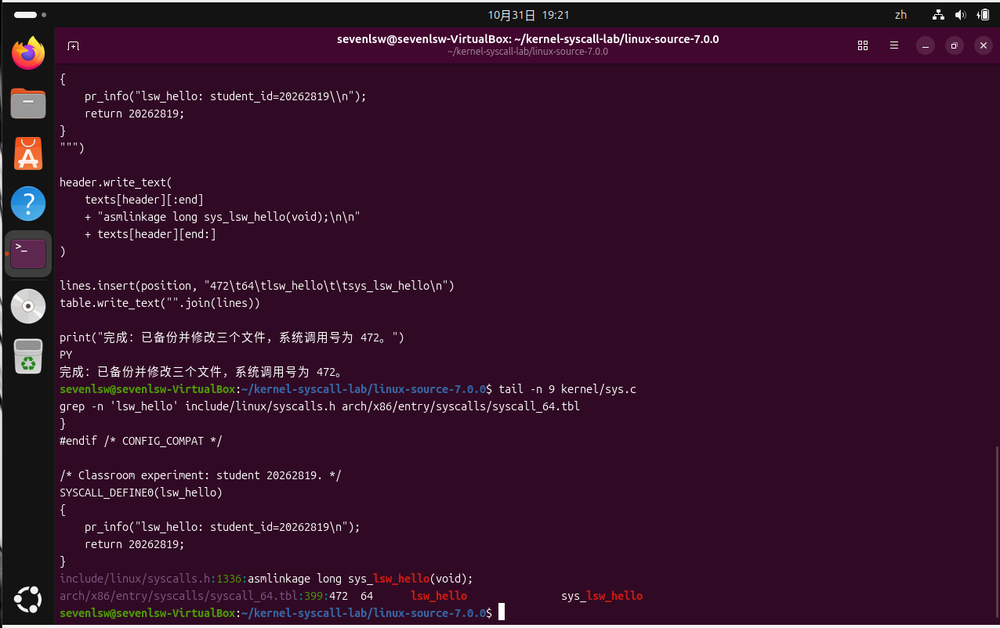
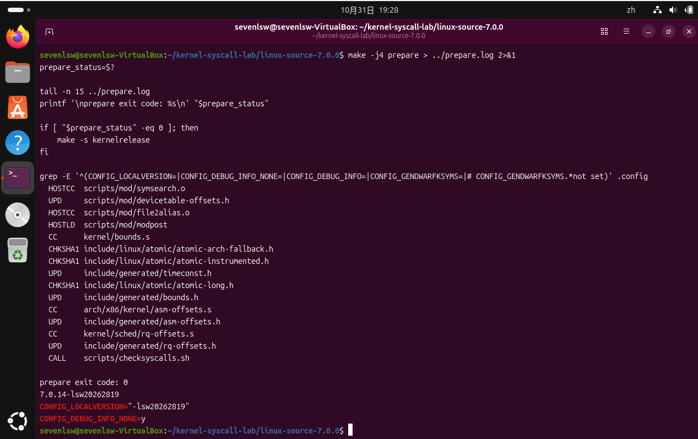
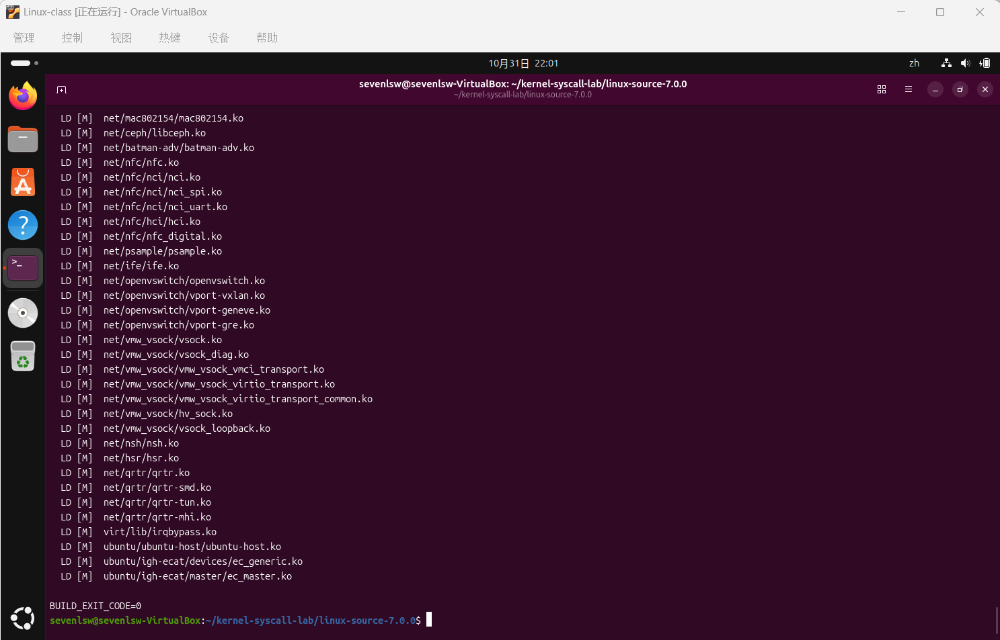
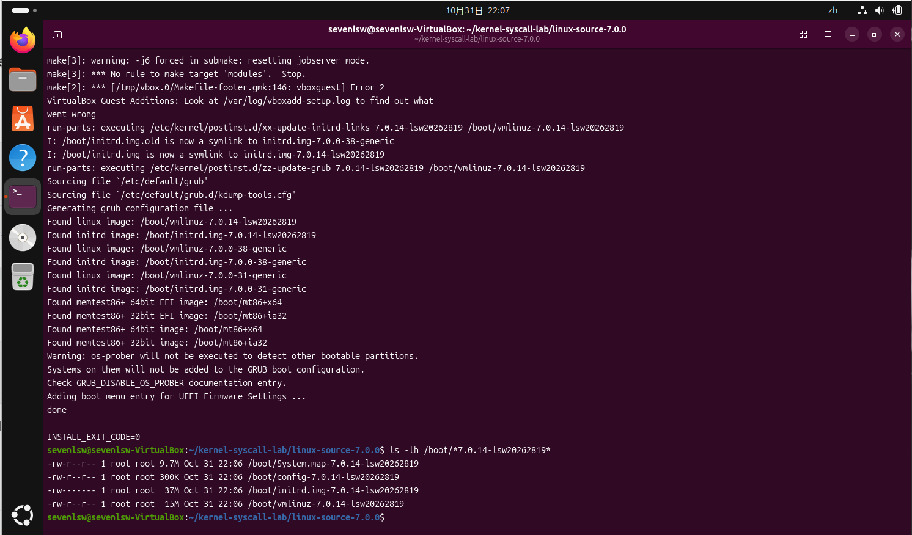
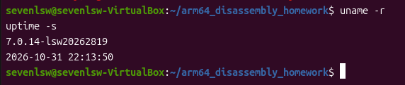
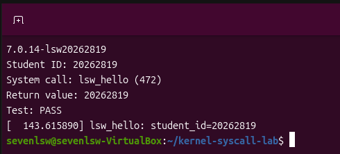

# 内核编译与系统调用课堂测试

本次实验在 VirtualBox 中的 Ubuntu 系统上修改 Linux 内核源码，添加一个返回学号的系统调用，完成内核编译、安装与启动，并通过用户程序输出和内核日志验证调用结果。

| 项目 | 内容 |
| --- | --- |
| 姓名 | 刘顺文 |
| 学号 | 20262819 |
| 课程 | Linux 原理与实践 |
| 测试主题 | 内核编译与系统调用 |
| 实验日期 | 2026 年 10 月 26 日至 10 月 31 日 |
| 实验完成日期 | 2026 年 10 月 31 日 |
| 新增系统调用 | `lsw_hello`，调用号 `472` |
| 完成情况 | 已编译并启动新内核，系统调用测试通过 |

## 01｜实验要求与目的

课堂测试要求参考《实践2.2编译内核及系统调用》完成相关实践，遇到磁盘空间问题时参考《编译内核之扩大硬盘空间》，提交新增系统调用的测试结果截图。

本次实验主要完成以下内容：

1. 检查系统架构、编译环境和磁盘空间，准备内核源码。
2. 在内核中实现系统调用，补充声明并登记调用号。
3. 配置、编译和安装内核与模块，更新启动菜单。
4. 启动新内核，通过用户程序调用新增接口，并核对内核日志。

参考材料中的示例使用 Linux 3.14.40，而本次环境的原内核为 `7.0.0-38-generic`，编译器为 GCC 15.2。因此使用 Ubuntu 软件源提供的内核源码，按照当前源码结构调整系统调用表路径和函数定义方式。源码包目录名为 `linux-source-7.0.0`，其 Makefile 中的实际源码版本为 **7.0.14**。

## 02｜实验环境与准备

### 2.1 实验环境

| 项目 | 实际配置 |
| --- | --- |
| 虚拟化平台 | Oracle VirtualBox |
| 操作系统 | Ubuntu 26.04.1 LTS |
| CPU 架构 | x86-64，64 位 |
| 原运行内核 | `7.0.0-38-generic` |
| 编译器 | GCC 15.2.0 |
| 逻辑 CPU 数量 | 6 |
| 虚拟机内存 | 约 7.2 GiB |
| 初始根分区可用空间 | 约 63 GB |
| 编译并行度 | 4 |
| 新内核版本 | `7.0.14-lsw20262819` |

使用以下命令检查环境：

```bash
cat /etc/os-release
uname -a
getconf LONG_BIT
gcc --version | head -n 1
df -h / /boot /home
free -h
nproc
systemd-detect-virt
```

检查结果表明根分区空间满足本次编译需要，因此没有执行分区、格式化或扩容操作。终端曾位于 `arm64_disassembly_homework` 目录，但目录名称不代表当前机器架构，本次实际编译目标为 x86-64。



### 2.2 安装工具与源码

本次使用的主要工具和依赖如下。其中 `gawk` 是首次完整编译报错后补装的，下面将其一并列入最终所需依赖。

```bash
sudo apt update
sudo apt install build-essential bc bison flex libssl-dev libelf-dev \
    libncurses-dev dwarves xz-utils rsync cpio python3 linux-source gawk
```

创建独立实验目录并解压源码：

```bash
mkdir -p ~/kernel-syscall-lab
cd ~/kernel-syscall-lab
tar -xf /usr/src/linux-source-7.0.0/linux-source-7.0.0.tar.bz2
cd linux-source-7.0.0
head -n 6 Makefile
```

源码目录为 `/home/sevenlsw/kernel-syscall-lab/linux-source-7.0.0`。源码修改和编译使用普通用户执行，仅安装依赖、安装内核和读取受限日志等操作使用 `sudo`。

## 03｜新增系统调用

### 3.1 接口设计与调用号选择

新增系统调用命名为 `lsw_hello`，不接收参数，执行时向内核日志写入学号，并返回长整型数值 `20262819`。

首先查看普通 x86-64 系统调用的编号：

```bash
awk '$1 ~ /^[0-9]+$/ && ($2 == "common" || $2 == "64") {print}' \
    arch/x86/entry/syscalls/syscall_64.tbl | tail -n 20
```

实际检查到最后一项为 `471 rseq_slice_yield`，因此选用当时表中未占用的 **472**。表尾的 `512–547` 是历史遗留的 x32 ABI 编号范围，不能据此直接确定普通 x86-64 调用号。本实验只添加原生 x86-64 接口。

修改前，三个文件均保存了 `.before-lsw` 备份。

### 3.2 实现内核函数

在 `kernel/sys.c` 文件末尾的现有条件编译块之外添加：

```c
/* Classroom experiment: student 20262819. */
SYSCALL_DEFINE0(lsw_hello)
{
    pr_info("lsw_hello: student_id=20262819\n");
    return 20262819;
}
```

`SYSCALL_DEFINE0` 用于定义无参数系统调用，并配合架构相关机制生成入口包装。`pr_info` 将信息写入内核日志缓冲区，返回值则沿系统调用返回路径交给用户程序。

### 3.3 添加声明与调用表条目

在 `include/linux/syscalls.h` 最后的 `#endif` 之前添加：

```c
asmlinkage long sys_lsw_hello(void);
```

在 `arch/x86/entry/syscalls/syscall_64.tbl` 的 471 号条目之后添加：

```text
472    64    lsw_hello    sys_lsw_hello
```

四列分别表示系统调用号、ABI、调用名称和内核实现入口。当前源码中的路径包含 `arch/x86/entry/syscalls/`，与旧参考材料中的目录结构不同。

通过以下命令核对修改：

```bash
tail -n 9 kernel/sys.c
grep -n 'lsw_hello' include/linux/syscalls.h \
    arch/x86/entry/syscalls/syscall_64.tbl
```



## 04｜配置与编译内核

### 4.1 生成编译配置

以原 Ubuntu 内核的配置为基础，保留虚拟机所需的驱动配置：

```bash
cp /boot/config-$(uname -r) .config
make olddefconfig
```

设置新内核后缀，清空发行版证书文件路径，并关闭本次不需要的调试信息。下面汇总的是经过排错后使用的设置：

```bash
scripts/config --set-str LOCALVERSION "-lsw20262819"
scripts/config --disable LOCALVERSION_AUTO
scripts/config --set-str SYSTEM_TRUSTED_KEYS ""
scripts/config --set-str SYSTEM_REVOCATION_KEYS ""
scripts/config --disable GENDWARFKSYMS
scripts/config --disable DEBUG_INFO_BTF
scripts/config --disable DEBUG_INFO_BTF_MODULES
scripts/config --disable DEBUG_INFO_DWARF_TOOLCHAIN_DEFAULT
scripts/config --disable DEBUG_INFO_DWARF4
scripts/config --disable DEBUG_INFO_DWARF5
scripts/config --enable DEBUG_INFO_NONE
make olddefconfig
```

这些证书设置用于避免引用源码环境中缺失的发行版证书文件，不代表已为新内核完成 Secure Boot 签名。关闭调试信息可以减少构建产物占用的磁盘空间。

执行构建准备并核对生成的版本：

```bash
make -j4 prepare > ../prepare.log 2>&1
prepare_status=$?
printf 'prepare exit code: %s\n' "$prepare_status"
make -s kernelrelease
grep -E '^(CONFIG_LOCALVERSION=|CONFIG_DEBUG_INFO_NONE=)' .config
```

最终准备过程退出码为 `0`，版本为 `7.0.14-lsw20262819`，且 `CONFIG_DEBUG_INFO_NONE=y`。



### 4.2 编译内核及模块

使用四个并行任务编译内核镜像和模块，同时保存日志：

```bash
set -o pipefail
make -j4 bzImage modules 2>&1 | tee ../build.log
build_status=$?
printf '\nBUILD_EXIT_CODE=%s\n' "$build_status"
```

`bzImage` 生成可启动的压缩内核镜像，`modules` 编译可加载模块。`tee` 在终端显示输出并保存日志；启用 `pipefail` 后，可以避免仅凭日志写入成功而误判编译成功。

首次完整编译因缺少 `gawk` 失败。补装后保留已有构建文件，重新执行相同构建目标，日志保存为 `../build-retry.log`。最终输出 **`BUILD_EXIT_CODE=0`**，内核与模块编译完成。



## 05｜安装并启动新内核

### 5.1 安装模块与内核

在源码目录执行：

```bash
set -o pipefail
(sudo make modules_install && sudo make install) 2>&1 | tee ../install.log
install_status=$?
printf '\nINSTALL_EXIT_CODE=%s\n' "$install_status"
ls -lh /boot/*7.0.14-lsw20262819*
```

模块安装到 `/lib/modules/7.0.14-lsw20262819/`。安装流程将新内核放入 `/boot`，生成 initramfs，并更新 GRUB。最终安装退出码为 `0`，且检查到以下文件：

```text
/boot/System.map-7.0.14-lsw20262819
/boot/config-7.0.14-lsw20262819
/boot/initrd.img-7.0.14-lsw20262819
/boot/vmlinuz-7.0.14-lsw20262819
```

安装日志同时出现 VirtualBox Guest Additions 外部模块构建失败，说明安装退出码不能代替对全部日志的检查。新内核及启动镜像已成功安装，后续也成功进入桌面；增强功能是否全部正常未在本次实验中验证。



### 5.2 设置启动菜单并重启

通过独立配置文件显示 GRUB 菜单，停留 10 秒：

```bash
printf 'GRUB_TIMEOUT_STYLE=menu\nGRUB_TIMEOUT=10\n' | \
    sudo tee /etc/default/grub.d/99-lsw-lab.cfg
sudo update-grub
```

更新输出识别到了新内核及对应的 initrd，同时保留原有 Ubuntu 内核。

执行 `mokutil --sb-state` 时返回 `EFI variables are not supported on this system`，未能通过该命令读取 Secure Boot 状态。随后实际启动成功，未出现签名阻止启动的错误。

普通 `sudo reboot` 被 GNOME 会话阻止。保存文件后，使用下面的命令忽略会话阻止请求进行重启：

```bash
sudo systemctl reboot -i
```

启动时从 GRUB 高级选项选择 `7.0.14-lsw20262819` 对应的普通启动项，登录后检查：

```bash
uname -r
uptime -s
```

实际输出：

```text
7.0.14-lsw20262819
2026-10-31 22:13:50
```

该结果确认当前运行的已经是包含新增系统调用的内核。



## 06｜编写测试程序与验证结果

### 6.1 用户态测试程序

在 `~/kernel-syscall-lab/` 中创建 `test_lsw_hello.c`：

```c
#define _GNU_SOURCE
#include <stdio.h>
#include <unistd.h>
#include <sys/syscall.h>

int main(void)
{
    long result = syscall(472);

    if (result == -1) {
        perror("lsw_hello");
        return 1;
    }

    printf("Student ID: 20262819\n");
    printf("System call: lsw_hello (472)\n");
    printf("Return value: %ld\n", result);
    printf("Test: %s\n", result == 20262819 ? "PASS" : "FAIL");

    return result == 20262819 ? 0 : 1;
}
```

编译并执行测试：

```bash
cd ~/kernel-syscall-lab
gcc -Wall -Wextra -O2 test_lsw_hello.c -o test_lsw_hello
uname -r
./test_lsw_hello
sudo dmesg | grep 'lsw_hello' | tail -n 5
```

`syscall(472)` 通过通用系统调用接口进入内核，472 号条目将请求分派到新增的实现。测试程序将返回值保存为 `long` 并与学号比较；内核日志提供另一个观察结果。

### 6.2 实际输出与提交截图

本次实际测试输出如下：

```text
7.0.14-lsw20262819
Student ID: 20262819
System call: lsw_hello (472)
Return value: 20262819
Test: PASS
[  143.615890] lsw_hello: student_id=20262819
```



| 验证项目 | 实际结果 | 判断 |
| --- | --- | --- |
| 运行内核 | `7.0.14-lsw20262819` | 已进入新内核 |
| 调用接口 | `lsw_hello (472)` | 用户程序使用本次登记的编号 |
| 返回值 | `20262819` | 与内核函数设定一致 |
| 程序判定 | `Test: PASS` | 返回值比较通过 |
| 内核日志 | `lsw_hello: student_id=20262819` | 新增函数已实际执行 |

返回值由用户程序的 `printf` 显示，日志由内核中的 `pr_info` 写入，两者来自不同的输出路径。内核版本、返回值和日志共同说明此次测试运行在新内核上，且新增系统调用成功执行。上图可作为课堂要求的新增系统调用测试结果截图。

## 07｜遇到的问题与解决过程

### 7.1 软件包依赖版本不匹配

初次安装依赖时，`libssl-dev` 只找到 `3.5.5-1ubuntu3`，而系统中的 `libssl3t64` 已是 `3.5.5-1ubuntu3.7`；zlib 的开发包与运行库也存在类似差异，导致 APT 无法完成依赖解析。

检查完整软件源配置后，确认更新与安全仓库已经启用。备份 `ubuntu.sources`，将主源地址从 `http://cn.archive.ubuntu.com/ubuntu/` 改为 `https://archive.ubuntu.com/ubuntu/`，清除本地软件包索引并重新执行 `sudo apt update`。刷新后，开发包与运行库的候选版本恢复匹配，依赖安装成功。由于同时切换了镜像并刷新了索引，未进一步单独区分镜像同步与本地索引各自的影响。

### 7.2 构建准备缺少 dwarf.h

第一次执行 `make prepare` 时出现：

```text
scripts/gendwarfksyms/gendwarfksyms.h:6:10:
fatal error: dwarf.h: 没有那个文件或目录
```

检查发现调试配置仍为 `CONFIG_DEBUG_INFO_DWARF5=y`。仅执行最初的调试开关设置，没有得到预期配置。随后禁用 `GENDWARFKSYMS` 及 DWARF、BTF 相关选项，启用 `DEBUG_INFO_NONE`，重新运行 `make olddefconfig` 与构建准备，最终退出码为 `0`。

这次排查说明：运行配置修改命令后，还需要检查最终 `.config` 和生成结果，不能只根据命令没有报错就认定设置已经生效。

### 7.3 完整编译缺少 gawk

首次完整编译最后显示“错误 2”。从保存的日志向前定位，找到真正原因：

```text
GEN     modules.builtin.ranges
/bin/sh: 1: gawk: not found
```

执行 `sudo apt install gawk` 后继续编译，最终 `BUILD_EXIT_CODE=0`。没有运行 `make clean` 或 `make mrproper`，因此保留并复用了已有构建产物。

### 7.4 VirtualBox 增强功能模块报错

安装阶段的外部模块构建出现：

```text
No rule to make target 'modules'. Stop.
VirtualBox Guest Additions: Look at /var/log/vboxadd-setup.log
```

后续安装流程仍生成了内核镜像、initramfs 和 GRUB 条目，并实际启动成功，系统调用验证也通过。该问题没有在本次实验中继续修复，因此共享剪贴板、共享文件夹等增强功能的状态不列为已验证内容。

### 7.5 GNOME 会话阻止普通重启

执行 `sudo reboot` 时提示 `Operation inhibited`，阻止者为 `gnome-session`。保存文件后使用 `sudo systemctl reboot -i`，忽略会话的阻止请求。重启后再次执行普通重启命令仍可能出现同样提示，不能据此判断是否进入新内核，最终以 `uname -r` 的实际输出确认。

## 08｜实验总结

本次实验完成了从内核源码修改到用户态调用验证的全过程。新增系统调用需要内核函数、声明与架构调用表相互对应；源码编译成功后，还必须安装并启动生成的新内核，才能让用户程序调用到新增接口。最终的 `20262819` 返回值和内核日志验证了这条调用路径。

实验中，软件包版本不匹配、缺少构建工具以及会话阻止重启分别出现在不同阶段。保留日志、定位最早的具体错误、检查最终配置与退出码，比只查看终端最后一行更有效。通过保留已有构建结果继续编译，也减少了不必要的重复工作。本次核心目标已经完成，新增系统调用测试通过，最终截图满足课堂提交要求。
