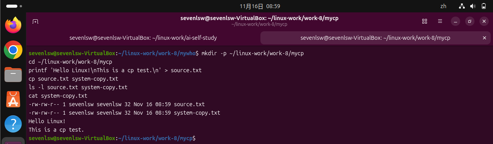
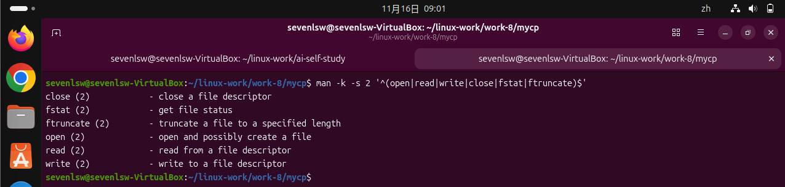
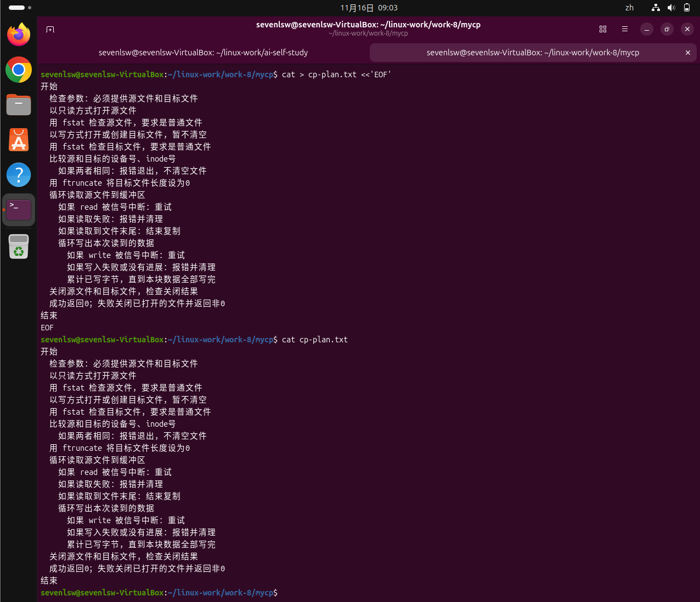
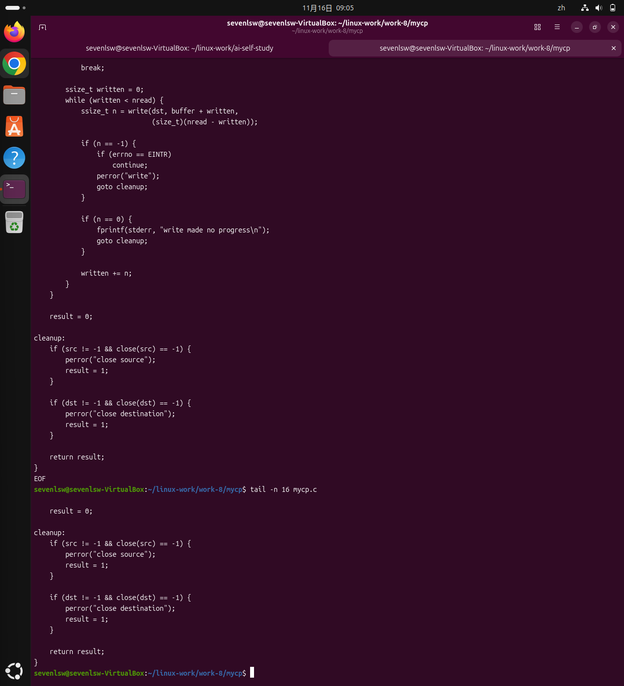
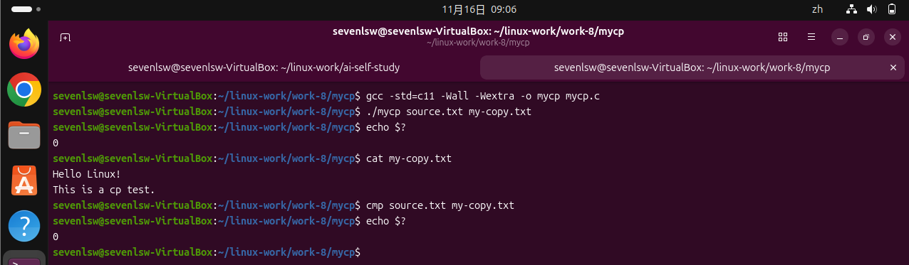
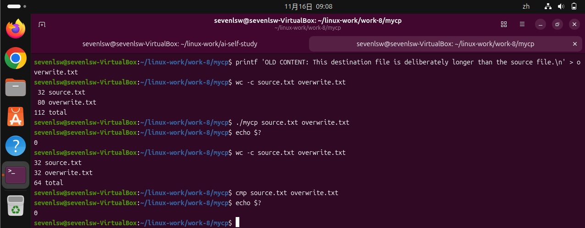
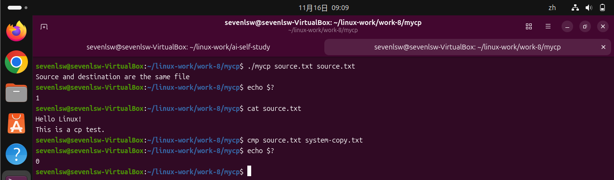
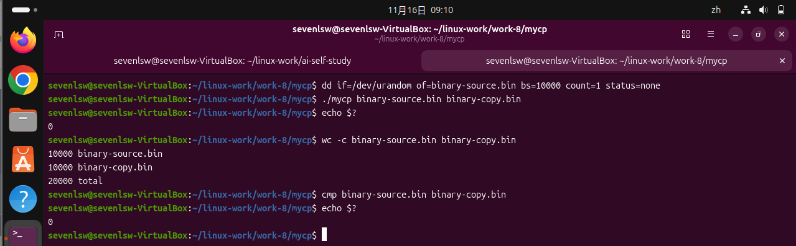

# 实现 cp：mycp 文件复制实验

| 项目 | 内容 |
| --- | --- |
| 姓名 | 刘顺文 |
| 学号 | 20262819 |
| 作业类型 | Linux 课上测试 |
| 实践环境 | VirtualBox 中的 Ubuntu 虚拟机 |
| 实践日期 | 2026-11-16 |
| 实验目录 | `/home/sevenlsw/linux-work/work-8/mycp` |
| 实验要求 | 说明 cp 功能、用 man -k 查找相关系统调用、设计伪代码、实现代码并提供运行截图 |
| 完成状态 | 四项任务已完成，基本复制、覆盖截断、同一文件保护和多块二进制复制均已验证 |

## 一、cp 的功能与实践准备

cp 用于复制文件或目录，通常保留源文件，将内容复制到目标位置。常见形式为 `cp 源文件 目标文件`，也支持将文件复制到目标目录，或使用递归等选项复制目录。

本次实现普通文件之间的基本内容复制：`mycp source destination`。目标不存在时创建，已经存在时覆盖原内容；源和目标为同一个文件时拒绝复制。目录递归、多个源文件、目标目录展开、时间戳和所有权保留等扩展功能不在本次实现范围。

在虚拟机终端中执行：

```bash
mkdir -p ~/linux-work/work-8/mycp
cd ~/linux-work/work-8/mycp
printf 'Hello Linux!\nThis is a cp test.\n' > source.txt
cp source.txt system-copy.txt
ls -l source.txt system-copy.txt
cat system-copy.txt
```

实际源文件与系统 cp 生成的副本均为32字节，副本内容如下：

```text
Hello Linux!
This is a cp test.
```



## 二、用 man -k 查找相关系统调用

### 2.1 查询命令与结果

```bash
man -k -s 2 '^(open|read|write|close|fstat|ftruncate)$'
```

`-k` 按关键词或正则表达式搜索手册摘要，`-s 2` 将查询限制在第2节的系统调用接口。本次实际找到了以下六个接口：

| 接口 | 手册摘要含义 | 本实验中的作用 |
| --- | --- | --- |
| open | 打开并可能创建文件 | 只读打开源文件，以写方式打开或创建目标文件 |
| read | 从文件描述符读取 | 分块读取源文件字节 |
| write | 向文件描述符写入 | 循环写完本次读取的数据 |
| close | 关闭文件描述符 | 正常结束或报错时释放文件描述符 |
| fstat | 获取文件状态 | 检查普通文件类型，比较设备号和 inode 号 |
| ftruncate | 将文件截断为指定长度 | 确认不是同一文件后清空目标旧内容 |



### 2.2 关键返回值与使用方法

open 成功返回非负文件描述符，失败返回 -1。创建文件时需要提供 mode，新建目标的实际权限还受到 umask 限制。程序打开目标时先不使用 O_TRUNC，避免尚未检查同一文件就清空数据。

read 成功返回实际读取字节数，返回0表示文件末尾，返回 -1 表示错误。write 成功返回实际写入字节数，可能小于要求长度，因此需要根据返回值推进缓冲区位置，继续写完剩余数据。read 和 write 被信号中断且返回 EINTR 时重试。

fstat 填充 struct stat，使用 S_ISREG 检查普通文件。设备号 st_dev 和 inode 号 st_ino 同时相同，说明两个描述符指向同一文件。检查通过后再调用 ftruncate(dst, 0)，避免目标比源文件长时残留旧内容。fstat、ftruncate 和 close 成功返回0，失败返回 -1。

## 三、实现 cp 的伪代码

在实验目录将以下内容保存为 cp-plan.txt，并用 `cat cp-plan.txt` 查看：

```text
开始
  检查参数：必须提供源文件和目标文件
  以只读方式打开源文件
  用 fstat 检查源文件，要求是普通文件
  以写方式打开或创建目标文件，暂不清空
  用 fstat 检查目标文件，要求是普通文件
  比较源和目标的设备号、inode号
    如果两者相同：报错退出，不清空文件
  用 ftruncate 将目标文件长度设为0
  循环读取源文件到缓冲区
    如果 read 被信号中断：重试
    如果读取失败：报错并清理
    如果读取到文件末尾：结束复制
    循环写出本次读到的数据
      如果 write 被信号中断：重试
      如果写入失败或没有进展：报错并清理
      累计已写字节，直到本块数据全部写完
  关闭源文件和目标文件，检查关闭结果
  成功返回0；失败关闭已打开的文件并返回非0
结束
```



外层循环负责逐块读取，内层循环负责将当前块全部写出。先判断同一文件，再截断目标，是保护源数据的关键顺序。比较文件身份使用设备号与 inode 号，也能从原理上识别硬链接指向同一文件的情况；本次实测使用的是相同路径，没有另外构造硬链接测试。

## 四、实现代码

在实验目录创建 mycp.c，内容如下。实际通过终端 here-document 写入源码，并使用 `tail -n 16 mycp.c` 确认末尾完整。

```c
#define _POSIX_C_SOURCE 200809L
#include <stdio.h>
#include <unistd.h>
#include <fcntl.h>
#include <errno.h>
#include <sys/stat.h>

int main(int argc, char *argv[])
{
    if (argc != 3) {
        fprintf(stderr, "Usage: %s source destination\n", argv[0]);
        return 1;
    }

    int src = -1;
    int dst = -1;
    int result = 1;
    struct stat src_info;
    struct stat dst_info;
    char buffer[4096];

    src = open(argv[1], O_RDONLY);
    if (src == -1) {
        perror(argv[1]);
        goto cleanup;
    }

    if (fstat(src, &src_info) == -1) {
        perror("fstat source");
        goto cleanup;
    }

    if (!S_ISREG(src_info.st_mode)) {
        fprintf(stderr, "Source must be a regular file\n");
        goto cleanup;
    }

    /* 暂不使用 O_TRUNC，先检查是否为同一文件 */
    dst = open(argv[2], O_WRONLY | O_CREAT,
               src_info.st_mode & 0777);
    if (dst == -1) {
        perror(argv[2]);
        goto cleanup;
    }

    if (fstat(dst, &dst_info) == -1) {
        perror("fstat destination");
        goto cleanup;
    }

    if (!S_ISREG(dst_info.st_mode)) {
        fprintf(stderr, "Destination must be a regular file\n");
        goto cleanup;
    }

    if (src_info.st_dev == dst_info.st_dev &&
        src_info.st_ino == dst_info.st_ino) {
        fprintf(stderr,
                "Source and destination are the same file\n");
        goto cleanup;
    }

    if (ftruncate(dst, 0) == -1) {
        perror("ftruncate");
        goto cleanup;
    }

    for (;;) {
        ssize_t nread = read(src, buffer, sizeof(buffer));

        if (nread == -1) {
            if (errno == EINTR)
                continue;
            perror("read");
            goto cleanup;
        }

        if (nread == 0)
            break;

        ssize_t written = 0;
        while (written < nread) {
            ssize_t n = write(dst, buffer + written,
                              (size_t)(nread - written));

            if (n == -1) {
                if (errno == EINTR)
                    continue;
                perror("write");
                goto cleanup;
            }

            if (n == 0) {
                fprintf(stderr, "write made no progress\n");
                goto cleanup;
            }

            written += n;
        }
    }

    result = 0;

cleanup:
    if (src != -1 && close(src) == -1) {
        perror("close source");
        result = 1;
    }

    if (dst != -1 && close(dst) == -1) {
        perror("close destination");
        result = 1;
    }

    return result;
}
```



程序直接处理字节，不使用 strlen 计算文件内容长度，因此能够复制包含零字节的二进制数据。每次实际读取多少字节，就写出多少字节。新建目标时使用源文件的普通权限位并受 umask 限制；覆盖已有目标时不主动复制源文件权限。

cleanup 统一关闭已经成功打开的描述符，并检查 close 的结果。复制途中失败可能留下已创建或已部分写入的目标文件，程序没有实现事务式替换或失败恢复。该代码针对实验中的普通文件，不是完整的系统 cp 替代品，也没有实现特殊文件、并发文件变化等场景的完整处理。

## 五、编译与运行截图

### 5.1 基本文本复制

逐条执行，echo 紧接所需检查的命令：

```bash
gcc -std=c11 -Wall -Wextra -o mycp mycp.c
./mycp source.txt my-copy.txt
echo $?
cat my-copy.txt
cmp source.txt my-copy.txt
echo $?
```

实际编译没有显示错误或警告，mycp 返回0。副本显示原来的两行文字，cmp 没有输出并返回0，说明源文件和副本逐字节相同。



### 5.2 覆盖较长目标文件

```bash
printf 'OLD CONTENT: This destination file is deliberately longer than the source file.\n' > overwrite.txt
wc -c source.txt overwrite.txt
./mycp source.txt overwrite.txt
echo $?
wc -c source.txt overwrite.txt
cmp source.txt overwrite.txt
echo $?
```

实际覆盖前，源文件32字节，目标80字节。复制返回0后，两者均为32字节，cmp 返回0。结果验证了目标旧内容被截断，末尾没有残留。



### 5.3 同一文件保护

```bash
./mycp source.txt source.txt
echo $?
cat source.txt
cmp source.txt system-copy.txt
echo $?
```

实际程序输出 `Source and destination are the same file`，退出状态为1。源文件仍保留原来的两行内容，与开始时系统 cp 创建的参考副本比较返回0，证明本次拒绝操作没有清空或修改源文件。



### 5.4 多块二进制复制

```bash
dd if=/dev/urandom of=binary-source.bin bs=10000 count=1 status=none
./mycp binary-source.bin binary-copy.bin
echo $?
wc -c binary-source.bin binary-copy.bin
cmp binary-source.bin binary-copy.bin
echo $?
```

实际生成10000字节随机二进制文件，mycp 返回0。源文件与副本均为10000字节，cmp 无输出且返回0。数据量超过4096字节缓冲区且不是其整数倍，验证了多轮复制与最后不足一块的数据处理。

该结果没有直接证明运行时发生过部分写入；代码已提供相应循环，但本次没有人为制造部分写入或 EINTR 情况。



### 5.5 结果汇总

| 测试项目 | 实际结果 |
| --- | --- |
| 编译 | 未显示错误或警告 |
| 新建目标并复制文本 | mycp返回0，cmp返回0 |
| 覆盖较长目标 | 目标从80字节变为32字节，cmp返回0 |
| 源与目标相同 | 拒绝并返回1，源内容与参考副本一致 |
| 多块二进制复制 | 两文件均为10000字节，mycp与cmp均返回0 |

## 六、实验总结

本次完成了 cp 功能分析、系统调用检索、伪代码设计和代码实现。普通文件复制的主线是打开文件、循环读取、循环写出和关闭描述符。通过读取返回值确定有效数据长度，可以同时处理文本与二进制内容。

实验还说明，正确复制不仅是将 read 和 write 各调用一次。覆盖较长目标前需要截断，复制到自身前需要比较文件身份，部分写入需要继续写完。实际测试验证了基本复制、覆盖、同一文件保护与跨缓冲区复制，形成了从流程设计到运行结果的完整记录。
