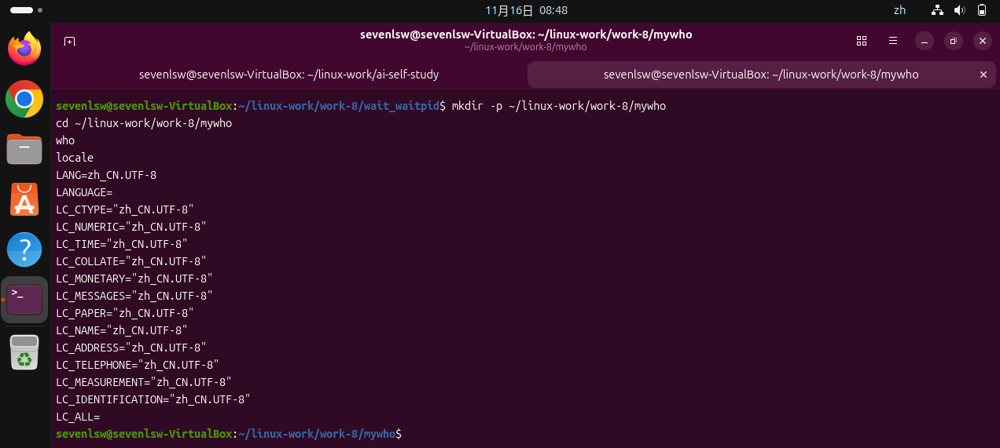
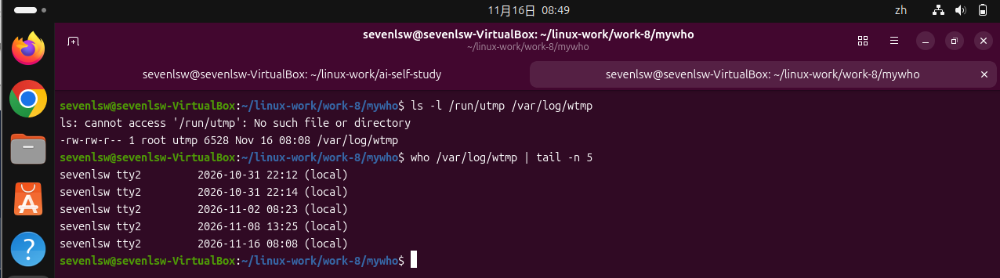
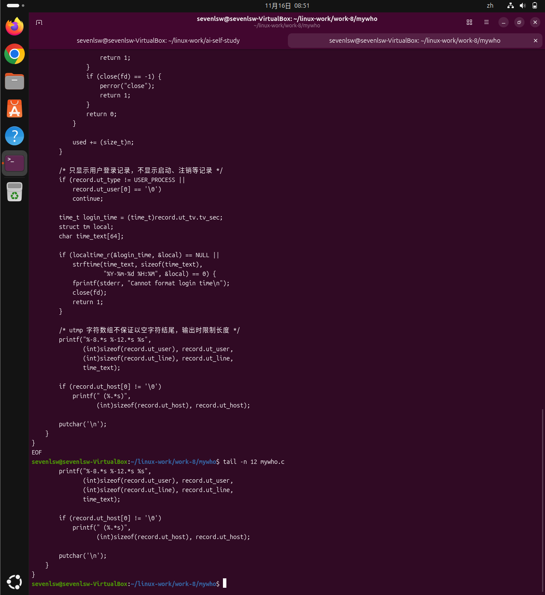
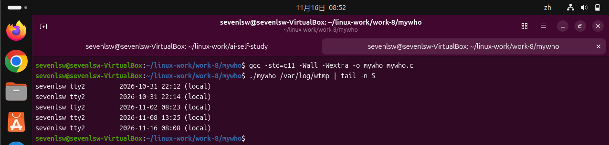
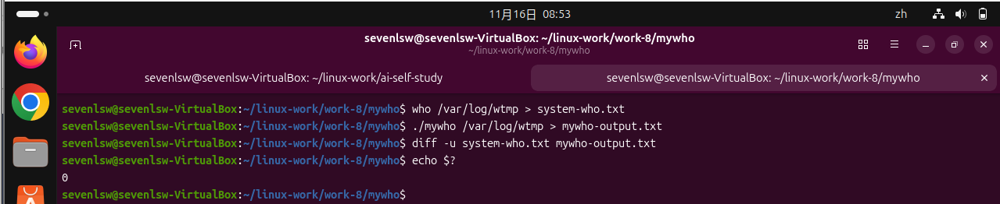
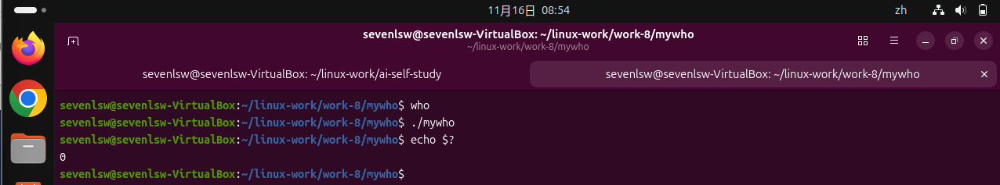

# 实现 who：mywho 命令实验

| 项目 | 内容 |
| --- | --- |
| 姓名 | 刘顺文 |
| 学号 | 20262819 |
| 作业类型 | Linux 课上测试 |
| 实验要求 | 用系统调用实现 who 命令 mywho，时间格式与系统 who 一致 |
| 实践环境 | VirtualBox 中的 Ubuntu 虚拟机 |
| 实践日期 | 2026-11-16 |
| 实验目录 | `/home/sevenlsw/linux-work/work-8/mywho` |
| 时间区域设置 | `LC_TIME=zh_CN.UTF-8` |
| 完成状态 | 已完成编写、编译、历史记录输出比较和默认运行验证 |

## 一、学习内容

本次用 C 语言实现简单的 mywho 命令，通过 open、read 和 close 接口读取登录记录，按 struct utmp 解析用户、终端、登录时间和来源信息，并与系统 who 的实际输出比较。

程序没有调用 system、popen 或 exec 执行系统 who 来代替实现。文件读取由系统调用接口完成，时间转换和文本格式化使用 C 库函数。实现范围为本次环境中的基本记录显示，不包含系统 who 的全部选项和扩展行为。

| 接口 | 本次作用 |
| --- | --- |
| open | 以只读方式打开记录文件，取得文件描述符 |
| read | 从文件描述符读取二进制登录记录 |
| close | 关闭文件描述符 |
| localtime_r | 将记录中的时间戳转为本地时间 |
| strftime | 生成与本机 who 相同格式的时间字符串 |

## 二、实践准备

### 2.1 创建目录并观察系统 who

在虚拟机中逐条执行：

```bash
mkdir -p ~/linux-work/work-8/mywho
cd ~/linux-work/work-8/mywho
who
locale
```

实际 who 没有显示记录。locale 输出表明 LANG 和 LC_TIME 为 zh_CN.UTF-8，LC_ALL 未设置。此时尚不能从空输出确认时间格式，需要进一步检查记录文件。



### 2.2 检查登录记录与时间格式

```bash
ls -l /run/utmp /var/log/wtmp
who /var/log/wtmp | tail -n 5
```

实际 `/run/utmp` 不存在，`/var/log/wtmp` 存在且可读。utmp 通常保存当前登录记录，wtmp 保存历史事件；本实验没有创建、修改或伪造系统登录记录，而是利用已有历史文件验证解析和显示。

系统 who 读取 wtmp 后，最后5条记录的时间分别为：

```text
2026-10-31 22:12
2026-10-31 22:14
2026-11-02 08:23
2026-11-08 13:25
2026-11-16 08:08
```

这些是历史登录记录，不能当作当前在线用户。用户名为 sevenlsw，终端为 tty2，来源显示为 `(local)`。



本次确认的格式为 `YYYY-MM-DD HH:MM`，对应：

```c
"%Y-%m-%d %H:%M"
```

其中 `%Y` 为年份、`%m` 为月份、`%d` 为日期、`%H` 为24小时制小时、`%M` 为分钟。没有输出秒数；分钟使用大写 M，不能与月份的小写 m 混淆。程序格式按本次系统实际输出确定，没有验证所有区域设置下与系统 who 的一致性。

## 三、程序实现

### 3.1 登录记录结构

本环境使用 `<utmp.h>` 中的 struct utmp。主要读取以下字段：

| 字段 | 含义与处理 |
| --- | --- |
| ut_type | 记录类型，只显示 USER_PROCESS 用户登录记录 |
| ut_user | 用户名，输出时限制读取长度 |
| ut_line | 终端名称，按最小宽度12左对齐 |
| ut_tv.tv_sec | 登录时间戳，转为 time_t 后进行本地时间转换 |
| ut_host | 登录来源，非空时放在括号内输出 |

用户名使用最小宽度8左对齐。记录内的定长字符数组不保证以空字符结尾，因此使用带精度限制的字符串输出，避免越过字段边界读取。记录布局按本机头文件解析，不能假定任意平台的二进制记录都能直接互读。

### 3.2 编写 mywho.c

在实验目录创建 mywho.c，内容如下。实际通过终端 here-document 写入源码，随后执行 `tail -n 12 mywho.c` 检查末尾完整性。

```c
#define _POSIX_C_SOURCE 200809L
#include <stdio.h>
#include <stdlib.h>
#include <unistd.h>
#include <fcntl.h>
#include <errno.h>
#include <locale.h>
#include <time.h>
#include <utmp.h>
#include <paths.h>

int main(int argc, char *argv[])
{
    if (argc > 2) {
        fprintf(stderr, "Usage: %s [record-file]\n", argv[0]);
        return 1;
    }

    setlocale(LC_ALL, "");

    const char *path = argc == 2 ? argv[1] : _PATH_UTMP;
    int fd = open(path, O_RDONLY);

    if (fd == -1) {
        /* 默认登录文件不存在时，与本机 who 一样不显示记录 */
        if (argc == 1 && errno == ENOENT)
            return 0;
        perror(path);
        return 1;
    }

    struct utmp record;

    for (;;) {
        size_t used = 0;

        /* read 可能短读，因此循环读满一条记录 */
        while (used < sizeof(record)) {
            ssize_t n = read(fd, (char *)&record + used,
                             sizeof(record) - used);

            if (n == -1) {
                if (errno == EINTR)
                    continue;
                perror("read");
                close(fd);
                return 1;
            }

            if (n == 0) {
                if (used != 0) {
                    fprintf(stderr, "Incomplete login record\n");
                    close(fd);
                    return 1;
                }
                if (close(fd) == -1) {
                    perror("close");
                    return 1;
                }
                return 0;
            }

            used += (size_t)n;
        }

        /* 只显示用户登录记录，不显示启动、注销等记录 */
        if (record.ut_type != USER_PROCESS ||
            record.ut_user[0] == '\0')
            continue;

        time_t login_time = (time_t)record.ut_tv.tv_sec;
        struct tm local;
        char time_text[64];

        if (localtime_r(&login_time, &local) == NULL ||
            strftime(time_text, sizeof(time_text),
                     "%Y-%m-%d %H:%M", &local) == 0) {
            fprintf(stderr, "Cannot format login time\n");
            close(fd);
            return 1;
        }

        /* utmp 字符数组不保证以空字符结尾，输出时限制长度 */
        printf("%-8.*s %-12.*s %s",
               (int)sizeof(record.ut_user), record.ut_user,
               (int)sizeof(record.ut_line), record.ut_line,
               time_text);

        if (record.ut_host[0] != '\0')
            printf(" (%.*s)",
                   (int)sizeof(record.ut_host), record.ut_host);

        putchar('\n');
    }
}
```



### 3.3 核心处理逻辑

不指定文件时使用 `<paths.h>` 中的 `_PATH_UTMP`；指定一个文件参数时读取该文件。本机默认 utmp 缺失，因此程序对默认路径的 ENOENT 返回空输出，与本次观察到的 who 行为一致。显式指定文件而打开失败时则报告错误。

read 每次不一定读满要求的字节数，因此内部循环累计已读长度，直到取得完整的一条记录。遇到 EINTR 时重试；完整记录之间遇到文件结束时正常关闭；读到半条记录就结束时报告记录不完整。

取得记录后先筛选 USER_PROCESS，再将 ut_tv.tv_sec 转为本地登录时间，按已确认的格式输出。时间来源是记录本身，不是运行程序时的当前时间。

## 四、编译与结果验证

### 4.1 编译并读取真实历史记录

```bash
gcc -std=c11 -Wall -Wextra -o mywho mywho.c
./mywho /var/log/wtmp | tail -n 5
```

实际编译未显示错误或警告。mywho 输出的最后5条历史记录，其用户名、终端、时间和来源与此前系统 who 的输出一致，最后一条为：

```text
sevenlsw tty2         2026-11-16 08:08 (local)
```



### 4.2 比较完整输出

在当前目录逐条执行：

```bash
who /var/log/wtmp > system-who.txt
./mywho /var/log/wtmp > mywho-output.txt
diff -u system-who.txt mywho-output.txt
echo $?
```

echo 必须紧接 diff 执行，才能读取该次比较的退出状态。实际 diff 没有显示任何差异，随后 echo 输出0，证明两份历史记录输出文件的内容完全一致，包括记录顺序、空格、时间格式和来源括号。

比较使用的是本次环境中的同一个 wtmp 文件，结果不能据此扩展为已实现系统 who 的所有功能。两份文本保存在虚拟机实验目录，没有修改系统记录文件。



### 4.3 验证默认运行

```bash
who
./mywho
echo $?
```

实际两个命令均未显示记录，mywho 的退出状态为0。这与本机默认 utmp 缺失时的观察一致。由于当前记录文件不存在，本次没有验证存在有效 utmp 时的当前在线用户显示；有记录时的解析和时间格式通过真实 wtmp 文件完成验证。



### 4.4 验证结果汇总

| 项目 | 实际结果 |
| --- | --- |
| GCC编译 | 未显示错误或警告 |
| 读取已有wtmp记录 | 成功显示用户、终端、登录时间和来源 |
| 时间格式 | YYYY-MM-DD HH:MM，与本机who一致 |
| 完整历史输出比较 | diff无输出，退出状态为0 |
| 不带参数运行 | 与本次系统who一样无记录输出，mywho返回0 |

代码中包含显式文件打开失败、读错误、短读、记录不完整、时间格式化失败等处理。本次没有人为构造这些异常，不将相关分支写为已实测。

## 五、易错点与实验总结

utmp 和 wtmp 是二进制记录，不能按普通文本逐行解析。读取时应使用本机结构体布局，并检查记录类型；启动、注销等记录不应直接当作用户登录记录输出。历史文件中的 USER_PROCESS 表示历史登录事件，不代表用户现在仍然在线。

时间显示既要使用正确字段，也要采用正确格式。直接输出时间戳、输出当前时间或使用带秒数的格式，都不能满足本次比较要求。本实现使用本地时间和 `%Y-%m-%d %H:%M`，并通过 diff 验证实际结果。

本次将文件描述符操作、结构体解析和时间格式化结合起来，实现了基本的 mywho。实验中发现默认 utmp 缺失后，保留系统现状，改用真实历史记录验证显示，再补充默认空输出测试，使结果与实际环境对应。最终历史记录的完整输出与系统 who 一致，达成本次基本实现及时间格式要求。
