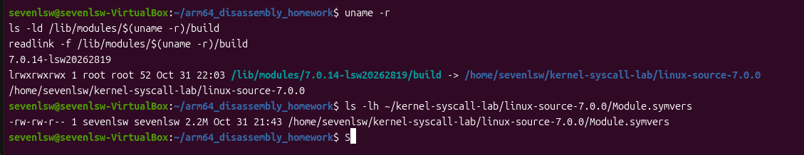
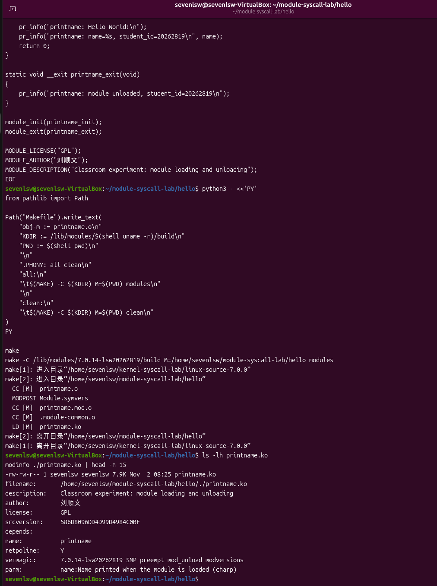
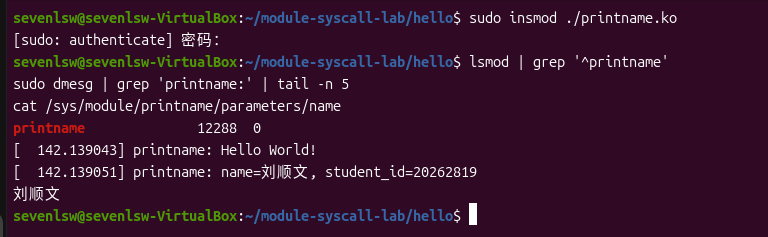
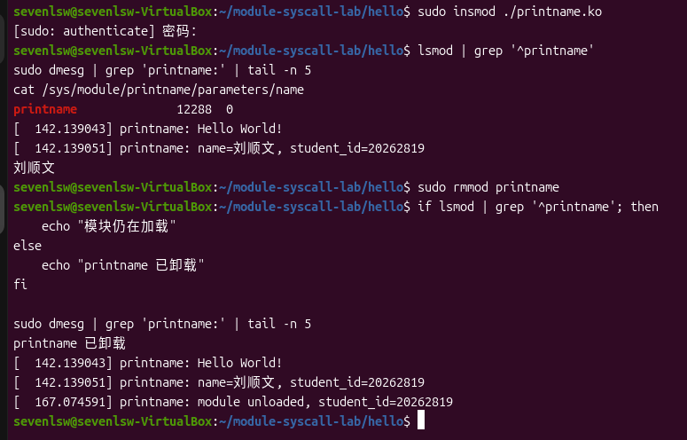
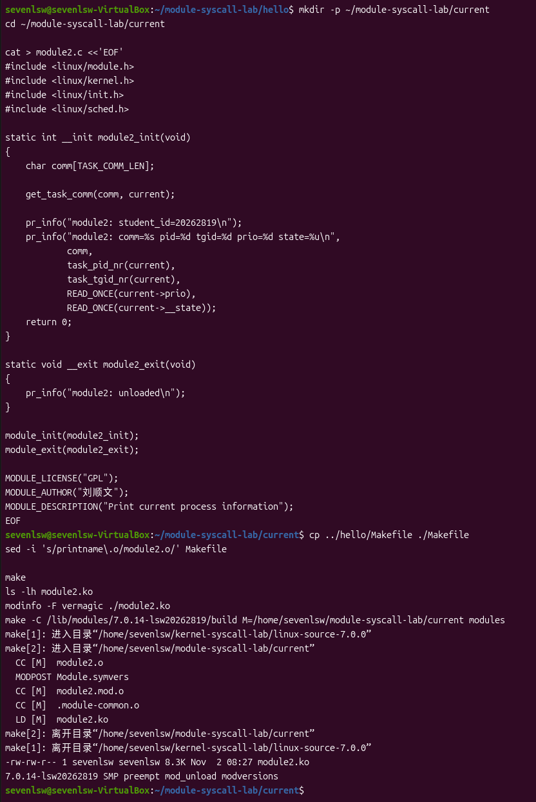
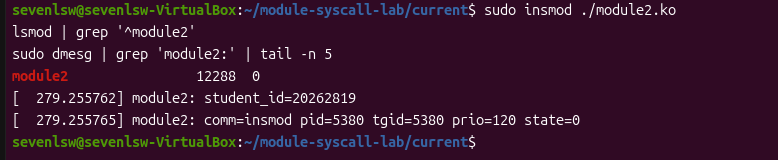
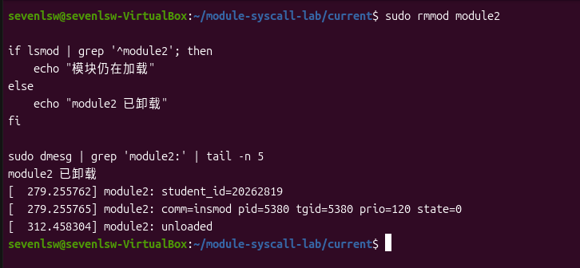
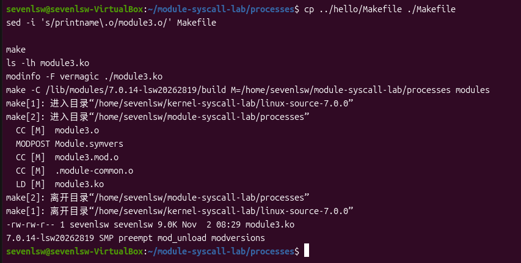
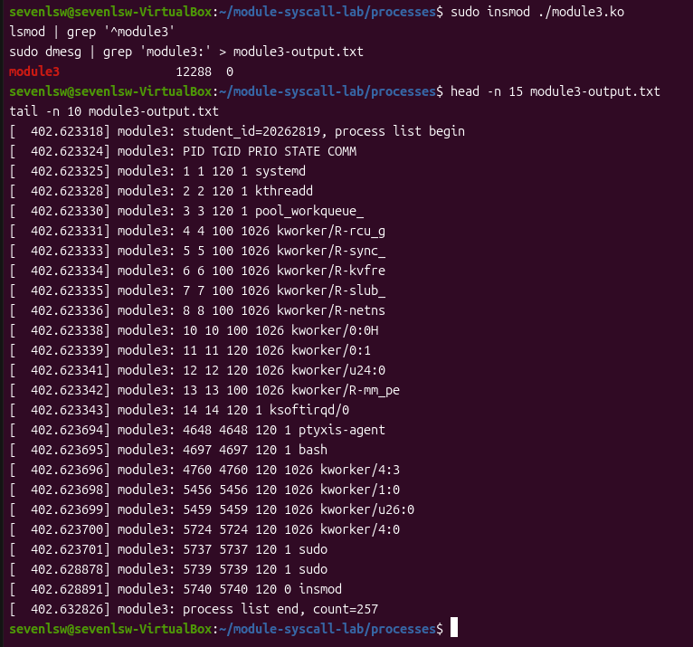
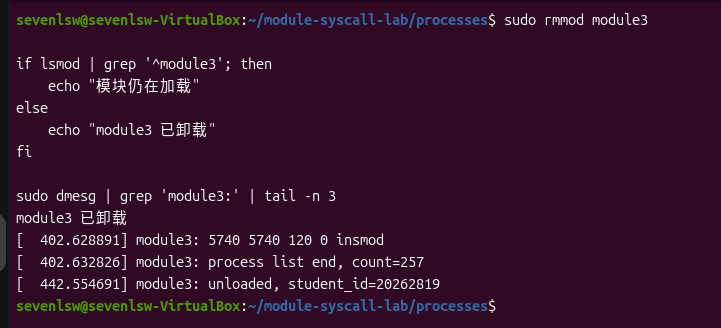

# 内核模块编译课堂测试

本次实验按照指导书完成三个内核模块的编写、编译、加载、测试和卸载，分别验证模块生命周期、当前进程信息获取和进程链表遍历。实验直接复用上次编译的内核构建目录，最终三个模块均测试通过并完成卸载。

| 项目 | 内容 |
| --- | --- |
| 姓名 | 刘顺文 |
| 学号 | 20262819 |
| 课程 | Linux 原理与实践 |
| 课堂测试 | 模块与系统调用 |
| 实验日期 | 2026 年 11 月 2 日 |
| 实验平台 | VirtualBox 中的 Ubuntu 虚拟机 |
| 当前运行内核 | `7.0.14-lsw20262819`，x86-64 |
| 实验目录 | `/home/sevenlsw/module-syscall-lab/` |
| 完成情况 | 三个模块均编译、加载、测试和卸载成功 |

## 01｜实验目标与原理

### 1.1 实验目标

本次完成的具体任务如下：

1. 编写简单模块，加载时输出问候语、姓名和学号，卸载时输出退出日志。
2. 编写当前进程信息模块，输出任务名称、PID、TGID、内部优先级和状态。
3. 使用 `for_each_process()` 遍历进程链表，输出进程信息并统计条目数量。
4. 通过 `lsmod`、`modinfo`、`dmesg` 和模块参数文件检查实际结果。

本次指导书要求的实践主体为内核模块，不涉及新增系统调用号或重新编译整个内核。扩容文档作为空间不足时的辅助材料，本次实际操作中没有执行扩容、分区或格式化。

### 1.2 模块机制

Linux 内核模块是可以单独编译、在内核运行期间加载和卸载的代码。生成的文件扩展名为 `.ko`，加载后在内核空间运行。使用模块机制可以扩展内核功能，而不必每次重新构建并启动整个内核。

`module_init()` 登记初始化函数，`module_exit()` 登记退出函数；二者是登记入口的宏，实际函数由程序自行定义。加载时执行初始化函数，初始化函数返回 `0` 表示成功；卸载时执行退出函数。`MODULE_LICENSE("GPL")` 声明许可证，`MODULE_AUTHOR()` 和 `MODULE_DESCRIPTION()` 分别补充作者与功能说明。

模块必须针对当前内核的构建环境编译。仅有内核版本名称相同还不足以保证兼容，还需相应的配置和符号版本等信息匹配。本次使用当前内核实际构建过的源码树及其 `Module.symvers`。

## 02｜构建环境检查

在 Ubuntu 终端执行：

```bash
uname -r
ls -ld /lib/modules/$(uname -r)/build
readlink -f /lib/modules/$(uname -r)/build
ls -lh ~/kernel-syscall-lab/linux-source-7.0.0/Module.symvers
```

实际检查结果如下：

| 检查项 | 结果 |
| --- | --- |
| 运行内核 | `7.0.14-lsw20262819` |
| 构建链接 | `/lib/modules/7.0.14-lsw20262819/build` |
| 链接目标 | `/home/sevenlsw/kernel-syscall-lab/linux-source-7.0.0` |
| 符号版本文件 | `Module.symvers` 存在，约 2.2 MB |

源码目录名称沿用软件包名称 `linux-source-7.0.0`，实际使用的内核版本由运行结果和构建信息确定。检查通过后，直接复用该源码树构建外部模块，没有重新安装依赖或重编内核。



## 03｜简单模块的编译与生命周期验证

### 3.1 编写模块代码

创建工作目录：

```bash
mkdir -p ~/module-syscall-lab/hello
cd ~/module-syscall-lab/hello
```

文件 `printname.c` 内容如下：

```c
#include <linux/module.h>
#include <linux/kernel.h>
#include <linux/init.h>

static char *name = "刘顺文";
module_param(name, charp, 0444);
MODULE_PARM_DESC(name, "Name printed when the module is loaded");

static int __init printname_init(void)
{
    pr_info("printname: Hello World!\n");
    pr_info("printname: name=%s, student_id=20262819\n", name);
    return 0;
}

static void __exit printname_exit(void)
{
    pr_info("printname: module unloaded, student_id=20262819\n");
}

module_init(printname_init);
module_exit(printname_exit);

MODULE_LICENSE("GPL");
MODULE_AUTHOR("刘顺文");
MODULE_DESCRIPTION("Classroom experiment: module loading and unloading");
```

模块参数 `name` 的默认值为姓名，类型为字符串指针，权限 `0444` 表示加载后对应参数文件只读。本次加载使用默认参数，并读取参数文件验证，没有另外进行覆盖参数值的测试。

### 3.2 编写 Makefile 并编译

`Makefile` 内容如下，命令行前使用 Tab 缩进：

```makefile
obj-m := printname.o
KDIR := /lib/modules/$(shell uname -r)/build
PWD := $(shell pwd)

.PHONY: all clean
all:
	$(MAKE) -C $(KDIR) M=$(PWD) modules

clean:
	$(MAKE) -C $(KDIR) M=$(PWD) clean
```

`obj-m` 声明需要编译成模块的目标。`-C` 指定内核构建目录，`M` 指定外部模块源码目录，由内核 Kbuild 系统处理编译和链接。

实际使用 Python 生成 Makefile，以确保命令前写入真正的 Tab 字符。随后执行：

```bash
make
ls -lh printname.ko
modinfo ./printname.ko | head -n 15
```

输出包含 `CC [M]`、`MODPOST` 和 `LD [M] printname.ko`，生成的模块约 7.9 KB。`modinfo` 显示作者、GPL 许可证、参数说明，以及包含 `7.0.14-lsw20262819` 的 `vermagic`。



### 3.3 加载并验证

执行：

```bash
sudo insmod ./printname.ko
lsmod | grep '^printname'
sudo dmesg | grep 'printname:' | tail -n 5
cat /sys/module/printname/parameters/name
```

实际观察到模块列表出现 `printname`，内核日志与参数输出为：

```text
printname: Hello World!
printname: name=刘顺文, student_id=20262819
刘顺文
```

初始化函数中的 `pr_info()` 将内容写入内核日志，因此成功加载时 `insmod` 本身没有打印问候语，需要通过 `dmesg` 查看。参数文件输出默认姓名，与初始化日志一致。



### 3.4 卸载并验证

执行：

```bash
sudo rmmod printname

if lsmod | grep '^printname'; then
    echo "模块仍在加载"
else
    echo "printname 已卸载"
fi

sudo dmesg | grep 'printname:' | tail -n 5
```

实际显示 `printname 已卸载`，日志新增：

```text
printname: module unloaded, student_id=20262819
```

模块从列表中移除，退出日志也出现，完成了对初始化和退出入口的验证。卸载模块不会清除已经写入的内核日志，因此此时仍可看到之前的初始化输出。



## 04｜输出当前进程信息

### 4.1 编写模块代码

创建独立目录，避免与第一个模块的构建文件混用：

```bash
mkdir -p ~/module-syscall-lab/current
cd ~/module-syscall-lab/current
```

文件 `module2.c` 内容如下：

```c
#include <linux/module.h>
#include <linux/kernel.h>
#include <linux/init.h>
#include <linux/sched.h>

static int __init module2_init(void)
{
    char comm[TASK_COMM_LEN];

    get_task_comm(comm, current);

    pr_info("module2: student_id=20262819\n");
    pr_info("module2: comm=%s pid=%d tgid=%d prio=%d state=%u\n",
            comm,
            task_pid_nr(current),
            task_tgid_nr(current),
            READ_ONCE(current->prio),
            READ_ONCE(current->__state));
    return 0;
}

static void __exit module2_exit(void)
{
    pr_info("module2: unloaded\n");
}

module_init(module2_init);
module_exit(module2_exit);

MODULE_LICENSE("GPL");
MODULE_AUTHOR("刘顺文");
MODULE_DESCRIPTION("Print current process information");
```

`current` 表示当前正在执行的任务，`get_task_comm()` 获取任务名称。针对本次内核使用 `__state` 字段，替代指导书旧代码中的 `state`。对优先级和状态的读取使用 `READ_ONCE()`，但这些字段并不构成整个系统的原子快照。

### 4.2 编译并加载

复用第一个模块的 Makefile，仅替换目标名称：

```bash
cp ../hello/Makefile ./Makefile
sed -i 's/printname\.o/module2.o/' Makefile
make
ls -lh module2.ko
modinfo -F vermagic ./module2.ko
```

编译成功，生成约 8.3 KB 的 `module2.ko`，版本信息与当前内核一致。



加载并检查：

```bash
sudo insmod ./module2.ko
lsmod | grep '^module2'
sudo dmesg | grep 'module2:' | tail -n 5
```

实际日志为：

```text
module2: student_id=20262819
module2: comm=insmod pid=5380 tgid=5380 prio=120 state=0
```



### 4.3 结果分析与卸载

| 字段 | 实际值 | 含义 |
| --- | --- | --- |
| `comm` | `insmod` | 执行模块初始化代码的任务名称 |
| `pid` | 5380 | 当前任务的线程 ID |
| `tgid` | 5380 | 当前任务所在线程组的 ID |
| `prio` | 120 | 本次任务的内核内部调度优先级 |
| `state` | 0 | 任务处于运行或可运行状态 |

初始化函数执行于加载模块的进程上下文，因此打印的是 `insmod` 对应任务的信息。`pid` 与 `tgid` 相同，说明观察到的是线程组主线程。内部优先级 `120` 不能直接等同于用户设置的 nice 值。

测试完成后执行：

```bash
sudo rmmod module2

if lsmod | grep '^module2'; then
    echo "模块仍在加载"
else
    echo "module2 已卸载"
fi

sudo dmesg | grep 'module2:' | tail -n 5
```

实际显示 `module2 已卸载`，并新增 `module2: unloaded` 日志。



## 05｜遍历进程链表

### 5.1 编写模块代码

创建工作目录：

```bash
mkdir -p ~/module-syscall-lab/processes
cd ~/module-syscall-lab/processes
```

文件 `module3.c` 内容如下：

```c
#include <linux/module.h>
#include <linux/kernel.h>
#include <linux/init.h>
#include <linux/sched.h>
#include <linux/sched/signal.h>
#include <linux/rcupdate.h>

static int __init module3_init(void)
{
    struct task_struct *task;
    unsigned int count = 0;
    char comm[TASK_COMM_LEN];

    pr_info("module3: student_id=20262819, process list begin\n");
    pr_info("module3: PID TGID PRIO STATE COMM\n");

    rcu_read_lock();
    for_each_process(task) {
        get_task_comm(comm, task);
        pr_info("module3: %d %d %d %u %s\n",
                task_pid_nr(task),
                task_tgid_nr(task),
                READ_ONCE(task->prio),
                READ_ONCE(task->__state),
                comm);
        count++;
    }
    rcu_read_unlock();

    pr_info("module3: process list end, count=%u\n", count);
    return 0;
}

static void __exit module3_exit(void)
{
    pr_info("module3: unloaded, student_id=20262819\n");
}

module_init(module3_init);
module_exit(module3_exit);

MODULE_LICENSE("GPL");
MODULE_AUTHOR("刘顺文");
MODULE_DESCRIPTION("Traverse the process list with for_each_process");
```

`for_each_process()` 遍历进程的线程组主线程，不会列出系统中的每一个线程，也不把作为遍历起点的 `init_task` 本身作为普通条目输出。RCU 读锁保护遍历期间对链表节点的访问，但不会冻结进程创建、退出和状态变化，因此输出与计数表示本次遍历观察到的情况。

### 5.2 编译与测试

执行：

```bash
cp ../hello/Makefile ./Makefile
sed -i 's/printname\.o/module3.o/' Makefile
make
ls -lh module3.ko
modinfo -F vermagic ./module3.ko
```

编译成功，生成约 9.0 KB 的 `module3.ko`，版本与当前内核一致。



加载模块，并保存本模块的内核日志：

```bash
sudo insmod ./module3.ko
lsmod | grep '^module3'
sudo dmesg | grep 'module3:' > module3-output.txt
head -n 15 module3-output.txt
tail -n 10 module3-output.txt
```

`module3-output.txt` 保存于虚拟机当前实验目录中。开头与末尾检查共同验证遍历已开始且正常结束。

实际输出中包含以下条目，省略号表示此处未逐行展开的其他进程：

```text
module3: student_id=20262819, process list begin
module3: PID TGID PRIO STATE COMM
module3: 1 1 120 1 systemd
module3: 2 2 120 1 kthreadd
...
module3: 5737 5737 120 1 sudo
module3: 5739 5739 120 1 sudo
module3: 5740 5740 120 0 insmod
module3: process list end, count=257
```



本次共遍历到 **257 个进程条目**。日志包含 PID 为 1 的 `systemd`、内核线程、Shell 和加载模块的 `insmod`。这表明模块已通过进程链表取得多种任务的信息。

进程状态字段是位掩码，截图中既有 `0`、`1`，也有 `1026` 等组合值，不能把状态理解成只有运行和睡眠两个数字。状态数值需要结合当前内核中的状态位定义解释。

### 5.3 卸载并验证

执行：

```bash
sudo rmmod module3

if lsmod | grep '^module3'; then
    echo "模块仍在加载"
else
    echo "module3 已卸载"
fi

sudo dmesg | grep 'module3:' | tail -n 3
```

实际结果为 `module3 已卸载`，日志最后显示：

```text
module3: 5740 5740 120 0 insmod
module3: process list end, count=257
module3: unloaded, student_id=20262819
```



## 06｜实验结果与注意事项

### 6.1 完成情况

| 实验内容 | 实际结果 |
| --- | --- |
| 构建环境 | 构建目录正确，`Module.symvers` 存在 |
| 简单模块 | 编译成功，问候语、姓名、学号和默认参数均验证通过 |
| 简单模块卸载 | 模块移除，退出日志正确 |
| 当前进程模块 | 编译与加载成功，输出 `insmod`、PID 5380、TGID 5380、优先级 120、状态 0 |
| 当前进程模块卸载 | 模块移除，退出日志正确 |
| 进程遍历模块 | 编译与加载成功，本次遍历到 257 个进程条目 |
| 进程遍历模块卸载 | 模块移除，退出日志正确 |

本次三个模块均未在截图中出现编译或加载错误。各模块测试后分别完成卸载，没有通过重启代替卸载验证。

### 6.2 版本适配与操作注意事项

本次直接适配现有 7.0.14 内核，没有按旧指导书切换到 3.x 内核。进程遍历使用 `<linux/sched/signal.h>` 中的接口，任务状态使用当前版本的 `__state` 字段，参数权限使用数值 `0444`。

Makefile 的构建命令由 Kbuild 提供，不能按普通用户态 C 程序的方式单独用 GCC 链接模块。生成 Makefile 时保证命令使用 Tab 缩进；三个模块分别放入独立目录，只调整 `obj-m` 的目标文件名。

`lsmod` 用于确认模块当前是否加载，`dmesg` 用于查看初始化和退出日志。卸载后历史日志仍保留，所以不能只凭日志中存在模块名称就判定模块仍在运行。

## 07｜实验总结

本次通过三个模块理解了内核模块从编译到卸载的完整流程。简单模块验证了初始化与退出入口，当前进程模块说明初始化代码运行在加载进程的上下文中，进程遍历模块则通过 `task_struct` 和 `for_each_process()` 观察到系统中的多种进程。

实验结果也体现了内核代码对版本和并发访问的要求。沿用旧示例时，需要核对字段、头文件和构建目录；遍历进程链表时，需要保护访问对象，并理解输出不等同于固定时刻的全系统快照。最终三个模块均完成编译、加载、测试和卸载，本次进程遍历得到 257 个条目，满足指导书要求。
